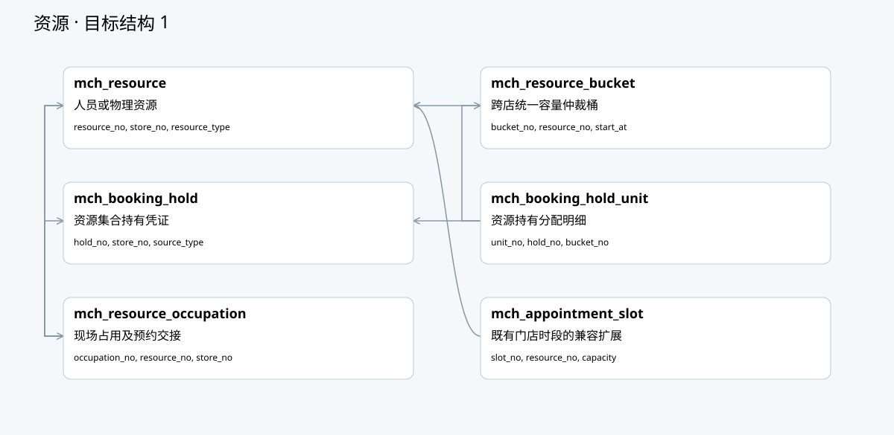
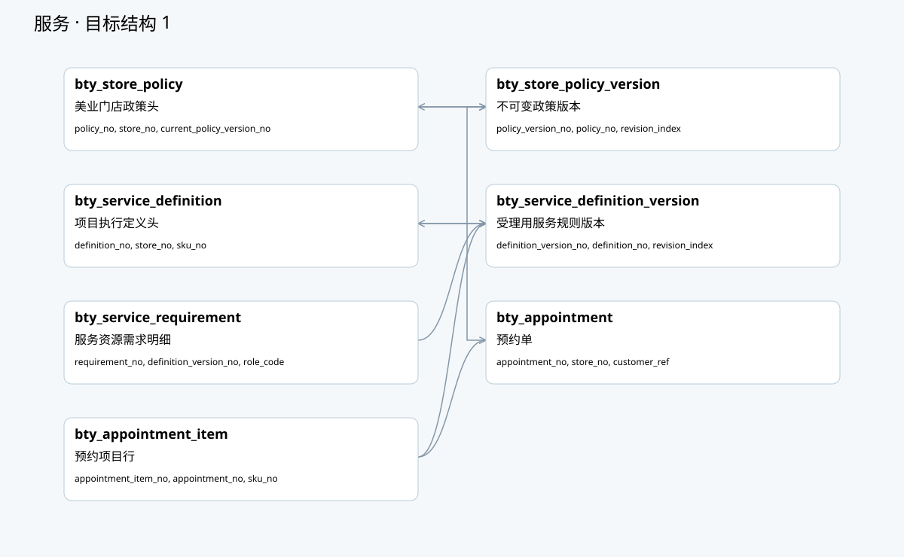
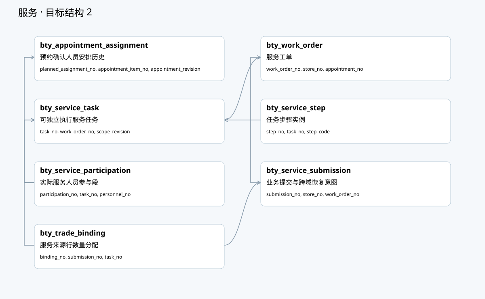
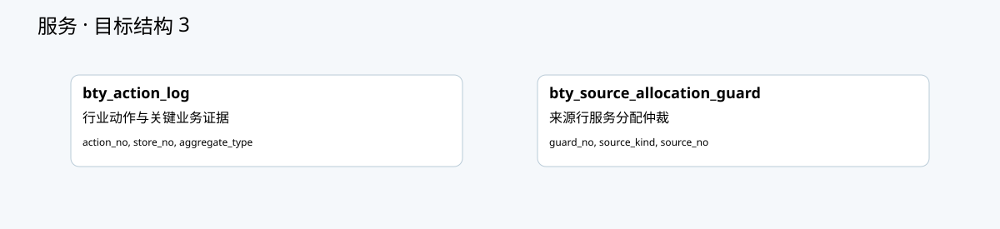
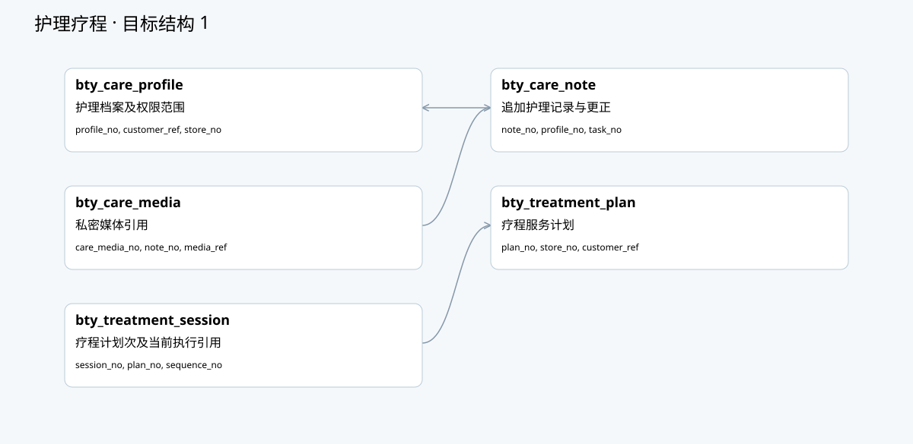
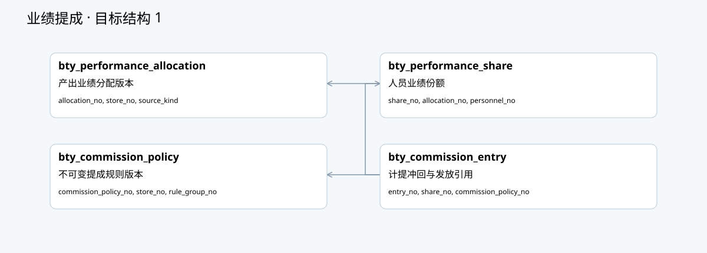

# 美业与共用人员资源数据库字段字典

> 状态：原41项目标基线保留；Task58正式V1–V8共28项私表，增量另列 · 2026-10-24
> 由 `python3 scripts/gen-beauty-database-design.py` 生成，勿手改；真源：[数据库设计源](./schema/beauty-database-design.json)。
> 业务约束及复用边界：[数据库结构设计](./美业系统-数据库结构设计.md)。本册不是Flyway迁移，不输出可执行建表SQL。

## 一、公共字段与约束

新增表合并下列公共字段；扩展既有表只表示所列目标，不重建原表。所有候选唯一键和普通索引默认前置tenant_no、entity_no，以下省略该前缀。id是物理主键；业务号不复用。关系均为服务校验的逻辑引用，不自动创建跨域外键。

| 字段 | 类型 | 说明 |
|---|---|---|
| id | bigint | 物理自增主键，不对外 |
| tenant_no | varchar(32) | 沿当前租户上下文；不另启租户体系 |
| entity_no | varchar(32) | 商家主体范围；不等于租户 |
| created_at | datetime(3) | 创建时刻 |
| created_by | varchar(64) | 实际操作者业务引用 |
| updated_at | datetime(3) | 更新时间 |
| updated_by | varchar(64) | 更新操作者 |
| version | bigint | 乐观锁 |
| deleted | int | 沿BaseEntity；事实表禁止删除或软删覆盖 |

所有新增公共字段NOT NULL，id按现有BaseEntity生成，其他默认值沿项目装配。状态、审计和事实保留规则见设计册；NULL不得代替有效状态仲裁。

## 二、按组关系图

图由同一表/引用源生成；每图最多七表。箭头为逻辑引用，跨图及既有表引用见字段列；没有图内连线不表示没有外部依赖。

### 人员 1

### 人员 2

### 资源 1

### 资源 2

### 服务 1

### 服务 2

### 服务 3

### 护理疗程 1

### 业绩提成 1

## 三、逐表字段与索引

### mch_personnel · 共用业务人员主档

归属：共用merchant能力；阶段：P1；目标：NEW。

| 字段 | 类型 | 可空 | 含义 | 逻辑引用 |
|---|---|---|---|---|
| personnel_no | varchar(32) | 否 | 稳定业务人员号 | — |
| name | varchar(64) | 否 | 业务姓名 | — |
| avatar_ref | varchar(64) | 是 | 媒体引用 | — |
| status | varchar(24) | 否 | ACTIVE或SUSPENDED或LEFT | — |
| contact_ref | varchar(64) | 是 | 受控联系资料引用 | — |

唯一键：`personnel_no`。
普通索引：`status, id`。

业务约束：同主体内一份主档；允许无登录账号，不按手机号跨主体自动合并。

### mch_personnel_account · 当前人员账号关联

归属：共用merchant能力；阶段：P1；目标：NEW。

| 字段 | 类型 | 可空 | 含义 | 逻辑引用 |
|---|---|---|---|---|
| link_no | varchar(32) | 否 | 关联业务号 | — |
| personnel_no | varchar(32) | 否 | 人员 | mch_personnel |
| mch_account_no | varchar(32) | 是 | 当前账号，无绑定可空 | mch_account |
| linked_at | datetime(3) | 是 | 绑定时刻 | — |

唯一键：`link_no`；`personnel_no`；`mch_account_no`。
普通索引：按主关系及业务号访问，不另预建。

业务约束：同主体账号与人员一对一当前关联；解绑清空当前引用并追加审计，历史不丢；校验账号主体一致。

### mch_personnel_store · 跨门店业务任职

归属：共用merchant能力；阶段：P1；目标：NEW。

| 字段 | 类型 | 可空 | 含义 | 逻辑引用 |
|---|---|---|---|---|
| assignment_no | varchar(32) | 否 | 任职号 | — |
| personnel_no | varchar(32) | 否 | 人员 | mch_personnel |
| store_no | varchar(32) | 否 | 任职门店 | mch_store |
| valid_from | datetime(3) | 否 | 生效 | — |
| valid_to | datetime(3) | 是 | 结束 | — |
| status | varchar(24) | 否 | ACTIVE或INACTIVE | — |
| public_visible | tinyint | 否 | 对客展示 | — |
| level_code | varchar(32) | 是 | 本店业务等级 | — |
| sort_order | int | 否 | 展示顺序 | — |

唯一键：`assignment_no`。
普通索引：`store_no, status, personnel_no`；`personnel_no, valid_from`。

业务约束：同人员同店有效任职区间不得重叠；锁人员主行仲裁；业务任职不授予登录权限。

### mch_personnel_position · 任职上的业务岗位

归属：共用merchant能力；阶段：P1；目标：NEW。

| 字段 | 类型 | 可空 | 含义 | 逻辑引用 |
|---|---|---|---|---|
| position_no | varchar(32) | 否 | 岗位分配号 | — |
| assignment_no | varchar(32) | 否 | 任职 | mch_personnel_store |
| position_code | varchar(32) | 否 | WAITER或TECHNICIAN等受控业务岗位 | — |
| status | varchar(24) | 否 | ACTIVE或INACTIVE | — |

唯一键：`position_no`；`assignment_no, position_code`。
普通索引：按主关系及业务号访问，不另预建。

业务约束：同一任职可多岗位；与mch_store_role授权角色分开；岗位码实施前统一字典。

### mch_personnel_skill · 项目服务资格

归属：共用merchant能力；阶段：P1；目标：NEW。

| 字段 | 类型 | 可空 | 含义 | 逻辑引用 |
|---|---|---|---|---|
| skill_no | varchar(32) | 否 | 资格号 | — |
| personnel_no | varchar(32) | 否 | 人员 | mch_personnel |
| store_no | varchar(32) | 是 | 可选门店限制 | mch_store |
| goods_no | varchar(32) | 否 | 可服务项目 | prd_goods |
| sku_no | varchar(32) | 是 | 可选规格约束 | prd_sku |
| level_code | varchar(32) | 是 | 技能级别 | — |
| valid_from | datetime(3) | 否 | 生效 | — |
| valid_to | datetime(3) | 是 | 到期 | — |
| status | varchar(24) | 否 | PENDING或VERIFIED或REVOKED | — |
| verified_by | varchar(64) | 是 | 核验人 | — |

唯一键：`skill_no`。
普通索引：`personnel_no, goods_no, status`；`store_no, goods_no, status`。

业务约束：匹配取有效且已核验的资格；重叠规则优先级明确，更新锁人员主行；资格不授予收款或隐私权限。

### mch_schedule_rule · 资源班表规则

归属：共用merchant能力；阶段：P1；目标：NEW。

| 字段 | 类型 | 可空 | 含义 | 逻辑引用 |
|---|---|---|---|---|
| rule_no | varchar(32) | 否 | 规则号 | — |
| resource_no | varchar(32) | 否 | 可占资源 | mch_resource |
| store_no | varchar(32) | 否 | 作业门店 | mch_store |
| timezone | varchar(64) | 否 | 业务时区 | — |
| weekday_mask | int | 否 | 周规则 | — |
| start_minute | int | 否 | 本地开始分钟 | — |
| end_minute | int | 否 | 结束分钟 | — |
| end_day_offset | int | 否 | 跨午夜偏移 | — |
| valid_from | date | 否 | 规则首日 | — |
| valid_to | date | 是 | 规则末日 | — |
| status | varchar(24) | 否 | ACTIVE或INACTIVE | — |

唯一键：`rule_no`。
普通索引：`resource_no, valid_from`；`store_no, status`。

业务约束：跨店同人员班表重叠需显式拒绝或协调；生成幂等且不覆盖已占用时段。

### mch_schedule_exception · 请假加班停约例外

归属：共用merchant能力；阶段：P3；目标：NEW。

| 字段 | 类型 | 可空 | 含义 | 逻辑引用 |
|---|---|---|---|---|
| exception_no | varchar(32) | 否 | 例外号 | — |
| resource_no | varchar(32) | 否 | 资源 | mch_resource |
| store_no | varchar(32) | 否 | 门店 | mch_store |
| start_at | datetime(3) | 否 | 开始 | — |
| end_at | datetime(3) | 否 | 结束 | — |
| kind | varchar(24) | 否 | LEAVE或EXTRA或CLOSE | — |
| status | varchar(24) | 否 | REQUESTED或APPROVED或REJECTED | — |
| reason | varchar(500) | 否 | 理由 | — |
| approval_ref | varchar(64) | 是 | 审批引用 | — |

唯一键：`exception_no`。
普通索引：`resource_no, start_at, end_at`。

业务约束：批准后核查受影响hold/任务，不能静默释放顾客已有约定。

### mch_schedule_change_log · 班表调整历史

归属：共用merchant能力；阶段：P1；目标：NEW。

| 字段 | 类型 | 可空 | 含义 | 逻辑引用 |
|---|---|---|---|---|
| change_no | varchar(32) | 否 | 变更号 | — |
| resource_no | varchar(32) | 否 | 资源 | mch_resource |
| source_ref | varchar(64) | 否 | 规则或例外来源 | — |
| before_revision | bigint | 否 | 原版本 | — |
| after_revision | bigint | 否 | 新版本 | — |
| affected_refs | json | 否 | 受影响业务引用快照 | — |
| reason | varchar(500) | 否 | 理由 | — |

唯一键：`change_no`。
普通索引：`resource_no, created_at, id`。

业务约束：追加事实；不复制整个预约内容；原号恢复受影响处理。

### mch_resource · 人员或物理资源

归属：共用merchant能力；阶段：P1；目标：NEW。

| 字段 | 类型 | 可空 | 含义 | 逻辑引用 |
|---|---|---|---|---|
| resource_no | varchar(32) | 否 | 资源号 | — |
| store_no | varchar(32) | 是 | 物理资源门店，STAFF为空 | mch_store |
| resource_type | varchar(24) | 否 | STAFF或ROOM或SEAT或DEVICE | — |
| personnel_no | varchar(32) | 是 | STAFF人员引用 | mch_personnel |
| name | varchar(64) | 否 | 资源名 | — |
| capacity | int | 否 | 并发上限 | — |
| status | varchar(24) | 否 | ACTIVE或SUSPENDED | — |
| open_occupation_no | varchar(32) | 是 | 当前独占式无确定结束占用指针 | mch_resource_occupation |

唯一键：`resource_no`；`personnel_no`。
普通索引：`store_no, resource_type, status`。

业务约束：STAFF对应同主体唯一人员且容量1，不复制为每店独立资源；物理资源必须有门店且personnel_no为空。

### mch_booking_owner · 稳定资源仲裁归属

归属：共用merchant能力；阶段：P1；目标：NEW。

| 字段 | 类型 | 可空 | 含义 | 逻辑引用 |
|---|---|---|---|---|
| owner_no | varchar(32) | 否 | 稳定仲裁归属号 | — |
| store_no | varchar(32) | 否 | 来源业务门店 | mch_store |
| source_type | varchar(32) | 否 | 来源类别，精确匹配 | — |
| source_no | varchar(64) | 否 | 来源业务引用 | — |
| current_hold_no | varchar(32) | 是 | 当前持有头 | mch_booking_hold |
| owner_version | bigint | 否 | 本域仲裁版本，非BaseEntity版本 | — |
| source_revision | bigint | 是 | 当前头外部来源修订 | — |

唯一键：`owner_no`；`store_no, source_type, source_no`。
普通索引：`current_hold_no`。

业务约束：同来源稳定唯一；当前持有与外部修订成对；本域owner_version与来源修订/实体版本分离。根锁/CAS后续协议实现。

### mch_resource_command · 资源持久命令与结果

归属：共用merchant能力；阶段：P1；目标：NEW。

| 字段 | 类型 | 可空 | 含义 | 逻辑引用 |
|---|---|---|---|---|
| command_no | varchar(32) | 否 | 持久命令号 | — |
| owner_no | varchar(32) | 否 | 稳定归属 | mch_booking_owner |
| store_no | varchar(32) | 否 | 来源门店 | mch_store |
| action | varchar(32) | 否 | RESERVE/PROTECT/CONFIRM/RENEW/RELEASE/EXPIRE/RECONCILE/REPLACE | — |
| request_key_hash | char(64) | 否 | 作用域内请求键SHA256 | — |
| payload_hash | char(64) | 否 | 冻结请求SHA256 | — |
| frozen_payload | longtext | 否 | 合法JSON冻结载荷，后续命令协议保持不可变 | — |
| expected_owner_version | bigint | 否 | 期望仲裁头版本 | — |
| source_revision | bigint | 否 | 外部来源修订 | — |
| target_hold_no | varchar(32) | 是 | 可选目标持有 | mch_booking_hold |
| expected_hold_version | bigint | 是 | 可选目标实体版本 | — |
| expected_lease_revision | bigint | 是 | 可选目标租约修订 | — |
| status | varchar(24) | 否 | ACCEPTED/SUCCEEDED/REJECTED | — |
| result_payload | longtext | 是 | 合法JSON权威结果 | — |
| rejection_code | varchar(64) | 是 | 稳定拒绝原因 | — |
| wait_reason | varchar(128) | 是 | 待恢复原因 | — |
| next_retry_at | datetime(3) | 是 | 待恢复下次处理时间 | — |
| initiated_by | varchar(64) | 否 | 原命令发起者 | — |

唯一键：`command_no`；`store_no, action, request_key_hash`。
普通索引：`owner_no, created_at, id`；`status, next_retry_at, id`。

业务约束：冻结载荷与结果为合法JSON，状态证据匹配；同键异参及不可变/不可逆由后续命令协议实现，不能直接以通用Mapper开放写入。

### mch_resource_bucket · 跨店统一容量仲裁桶

归属：共用merchant能力；阶段：P1；目标：NEW。

| 字段 | 类型 | 可空 | 含义 | 逻辑引用 |
|---|---|---|---|---|
| bucket_no | varchar(32) | 否 | 容量桶号 | — |
| resource_no | varchar(32) | 否 | 跨店规范资源 | mch_resource |
| start_at | datetime(3) | 否 | UTC五分钟开始 | — |
| end_at | datetime(3) | 否 | UTC五分钟排他结束 | — |
| capacity | int | 否 | 桶容量正整数 | — |
| held_qty | int | 否 | 未确认占用数量 | — |
| confirmed_qty | int | 否 | 确认占用数量 | — |
| capacity_revision | bigint | 否 | 容量事实修订 | — |

唯一键：`bucket_no`；`resource_no, start_at`。
普通索引：`resource_no, end_at`。

业务约束：UTC统一五分钟网格、存储安全边界、容量正整数及held+confirmed<=capacity；资源身份不含门店。活动事实仍须根锁内复核。

### mch_booking_hold · 资源集合持有凭证

归属：共用merchant能力；阶段：P1；目标：NEW。

| 字段 | 类型 | 可空 | 含义 | 逻辑引用 |
|---|---|---|---|---|
| hold_no | varchar(32) | 否 | 集合持有号 | — |
| owner_no | varchar(32) | 否 | 稳定归属 | mch_booking_owner |
| store_no | varchar(32) | 否 | 业务门店 | mch_store |
| command_no | varchar(32) | 否 | 唯一创建命令 | mch_resource_command |
| source_revision | bigint | 否 | 创建来源修订 | — |
| lease_revision | bigint | 否 | 租约修订，从1开始 | — |
| status | varchar(24) | 否 | HELD/CONFIRMED/RELEASED/EXPIRED | — |
| expiration_policy | varchar(32) | 否 | LOCAL_TTL/SOURCE_COORDINATED | — |
| expires_at | datetime(3) | 否 | 原临时期限定点，确认后保留 | — |
| creation_plan_hash | char(64) | 否 | 创建计划摘要不可覆盖 | — |
| current_plan_hash | char(64) | 否 | 当前计划摘要 | — |
| plan_revision | bigint | 否 | 当前计划修订，从1开始 | — |
| replaces_hold_no | varchar(32) | 是 | 替换的旧持有 | mch_booking_hold |
| replaced_by_hold_no | varchar(32) | 是 | 后继持有 | mch_booking_hold |
| termination_reason | varchar(64) | 是 | 终止原因 | — |
| terminated_at | datetime(3) | 是 | 实际终止时刻 | — |
| execution_started_at | datetime(3) | 是 | 首次执行标记 | — |

唯一键：`hold_no`；`command_no`。
普通索引：`owner_no, status`；`status, expires_at, id`。

业务约束：创建命令唯一；来源/租约/计划版本分离，终态留完整证据；保护来源未知不由TTL盲释，后续生命周期事务实现。

### mch_booking_hold_unit · 资源持有分配历史明细

归属：共用merchant能力；阶段：P1；目标：NEW。

| 字段 | 类型 | 可空 | 含义 | 逻辑引用 |
|---|---|---|---|---|
| unit_no | varchar(32) | 否 | 历史分配单位号 | — |
| hold_no | varchar(32) | 否 | 持有根 | mch_booking_hold |
| bucket_no | varchar(32) | 否 | 统一容量桶 | mch_resource_bucket |
| allocation_revision | bigint | 否 | 分配修订，从1开始 | — |
| qty | int | 否 | 正整数容量份数 | — |
| source_line_ref | varchar(128) | 否 | 精确持续使用组引用，utf8mb4_bin | — |
| released_at | datetime(3) | 是 | 实际释放标记 | — |
| release_command_no | varchar(32) | 是 | 释放证据命令 | mch_resource_command |

唯一键：`unit_no`；`hold_no, allocation_revision, bucket_no, source_line_ref`。
普通索引：`bucket_no, hold_no`；`hold_no, released_at`。

业务约束：组引用区分大小写/重音，分配历史唯一且不复用；正数量；释放标记/命令成对。活动单位唯一及计数事务由后续根锁/CAS保证。

### mch_resource_occupation · 现场占用及预约交接

归属：共用merchant能力；阶段：P1；目标：NEW。

| 字段 | 类型 | 可空 | 含义 | 逻辑引用 |
|---|---|---|---|---|
| occupation_no | varchar(32) | 否 | 占用号 | — |
| resource_no | varchar(32) | 否 | 资源 | mch_resource |
| store_no | varchar(32) | 否 | 执行门店 | mch_store |
| hold_no | varchar(32) | 是 | 原预约持有 | mch_booking_hold |
| source_type | varchar(32) | 否 | 业务来源 | — |
| source_no | varchar(64) | 否 | 任务或台账号 | — |
| started_at | datetime(3) | 否 | 开始 | — |
| expected_end_at | datetime(3) | 是 | 预计结束 | — |
| released_at | datetime(3) | 是 | 实际释放 | — |

唯一键：`occupation_no`。
普通索引：`resource_no, released_at`；`source_type, source_no`。

业务约束：从预约交接复用原容量，不重复占用；开放占用在资源主行记录阻断并与未来预约共同仲裁，不用可空唯一键假装互斥。

### mch_appointment_slot · 既有门店时段的兼容扩展

归属：共用merchant能力；阶段：P1；目标：EXTEND_EXISTING。

| 字段 | 类型 | 可空 | 含义 | 逻辑引用 |
|---|---|---|---|---|
| slot_no | varchar(32) | 否 | 已有门店时段号 | — |
| resource_no | varchar(32) | 是 | 新增规范资源引用 | mch_resource |
| capacity | int | 否 | 既有容量 | — |
| booked | int | 否 | 既有占用计数 | — |

唯一键：`slot_no`。
普通索引：`resource_no`。

业务约束：此清单仅说明目标增量/既有字段，非重建整表。普通旧路径仍由原协议维护；迁入资源模式后只作投影或统一适配，不能与bucket同时独立扣容量。

### bty_store_policy · 美业门店政策头

归属：美业行业能力；阶段：P1；目标：NEW。

| 字段 | 类型 | 可空 | 含义 | 逻辑引用 |
|---|---|---|---|---|
| policy_no | varchar(32) | 否 | 政策号 | — |
| store_no | varchar(32) | 否 | 门店 | mch_store |
| current_policy_version_no | varchar(32) | 否 | 当前版本 | bty_store_policy_version |
| status | varchar(24) | 否 | ACTIVE或INACTIVE | — |

唯一键：`policy_no`；`store_no`。
普通索引：按主关系及业务号访问，不另预建。

业务约束：切换当前版本需锁政策头，禁止改历史受理快照。

### bty_store_policy_version · 不可变政策版本

归属：美业行业能力；阶段：P1；目标：NEW。

| 字段 | 类型 | 可空 | 含义 | 逻辑引用 |
|---|---|---|---|---|
| policy_version_no | varchar(32) | 否 | 版本号 | — |
| policy_no | varchar(32) | 否 | 政策 | bty_store_policy |
| revision_index | int | 否 | 版本序号 | — |
| booking_ahead_days | int | 否 | 预约窗口 | — |
| cancel_rule | json | 否 | 取消规则 | — |
| allowed_modes | json | 否 | 已获准营业模式 | — |
| effective_at | datetime(3) | 否 | 生效 | — |
| schema_version | int | 否 | 规则结构版本 | — |
| snapshot_hash | char(64) | 否 | 摘要 | — |

唯一键：`policy_version_no`；`policy_no, revision_index`。
普通索引：按主关系及业务号访问，不另预建。

业务约束：发布版本不可编辑；模式配置不授予后付或退款能力。

### bty_service_definition · 项目执行定义头

归属：美业行业能力；阶段：P1；目标：NEW。

| 字段 | 类型 | 可空 | 含义 | 逻辑引用 |
|---|---|---|---|---|
| definition_no | varchar(32) | 否 | 定义号 | — |
| store_no | varchar(32) | 否 | 门店 | mch_store |
| sku_no | varchar(32) | 否 | 规格 | prd_sku |
| current_definition_version_no | varchar(32) | 否 | 版本 | bty_service_definition_version |
| status | varchar(24) | 否 | ACTIVE或INACTIVE | — |

唯一键：`definition_no`；`store_no, sku_no`。
普通索引：按主关系及业务号访问，不另预建。

业务约束：不复制商品价格；跨店共享可后续抽模板，首期明确门店规格定义。

### bty_service_definition_version · 受理用服务规则版本

归属：美业行业能力；阶段：P1；目标：NEW。

| 字段 | 类型 | 可空 | 含义 | 逻辑引用 |
|---|---|---|---|---|
| definition_version_no | varchar(32) | 否 | 版本号 | — |
| definition_no | varchar(32) | 否 | 定义 | bty_service_definition |
| revision_index | int | 否 | 序号 | — |
| duration_min_snapshot | int | 否 | 受理用商品时长快照 | — |
| buffer_before_min | int | 否 | 前缓冲 | — |
| buffer_after_min | int | 否 | 后缓冲 | — |
| steps_template | json | 否 | 含稳定step_code与顺序的步骤模板 | — |
| notes | json | 否 | 项目注意事项 | — |
| schema_version | int | 否 | 结构版本 | — |
| snapshot_hash | char(64) | 否 | 摘要 | — |

唯一键：`definition_version_no`；`definition_no, revision_index`。
普通索引：按主关系及业务号访问，不另预建。

业务约束：不可变版本；时长快照不是另一份可编辑商品时长。

### bty_service_requirement · 服务资源需求明细

归属：美业行业能力；阶段：P1；目标：NEW。

| 字段 | 类型 | 可空 | 含义 | 逻辑引用 |
|---|---|---|---|---|
| requirement_no | varchar(32) | 否 | 需求号 | — |
| definition_version_no | varchar(32) | 否 | 版本 | bty_service_definition_version |
| role_code | varchar(32) | 否 | 执行角色 | — |
| resource_type | varchar(24) | 否 | 所需资源 | — |
| skill_goods_no | varchar(32) | 是 | 技能项目 | prd_goods |
| qty | int | 否 | 需求量 | — |
| sequence_no | int | 否 | 任务顺序 | — |
| offset_min | int | 否 | 相对开始偏移 | — |
| duration_min | int | 否 | 占用时长 | — |
| selection_rule | varchar(24) | 否 | 指定或任意合格 | — |

唯一键：`requirement_no`。
普通索引：`definition_version_no, sequence_no`。

业务约束：必要资源集合必须原子满足；任意人员并非无容量承诺。

### bty_appointment · 预约单

归属：美业行业能力；阶段：P1；目标：NEW。

| 字段 | 类型 | 可空 | 含义 | 逻辑引用 |
|---|---|---|---|---|
| appointment_no | varchar(32) | 否 | 预约号 | — |
| store_no | varchar(32) | 否 | 门店 | mch_store |
| customer_ref | varchar(64) | 是 | 已识别客户引用 | — |
| guest_ref | varchar(64) | 是 | 受控临客资料引用 | — |
| source | varchar(24) | 否 | ONLINE或PHONE或WALK_IN或STAFF | — |
| status | varchar(24) | 否 | 预约状态 | — |
| start_at | datetime(3) | 否 | 服务开始 | — |
| end_at | datetime(3) | 否 | 服务结束 | — |
| timezone | varchar(64) | 否 | 业务时区 | — |
| hold_no | varchar(32) | 是 | 资源凭证 | mch_booking_hold |
| policy_version_no | varchar(32) | 否 | 受理规则 | bty_store_policy_version |
| checked_in_at | datetime(3) | 是 | 签到 | — |

唯一键：`appointment_no`。
普通索引：`store_no, start_at, status`；`customer_ref, start_at`。

业务约束：客户引用与临客引用按状态校验；CONFIRMED必须有正式资源承诺；可无交易。

### bty_appointment_item · 预约项目行

归属：美业行业能力；阶段：P1；目标：NEW。

| 字段 | 类型 | 可空 | 含义 | 逻辑引用 |
|---|---|---|---|---|
| appointment_item_no | varchar(32) | 否 | 项目行号 | — |
| appointment_no | varchar(32) | 否 | 预约 | bty_appointment |
| sku_no | varchar(32) | 否 | 项目规格 | prd_sku |
| definition_version_no | varchar(32) | 否 | 执行版本 | bty_service_definition_version |
| qty | decimal(18,6) | 否 | 数量 | — |
| uom | varchar(24) | 否 | 单位 | — |
| sequence_no | int | 否 | 顺序 | — |
| requested_personnel_no | varchar(32) | 是 | 顾客指定人员 | mch_personnel |
| execution_snapshot | json | 否 | 受理项目与时长快照 | — |

唯一键：`appointment_item_no`。
普通索引：`appointment_no, sequence_no`。

业务约束：指定人员是顾客意愿，不能被确认安排或实际执行字段覆盖。

### bty_appointment_assignment · 预约确认人员安排历史

归属：美业行业能力；阶段：P1；目标：NEW。

| 字段 | 类型 | 可空 | 含义 | 逻辑引用 |
|---|---|---|---|---|
| planned_assignment_no | varchar(32) | 否 | 安排号 | — |
| appointment_item_no | varchar(32) | 否 | 项目行 | bty_appointment_item |
| appointment_revision | bigint | 否 | 安排对应预约修订 | — |
| requirement_no | varchar(32) | 否 | 需求 | bty_service_requirement |
| personnel_no | varchar(32) | 是 | 确认人员，资源池可暂未指定 | mch_personnel |
| resource_no | varchar(32) | 否 | 已承诺资源或合法资源池 | mch_resource |
| hold_no | varchar(32) | 否 | 持有 | mch_booking_hold |
| start_at | datetime(3) | 否 | 预计开始 | — |
| end_at | datetime(3) | 否 | 预计结束 | — |
| skill_snapshot | json | 否 | 资格匹配依据 | — |

唯一键：`planned_assignment_no`；`appointment_item_no, appointment_revision, requirement_no, resource_no`。
普通索引：按主关系及业务号访问，不另预建。

业务约束：保留旧安排版本；预约头version指向当前安排。未指定人需合法资源池合同，首期无资源池实现时不开放该分支。

### bty_work_order · 服务工单

归属：美业行业能力；阶段：P1；目标：NEW。

| 字段 | 类型 | 可空 | 含义 | 逻辑引用 |
|---|---|---|---|---|
| work_order_no | varchar(32) | 否 | 工单号 | — |
| store_no | varchar(32) | 否 | 门店 | mch_store |
| appointment_no | varchar(32) | 是 | 来源预约 | bty_appointment |
| customer_ref | varchar(64) | 否 | 可信客户 | — |
| status | varchar(24) | 否 | OPEN等 | — |
| scope_revision | bigint | 否 | 服务范围版本 | — |
| scope_frozen | tinyint | 否 | 关闭检查冻结 | — |
| started_at | datetime(3) | 是 | 实际开始 | — |
| finished_at | datetime(3) | 是 | 范围完工 | — |
| closed_at | datetime(3) | 是 | 关闭 | — |

唯一键：`work_order_no`；`appointment_no`。
普通索引：`store_no, status, created_at`。

业务约束：首期同预约只开一个工单，取消后也不删除重建；直客使用稳定开单键由submission防重。

### bty_service_task · 可独立执行服务任务

归属：美业行业能力；阶段：P1；目标：NEW。

| 字段 | 类型 | 可空 | 含义 | 逻辑引用 |
|---|---|---|---|---|
| task_no | varchar(32) | 否 | 任务号 | — |
| work_order_no | varchar(32) | 否 | 工单 | bty_work_order |
| scope_revision | bigint | 否 | 创建范围版本 | — |
| sku_no | varchar(32) | 否 | 规格 | prd_sku |
| definition_version_no | varchar(32) | 否 | 规则 | bty_service_definition_version |
| appointment_item_no | varchar(32) | 是 | 预约项目行 | bty_appointment_item |
| qty | decimal(18,6) | 否 | 承诺数量 | — |
| done_qty | decimal(18,6) | 否 | 已做 | — |
| voided_qty | decimal(18,6) | 否 | 合法未做撤销 | — |
| uom | varchar(24) | 否 | 单位 | — |
| status | varchar(24) | 否 | PENDING等 | — |
| binding_revision | bigint | 否 | 当前来源绑定版本指针 | — |
| started_at | datetime(3) | 是 | 开始 | — |
| finished_at | datetime(3) | 是 | 完工 | — |
| execution_snapshot | json | 否 | 冻结执行内容 | — |

唯一键：`task_no`。
普通索引：`work_order_no, status`；`status, updated_at`。

业务约束：0<=done+voided<=qty，已做不可撤成未做；开始须来源、资格、资源和范围守卫成立。

### bty_service_step · 任务步骤实例

归属：美业行业能力；阶段：P1；目标：NEW。

| 字段 | 类型 | 可空 | 含义 | 逻辑引用 |
|---|---|---|---|---|
| step_no | varchar(32) | 否 | 步骤号 | — |
| task_no | varchar(32) | 否 | 任务 | bty_service_task |
| step_code | varchar(32) | 否 | 模板稳定步骤码 | — |
| sequence_no | int | 否 | 顺序 | — |
| status | varchar(24) | 否 | PENDING或IN_PROGRESS或DONE或SKIPPED | — |
| started_at | datetime(3) | 是 | 开始 | — |
| finished_at | datetime(3) | 是 | 结束 | — |
| result_snapshot | json | 是 | 非敏感执行结果 | — |

唯一键：`step_no`；`task_no, step_code`。
普通索引：按主关系及业务号访问，不另预建。

业务约束：必须步骤完成后才整任务完工；跳过需理由与权限。

### bty_service_participation · 实际服务人员参与段

归属：美业行业能力；阶段：P1；目标：NEW。

| 字段 | 类型 | 可空 | 含义 | 逻辑引用 |
|---|---|---|---|---|
| participation_no | varchar(32) | 否 | 参与号 | — |
| task_no | varchar(32) | 否 | 任务 | bty_service_task |
| personnel_no | varchar(32) | 否 | 实际人员 | mch_personnel |
| assignment_no | varchar(32) | 否 | 有效门店任职 | mch_personnel_store |
| planned_assignment_no | varchar(32) | 是 | 原计划安排 | bty_appointment_assignment |
| role_code | varchar(32) | 否 | 技师或助理等业务角色 | — |
| occupation_no | varchar(32) | 是 | 实际资源占用 | mch_resource_occupation |
| started_at | datetime(3) | 否 | 参与开始 | — |
| ended_at | datetime(3) | 是 | 参与结束 | — |
| handover_from_no | varchar(32) | 是 | 前一参与段 | bty_service_participation |
| reason | varchar(500) | 是 | 交接理由 | — |
| qualification_snapshot | json | 否 | 开工资格与规则版本 | — |

唯一键：`participation_no`。
普通索引：`personnel_no, started_at`；`task_no, started_at`。

业务约束：结束旧段再追加新段，禁止覆盖人员号；同资源冲突在资源域仲裁；个人任务查询经人员与账号关联鉴权。

### bty_service_submission · 业务提交与跨域恢复意图

归属：美业行业能力；阶段：P1；目标：NEW。

| 字段 | 类型 | 可空 | 含义 | 逻辑引用 |
|---|---|---|---|---|
| submission_no | varchar(32) | 否 | 提交号 | — |
| store_no | varchar(32) | 否 | 门店 | mch_store |
| work_order_no | varchar(32) | 是 | 工单 | bty_work_order |
| action | varchar(32) | 否 | OPEN或ADD或BIND等 | — |
| request_key_hash | char(64) | 否 | 幂等键摘要 | — |
| payload_hash | char(64) | 否 | 参数摘要 | — |
| status | varchar(24) | 否 | RECEIVED或SOURCE_PENDING或BOUND或RECOVERING或REJECTED | — |
| frozen_command | json | 否 | 受控冻结命令 | — |
| next_retry_at | datetime(3) | 是 | 恢复时刻 | — |
| failure_code | varchar(64) | 是 | 安全错误码 | — |

唯一键：`submission_no`；`store_no, action, request_key_hash`。
普通索引：`status, next_retry_at`。

业务约束：跨域超时查询同一源操作；不通过换键新建或恢复时重扣资产。

### bty_trade_binding · 服务来源行数量分配

归属：美业行业能力；阶段：P1；目标：NEW。

| 字段 | 类型 | 可空 | 含义 | 逻辑引用 |
|---|---|---|---|---|
| binding_no | varchar(32) | 否 | 绑定号 | — |
| submission_no | varchar(32) | 否 | 拥有此分配的提交 | bty_service_submission |
| task_no | varchar(32) | 否 | 任务 | bty_service_task |
| binding_revision | bigint | 否 | 绑定版本 | — |
| source_kind | varchar(32) | 否 | STORE_ORDER或SERVICE_USE | — |
| source_no | varchar(64) | 否 | 类型化源业务号 | — |
| source_line_ref | varchar(64) | 否 | 稳定源行引用 | — |
| source_revision | bigint | 否 | 源版本 | — |
| qty | decimal(18,6) | 否 | 分配数量 | — |
| uom | varchar(24) | 否 | 单位 | — |
| source_snapshot_hash | char(64) | 否 | 源摘要 | — |
| guard_no | varchar(32) | 否 | 来源行数量仲裁 | bty_source_allocation_guard |

唯一键：`binding_no`；`task_no, binding_revision, source_kind, source_no, source_line_ref`。
普通索引：`source_kind, source_no, source_line_ref`。

业务约束：只追加绑定版本；task指针在本地事务切换并守卫旧来源已明确取消；绑定不是一份收款账。

### bty_action_log · 行业动作与关键业务证据

归属：美业行业能力；阶段：P1；目标：NEW。

| 字段 | 类型 | 可空 | 含义 | 逻辑引用 |
|---|---|---|---|---|
| action_no | varchar(32) | 否 | 动作号 | — |
| store_no | varchar(32) | 否 | 门店 | mch_store |
| aggregate_type | varchar(32) | 否 | 业务对象类型 | — |
| aggregate_no | varchar(64) | 否 | 对象号 | — |
| action | varchar(32) | 否 | 动作 | — |
| operator_ref | varchar(64) | 否 | 实际操作者 | — |
| personnel_no | varchar(32) | 是 | 相关业务人员 | mch_personnel |
| expected_revision | bigint | 否 | 原版本 | — |
| result_revision | bigint | 否 | 新版本 | — |
| reason | varchar(500) | 是 | 原因 | — |
| safe_snapshot | json | 是 | 脱敏前后差异 | — |
| request_ref | varchar(64) | 否 | 关联请求 | — |

唯一键：`action_no`。
普通索引：`aggregate_type, aggregate_no, created_at`。

业务约束：关键动作本域同事务追加，敏感护理资料不写公共日志；不替代Pay和库存凭证。

### bty_care_profile · 护理档案及权限范围

归属：美业行业能力；阶段：P3；目标：NEW。

| 字段 | 类型 | 可空 | 含义 | 逻辑引用 |
|---|---|---|---|---|
| profile_no | varchar(32) | 否 | 档案号 | — |
| customer_ref | varchar(64) | 否 | 客户引用 | — |
| store_no | varchar(32) | 否 | 首期档案门店 | mch_store |
| status | varchar(24) | 否 | ACTIVE或RESTRICTED | — |
| access_policy_ref | varchar(64) | 否 | 受控资料权限规则 | — |

唯一键：`profile_no`；`store_no, customer_ref`。
普通索引：按主关系及业务号访问，不另预建。

业务约束：首期按门店隔离护理资料；主体级共享需单独授权与迁移，顾客会员身份仍共用。

### bty_care_note · 追加护理记录与更正

归属：美业行业能力；阶段：P3；目标：NEW。

| 字段 | 类型 | 可空 | 含义 | 逻辑引用 |
|---|---|---|---|---|
| note_no | varchar(32) | 否 | 记录号 | — |
| profile_no | varchar(32) | 否 | 档案 | bty_care_profile |
| task_no | varchar(32) | 是 | 服务任务 | bty_service_task |
| author_personnel_no | varchar(32) | 否 | 记录人 | mch_personnel |
| kind | varchar(24) | 否 | CARE或PREFERENCE或ALLERGY | — |
| content_cipher | text | 否 | 加密敏感正文 | — |
| supersedes_note_no | varchar(32) | 是 | 被更正记录 | bty_care_note |
| recorded_at | datetime(3) | 否 | 记录发生时刻 | — |

唯一键：`note_no`。
普通索引：`profile_no, recorded_at, id`。

业务约束：更正追加且记录链无环；历史不删。密钥与正文分离，访问需用途与岗位。

### bty_care_media · 私密媒体引用

归属：美业行业能力；阶段：P3；目标：NEW。

| 字段 | 类型 | 可空 | 含义 | 逻辑引用 |
|---|---|---|---|---|
| care_media_no | varchar(32) | 否 | 媒体关联号 | — |
| note_no | varchar(32) | 否 | 记录 | bty_care_note |
| media_ref | varchar(64) | 否 | 私有媒体键 | — |
| purpose | varchar(64) | 否 | 资料用途 | — |
| consent_ref | varchar(64) | 是 | 必要授权引用 | — |
| status | varchar(24) | 否 | ACTIVE或RESTRICTED | — |

唯一键：`care_media_no`；`note_no, media_ref`。
普通索引：按主关系及业务号访问，不另预建。

业务约束：不存永久公共URL；撤权不等于删服务事实。

### bty_treatment_plan · 疗程服务计划

归属：美业行业能力；阶段：P4；目标：NEW。

| 字段 | 类型 | 可空 | 含义 | 逻辑引用 |
|---|---|---|---|---|
| plan_no | varchar(32) | 否 | 计划号 | — |
| store_no | varchar(32) | 否 | 服务门店 | mch_store |
| customer_ref | varchar(64) | 否 | 客户 | — |
| entitlement_ref | varchar(64) | 否 | Pay持有权益引用 | — |
| status | varchar(24) | 否 | DRAFT或ACTIVE或SUSPENDED或COMPLETED或CANCELLED | — |
| plan_revision | bigint | 否 | 计划版本 | — |
| policy_snapshot | json | 否 | 计划项目间隔等规则 | — |

唯一键：`plan_no`。
普通索引：`customer_ref, status`；`entitlement_ref`。

业务约束：不存可用余次；同权益多计划也不能突破Pay实际可用；取消计划不自动退款。

### bty_treatment_session · 疗程计划次及当前执行引用

归属：美业行业能力；阶段：P4；目标：NEW。

| 字段 | 类型 | 可空 | 含义 | 逻辑引用 |
|---|---|---|---|---|
| session_no | varchar(32) | 否 | 计划次号 | — |
| plan_no | varchar(32) | 否 | 计划 | bty_treatment_plan |
| sequence_no | int | 否 | 次序 | — |
| sku_no | varchar(32) | 否 | 计划项目 | prd_sku |
| status | varchar(24) | 否 | PLANNED或SCHEDULED或DONE或CANCELLED | — |
| appointment_no | varchar(32) | 是 | 当前预约 | bty_appointment |
| task_no | varchar(32) | 是 | 当前有效执行任务 | bty_service_task |
| asset_use_ref | varchar(64) | 是 | 对应使用操作 | — |
| revision_index | bigint | 否 | 计划次修订 | — |

唯一键：`session_no`；`plan_no, sequence_no`；`task_no`。
普通索引：按主关系及业务号访问，不另预建。

业务约束：重约保留动作历史；一个任务最多结清一个计划次，特殊补做另受权，不提前扣未来次数。

### bty_performance_allocation · 产出业绩分配版本

归属：美业行业能力；阶段：P3；目标：NEW。

| 字段 | 类型 | 可空 | 含义 | 逻辑引用 |
|---|---|---|---|---|
| allocation_no | varchar(32) | 否 | 分配版本号 | — |
| store_no | varchar(32) | 否 | 门店 | mch_store |
| source_kind | varchar(32) | 否 | SERVICE_TASK或CARD_SALE | — |
| source_no | varchar(64) | 否 | 来源 | — |
| revision_index | int | 否 | 版本 | — |
| basis_code | varchar(32) | 否 | 业绩计量口径 | — |
| total_minor | bigint | 否 | 本口径分配基数 | — |
| currency | char(3) | 否 | 币种 | — |
| status | varchar(24) | 否 | DRAFT或CONFIRMED | — |
| supersedes_no | varchar(32) | 是 | 前一分配版本 | bty_performance_allocation |

唯一键：`allocation_no`；`source_kind, source_no, basis_code, revision_index`。
普通索引：`store_no, status, created_at`。

业务约束：确认后不可原地改；服务产出和售卡分口径；总额不是应收或现金流水。

### bty_performance_share · 人员业绩份额

归属：美业行业能力；阶段：P3；目标：NEW。

| 字段 | 类型 | 可空 | 含义 | 逻辑引用 |
|---|---|---|---|---|
| share_no | varchar(32) | 否 | 份额号 | — |
| allocation_no | varchar(32) | 否 | 分配 | bty_performance_allocation |
| personnel_no | varchar(32) | 否 | 人员 | mch_personnel |
| role_code | varchar(32) | 否 | 参与角色 | — |
| participation_no | varchar(32) | 是 | 实际参与 | bty_service_participation |
| share_minor | bigint | 否 | 份额金额 | — |
| ratio_ppm | int | 是 | 百万分比例 | — |

唯一键：`share_no`；`allocation_no, personnel_no, role_code`。
普通索引：按主关系及业务号访问，不另预建。

业务约束：确认事务校验份额合计等于总额，尾差按稳定规则，禁止比例浮点计算。

### bty_commission_policy · 不可变提成规则版本

归属：美业行业能力；阶段：P3；目标：NEW。

| 字段 | 类型 | 可空 | 含义 | 逻辑引用 |
|---|---|---|---|---|
| commission_policy_no | varchar(32) | 否 | 规则版本号 | — |
| store_no | varchar(32) | 否 | 门店 | mch_store |
| rule_group_no | varchar(32) | 否 | 规则族 | — |
| revision_index | int | 否 | 序号 | — |
| scope_kind | varchar(32) | 否 | 人员或项目或门店范围 | — |
| scope_ref | varchar(64) | 是 | 范围引用 | — |
| basis_code | varchar(32) | 否 | 原价或成交分摊或定额 | — |
| mode | varchar(24) | 否 | RATE或FIXED | — |
| rate_ppm | int | 是 | 比例 | — |
| fixed_minor | bigint | 是 | 定额 | — |
| currency | char(3) | 否 | 币种 | — |
| priority | int | 否 | 优先级 | — |
| valid_from | datetime(3) | 否 | 生效 | — |
| valid_to | datetime(3) | 是 | 结束 | — |
| status | varchar(24) | 否 | DRAFT或PUBLISHED或RETIRED | — |

唯一键：`commission_policy_no`；`rule_group_no, revision_index`。
普通索引：`store_no, status, priority`。

业务约束：发布锁门店政策头校验适用重叠及优先级；发布后不可改经济规则。

### bty_commission_entry · 计提冲回与发放引用

归属：美业行业能力；阶段：P3；目标：NEW。

| 字段 | 类型 | 可空 | 含义 | 逻辑引用 |
|---|---|---|---|---|
| entry_no | varchar(32) | 否 | 条目号 | — |
| share_no | varchar(32) | 否 | 产出份额 | bty_performance_share |
| commission_policy_no | varchar(32) | 否 | 规则版本 | bty_commission_policy |
| personnel_no | varchar(32) | 否 | 人员 | mch_personnel |
| entry_kind | varchar(24) | 否 | ACCRUAL或REVERSAL或ADJUSTMENT | — |
| original_entry_no | varchar(32) | 是 | 原条目 | bty_commission_entry |
| business_key | varchar(128) | 否 | 来源动作防重键 | — |
| base_minor | bigint | 否 | 基数快照 | — |
| amount_minor | bigint | 否 | 带方向金额 | — |
| currency | char(3) | 否 | 币种 | — |
| status | varchar(24) | 否 | ACCRUED或PAYABLE或PAID | — |
| payment_proof_ref | varchar(64) | 是 | 实际发放凭证 | — |
| occurred_at | datetime(3) | 否 | 发生时间 | — |

唯一键：`entry_no`；`business_key`。
普通索引：`personnel_no, status, occurred_at`；`original_entry_no`。

业务约束：重复计提按来源业务键拒绝；多次冲回锁原条目防累计超冲；已付原条目保持事实，调整另记。

### bty_source_allocation_guard · 来源行服务分配仲裁

归属：美业行业能力；阶段：P1；目标：NEW。

| 字段 | 类型 | 可空 | 含义 | 逻辑引用 |
|---|---|---|---|---|
| guard_no | varchar(32) | 否 | 仲裁号 | — |
| source_kind | varchar(32) | 否 | 来源类型 | — |
| source_no | varchar(64) | 否 | 来源业务号 | — |
| source_line_ref | varchar(64) | 否 | 稳定来源行 | — |
| source_revision | bigint | 否 | 权威来源版本 | — |
| source_qty | decimal(18,6) | 否 | 可信来源数量快照 | — |
| allocated_qty | decimal(18,6) | 否 | 当前有效分配数量 | — |
| uom | varchar(24) | 否 | 数量单位 | — |
| source_hash | char(64) | 否 | 来源摘要 | — |

唯一键：`guard_no`；`source_kind, source_no, source_line_ref`。
普通索引：按主关系及业务号访问，不另预建。

业务约束：绑定/释放分配先锁此行，再锁任务按固定顺序处理；allocated_qty不超source_qty，源修订先验证旧分配兼容，不能按源版本另开仲裁行绕过数量上限。

## 四、边界

字段、索引及表名为候选设计；实施前核对现有迁移、引用键类型、原子SQL、实际查询计划和存量。禁止按本字典直接覆盖既有表或执行资金迁移。

## BM03-a1增量字段（私有V2）

原41项结构/16项V1保持冻结；另追加2项私有结构，合计43项设计、18项已迁移私表。增量真源：[beauty-resource-intent-schema.json](./schema/beauty-resource-intent-schema.json)，生命周期与验收见主TDD§2.15/§26。以下是内部存储，不代表已支持预约营业。

### bty_appointment_resource_intent

| 字段 | 类型 | 可空 | 含义 |
|---|---|---|---|
| intent_no | varchar(32) | False | 意图号 |
| appointment_no | varchar(32) | False | 预约根 |
| store_no | varchar(32) | False | 门店 |
| command_no | varchar(32) | False | 共用命令号 |
| source_revision | bigint | False | 来源预约版本 |
| action | varchar(32) | False | 资源动作 |
| command_hash | char(64) | False | 完整命令摘要 |
| plan_hash | char(64) | False | 原始计划字节摘要 |
| frozen_plan | longtext | False | 保留原始UTF8字节；不能用JSON列归一化 |
| phase_code | int | False | 0准备1许可2拒绝3已对账 |
| initiated_by | varchar(64) | False | 发起主体 |
| decision_no | varchar(32) | True | 来源决定 |
| issued_at | datetime(3) | True | 许可起始 |
| valid_until | datetime(3) | True | 许可截止；不是栅栏释放条件 |
| terminal_code | int | True | 1成功2拒绝 |
| terminal_hash | char(64) | True | 权威终态摘要 |
| reason_code | varchar(64) | True | 拒绝安全原因；拒绝不携带许可窗口，终态保留原决定 |

唯一键均含tenant_no/entity_no：intent_no；command_no。

### bty_appointment_resource_fence

| 字段 | 类型 | 可空 | 含义 |
|---|---|---|---|
| fence_no | varchar(32) | False | 栅栏号 |
| appointment_no | varchar(32) | False | 永久唯一预约根 |
| store_no | varchar(32) | False | 门店 |
| active_intent_no | varchar(32) | True | 活动意图；显式置空释放，禁止删行释放 |

唯一键均含tenant_no/entity_no：fence_no；appointment_no；active_intent_no。

## BM03业务与冻结决策增量（私有V3/V4）

原41项目标及V1/V2保持冻结。V3追加准备、操作、当前指针、不可变安排4表；V4追加不可变来源决策1表。当前私表16+2+4+1=23，行业历史表另计；并非把49任务/160接口目标宣称全部交付。

正式迁移与严格物理manifest由BeautySchemaValidator核验；生成器为gen-beauty-appointment-business-schema.mjs、gen-beauty-appointment-decision-schema.mjs。原生升级及部署证据见[Task53报告](../../../.superpowers/sdd/beauty-backend/task-53-report.md)。

增量真源：[beauty-appointment-business-schema.json](./schema/beauty-appointment-business-schema.json)。

### bty_appointment_preparation

| 字段 | 类型 | 可空 | 含义 |
|---|---|---|---|
| preview_no | varchar(32) | False | preview_no |
| store_no | varchar(32) | False | store_no |
| actor_no | varchar(64) | False | actor_no |
| actor_realm | varchar(32) | False | actor_realm |
| actor_kind | varchar(32) | False | actor_kind |
| customer_ref | varchar(64) | True | customer_ref |
| guest_ref | varchar(64) | True | guest_ref |
| appointment_no | varchar(32) | True | appointment_no |
| expected_revision | bigint | False | expected_revision |
| policy_version_no | varchar(32) | False | policy_version_no |
| start_at | datetime(3) | False | start_at |
| end_at | datetime(3) | False | end_at |
| timezone | varchar(64) | False | timezone |
| frozen_plan | longtext | False | frozen_plan |
| plan_hash | char(64) | False | plan_hash |
| snapshot | longtext | False | snapshot |
| expires_at | datetime(3) | False | expires_at |

唯一键均含tenant_no/entity_no：preview_no。

### bty_appointment_operation

| 字段 | 类型 | 可空 | 含义 |
|---|---|---|---|
| operation_no | varchar(32) | False | operation_no |
| store_no | varchar(32) | False | store_no |
| actor_no | varchar(64) | False | actor_no |
| actor_realm | varchar(32) | False | actor_realm |
| actor_kind | varchar(32) | False | actor_kind |
| key_hash | char(64) | False | key_hash |
| request_hash | char(64) | False | request_hash |
| appointment_no | varchar(32) | False | appointment_no |
| preview_no | varchar(32) | False | preview_no |
| action | varchar(32) | False | action |
| state | varchar(32) | False | state |
| accept_payload | longtext | False | accept_payload |
| receipt | longtext | True | receipt |
| result | longtext | True | result |
| next_retry_at | datetime(3) | False | next_retry_at |
| lease_until | datetime(3) | True | lease_until |

唯一键均含tenant_no/entity_no：operation_no；store_no, actor_realm, actor_kind, actor_no, key_hash。

### bty_appointment_arrangement

| 字段 | 类型 | 可空 | 含义 |
|---|---|---|---|
| appointment_no | varchar(32) | False | appointment_no |
| arrangement_revision | bigint | False | arrangement_revision |
| preview_no | varchar(32) | False | preview_no |
| hold_no | varchar(32) | False | hold_no |
| snapshot | longtext | False | snapshot |

唯一键均含tenant_no/entity_no：appointment_no, arrangement_revision。

### bty_appointment_current

| 字段 | 类型 | 可空 | 含义 |
|---|---|---|---|
| appointment_no | varchar(32) | False | appointment_no |
| arrangement_revision | bigint | False | arrangement_revision |
| operation_no | varchar(32) | True | operation_no |

唯一键均含tenant_no/entity_no：appointment_no。

增量真源：[beauty-appointment-decision-schema.json](./schema/beauty-appointment-decision-schema.json)。

### bty_appointment_resource_decision

| 字段 | 类型 | 可空 | 含义 |
|---|---|---|---|
| intent_no | varchar(32) | False | intent_no |
| command_no | varchar(32) | False | command_no |
| decision_no | varchar(32) | False | decision_no |
| fence_no | varchar(32) | False | fence_no |
| fence_revision | bigint | False | fence_revision |

唯一键均含tenant_no/entity_no：intent_no；command_no；decision_no。

## Task55A接待身份基础（私有V5）

四项增量表使私表合计27，历史表另计。这里只交付登记/认领回执/到店码及基础表；签到、工单、恢复扫描尚未交付。V1–V4保持冻结。

真源：[beauty-reception-schema.json](./schema/beauty-reception-schema.json)；生成器gen-beauty-reception-schema.mjs；正式迁移SHA及原生测试见Task55A报告。

### bty_reception_operation

| 字段 | 类型 | 可空 | 含义 |
|---|---|---|---|
| store_no | varchar(32) | False | store_no |
| operation_no | varchar(32) | False | operation_no |
| actor_no | varchar(64) | False | actor_no |
| actor_realm | varchar(32) | False | actor_realm |
| actor_kind | varchar(32) | False | actor_kind |
| endpoint | varchar(64) | False | endpoint |
| action | varchar(32) | False | action |
| key_hash | char(64) | False | key_hash |
| request_hash | char(64) | False | request_hash |
| appointment_no | varchar(32) | True | appointment_no |
| work_order_no | varchar(32) | True | work_order_no |
| identity_kind | varchar(16) | True | identity_kind |
| identity_ref | varchar(32) | True | identity_ref |
| phase | varchar(24) | False | phase |
| appointment_operation_no | varchar(32) | True | appointment_operation_no |
| derived_key_hash | char(64) | True | derived_key_hash |
| frozen_payload | json | False | frozen_payload |
| result | json | True | result |
| next_retry_at | datetime(3) | True | next_retry_at |
| lease_until | datetime(3) | True | lease_until |
| failure_code | varchar(64) | True | failure_code |

唯一键：tenant_no, entity_no, operation_no；tenant_no, entity_no, store_no, actor_realm, actor_kind, actor_no, endpoint, key_hash。
CHECK：`version` >= 0；`deleted` = 0；`phase` IN ('RECEIVED','RESOURCE_PENDING','ARRIVAL_PENDING','OPEN_PENDING','SUCCEEDED','REJECTED')；(`identity_kind` IS NULL AND `identity_ref` IS NULL) OR (`identity_kind` IN ('USER','GUEST') AND `identity_ref` IS NOT NULL AND CHAR_LENGTH(`identity_ref`) > 0)。

### bty_work_order_context

| 字段 | 类型 | 可空 | 含义 |
|---|---|---|---|
| store_no | varchar(32) | False | store_no |
| work_order_no | varchar(32) | False | work_order_no |
| identity_kind | varchar(16) | False | identity_kind |
| identity_ref | varchar(32) | False | identity_ref |
| source_reception_operation_no | varchar(32) | False | source_reception_operation_no |
| appointment_arrangement_revision | bigint | True | appointment_arrangement_revision |
| frozen_scope | json | False | frozen_scope |

唯一键：tenant_no, entity_no, work_order_no。
CHECK：`version` >= 0；`deleted` = 0；`identity_kind` IN ('USER','GUEST')；`appointment_arrangement_revision` IS NULL OR `appointment_arrangement_revision` > 0。

### bty_guest_claim_receipt

| 字段 | 类型 | 可空 | 含义 |
|---|---|---|---|
| store_no | varchar(32) | False | store_no |
| guest_no | varchar(32) | False | guest_no |
| claim_revision | bigint | False | claim_revision |
| user_no | varchar(32) | False | user_no |
| owner_receipt_hash | char(64) | False | owner_receipt_hash |
| recorded_at | datetime(3) | False | recorded_at |

唯一键：tenant_no, entity_no, store_no, guest_no。
CHECK：`version` >= 0；`deleted` = 0；`claim_revision` > 0。

### bty_arrival_challenge

| 字段 | 类型 | 可空 | 含义 |
|---|---|---|---|
| store_no | varchar(32) | False | store_no |
| challenge_no | varchar(32) | False | challenge_no |
| code | varchar(43) | False | code |
| issued_at | datetime(3) | False | issued_at |
| expires_at | datetime(3) | False | expires_at |
| actor_no | varchar(64) | False | actor_no |
| actor_realm | varchar(32) | False | actor_realm |
| actor_kind | varchar(32) | False | actor_kind |
| key_hash | char(64) | False | key_hash |

唯一键：tenant_no, entity_no, challenge_no；tenant_no, code；tenant_no, entity_no, store_no, actor_realm, actor_kind, actor_no, key_hash。
CHECK：`version` >= 0；`deleted` = 0；`expires_at` > `issued_at`；CHAR_LENGTH(`code`) = 43。

## Task55D walk-in and recovery persistence

Task55D adds no tables or migrations; frozen V1-V7, ready7 and 27 private tables remain unchanged.

RECEIVE_WALK_IN/BAPI-048 persists verified canonical identity, fixed derived key, selected start and complete plan. CREATE preview/root/fence/current/appointment operation and outer link commit atomically.

RESOURCE_PENDING -> ARRIVAL_PENDING -> OPEN_PENDING -> SUCCEEDED; C sole scope writer stores typed WalkInVO in the same transaction as work order/context/tasks/local draft/log/outbox.

CONFIRM rejection remains PENDING RESOURCE_RELEASE_REQUIRED until an original CANCEL/RELEASE receipt, completed intent and current RELEASED hold prove no residual resource side effect.

Background queue filters trusted complete receipt/intent binding before LIMIT50; next_retry_at,id ascending, fresh per-item lease30s, completion-based unfinished retry30s/failure60s. Only original reconciliation; no user authorization, guest lookup, accept, arrival or opening.

## Task55A修复增量（私有V6）

V5保持原字节；其nullable identity CHECK允许UNKNOWN。本版本追加明确kind非空分支，四种NULL组合按同空或合法非空处理。无新表，无数据修复/伪baseline；非法V5存量阻断升级。

真源：[beauty-reception-identity-guard-schema.json](./schema/beauty-reception-identity-guard-schema.json)。

`bty_reception_operation` / `ck_bty_reception_operation_5`：

(`identity_kind` IS NULL AND `identity_ref` IS NULL) OR (`identity_kind` IS NOT NULL AND `identity_kind` IN ('USER','GUEST') AND `identity_ref` IS NOT NULL AND CHAR_LENGTH(`identity_ref`) > 0)

## Task55B容量单位修复（私有V7）

V1–V6字节冻结；同一项目需求可按容量使用同资源多份，每份保留独立planned_assignment_no。只将冲突的资源组合唯一索引改为同列普通索引；不合并、不回写既有行，无新列或新表。

真源：[beauty-appointment-assignment-units-schema.json](./schema/beauty-appointment-assignment-units-schema.json)。

`bty_appointment_assignment`：移除唯一索引 `uk_bty_appointment_assignment_2`；新增普通索引 `idx_bty_appointment_assignment_1`（tenant_no, entity_no, appointment_item_no, appointment_revision, requirement_no, resource_no）；保留业务号唯一索引 `uk_bty_appointment_assignment_1`。

## Task58 source observation watermark (private V8)

V1-V7 and platform539/540 remain frozen. V8 adds one private table; 28 private tables plus industry history. No money, receipt amount, raw customer proof or consumer token is stored here. Canonical caller/operation and source identities are both permanent unique domains.

Source: [beauty-source-observation-schema.json](./schema/beauty-source-observation-schema.json). Generator: gen-beauty-source-observation-schema.mjs. Runtime design and exact pin are in Task58 report.

### bty_source_observation

| Field | Type | Nullable | Meaning |
|---|---|---|---|
| id | bigint | False | Physical key; never public |
| tenant_no | varchar(32) | False | Existing tenant |
| entity_no | varchar(32) | False | Authorized entity |
| created_at | datetime(3) | False | Creation time |
| created_by | varchar(64) | True | Actual actor |
| updated_at | datetime(3) | False | Observation update time |
| updated_by | varchar(64) | True | Actual observing actor |
| version | bigint | False | Local compare-and-set version |
| deleted | int | False | Permanent identity; deletion forbidden |
| store_no | varchar(32) | False | Canonical owner store |
| source_kind | varchar(32) | False | STORE_ORDER only |
| source_no | varchar(64) | False | Canonical sub-order number |
| checkout_caller | varchar(16) | False | BEAUTY only |
| checkout_operation_no | varchar(64) | False | Unique owner revision domain |
| order_no | varchar(64) | False | Canonical ordinary payment root |
| buyer_no | varchar(64) | False | Verified USER identity |
| observation_epoch | bigint | False | Local monotonic source-call fence |
| state | varchar(16) | False | UNKNOWN or READY or BLOCKED |
| source_revision | bigint | True | Highest observed owner revision |
| source_hash | char(64) | True | Hash paired with highest owner revision |
| verified_revision | bigint | True | Last complete verified owner revision |
| verified_hash | char(64) | True | Hash paired with verified lines |
| verified_lines | json | True | Last verified identity and quantity lines; no money |
| verified_at | datetime(3) | True | Last complete owner observation time |
| observed_at | datetime(3) | True | Current epoch completion time; null while reading |
| failure_code | varchar(64) | True | Safe current blocking reason |

Highest owner pair never decreases; verified pair/quantity lines preserve historical evidence. Current UNKNOWN/BLOCKED does not erase that history. No automatic allocation release; canStart=false.

## 现金线下核心：共用订单存储增量（逐项状态，非41项目标扩表）

IMPLEMENTED_TASK64_M1_CODE_TESTED_REVIEWED_NOT_DEPLOYED

| Migration / plan | State | Shared owner purpose |
|---|---|---|
| `backend/shop-app/src/main/resources/db/migration/V541__manual_service_admission.sql` | CODE_COMMITTED_ISOLATED_FIXTURE_EXECUTED_NOT_DEPLOYED | 共用操作/父子订单不可变admission_kind；人工声明与追加action；独立manual观察/库存原权威清单；同时扩展prd_stock_lock原manifest/源门店/生命周期/确认原号；实际7022字节已在首次隔离执行前审查并冻结；不表示营业库升级 |
| `backend/shop-inventory/src/main/resources/db/inventory/V14__original_stock_disposition.sql` | CODE_COMMITTED_ISOLATED_FIXTURE_EXECUTED_NOT_DEPLOYED | 既有库存预留头/行冻结原SKU/源门店/完整manifest及确认原号；真实所有者结果，旧数据不回填为成功；专用disposition_revision：旧NULL、新清单起1、跟踪变更在原预留根锁递增，不给库存基类新增通用version |
| `backend/shop-app/src/main/resources/db/migration/V542__shared_manual_order_customer_party.sql` | TASK66_CODE_ACCEPTED_ISOLATED_SQL_EXECUTED_FORMAL_DEPLOY_PENDING | 六项共用交易聚合USER/GUEST条件约束（包含V541 admission.buyer_no）、confirmation authority/namespace与counter intent原号；会员仅增加当前认领索引，无购买见证表 |
| `backend-plugins/shop-industry-beauty/beauty-core/src/main/resources/db/industry/beauty/V9__beauty_manual_source_observation.sql` | TASK67_CODE_COMPILED_STATIC_REVIEWED_HISTORICAL_SQL_EXECUTED_UNIFIED_TEST_DEPLOY_PENDING | 独立manual epoch/hash与观察/绑定/数量guard；空UNKNOWN占位权威核验后同一行受限adopt、条件SQL及旧financial UPDATE防护，V8冻结不改 |
| `backend/shop-app/src/main/resources/db/migration/V543__counter_campaign_owner_fence.sql` | TASK68A_CODE_COMPILED_STATIC_REVIEWED_SQL_NOT_EXECUTED | 共用marketing并发协调表/触发器；非美业私表、非优惠资金账，descriptor和包内能力校验按Task68补充；阶段A仅生成不执行 |
| `M3–M4：平台V544/V545与美业V10候选（尚未创建）` | CANDIDATE_NOT_CREATED_RECHECK_NUMBER_BEFORE_USE | M2c共用marketing V543 owner fence优先预留；M3来源单位执行许可顺延V544、M4真实占用顺延V545，美业V10不变；实际开工重新核号 |

原41项表设计不变；M1实际迁移已首文件审查并在隔离结构夹具执行后冻结，不能等同营业库升级或完整历史Flyway验证；后续候选号未创建，开工前重新核号。

M1仅已识别真实顾客、普通正价单店SERVICE/STORE_VERIFY/COUNT；C购买确认不等于在线支付，不冒充C，临客M2仍属本阶段必做。

MANUAL_OFFLINE只由专用服务器操作持久；旧在线/资产/正式资金来源不能改标签降级。商品/价格/门店/业务资格仍复用，支付渠道配置/资金查询/点数协调不作为人工模式前置。

受权现金经办人+CASH_RECEIVE+trade:manual-service:confirm；原额/CNY/时间/作用域及原键幂等校验，真实声明可推进人工PAID；不调用旧markPaid或发布普通金融已付事件。

原库存命令已接受或void调用成功不等于成功结果；必须读取冻结原权威、生命周期及完整行数量的一致终态；未知保留原号和实收声明，不能ADMITTED。

人工准入/来源观察与金融回执分开；旧source保持UNKNOWN且不得先查Pay；金额及经办审计按权限裁剪。M1不开放canStart/任务实际占用/履约。原订单详情仅业务状态，专用B查询/source提供人工声明；M2前台账单/展示整合必须显式区分人工登记与Pay核验，开放完整现金闭环前完成，M1不声称页面/全部资金看板已实现。

PAID/paid_at自动结算选择器在LIMIT前排除人工；普通支付/正式线下receipt/售后退款/修复/通用履约入口拒绝人工；原资金路径及SERVICE_EXECUTION旧完成门禁保持。退款编排的实际派发/查询/成功回调核验和现金、点数两类独立资源恢复都须在外部效果前，以短事务按子单优先锁序核对当前来源及原执行/任务身份；导入矛盾原记录持久保留冲突，不得访问Pay、释放/恢复库存或记成功。扫描排除冲突不能替代直接入口门禁；跨所有者IO不持Core根/执行/任务锁，保留普通资金所有者本地事务。

Task64 M1已完成代码、分版本定向验证和独立审查；正式部署未执行，M2～M7完整核心尚未完成。M2临客及绑定→M3数量许可→M4真实占用→M5作业→M6履约关闭→M7具体任务日历。

Task66 M2a共用USER/GUEST购买与V542已接受；Task67 M2b及远程未成单兼容编码编译、独立静态复审完成，V9已在历史隔离分片执行且SQL冻结。真实V8→V9、旧写防护、矩阵与有效消融保留原版本证据；C01新增7项远程测试仅编写编译未执行，不继承旧通过状态。全范围编码之后统一测试和部署，未开放开工。

## 服务执行数量授权增量（M3候选，未创建/未执行）

M3_DESIGN_STATIC_REVIEWED_A1_CODE_PHASE_RELEASED

主TDD§0.4/§2.48；设计R2 Spec PASS/Architecture APPROVED。当前仅发布A1精确23文件编码；A2–A5逐片核对后发布，全部测试及部署后置。

| Candidate migration | State | Purpose |
|---|---|---|
| `backend/shop-app/src/main/resources/db/migration/V544__manual_service_execution_authority.sql` | A1_CODE_RELEASED_SQL_NOT_CREATED | A1新增Core永久单位/尝试授权/原始动作3表；尚未编码执行 |
| `backend-plugins/shop-industry-beauty/beauty-core/src/main/resources/db/industry/beauty/V10__beauty_service_execution_fence.sql` | A2_PLANNED_SQL_NOT_CREATED | A2候选新增美业永久执行围栏1表；尚未发布A2编码 |

| Candidate table | Owner | State |
|---|---|---|
| `ord_service_execution_unit` | Core | PLANNED_NOT_CREATED |
| `ord_service_execution` | Core | PLANNED_NOT_CREATED |
| `ord_service_execution_action` | Core | PLANNED_NOT_CREATED |
| `bty_service_execution_fence` | Beauty | PLANNED_NOT_CREATED |

共用Core拥有订单行Q及永久(sourceLineNo,unitOrdinal)→task关联，美业不复制订单或数量账；任务仅支持精确COUNT1，1.000000合法，聚合及小数历史不猜测拆分。

永久单位与尝试分离，换键/取消重建/新绑定不得复用他人单位；reserved+performed+voided<=ordered，UNKNOWN保留单位与原号，M3仅attempt1/PREPARED/query/suspend。

START意图在美业本地提交后才调用Core；当前SELF/真实人员任职必须重验，原号机器查询不保存或重放人工身份。

实际completeManual证据异常在同一事务持久挂起；三处pre-owner刷新只产生PENDING，未变化有效结果恢复连续性，不能抹除真正的既有挂起。

Core锁父单→排序子单→来源行/单位/授权→操作/声明明细，真正失效写入同根协调；旧sourceHash/schema0/seal与柜台经济结果字节不改。

V1–V9基础28私表严格校验；V10候选新增1表共29，base readiness9与执行能力分开；仅已知扩展损坏隔离到受影响操作，基础或未知结构损坏仍拒绝启动。

Core/Beauty恢复Bean分别coreServiceExecutionRecoveryJob/beautyServiceExecutionRecoveryJob，声明和逻辑任务名亦不同，禁止开启bean覆盖。

M4真实占用/双向单位证明、生命周期2库存保留及头→行锁序是实际开工硬前置；M5人工参与和M6履约独立，M3不开放canStart、doneQty或支付链。

5条内部HTTP为A4待实现，未新增公开开工空壳；权限复用Task62，未新增权限码、默认授权、配置键或i18n词条；所有计划方法均非运行验收。
