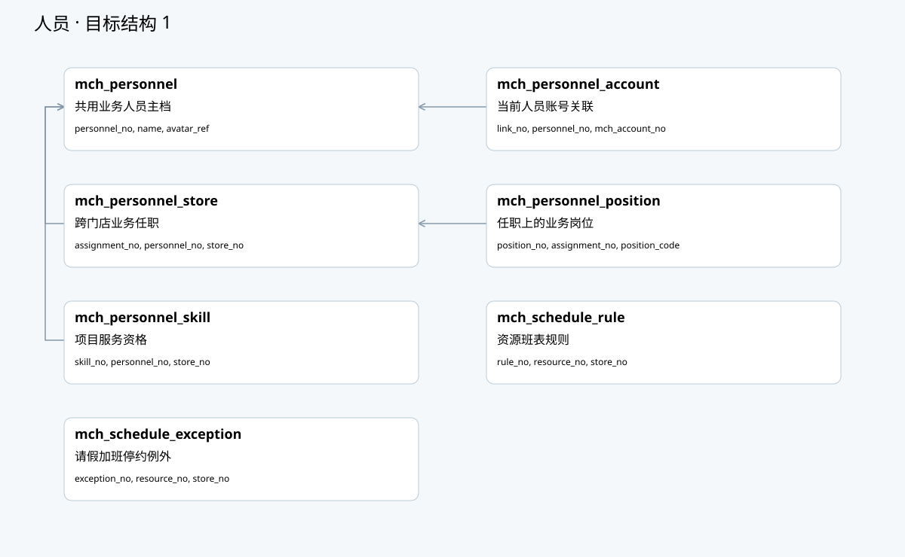

# 美业与共用人员资源数据库结构设计

> 状态：数据库结构提案，待评审 · 2026-10-20 · 未执行建表、修改迁移或访问生产数据库。
> 需求：[六端20模块118项功能矩阵](../../requirements/美业系统-多端功能矩阵.md)；对象：[领域对象及共用服务人员补充](./美业系统-领域对象与聚合边界.md)。
> 字段与索引真源：[数据库设计JSON](./schema/beauty-database-design.json)；生成物：[逐表字段字典与关系图](./美业系统-数据库字段字典.md)。生成命令：`python3 scripts/gen-beauty-database-design.py`，校验追加`--check`。

> 下游：[分模块API清单](./美业系统-API清单.md) · [预约工作台与日历契约](./美业系统-预约工作台与日历API设计.md)，日历读取人员/资源/预约/任务投影，不直接写容量桶或资产账。

## 一、设计结论

**共用业务人员主档关联可选登录账号，以同一人员号贯穿任职、岗位、技能、排班、预约安排和实际任务参与。** 餐饮服务员、厨师、美业技师/助理及零售服务人员共用该模型；美业只新增预约工单、执行记录、护理、疗程计划和业绩提成数据。

> 下一阶段增量提案：[SHR-02b详细方案§7](../TDD-共用资源容量与组合占用-SHR02b.md#7-数据结构补充提案)原提案增加归属头、命令、交接关系和block四类支撑表。02b-1b已冻结前两项归属头/命令及原bucket/hold/unit字段，合入41项JSON并新增V535；交接关系/block仍待后续，不把数据层视为完整恢复协议。

当前设计源包含41项表结构：共用人员8项、共用资源8项、美业服务过程16项、护理疗程5项、业绩提成4项。其中40项是新增目标，1项为既有`mch_appointment_slot`的兼容扩展；不是要求本次一起创建41张表。

| 分类 | 数量 | 写入所有者 | 交付边界 |
|---|---|---|---|
| 既有核心表复用 | 不重复列入新增数 | merchant/product/trade/member/Pay/inventory各自所有 | 只经正式合同访问，不重建价格、订单、余额和库存 |
| 共用人员资源候选增量 | 15新增＋1既有扩展 | merchant人员/资源能力 | 零售餐饮美业共用；不属于美业私有迁移 |
| 美业候选增量 | 25新增 | 美业应用 | 按阶段落地；护理、疗程、提成不阻塞单次服务 |

### 1.1 当前代码依据与旧稿修订

| 事实 | 本轮处理 |
|---|---|
| [MchAccount](../../../backend/shop-merchant/src/main/java/ai/neargo/shop/merchant/entity/MchAccount.java)已有登录手机号或消费者账号关联要求 | 保留登录及主体成员身份，不向其中塞入无登录服务人员或技能排班 |
| [MchStoreRole](../../../backend/shop-merchant/src/main/java/ai/neargo/shop/merchant/entity/MchStoreRole.java)已有一账号多店多角色 | 保留授权角色；新增业务任职/岗位不自动变成系统权限 |
| [MchAppointmentSlot](../../../backend/shop-merchant/src/main/java/ai/neargo/shop/merchant/entity/MchAppointmentSlot.java)只有门店时段容量 | 旧单格路径保持；资源模式经明确所有权切换，不能直接假定有技师维度 |
| 旧[资源规格](./预约资源域V2-设计规格书.md)拟定mch_staff/staff_no和门店归属人员资源 | 改为personnel_no，人员主档在主体内稳定、跨店任职；STAFF规范资源不按店复制 |
| 已有平台运营staff_no语义、旧MchStaffLog命名 | 不挪用平台staff_no，也不因新业务人员补一套平台账号 |
| 早期美业表清单只有工单行staff_no | 改为预约指定、确认安排和实际参与三层关系，换人记录追加 |

本轮使用`mch_personnel`作为候选统一命名，替代尚未落地的同义人员草案；实施前核对所有既有引用并修订旧规格，不同时建设mch_staff和mch_personnel两套业务人员。人员号在租户/主体范围内稳定，不据手机号跨主体自动归并自然人或共享私人资料。

## 二、人员与预约执行关系

图由表字段引用生成。人员可以没有登录账号；当技师自己登录操作时，服务端由当前mch_account查到personnel，再校验门店任职和权限。前台代派未登录技师时，操作者与执行人员分别记录，不能伪装成该技师登录。

| 层次 | 表 | 关系与目的 |
|---|---|---|
| 主档 | mch_personnel | 一人员主档，不复制每店同一人 |
| 可选账号 | mch_personnel_account→mch_account | 首期一个人员一个当前账号，账号至多对应一个人员；解绑留审计 |
| 任职与岗位 | mch_personnel_store＋mch_personnel_position | 一人员多店、多岗位；业务资格不替代mch_store_role权限 |
| 技能 | mch_personnel_skill | 按项目、可选SKU/门店、生效期和核验状态匹配 |
| 排班 | mch_schedule_rule/exception/change_log | 班表和临时例外独立；变更产生受影响业务待办 |
| 人员资源 | mch_resource(resource_type=STAFF,personnel_no) | 同主体人员一个规范资源、容量1，跨店同一仲裁 |
| 预约计划 | bty_appointment_item.requested_personnel_no＋bty_appointment_assignment | 分别表达指定意愿、确认安排及其版本 |
| 实际执行 | bty_service_participation | 记录实际人员、任职、角色、时间段、资格快照和交接 |

例如顾客指定甲技师，预约安排甲，实际由乙接替：指定字段仍保留甲，原安排版本不覆盖；批准换人并核查乙的资格/班表/资源后追加安排与实际参与段。业绩读取实际参与及分配规则，不从最新预约字段反推历史执行者。

## 三、表组与职责

各表的类型、可空、逻辑引用、唯一键和索引完整列在字段字典；以下说明结构与一致性。表名及字段为提案，不代表Java实体已经存在。

### 3.1 共用人员：8项

`mch_personnel`、`mch_personnel_account`、`mch_personnel_store`、`mch_personnel_position`、`mch_personnel_skill`、`mch_schedule_rule`、`mch_schedule_exception`、`mch_schedule_change_log`。

人员业务停用与账号停用分开：业务停用阻止新预约/分派并列出在途影响，账号停用撤销会话与操作权；两者都不删除历史参与。任职/资格有效期按区间验证，业务岗位可以多个，不能以可空唯一索引代替有效区间不重叠校验。

### 3.2 共用资源：6项

`mch_resource`、`mch_resource_bucket`、`mch_booking_hold`、`mch_booking_hold_unit`、`mch_resource_occupation`，以及兼容扩展的`mch_appointment_slot`。

规范资源与容量桶是资源模式的唯一仲裁：同一STAFF在不同门店的班表可分别配置，但指向同一个resource_no和同一组规范时间桶。新hold锁统一桶后条件判断held＋confirmed不超容量；不因换门店新开一套人员容量。

STAFF资源的store_no为空，通过人员有效任职验证业务门店；床位、房间等物理资源必须有门店。这个约束不同于旧“所有资源store_no必填且等于订单门店”的草案，必须同步改正式合同，不能只放宽数据库空值而不做任职验证。

单时段旧模式与资源新模式按明确能力/来源生命周期选择一个权威，新模式slot仅作查询投影/兼容适配，不再独立扣booked。迁移时先盘点旧占位和未完订单，映射并核对数量后切写，不以“双扣后补偿”作为常态。

预约转工单复用原hold的已承诺容量，occupation只记录执行交接。首期无确定结束的独占式开放占用通过resource.open_occupation_no仲裁：不允许与任何相冲突的未来hold并存；活动期间阻断新的冲突预订。已预约的有限区间服务沿原hold，不将所有就餐/服务占用无条件变为无限阻断。

更复杂的餐饮预计离台时间、多人容量现场占用与保留截止策略另补合同；预计结束不是保证释放，不可仅凭估计时间允许超订。

### 3.3 美业服务：16项

| 范围 | 表 | 用途 |
|---|---|---|
| 门店政策 | bty_store_policy、bty_store_policy_version | 头表切换当前版本，历史版本不可变 |
| 执行定义 | bty_service_definition、bty_service_definition_version、bty_service_requirement | 门店SKU规则、步骤模板及资源需求；不存第二份售价 |
| 预约 | bty_appointment、bty_appointment_item、bty_appointment_assignment | 约定、项目、指定人及确认资源安排历史 |
| 工单任务 | bty_work_order、bty_service_task、bty_service_step、bty_service_participation | 服务范围、独立任务、执行步骤及实际参与 |
| 提交关联 | bty_service_submission、bty_trade_binding、bty_source_allocation_guard | 跨域原号恢复、稳定源行分配及数量上限仲裁 |
| 行为证据 | bty_action_log | 本域关键动作追加事实及安全差异快照 |

普通交易来源与服务核销来源通过source_kind/source_no/source_line_ref区分，不给每个来源强行分配ord_item.id。每个任务当前binding_revision指向确定的不可变分配版本；更换来源先查明旧来源已明确取消、占用已合法释放，未知状态不能改指针重收款。

来源行分配使用`bty_source_allocation_guard`按类型/单号/稳定行唯一仲裁，allocated_qty不得超过可信source_qty；不能把source_revision放入唯一键，让改版再开一行绕过累计限制。这是行业服务数量分配，不是第二份订单或支付账。

### 3.4 护理与疗程：5项

`bty_care_profile`、`bty_care_note`、`bty_care_media`、`bty_treatment_plan`、`bty_treatment_session`。

护理资料首期按门店和客户隔离，共用会员身份不意味着所有店可看护理照片。记录正文加密、媒体只存私密引用，授权检查在读取时执行；更正以supersedes_note_no追加，禁止普通日志携带敏感正文。

疗程计划引用Pay持有权益，计划次引用预约和实际任务，绝不存可编辑余次。sequence_no用于计划次序，不等于已核销次数；取消或重约只改合法计划关联并保留动作历史，不自动退卡、返次或触发第二次现金收入。

### 3.5 业绩提成：4项

`bty_performance_allocation`、`bty_performance_share`、`bty_commission_policy`、`bty_commission_entry`。

产出分配保存口径/版本和人员份额；提成条目保存规则、基数和计算结果。售卡和实际服务产出分开，比例用整数百万分，金额用最小币种单位。确认事务校验份额合计与稳定尾差。

冲回是追加REVERSAL/ADJUSTMENT条目并引用原条目，按原条目锁检查累计可冲额度；不得以原条目引用全局唯一阻止合法多次部分调整。已PAID的原事实保留，后续差额另记，不隐含新增银行代发工资通道。

## 四、公共字段、类型和索引规则

新增表沿[BaseEntity](../../../backend/shop-store-mybatis/src/main/java/ai/neargo/shop/common/BaseEntity.java)的id、tenant_no、审计、version及deleted约定，额外显式记录entity_no和必要门店。id是物理主键，所有公开引用使用稳定业务号；业务范围仍必须校验，不能因为编号全局生成就省略主体过滤。

候选唯一键/索引统一前置tenant_no和entity_no，字段字典中省略该前缀。账号、人员、资源等关联必须同主体；跨域引用是逻辑合同，不自动增加跨数据源外键。最终业务号长度、字符集、大小写敏感比较及现有列类型在DDL阶段逐一核对，幂等摘要固定char(64)。

时间采用datetime(3)说明真实时刻，沿当前LocalDateTime和数据源时区约定实施，必须验证UTC转换；规则另存timezone和跨日偏移。范围使用半开区间，结束时刻必须晚于开始。既有slot的BIGINT时间不原地改类型，适配层转换。

金额为bigint最小币种单位，明确币种；数量为decimal(18,6)并带单位，普通SKU整数限制和次数权益整数约束由对应合同强制，不因支持小数就允许半次核销。JSON仅用于不可变版本、模板或安全快照，关系、查询键、资金和资源计数不藏在自由JSON内。

配置停用不删除；流水、参与历史、版本、已确认分配、计提和关键动作禁止软删覆盖。保留deleted是沿基类结构，不代表业务允许清理历史。合法隐私清理与账务证据保留分别制定流程。

关键查询索引覆盖：门店预约时间/状态、人员参与时间、工单任务状态、源行绑定、待恢复提交状态/下次重试、人员提成状态与发生时刻。日期筛选使用范围和稳定id游标，不能按当前updated_at替代真实业务时间。

## 五、事务与并发守卫

| 场景 | 原子边界和锁序 | 不允许的做法 |
|---|---|---|
| 人员账号绑定 | 锁人员及账号仲裁，unique约束兜底；历史写审计 | 用手机号自动合并，不登录人员伪造账号 |
| 资格/任职更新 | 锁人员主行校验有效区间和依赖，产生影响待办 | 只改status，预约继续无检查开工 |
| 多资源hold/换约 | 先定hold幂等意图，按规范资源号/桶起始稳定锁序，全成全败 | 门店各扣一遍同一人；循环独立抢位后尽力回滚 |
| 现场占用 | 锁resource主行再处理桶/hold；与未来预订统一检查 | 可空released_at唯一索引被当作活动占用互斥 |
| 开工/换人 | 持久意图，权威资格/资源确认后追加实际参与；结果未知保留恢复 | 只覆盖personnel_no，或仅凭预约时资格开工 |
| 来源分配 | 同一本地事务按源行guard稳定排序再锁任务，更新分配和当前版本指针 | 按SKU找第一行、以源版本新建guard避开已分配量 |
| 完工/关闭 | 完工校验任务数量；关闭先冻结scope_revision，再查全部权威任务/来源版本 | 用陈旧投影计数关闭，或把支付成功当服务完成 |
| 核心/Pay/库存交互 | 各域本地事务、正式合同、Outbox和原号恢复 | 跨库大事务，绑定失败让顾客重付款或重新扣资产 |

以上锁序是各本地域内原则，不允许数据库持锁等待远程调用；跨域通过已持久化过程、版本和决策凭证协调。全部新命令仍校验租户/主体/门店、实际操作者、本人授权和业务归属。

## 六、功能到数据结构追溯

| 功能范围 | 主要数据落点 |
|---|---|
| BTY-A01–A05 | 既有门店＋bty_store_policy/version |
| BTY-B01–B06 | 既有商品价格目录＋bty_service_definition/version/requirement |
| BTY-C01–C05 | mch_personnel/account/store/position/skill＋既有账号权限 |
| BTY-D01–D06 | mch_schedule_rule/exception/change_log、resource/bucket、hold/unit/occupation |
| BTY-E01–E05 | 既有会员识别＋bty_care_profile/note/media |
| BTY-F01–F06 | bty_appointment/item/assignment、共用hold；定金支付计划另属共用合同 |
| BTY-G01–G05 | 预约签到、bty_work_order、共用占用/等候号；不新建美业队列表 |
| BTY-H01–H08 | bty_work_order、service_task/step/participation、submission及action_log |
| BTY-I01–I07 | 既有报价订单支付＋bty_trade_binding/source_allocation_guard/submission |
| BTY-J01–J07 | 复用Pay储值方案/账户/充值/使用/凭证，不修改其他储值专项DDL |
| BTY-K01–K08 | 共用权益销售/发行/消费＋bty_treatment_plan/session，未开放政策不预写资金表 |
| BTY-L01–L05 | 既有活动/标签/券权益/触达，引用美业服务事实 |
| BTY-M01–M05 | 既有商品和库存/物料/领用凭证，以task_no关联 |
| BTY-N01–N06 | 既有售后/退款/资产纠错合同＋任务数量/动作证据 |
| BTY-O01–O05 | bty_performance_allocation/share、commission_policy/entry及实际参与 |
| BTY-P01–P05 | 共用收银/钱箱/营业日/对账和来源引用，不另建美业收款账 |
| BTY-Q01–Q06 | 共用报表投影，读取源事实和水位，不新增权威余额表 |
| BTY-R01–R05 | 共用消息/回访任务/发送结果，不新建美业通知引擎 |
| BTY-S01–S05 | 共用打印文档/任务/设备，引用工单和真实消费来源 |
| BTY-T01–T08 | 共用审计/监控/恢复/外部映射＋submission关联，不设万能人工改账表 |

没有新增表不代表没有功能落点。共用审批、排队、回访、打印、收银或边缘能力未实现的部分需各自补专项设计，不能用本册美业表替代其权威。

## 七、分期与存量演进

P1先建共用业务人员/资源最小闭环和美业政策、执行定义、预约、任务、参与、来源关联及恢复。共用人员资源按merchant归属迁移，美业表按行业归属迁移；不把全部候选共用表塞进美业Flyway历史。

已有员工账号按经核实的主体成员建立人员及绑定，保留原mch_account_no/权限关系；无登录服务人员新建业务档案但不建账号。同一人多店建立多任职，合并须人工受权核实，禁止只按同名/手机号批量合并。旧资源/时段占位映射后核对未完成预约、库存/资产意图和容量再切写。

P2只接已验收资产来源，不更改最新门店储值的范围和未完成迁移。P3再建护理、业绩提成；P4才建疗程计划和复杂模式。表可按阶段分批，不要求一次建齐38张候选新增表。

已有Flyway不可编辑；实施前分配未占用迁移号、核对实际数据库版本/字符集、样本回填与唯一键冲突，并在原生目标数据库验证条件更新、事务回滚、JSON和索引。不能用恢复旧jar撤销已发生的人员关联、资产或服务事实。

## 八、本次校验边界

生成器校验表/字段唯一、业务键、索引字段存在、引用目标、产物新鲜度，并从同一真源生成字段字典与8张分组图。功能追溯覆盖118项，矩阵编号保持不变。

这些是设计与生成物校验，不是SQL执行、数据库并发或业务端到端通过。后续实施仍须验证跨店同人员抢位、改约失败原位保留、无账号人员安排、换人资格冲突、重复签到、来源超分配、未知结果恢复与提成部分冲回等真实场景。

本次实际检查（2026-10-20）：生成器`--check`通过，39项结构及9个生成物保持一致；领域及数据库两份追溯各覆盖118项功能且无重复遗漏；四篇相关文档链接/索引/空白检查通过，8张SVG XML有效，人员与服务分组图完成PNG渲染并抽查人员图。全仓文档规范检查5项通过、3项失败，仍为其他文档的Mermaid超基线、9份文档缺索引及缺状态行超基线；本轮新增文档均登记且具有状态行，未放宽基线。

## 九、BM03-a1私有V2增量（2026-10-21）

冻结的原41项结构设计与16项V1迁移保持不变；新增2项预约来源存储，完整设计合计43项，实际私表18项。
增量真源：[预约资源意图与栅栏](./schema/beauty-resource-intent-schema.json)；字段见[增量字段字典](./美业系统-数据库字段字典.md#bm03-a1增量字段私有v2)。

| 对象 | 键与约束 | 作用 |
|---|---|---|
| bty_appointment_resource_intent | tenant/entity/intentNo及commandNo唯一；非负修订、阶段与终态形状；原始JSON有效且UTF8字节≤64KiB | 不可替换的原命令/计划字节与摘要、发起人、决定和对账证据 |
| bty_appointment_resource_fence | tenant/entity/appointmentNo永久唯一，fenceNo与非空activeIntentNo各唯一 | 一预约同时一个活动意图，CAS显式置NULL解除；禁止用删行或TTL释放 |

新库显式migrate依序应用V1/V2；存量V1库先拒绝启动，受控迁移升级后才validate通过，原预约保留。
美业readiness版本为2；V1及V2分别校验唯一资源归属、固定摘要和精确结构。授权、重试和终态真实性须由后续a2服务验证，SQL行不是实际资源结果。
