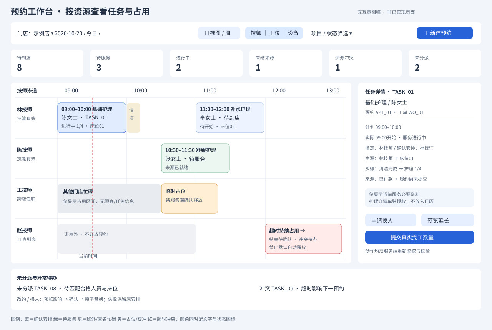

# 美业预约工作台与日历 API 设计

> 状态：交互与接口契约草稿，待评审 · 2026-10-20 · 未实现页面、接口或资源锁。
> 总清单：[20模块API清单](./美业系统-API清单.md)；上游：[功能矩阵](../../requirements/美业系统-多端功能矩阵.md)、[领域对象](./美业系统-领域对象与聚合边界.md)、[数据库结构](./美业系统-数据库结构设计.md)。

> Java落点：[独立美业项目与包依赖](../TDD-美业系统-独立项目与包依赖方案.md) · [完整包名与API归属](./美业系统-Java项目结构与类职责.md)。

## 一、目标与边界

预约工作台让前台、店长和技师在同一日历中看到“谁在什么时间做什么、占用谁/哪个工位、当前执行到了哪里、还能否安排”。这里将“工作元”解释为参与作业的人员及床位、座位、房间、设备等资源；任务是待完成的服务工作，资源是承载任务的容量，两者分开建模。

推荐首期采用**日视图为主、周视图辅助，人员/工位泳道切换，窗口快照＋15秒短轮询**。预约、任务、来源账单均有自己的详情；日历不直接操作资源桶、支付账或权益余额。提供三种业务入口但共用一套后端：前台全店受权调度，技师本人排程与执行，店长受权跨店概览和异常协调。



图为交互意图，示例姓名与时间不对应真实数据。预约卡片表现业务安排；资源占用底色才代表容量承诺。上半部按技师展示，同一预约还占用床位时，在切换工位视图后复用同一预约/任务引用，不复制预约记录或重复统计。右侧查看具体项目任务、步骤、指定/安排/实际人员以及来源是否具备开工条件。

| 区域 | 展示内容 | 对应接口/能力 |
|---|---|---|
| 顶部筛选与概览 | 门店、日期、日/周、人员/工位、项目、状态；待到店/待服务/进行中/待结/异常 | `GET workbench/summary`、`GET workbench/calendar`，以下业务路径统一前缀`/biz/x/beauty/` |
| 日历主体 | 资源泳道、营业/班次底色、已确认安排、临时占位、准备清洁缓冲、实际执行及超时阻断 | `CalendarSnapshotVO`，以规范资源占用为准 |
| 底部/侧栏待办 | 未分派任务、冲突、迟到、停约影响、未知来源、待交接 | 快照中的`unassigned`摘要（以targetType区分APPOINTMENT/TASK），完整列表`GET appointments?assignmentState=UNASSIGNED`、`GET tasks?assignmentState=UNASSIGNED`与`GET workbench/exceptions` |
| 详情抽屉 | 预约项目与任务树、顾客脱敏称呼、计划/实际时间、指定/安排/实际参与、床位设备、步骤、来源状态、历史与可用动作 | `GET appointments/{appointmentNo}`、`GET work-orders/{workOrderNo}`、`GET tasks/{taskNo}`、`GET tasks/{taskNo}/participations`、`GET work-orders/{workOrderNo}/bill` |
| 创建与调整 | 点击空格预览可约组合，选项目与人员；拖动改时/换人；超时延长；异常协调 | 可约查询、预约预览/提交、改约预览/提交、资源变更预览/提交，均重新仲裁 |

## 二、资源、任务与占用口径

| 概念 | 稳定标识与来源 | 展示与计算规则 |
|---|---|---|
| 人员泳道 | 共用personnelNo及唯一STAFF resourceNo | 同主体同一人员跨店共用规范资源，不能每店复制一个可独立预约的技师容量；公开资格与账号授权分开 |
| 物理资源泳道 | 床位/座位/房间/设备resourceNo | 有门店归属；可配置容量，容量大于1按数量呈现，不能仅凭卡片数量计算空闲 |
| 预约安排 | appointmentNo、itemNo、assignmentRevision | 保留顾客指定意愿与确认安排；可尚无交易/工单，卡片明确“未建单/待付款”，不能显示可直接开工 |
| 具体服务任务 | workOrderNo、taskNo、stepNo | 一预约可关联多个任务，任务独立状态/资格/来源绑定；任务卡片列项目、任务状态、步骤完成数、安排人员及资源 |
| 确认容量占用 | 共用hold/occupation及资源时间桶投影 | PREPARE、SERVICE、CLEANUP可有连续分段；占用集合有稳定occupationNo和segmentNo，跨视图不重复扣量 |
| 临时占位 | HELD，带expiresAt | 画半透明/虚线，过期由服务端释放；前端倒计时不能自行宣告可用。只显示受权业务详情，其他主体意图显示“临时占用” |
| 实际参与 | participationNo及actualStartAt/actualEndAt | 与计划对照的细线/徽标；实际执行仍消费原确认占用时不再叠加计一次容量，实际参与人数不等于资源新增容量 |
| 未知结束占用 | openOccupation根指针，endAt可空 | 超时且未释放显示“持续占用/结束待确认”，阻断后续新占位，红色延伸至可视窗口末端；绝不默认计划结束即空闲 |
| 排班/封锁 | 班表、休息、停约、设备维修 | 班表外不开放预约，已有安排仍显示并标冲突；停约要生成受影响业务待办，不静默删除原预约 |
| 未分派/待协调 | appointment/task及业务待办 | 单独列表，不捏造人员泳道或固定开始时间；“未分派”不代表已锁定任何人员 |

资源日历至少提供人员、工位、设备三组筛选；P1支持一个服务任务所需的一名主技师＋床位/房间等串行完整资源组合，不能把D06/H08的P4团体、多人并行和跨阶段排程提前打开。协作角色、护理详情与高级流程按原阶段接入。

**三种状态正交展示：**预约状态（已约/到店/取消/爽约等）、任务状态（待接/待开始/进行/暂停/服务完成等）、来源状态（未绑定/待付款/已付/确认中/未知等）。服务完成但核心履约待确认时，卡片写“服务已完成 · 履约确认中”；不因已收款染成“已完成”。实际资源释放与来源恢复分别查询，不让财务UNKNOWN自动无限占床，也不在执行未结束时自动释放。

## 三、日历读接口契约

### 3.1 获取窗口快照

`GET /biz/x/beauty/workbench/calendar`

| 请求字段 | 类型/约束 | 用途 |
|---|---|---|
| storeNo | String，必填且受权 | 当前业务门店；跨店汇总首期由受权门店切换，人员跨店忙碌仍参与仲裁 |
| from/to | 带偏移RFC3339，必填，左闭右开，最长7天 | UTC查询范围，日视图按门店本地日计算边界；跨夏令时不能硬加24小时 |
| view | DAY / WEEK | DAY细粒度泳道；WEEK每一天为列，人员选中后查看周安排；均使用同一占用模型 |
| resourceTypes | STAFF/BED/SEAT/ROOM/EQUIPMENT集合 | 切换人员/工位/设备 |
| personnelNos/resourceNos | 可选受权集合 | 勾选技师/资源；后端不得因传编号越权 |
| serviceSkuNo/taskStatuses/appointmentStatuses | 可选 | 过滤业务卡片；**不裁掉真实容量占用底图**，隐藏项目的忙碌也必须显示匿名busy |
| resourceCursor/resourcePageSize | 首次cursor省略，默认20，最大50 | 分页泳道；响应返回同快照续页令牌 |
| includeUnassigned | Boolean，默认true | 首屏返回最多20项未分派摘要及未分派总数，超出转任务列表 |

候选返回数据结构如下；外层沿用项目响应封装。示例仅一个人员泳道，另有一页床位数据，不表示资源已全部加载。

```json
{
  "snapshotToken": "cal-snap-opaque",
  "snapshotExpiresAt": "2026-10-20T09:02:00+08:00",
  "asOf": "2026-10-20T09:00:00+08:00",
  "storeNo": "STORE_01",
  "timeZone": "Asia/Shanghai",
  "window": {"from": "2026-10-20T08:00:00+08:00", "to": "2026-10-20T20:00:00+08:00"},
  "coverage": {
    "resourcePageComplete": true,
    "allResourcePagesLoaded": false,
    "occupancyComplete": true,
    "businessProjectionState": "CURRENT",
    "capacityVersion": "cap-248",
    "sourceWatermarks": {"appointment": "a-19", "task": "t-42"}
  },
  "lanes": [{
    "resourceNo": "RES_P01", "type": "STAFF", "personnelNo": "PERSON_01",
    "label": "林技师", "capacity": 1, "resourceRevision": 6,
    "workingIntervals": [{"from": "2026-10-20T08:00:00+08:00", "to": "2026-10-20T18:00:00+08:00"}],
    "blockedIntervals": []
  }],
  "occupations": [{
    "occupationNo": "OCC_01", "segmentNo": "SEG_01", "resourceNo": "RES_P01",
    "appointmentNo": "APT_01", "itemNo": "AIT_01", "taskNo": "TASK_01",
    "kind": "SERVICE", "state": "CONFIRMED", "quantity": 1,
    "from": "2026-10-20T09:00:00+08:00", "to": "2026-10-20T10:00:00+08:00",
    "openEnded": false, "revision": 3, "detailVisibility": "FULL"
  }],
  "appointments": [{
    "appointmentNo": "APT_01", "revision": 4, "status": "ARRIVED",
    "customerLabel": "陈女士", "serviceLabels": ["基础护理"],
    "taskNos": ["TASK_01"], "assignmentRevision": 2
  }],
  "tasks": [{
    "taskNo": "TASK_01", "workOrderNo": "WO_01", "revision": 5,
    "bindingRevision": 1, "serviceLabel": "基础护理", "status": "IN_PROGRESS",
    "sourceState": "PAID", "fulfillmentState": "NOT_SUBMITTED",
    "plannedStartAt": "2026-10-20T09:00:00+08:00", "plannedEndAt": "2026-10-20T10:00:00+08:00",
    "actualStartAt": "2026-10-20T09:00:00+08:00", "actualEndAt": null,
    "progress": {"completedSteps": 1, "totalSteps": 4},
    "assignmentResourceNos": ["RES_P01", "RES_B01"],
    "allowedActions": ["PAUSE", "REQUEST_HANDOVER", "COMPLETE"], "blockers": []
  }],
  "unassigned": {"total": 0, "records": [], "hasMore": false},
  "exceptions": {"total": 0, "records": [], "hasMore": false},
  "nextResourceCursor": "cursor-page-2",
  "refreshAfterSeconds": 15
}
```

`occupations`是容量底图，`appointments/tasks`是本页引用的业务摘要，数量统计按业务号去重。跨泳道重复返回相同业务摘要时须保持该snapshot内版本一致。床位`RES_B01`可能在下一页，首屏仍可通过任务详情得知完整资源组合。准备和清洁是其他占用分段，示例为简化省略，不能由前端自行将任意空白时长当可约。

### 3.2 快照一致性、分页和刷新

1. 首次响应按受权范围与过滤条件生成不可变的短期读快照，建议有效期2分钟；快照包含资源目录、规范占用、业务摘要及各域水位。页令牌绑定账号/权限版本、门店、窗口、过滤hash与snapshotToken，不是数据库offset。资源仲裁与业务投影可有独立水位，**不能伪造全域同一事务时间点**。
2. 续页用`GET /biz/x/beauty/workbench/calendar/pages?snapshotToken=...&resourceCursor=...`；所有页面读取同一快照的目录、占用和摘要。过期返回`CALENDAR_SNAPSHOT_EXPIRED`，权限变化返回重新授权/重载；不能从新版本随意拼半页到旧快照。
3. `resourcePageComplete=true`表示当前泳道页的窗口占用齐全；`allResourcePagesLoaded`表示全资源分页是否结束。服务端每页最多1000占用分段（候选保护值）；达到上限时返回不完整标记与`WINDOW_TOO_DENSE`提示缩短窗口/泳道数，UI用“数据未完整加载”遮罩，不能静默截断。容量与业务投影不完整分别标记。
4. `businessProjectionState=LAGGING/UNKNOWN`时显示数据延迟和水位。可保留真实busy底图；未知状态不得呈现“可预约”保证。日历可点空白发起可约查询，是否可约始终由提交仲裁决定，不由快照或前端比较空白面积决定。
5. 前台页面可见时15秒轮询新快照，聚焦/动作成功后立即刷新，后台暂停。每次刷新取消旧请求或按请求序号丢弃迟到响应；完整替换当前已加载窗口页，禁止局部叠加造成重复占用。编辑中的弹层保留表单，收到新revision提示“数据已变化”并要求重新预览。网络失败保留旧视图并标`asOf`过期。
6. 概览、异常全量列表和日历各自返回asOf；暂不承诺三者同事务一致。概览“预约数”按appointmentNo、“任务数”按taskNo；同一资源多段占用按区间并集和quantity计量，不按卡片数算利用率。

异步命令返回operationNo，统一经`GET operations/{operationNo}`查原号进度；该查询只查询美业编排操作，资金原号仍交共用所有者查询。

首期不另建增量事件协议。以后增加SSE/WebSocket只能作为刷新提示，断线仍回全量快照；不能只依赖推送决定资源释放、付款成功或任务完成。

### 3.3 任务与详情字段

`AppointmentDetailVO`至少包含customerRef脱敏信息、预约状态/修订、itemNo与SKU及定义版本、requestedPersonnelNo、各版确认安排、计划区间、关联taskNos、到店记录、sourceRefs和allowedActions。`GET tasks/{taskNo}`返回具体`ServiceTaskDetailVO`，含步骤列表及其修订/动作；`ServiceTaskVO`列表摘要至少包含任务/工单/预约引用、步骤进度、bindingRevision、来源就绪/履约状态、计划和实际区间、安排与实际参与摘要、资源引用、阻断原因和allowedActions。

卡片默认显示“09:00–10:00 · 基础护理 / 陈女士 / 进行中 1/4 / 林技师 · 床位01”；展开可逐项看到同一预约中的其他任务。护理过敏详情与照片只在具备目的及权限的护理接口读取，不放日历返回、打印公共单或外部通知。来源摘要只显示开工所需状态与受权付款入口，不返回顾客余额和内部本金赠金拆分。

## 四、可约、创建、拖动、换人和执行

### 4.1 可约与创建

1. 查询项目与服务定义，通过`POST availability/queries`匹配项目→有效门店任职→技能资格生效期→完整班表→全部资源容量。返回按开始时间与resource组合标识的offer，含定义版本、结束时间、缓冲、限制、expiresAt和失败原因；offer是候选结果，不是容量锁。
2. `POST appointments/previews`核对顾客/代约身份、请求指定人员、项目与资源需求及来源规则，返回previewNo、各revision、政策版本、需本人确认内容。可无交易预约，不制造零元已付订单。
3. `POST appointments`使用幂等键和previewNo，服务端在共用仲裁内校验并占齐所有资源，再确认预约。任一资源冲突则不留下半个组合；跨库/跨服务无法同事务时，以持久化意图＋有期限hold＋确认/补偿过程承接，中间状态明确为PENDING，不提前返回CONFIRMED。内部hold接口不暴露给顾客自由占任意资源。
4. 如涉及付款/资产授权，由正式Core/Pay合同另完成，保存ServiceSubmission、来源与绑定修订。占位到期而付款未知时不能盲目退款、再付或继续占新号；形成资源已释放/来源待恢复的明确异常，原号核查后重新查可约，不能强行复活已被他人占用的时段。

### 4.2 拖动改约示例

拖动只是预览动作。原位置保留，鼠标松开后展示新时段、技师、床位、价格/来源影响和需本人确认内容。用户提交成功后刷新；失败回到服务端当前安排。

`POST /biz/x/beauty/appointments/APT_01/changes/previews`

```json
{
  "expectedRevision": 4,
  "startAt": "2026-10-20T11:00:00+08:00",
  "items": [{"itemNo": "AIT_01", "skuNo": "SKU_FACIAL", "quantity": 1}],
  "assignments": [{"itemNo": "AIT_01", "personnelNo": "PERSON_02", "resourceNos": ["RES_P02", "RES_B02"]}]
}
```

候选响应`AppointmentChangePreviewVO`：

```json
{
  "previewNo": "PREVIEW_01", "expiresAt": "2026-10-20T09:01:00+08:00",
  "targetRevision": 4, "capacityVersion": "cap-249",
  "newInterval": {"from": "2026-10-20T11:00:00+08:00", "to": "2026-10-20T12:00:00+08:00"},
  "resourceRevisions": {"RES_P02": 2, "RES_B02": 3},
  "priceImpact": {"state": "UNCHANGED", "quoteNo": null},
  "requiredConfirmations": [], "conflicts": [], "canSubmit": true
}
```

随后`POST appointments/APT_01/changes`，带`Idempotency-Key`，body为`previewNo,expectedRevision,reason,consentRef?`。服务端绑定预览范围、重新验证来源/资格/任职/排班及资源修订，在同一仲裁中“校验新完整组合→替换资源→新安排版本生效”，不能先释放旧资源再抢新资源。失败保持旧安排；若已开工，预约拖动禁用，走任务交接/资源延长协议，不覆盖历史实际时间。

价格或服务内容改变时，必须取得新正式报价与合法来源，原支付/资产状态未知则阻断替换。P1不支持的补差、混付、后付，返回能力阻断，不因改约弹层存在就绕过核心合同。

### 4.3 执行、换人、超时与释放

- 开始：`POST tasks/{taskNo}/starts`重新核查绑定版本/来源就绪、人员当时任职资格、班表和完整资源。前台代操作要记录operator与实际执行personnel，不能伪装成无登录技师本人。
- 换人：未开始安排可走改约；已开始任务走`handovers/previews`→`handovers`。旧参与段结束、新参与段追加，同时切换人员资源；顾客原指定、历史确认安排与实际参与各保留。多人并行协作仍受P4能力控制。
- 超时：`POST resource-changes/previews`返回冲突预约/待办与候选后续处理，提交`resource-changes`争取新增区间。不能覆盖下一预约；无法延长且实际仍在服务时，开放占用guard阻止新开工，并生成冲突待办协调已存在的未来安排。允许店长协调不等于允许同容量双约。
- 暂停：任务暂停不自动释放床位/人员；如需让出，必须有资源释放与重新获取规则并明确UI状态，恢复时再核查。提前结束保留实际数量，不能据此自动退款或返次。
- 完工：真实服务完成后提交核心履约；任务服务完成和履约成功各有状态。释放按实际资源使用结束政策执行，并保留清洁缓冲；工单关闭须冻结范围并检查全部任务/来源的真实版本和未结阻断。不能靠日历删除卡片实现释放。

## 五、错误、授权与日历降级

| 候选错误码 | 条件 | 界面行为 |
|---|---|---|
| VERSION_CONFLICT / PREVIEW_EXPIRED | 修订变化或预览过期 | 展示当前安排，保留草稿并重新预览 |
| RESOURCE_CONFLICT | 资源容量不足，包括同一人员其他店占用 | 标冲突区间；返回受权可见的候选组合，重新选择；不无限自动抢占 |
| QUALIFICATION_INVALID / ASSIGNMENT_INVALID | 资格过期、任职无效/停用 | 定位到人员要求并要求换人；历史安排继续可读 |
| OUTSIDE_SCHEDULE / RESOURCE_BLOCKED | 班外、休息、维修、持续占用 | 展示原因与待协调入口；无“强制忽略”按钮 |
| SOURCE_NOT_READY / SOURCE_UNKNOWN | 未付、绑定未完成、资金未知 | 禁止开工/受影响替换，显示原提交号查进度 |
| CAPABILITY_DISABLED / CONSENT_REQUIRED | 合同未启用或缺本人确认 | 展示缺少条件，不代用户确认 |
| CALENDAR_SNAPSHOT_EXPIRED / WINDOW_TOO_DENSE | 快照过期/窗口数据超上限 | 重新载入或缩小窗口，不显示虚假空闲 |
| PERMISSION_CHANGED / SCOPE_DENIED | 店铺/任务/字段权限撤回 | 重载并收回敏感抽屉；跨店忙碌仅保留匿名占用 |

同主体技师在其他门店忙碌，当前受权门店必须看到该时间不可约；无对方门店查看权限时仅返回resourceNo、区间、quantity、kind=EXTERNAL_BUSY和opaqueBusyNo，不含顾客、项目、门店号、任务号及可跳转业务引用。真实occupationNo也不直接泄露。顾客端只看可约结果和本人记录，不读取内部日历。跨主体不得按相同手机号自动联通排程或共享人员资料。

## 六、表与接口落点

| 页面/API职责 | 写入或读取对象 | 主责 |
|---|---|---|
| 人员与泳道 | mch_personnel、mch_personnel_store/position/skill、mch_resource | 共用人员与资源；M03/E03/E04 |
| 班表底图与占用 | mch_schedule_rule/exception、mch_resource_bucket、mch_booking_hold/unit、mch_resource_occupation | 共用资源仲裁；日历读投影不作为写锁 |
| 预约卡片与改约 | bty_appointment/item/assignment | Appointment聚合，安排版本追加 |
| 具体服务与实际执行 | bty_work_order、bty_service_task/step/participation | WorkOrder/ServiceTask各自聚合 |
| 来源状态与异常 | bty_service_submission/trade_binding/action_log、来源分配guard、Core/Pay正式查询 | 编排保存意图与绑定，不另建余额/支付账 |
| 概览与日历快照 | DaySchedule/ReceptionBoard/ExceptionWorklist及CalendarSnapshotVO | 读模型；短期快照缓存，不因需要日历增加事实表 |

共用资源模型可以供餐饮的桌位预约、包间及服务人员安排复用，零售可复用导购/安装/体验服务排班；菜品时段餐牌和美业步骤护理仍由各行业拥有。共用资源不要求餐饮强制建设整套美业工作流。

## 七、验收场景与待决事项

| 验收场景 | 必须观察到的结果 |
|---|---|
| 同一技师跨两店同一时段下单 | 只有一个完整资源组合确认，另一方冲突；未受权方只见匿名忙碌 |
| 一项目需技师＋床位，床位被并发占用 | 失败后无孤立人员占用；旧改约安排不丢失 |
| 日历筛选只看某项目 | 其他项目占用仍以busy底图阻止误判，未加载页不计空闲 |
| 一预约多任务、多资源、缓冲分段 | 任务可逐个打开，按预约号统计一次；同一次容量承诺不因跨泳道重复扣量 |
| 拖动期间别人换班/抢位 | 提交重新校验并失败，原安排保留，刷新后明确冲突 |
| 技师开始后资格失效/离职 | 新开工/新分派阻止，当前任务形成交接待办，历史参与不改写 |
| 实际超时未完、下一预约已确认 | 明确超时与冲突待办，后续新开工被阻断，不把计划结束当资源已释放 |
| 已完成服务但核心履约未知 | 显示“服务已完成/履约确认中”，按原提交号恢复，不重复扣款扣次 |
| 分页续取快照过期/网络断开 | 保留已读状态并显著标过期，重新加载；无静默跨版本拼页或默认空闲 |
| 两个浏览器同时提交/重复点击 | 幂等同键返回同一结果，异键受版本与资源仲裁约束，不产生重复预约/工单 |
| 角色权限撤销或跨店越权请求 | 页面与命令双重收回权限，日历和护理/资金字段按范围裁剪 |

待实施评审确认：①行业路由与共用权限编码；②资源桶粒度、容量上限及服务时长取整/缓冲规则；③快照生成方式、投影延迟阈值、2分钟TTL与1000分段保护值压测；④完整资源替换事务边界与跨域补偿；⑤各来源能否部分履约/取消和临客认领验证方式。上述是候选工程参数，不冒充当前系统能力。P1任务状态/可约结果必须有真实后端与并发验证后才可上线，当前交付为可评审设计。
