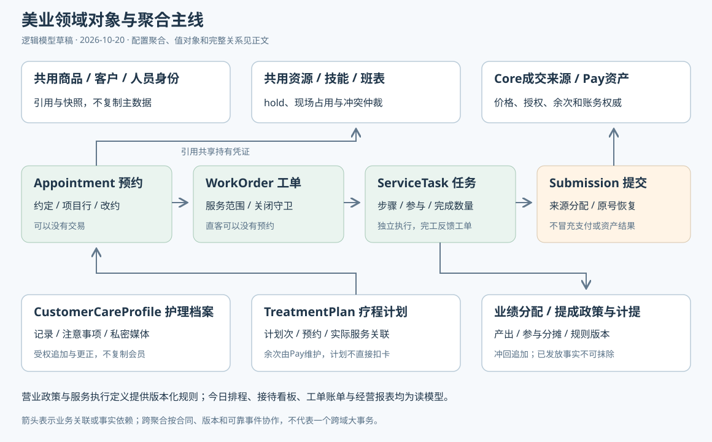

# 美业系统领域对象与聚合边界

> 状态：领域模型草稿，待评审 · 2026-10-20 · 基于[20模块118项功能矩阵](../../requirements/美业系统-多端功能矩阵.md)，不代表类、表或API已实现。
> 边界依据：[零售核心边界](./零售基础数据与核心能力边界.md)、[统一架构](../TDD-多行业统一业务架构-零售餐饮美业.md)、[美业工作流](../TDD-美业系统-共用商品订单与服务工作流.md)。

## 一、定位与对象结构

**美业领域以预约、服务工单、服务任务为主线，引用共用商品、人员、资源、成交来源与资产凭证。** 疗程服务计划、护理档案、业绩与提成是独立扩展，不再建设商品、会员、订单和余次账。

图表达业务关联和所有权，不是数据库ER图。箭头不代表跨域外键或共享事务；原子资源占用、交易授权和资产使用均由相应所有者执行。聚合根是独立一致性边界，不等于一定单独建表或拆服务。

| 对象类别 | 美业中的用途 | 不能混同 |
|---|---|---|
| 复用聚合 | 门店、商品、人员身份、资源持有、交易/资产来源 | 不在美业复制实体及写入口 |
| 美业聚合根 | 预约、工单、任务、服务计划等业务不变量 | 不是界面、功能菜单或所有表的集合 |
| 聚合内实体 | 预约项目行、任务步骤、人员参与记录 | 生命周期跟随根，通过根的规则变更 |
| 值对象 | 区间、资源需求、来源引用、数量单位、规则快照 | 无独立业务生命周期；金额快照不是新应收账 |
| 读模型 | 今日排程、接待工作台、工单账单、个人业绩 | 可重建，不维护第二份状态和资金事实 |
| 过程记录 | 提交意图、来源绑定、事件消费与恢复进度 | 不冒充支付成功或实际服务完成 |

六类终端调用同一组对象和合同，不建立C端预约、前台预约和技师预约三套领域模型。下列英文名称为逻辑名称，实际Java命名沿项目规范，DDL及完整接口另行设计。

### 共用服务人员模型补充

服务员、技师、助理、厨师和零售作业人员共用一套业务人员体系，不分别建立餐饮/美业员工库。业务人员档案与登录账号分开：现有`mch_account`是登录和主体成员关系，不能为了让不登录的技师可预约而伪造账号或消费者账号。

| 共用对象 | 责任 | 关系与守卫 |
|---|---|---|
| Personnel 业务人员主档 | 同一主体内稳定人员编号、姓名/展示资料、业务状态 | 可无账号；不按手机号自动合并跨主体人员 |
| PersonnelAccountLink 账号关联 | 关联现有mch_account，不复制会话与密码 | 首期同主体一人员最多一个当前账号，账号最多关联一人员；历史变更审计 |
| PersonnelStoreAssignment 门店任职 | 可在哪些店、何时承担业务、对客展示 | 多门店任职共用人员号；不自动授予登录操作权限 |
| PersonnelPosition 业务岗位 | 技师/助理/服务员等可兼任岗位 | 业务岗位不等同mch_store_role的授权角色 |
| PersonnelSkill 服务资格 | 可执行项目/技能、等级、生效期和核验状态 | 有权限不代表有技能，技能也不授予顾客资料访问权 |
| PersonnelSchedule/Resource | 班表、例外和人员统一时间占用 | STAFF资源映射唯一人员；跨店共用仲裁，不在每店复制独立人员容量 |
| PlannedAssignment / StaffParticipation | 预约计划人员与实际任务参与分别记录 | 指定人、确认安排人、实际执行人不能只存同一个可覆盖字段 |

预约按项目要求、有效任职、技能资格、排班和资源可用性匹配；到店开工再次验证。允许预约阶段不指定具体人，但须持有已承诺的真实资源容量，不能使用“未分配”绕过占位。临时换人先验证资格与剩余时间资源，再追加参与/交接事实。

业务停用阻止新分派并产生预约/在途任务处置，账号停用另行撤会话；历史参与和业绩不删除。旧资源草案使用`mch_staff/staff_no`，本轮候选统一命名为`mch_personnel/personnel_no`，避免与平台运营`staff_no`混用，实施前更新旧共享资源契约，不同时落地两套同义人员表。

数据库结构见[美业与共用人员资源数据库设计](./美业系统-数据库结构设计.md)，包含预约计划人员与实际参与的独立关系；本补充不创建人员或账号数据。

## 二、复用的核心与共用对象

| 所有者 | 复用对象 | 美业保存或使用什么 | 对应功能 |
|---|---|---|---|
| M01/M02 主体门店 | 经营主体、门店、资质、服务范围、营业资料 | 受权引用与发生时归属快照 | A、P、T |
| M03/S01 人员访问 | 员工账号、门店任职、角色/数据范围、设备身份 | operatorRef、staffRef；技师和顾问是业务岗位 | C及所有写动作 |
| M04 顾客会员 | 顾客身份、联系引用、会员关系、识别凭证 | customerRef或临客引用，不复制客户身份 | E、F、J、K |
| M05/M06 商品 | 商品、SKU、门店价格/上架、服务基础时长 | goodsRef/skuRef和冻结执行快照 | B、H、I、M |
| E01/E02 陈列报价扩展 | 目录/分组、销售日历、选配/组合及计量规则 | 配置引用；最终报价归K01 | B、I |
| E03 人员业务 | 技师档案、技能、班表、请假与调整记录 | 技能引用、排班版本；不建重复账号 | C、D |
| E04/E05 资源协作 | 资源、可用区间、BookingHold、现场占用、排队号、公共任务 | holdRef、occupancyRef、queueRef | D、F、G、H |
| K02/K04 成交与付款 | 普通支付根/门店订单/成交行、服务消费来源、授权、支付结果 | 带类型TradeSourceRef及分配，不能都叫orderNo | H、I、J、K、N |
| Pay/E06 资产 | 储值方案/版本、充值、账户/批次、权益定义/实例、预占/使用凭证 | sourceRef/assetRef/useOperationRef及只读结果 | J、K、L |
| K03/E07 库存 | 商品库存承诺、耗材物料、出入库/领用/退回凭证 | serviceTaskRef和materialUsageRef关联 | M、N |
| K06/K07/E08 财务 | 售后、退款执行、收银范围、钱箱班次、营业日、结算/对账 | 原始服务证据与关联，不维护另一份收款流水 | I、N、P |
| E06/E10 客户经营 | 标签/人群、活动参与、券发行、回访任务、报表投影 | 美业触点、护理内容、产出事实 | L、O、Q、R |
| S/E09 业务支持 | 消息、打印任务/尝试、文件、设备、审批、审计、恢复待办 | 业务来源引用及合法内容，不复制通道状态机 | R、S、T |

这些是逻辑复用对象，其中完整多资源、通用打印等仍待建设，不能据对象名认定已有接口。账户与权益由Pay所有；同店多方案不等于多个钱包；不同店账户按最新专项目标隔离。

## 三、美业自有聚合目录

| 聚合根 | 职责与主要字段 | 聚合内实体/值对象 | 关键不变量 | 阶段 |
|---|---|---|---|---|
| BeautyStorePolicy 营业政策 | storeRef、policyVersion、预约窗口、已获准营业模式、规则生效时间 | 政策版本/取消及爽约规则快照 | 模式配置不能越过共用能力验收；历史受理规则冻结 | P1，复杂政策P4 |
| ServiceDefinition 服务执行定义 | goodsRef/skuRef、definitionVersion、资源需求、步骤、缓冲、注意事项 | ResourceRequirement、StepDefinition、服务规则版本 | 不存第二份售价；基础时长引用商品，受理时冻结版本 | P1，复杂步骤P4 |
| Appointment 预约单 | appointmentNo、storeRef、客户/临客、source、起止区间、holdRef、status、revision | AppointmentItem项目行、需求/安排快照、预约变更记录 | 资源集合确认才成约；可无交易；取消不删除历史 | P1 |
| WorkOrder 服务工单 | workOrderNo、storeRef、customerRef、appointmentRef可空、status、起止时间 | ServiceScope服务范围、任务引用、关闭检查版本 | 同一预约签到幂等；任务覆盖范围及来源结果均满足才关闭 | P1 |
| ServiceTask 服务任务 | taskNo、workOrderRef、sourceLineRef、数量、状态、实际起止 | ServiceStep、StaffParticipation、ResourceUsageRef、完成数量 | 仅合法任务开工；实际完工不超分配量；已做不能作废成未做 | P1，多人/复杂步骤P3/P4 |
| ServiceSubmission 服务提交过程 | submissionNo、action、requestHash、revision、冻结需求、进度 | TradeBinding来源分配、权威结果引用、恢复检查点 | 同键异参拒绝；未知结果查原来源；同一任务不重复结清 | P1，资产接入P2 |
| CustomerCareProfile 护理档案 | customerRef、entity/storeScope、revision、资料访问策略 | CareNote、Preference、AllergyNotice、MediaRef、记录作者/时刻 | 不复制会员身份；分权访问；更正留原记录，不静默覆盖 | P3 |
| TreatmentPlan 疗程服务计划 | planNo、customerRef、storeRef、entitlementRef、version、status | PlannedSession计划次、项目/间隔要求、预约与任务引用 | 不存余次账；不提前扣完未来次数；取消计划不自动退卡 | P4 |
| PerformanceAllocation 业绩分配 | allocationNo、task/sourceRef、产出数量/金额口径、规则版本、revision | ParticipantShare、服务/销售业绩分类、调整事实 | 分摊总额/数量可核；售卡与服务产出分开；换人不抹历史 | 基础参与P1，分配P3 |
| CommissionPolicy 提成政策 | policyNo、scope、version、基数类型、比例/定额、生效期 | 适用范围、优先级、参与分配及冲回规则 | 不默认按原价；发布版本不可改写历史计提 | P3 |
| CommissionEntry 提成计提 | entryNo、allocationRef、staffRef、ruleVersion、base、amount、status | AccrualProof、ReversalEntryRef、发放凭证引用 | 同一产出/规则不得重计；冲回追加，已发放调整可追溯 | P3 |

### 聚合边界说明

WorkOrder管理服务范围与关闭，不把所有资源、订单、资产和每位技师的事务装进一个巨型聚合。ServiceTask独立承接开始、步骤、参与和完成，便于不同技师并发作业；工单只持有任务引用和受版本控制的完成事实投影。

这比早期“工单内直接维护全部服务行”更明确：工单创建/撤项与任务创建通过持久提交意图和幂等协调，任务未创建或结果未知时工单不可关闭。关闭先冻结服务范围及任务版本，再核对所有权威完成结果；不能凭陈旧计数关闭。

ServiceSubmission是业务提交/恢复边界，不吞并交易或Pay事务。TradeBinding为其管理的分配关系，工作台可以按任务查询投影；不得同时在工单、任务和扩展表维护三份可编辑的来源关联。

护理记录首期作为CustomerCareProfile管理的追加实体；若后续病史/照片规模或审批生命周期要求独立，再拆文档聚合，不能现在为每种记录先造一套档案系统。回访任务、争议/售后、审批、工资支付不另建美业同义聚合，分别使用共用所有者及业务关联。

## 四、主要关系与基数

| 关系 | 基数与含义 | 约束 |
|---|---|---|
| 商品SKU→服务执行定义 | 一个SKU可有多版定义/门店覆盖 | 每次受理绑定确定版本，不靠当前配置回算 |
| 预约→预约项目行 | 1:N | 项目顺序、数量和资源需求显式表达 |
| 预约→资源hold | 每个预约修订对应确定的有效持有凭证 | 多资源明细归资源域；改约原子替换后更新引用 |
| 预约→工单 | 首期一个预约最多一张有效工单 | 直客工单无预约；重复签到返回原工单 |
| 工单→任务 | 1:N | 每次加项形成新提交/任务；不能覆盖已做任务 |
| 任务→步骤/人员参与 | 1:N | 一人可多段参与；角色、起止、交接和原因留痕 |
| 来源行→服务任务分配 | 1:N或N:M，由稳定源行和数量确定 | 有效分配之和不超源行；关闭时服务范围须完整映射 |
| 任务→资产使用操作 | 可引用具体本次使用事实 | 交易消费与实际服务分开；不能以任务开始自行扣卡 |
| 疗程权益→疗程服务计划 | 按范围可关联一个或多个计划 | 权益唯一账仍在Pay；计划数量不是剩余可用次数 |
| 计划次→预约/实际任务 | 保留历次取消/重约，最多一份当前有效执行关联 | 修改计划不能重复消费；特殊补做需新受权决策 |
| 服务产出→业绩分配→提成 | 一个产出可按明确口径分给多人并生成计提 | 同来源/规则/参与人按业务键防重，调整不删除原条目 |

金额、数量、门店、币种、单位及来源版本均随事实冻结。可读快照允许保存；应收、库存余额、资产余次不在美业维护第二份真源。

## 五、状态与领域行为

| 对象 | 建议生命周期/行为 | 守卫与终态边界 |
|---|---|---|
| 预约 | HELD→CONFIRMED→CHECKED_IN；取消/过期/爽约分别为CANCELLED/EXPIRED/NO_SHOW | 已签到不能再记爽约；hold超期先核查支付/来源，不盲目释放 |
| 工单 | OPEN→IN_SERVICE→SERVICE_FINISHED→CLOSED；未开工可CANCELLED | 部分做完是待处理事实，不是整单完工；有经济结果的取消不能自动撤账 |
| 任务 | PENDING→IN_SERVICE→DONE；暂停可PAUSED后恢复；开工前可VOIDED | 提前结束保留已做/未做数量及处置进度，未处置部分不得假记DONE |
| 提交过程 | RECEIVED→SOURCE_PENDING→BOUND；失败可REJECTED；未知进入RECOVERING | 原号查权威结果后恢复；不能因本地超时认定核心没建单 |
| 疗程计划 | DRAFT→ACTIVE→COMPLETED；可SUSPENDED/CANCELLED | 完成按实际计划执行事实，不按售卡付款；停计划不返余次或退钱 |
| 业绩分配 | DRAFT→CONFIRMED；更正产生后继版本 | 已用于提成的版本不可原地改金额/参与人 |
| 提成 | ACCRUED→PAYABLE→PAID；可追加冲回/调整条目 | 已付条目保持原事实；负向调整另记，不靠回退PAID实现 |

这些是目标业务状态，不新增到统一订单主状态，也不将过程状态等同现金支付或资产状态。具体状态取值在后续详细契约阶段冻结；PAUSED等新细分态需与工作流方案对齐后实施。

### 按聚合组织主要动作

| 聚合 | 主要动作 | 产生的业务事实示例 |
|---|---|---|
| Appointment | create、confirm、reschedule、cancel、checkIn、markNoShow | AppointmentConfirmed/Changed/CheckedIn；取消与资源处理结果分别记录 |
| WorkOrder | open、requestAddItem、freezeScope、finishScope、close | WorkOrderOpened、ServiceScopeChanged、WorkOrderClosed |
| ServiceTask | assign、start、pause/resume、handover、recordProgress、finish | ServiceStarted、StaffParticipationChanged、ServiceTaskFinished |
| ServiceSubmission | accept、bindSource、queryOriginal、recover、reject | ServiceSourceBound或待恢复事实；不是伪造OrderPaid |
| CustomerCareProfile | appendNote、attachMedia、correct、restrictAccess | 资料版本与访问审计；敏感内容不直接广播到事件 |
| TreatmentPlan | activate、scheduleSession、linkExecution、suspend、complete | 计划次与实际任务关联；不直接发行或扣减权益 |
| PerformanceAllocation/Commission | confirmAllocation、accrue、approvePayable、recordPayment、appendReversal | 可核查产出、计提、发放引用与调整，不自动新增银行支付通道 |

事件名称为语义候选，不是已注册接口。接入现有可靠事件信封、去重和版本机制；涉及Core、资源、Pay、库存的操作遵循各自本地事务及原号恢复。

## 六、领域值对象与读模型

| 值对象 | 内容与用途 |
|---|---|
| BusinessScope | tenant/entity/store及发生时归属，不与操作者身份混同 |
| CustomerRef | 已识别客户或临客引用；识别凭证有门店/操作者/期限约束 |
| ServiceWindow | 服务区间、时区、缓冲及规则版本；不是销售窗口 |
| ResourceRequirement | 技能、人员/床位/房间/设备类型、数量和顺序；不存容量余额 |
| ServiceExecutionSnapshot | 受理时商品/项目名、时长、步骤、注意事项及定义版本 |
| TradeSourceRef/SourceLineRef | 普通门店交易或服务消费来源、稳定行、修订和快照摘要 |
| ServiceAllocation | 任务与源行之间的数量、单位及有效版本，禁止歧义SKU匹配 |
| AssetUseRef | 资产类型、权益/账户引用、使用操作/凭证；无可编辑余次和余额 |
| Money/Quantity | 金额币种、数量单位和精度；快照金额不赋予报价写权 |
| ActorAndReason | 操作者、岗位/代办依据、动作理由、关联请求与时间 |

| 读模型 | 数据来自哪里 | 可见范围 |
|---|---|---|
| ProjectAvailability 项目可约视图 | 商品销售配置＋服务定义＋技能班表＋资源 | 顾客仅可约结果；管理端看受权配置 |
| DaySchedule 今日排程 | 预约/hold/现场占用/请假＋任务 | 前台本店、技师本人、管理受权范围 |
| ReceptionBoard 接待工作台 | 签到、等候号、预约、工单状态与来源摘要 | 不直接暴露顾客全部资产或敏感客史 |
| WorkOrderBill 工单消费视图 | 来源/Pay结果＋任务完成数量＋待处理 | 不自行计价或把未知结果显示已结清 |
| CustomerServiceHistory 客户服务史 | 已受权会员关系＋服务/资产事实投影 | 本人及业务必要岗位，照片独立鉴权 |
| TreatmentProgress 疗程进度 | 权益权威查询＋计划次＋实际使用/服务 | “计划剩余”与“资产可用”分开显示 |
| StaffPerformance 个人业绩 | 产出、分配、提成及调整 | 本人或有权经营者，不反写薪资/资金账 |
| ExceptionWorklist 异常待办 | 提交恢复、资源、支付/资产、打印/事件结果 | 按异常类型授权；运维不能替顾客授权 |

## 七、20模块到领域对象的追溯

范围写法覆盖对应模块全部连续编号；编号与功能矩阵核对，不以模块数量决定新建聚合数量。

| 功能范围 | 主责对象 | 共用依赖/读模型 |
|---|---|---|
| BTY-A01–A05 | 门店主数据、BeautyStorePolicy | 准入/能力、配置版本和作用域 |
| BTY-B01–B06 | 商品/SKU、目录、ServiceDefinition | 核心报价、ProjectAvailability |
| BTY-C01–C05 | 共用员工/任职/技能；任务人员参与 | 会话/权限撤销、交接待办 |
| BTY-D01–D06 | 共用资源/班表/hold、Appointment | DaySchedule，换人任务/恢复 |
| BTY-E01–E05 | 共用客户会员、CustomerCareProfile | 识别授权、私密媒体、服务历史 |
| BTY-F01–F06 | Appointment及项目行 | 资源hold、政策快照、共用支付计划（后续） |
| BTY-G01–G05 | Appointment、WorkOrder、共用等候号 | ReceptionBoard、资源持有交接 |
| BTY-H01–H08 | WorkOrder、ServiceTask、ServiceSubmission | 核心来源、履约数量、人员资源 |
| BTY-I01–I07 | 共用报价/成交/支付；ServiceSubmission | TradeBinding、收银范围/审批（后续） |
| BTY-J01–J07 | Pay方案/账户/充值/使用、Core消费来源 | 会员识别、消费记录、异常工作台 |
| BTY-K01–K08 | 共用权益定义/销售/发行/使用；TreatmentPlan | TreatmentProgress、预约/服务任务；退卡等另验合同 |
| BTY-L01–L05 | 共用活动/标签/人群/发行/触达 | 美业服务触点、营销效果投影 |
| BTY-M01–M05 | 共用商品/库存/物料/领用凭证 | taskRef及实际耗用事实，成本投影 |
| BTY-N01–N06 | 共用售后/争议/退款；任务处置事实 | 撤项、资源释放、资产纠错待办 |
| BTY-O01–O05 | PerformanceAllocation、CommissionPolicy/Entry | 实际产出、来源分摊、发放凭证引用 |
| BTY-P01–P05 | 共用收银班次/营业日/对账/结算 | 工单来源及消费凭条，签核水位 |
| BTY-Q01–Q06 | 共用报表投影与上述读模型 | M维度＋K/E/I事实，非新业务写聚合 |
| BTY-R01–R05 | 共用消息/回访任务/触达偏好 | 预约/服务事件、受控护理回访内容 |
| BTY-S01–S05 | 共用打印文档/任务/尝试、设备身份 | 美业内容快照，不据打印结果推进服务 |
| BTY-T01–T08 | 共用能力/审计/告警/恢复/集成来源映射 | ServiceSubmission及全链路关联，不建万能改账对象 |

## 八、分期、取舍与验收约束

P1先交付政策/服务要求、预约、工单、任务、提交关联与恢复及基本人员参与事实。P2接已有合格资产来源。P3补护理档案、完整产出分配与提成。P4再建设疗程计划、付费销售及复杂服务；共用对象按各自能力状态逐项验收，不把本册当已完成核心依赖。

本册不为前台/POS、技师端、老板端分别建对象，不将今日排程、账单、报表作为第二份可编辑账，不因疗程对象出现就开放退卡、转卡、延期或跨店通兑。当前储值专项“不新增核销页、不开线上退款”等范围仍保持。

模型验收重点：并发改约/换人不超约；任务完工不超数量；工单关闭不读陈旧投影；原号恢复不重复消费；资料更正保留历史；提成调整不抹已发放事实。后续详细设计需冻结聚合事务、字段/API、权限和事件，按118项功能逐项挂接实现与测试。

本轮仅新增逻辑领域设计和关系图，不执行DDL、业务编码或资金/设备操作；物理表设计应从本模型继续细化，不能一对象一表照抄。

## 九、BM-01目录与版本对象实施对照（2026-10-21）

StoreSalesCatalog属于product共用所有者，一家门店一个修订头；StoreSalesCatalogVersion冻结分组、SKU陈列及周时段，旧版本不覆盖。
Group/Entry/Window是版本内值对象，服务项目仍引用既有商品/SKU；不在美业持有价格/货架/库存。
ServiceDefinitionVersion补齐顾客须知，StorePolicyVersion按生效时间投影；美业的PublicStore/PublicService为只读视图，不是新的聚合或预约凭证。
目录版本、作业定义版本和门店政策版本各自保留身份；预约接受时如何冻结引用由BM-03实现，不能依据当前可见目录重写既有预约/订单。
公共门店只返回可见分组，公共项目拒绝隐藏条目/隐藏分组，窗口外可显示项目但saleableNow=false。
真实实现与物理合同见[ADR-044](../ADR/ADR-044-共用门店销售目录的增量版本接入.md)；整个模块交付以主TDD部署关口为准。

## 十、BM02-a人员维护落地（2026-10-21）

Personnel是任职/岗位/SKU资格及可选当前账号关联的稳定父锁和修订根；STAFF资源仍为实体范围唯一，门店来自有效任职。
初次建档原子建立当前店任职和STAFF；同店替换保留旧任职/资格历史，账号解绑保留原/新关联审计，不删除成员或抹除原授权事实。
暂停/离职前检查规范资源、容量/单位和未恢复命令；联动成员停用时锁规范成员并回查实际DISABLED，避免并发改名使登录仍为ACTIVE。
当前目录与不可变/撤销历史分开读取，未来有效配置受写入上限保护；具体行为/测试及未实现的资源排班与交接边界见[主TDD§23](../TDD-美业系统-后端开发计划.md)。

## 十一、BM02-b资源主档维护（2026-10-21）

Resource是共用规范身份主档；物理ROOM/SEAT/DEVICE以资源根和revision保护维护，门店/类型/人员引用不可改写。
STAFF仍由Personnel建档及状态流程管理，资源维护接口只读，避免绕过人员锁或建立第二份可约身份。任职EXISTS投影不重复计数同人资源。
容量不是可用数量；已有任意容量桶后冻结主档容量，不以释放计数为由重写历史快照。暂停/恢复在影响守卫通过后进行，不迁移旧预约/任务。
未恢复命令、开放占用及容量证据沿既有共用仲裁根保护；真实预约仲裁与班表写入仍是后续范围。合同见[主TDD§2.13](../TDD-美业系统-后端开发计划.md)。

## 十二、BM02-c周规则修订与远程事实

ScheduleRule属于共用资源维护：资源根revision统一保护物理主档与周规则，STAFF先锁Personnel再锁规范资源。
替换保留旧行内容并标INACTIVE，另建新规则号；ScheduleChangeLog记录变更前后资源修订、实际actor和理由，affectedRefs=[]仅表示当前占用守卫下通过，不是全量业务任务影响报告。
有效日期有限时逐31日片完整校验；跨店窗口交集拒绝，任职外裁剪，DST端点缺失/重复不猜测时区偏移。
MerchantFactsInternalApi为三个既有Port提供受凭证保护的内部运输，独立美业仍消费原所有者事实，不创建第二个聚合。详见[主TDD§2.14](../TDD-美业系统-后端开发计划.md)。

BM-02 P1后端隔离部署已通过；任职写入不得绕过ACTIVE周规则守卫，内部拥有方歧义统一HTTP409，具体测试与构件摘要见[主TDD§25](../TDD-美业系统-后端开发计划.md)。
