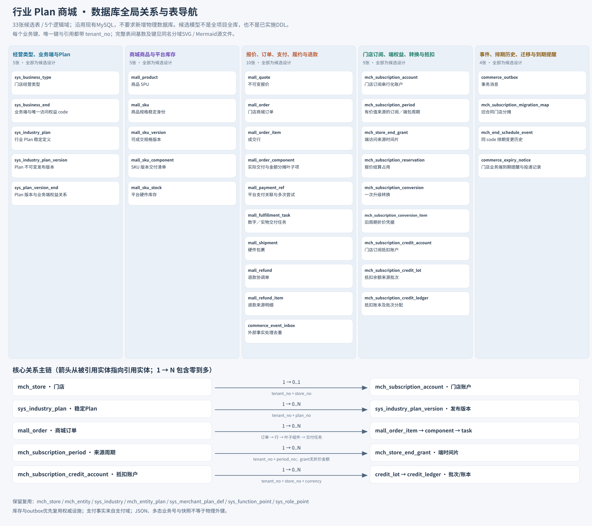
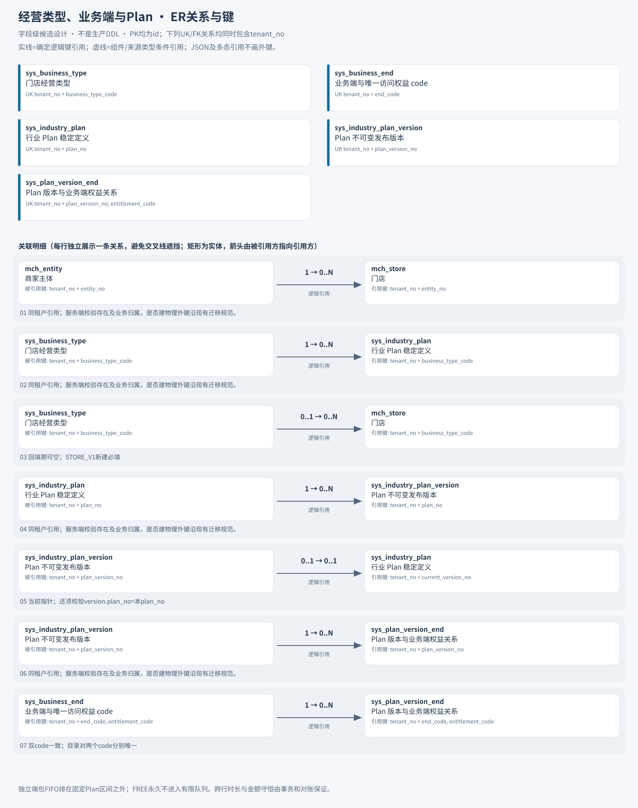
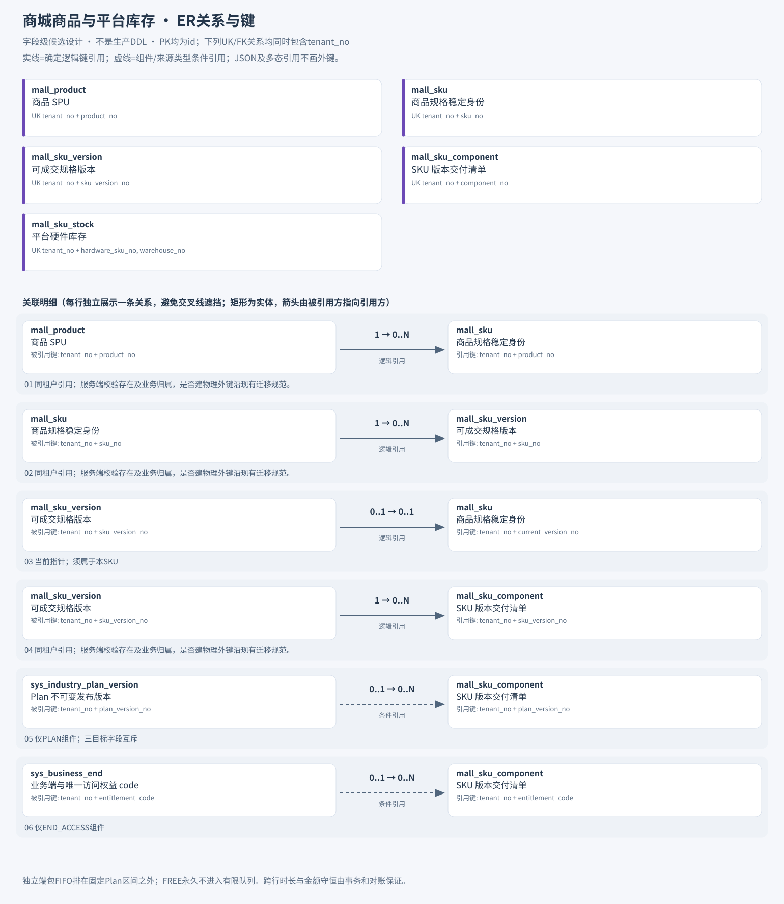
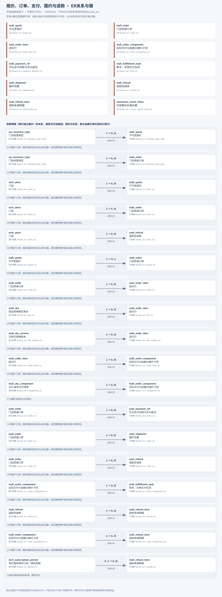
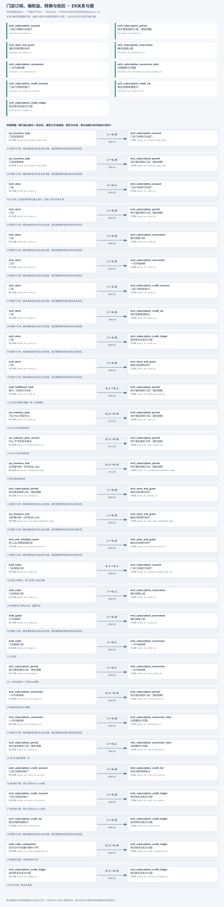
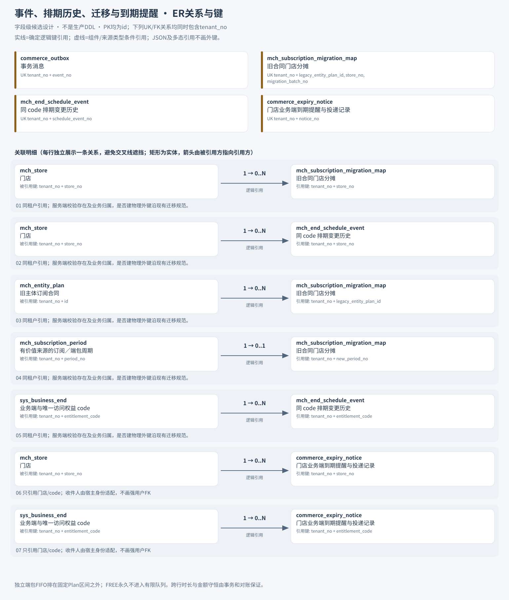

# 门店行业 Plan 商城：数据库与字段字典

日期：2026-11-03。状态：**字段级设计建议，不是现有生产 DDL，不是迁移 SQL，未表示已实施。**

本次范围是注册开店、每店行业 Plan、B 端商城、门店整端访问权益、升级、订阅抵扣和按端到期提醒。**这是本模块的完整候选表清单，不是全项目全数据库清单。** 沿用现有 MySQL；逻辑域表示职责边界，不要求按域分库，物理实例、库名与数据源继续沿现有部署配置。账号、支付、门店消费者库存、消费者卡券/储值和全量 RBAC 表不在这份新增字段字典中。

覆盖：**33 张候选表、357 个业务字段、逐表展开后 621 个字段**（每表展开 8 个通用字段）；其中30张新建候选、3项设施优先复用；另列 7 张既有保留表的职责和门店新增字段。

## 数据库 / 表清单

| 逻辑域 | 表名 | 中文名 | 用途 | 新建或复用候选 |
|---|---|---|---|---|
| 经营类型、业务端与Plan | [`sys_business_type`](#table-sys-business-type) | 门店经营类型 | 为每店选经营类型并串行发布本行业三档目录 | 新建候选 |
| 经营类型、业务端与Plan | [`sys_business_end`](#table-sys-business-end) | 业务端与唯一访问权益 code | 登记整端身份、唯一权益码、适用范围与可信验收/路由引用 | 新建候选 |
| 经营类型、业务端与Plan | [`sys_industry_plan`](#table-sys-industry-plan) | 行业 Plan 稳定定义 | 稳定标识每行业FREE/PRO/CHAIN三档Plan | 新建候选 |
| 经营类型、业务端与Plan | [`sys_industry_plan_version`](#table-sys-industry-plan-version) | Plan 不可变发布版本 | 冻结Plan组合及展示的不可变发布版本 | 新建候选 |
| 经营类型、业务端与Plan | [`sys_plan_version_end`](#table-sys-plan-version-end) | Plan 版本与业务端权益关系 | 把Plan版本关联到整个业务端权益组合 | 新建候选 |
| 商城商品与平台库存 | [`mall_product`](#table-mall-product) | 商品 SPU | B端商城SPU图文和经营类型范围 | 新建候选 |
| 商城商品与平台库存 | [`mall_sku`](#table-mall-sku) | 商品规格稳定身份 | 稳定规格身份及当前成交版本指针 | 新建候选 |
| 商城商品与平台库存 | [`mall_sku_version`](#table-mall-sku-version) | 可成交规格版本 | 冻结价格、币种、退款政策和可售版本 | 新建候选 |
| 商城商品与平台库存 | [`mall_sku_component`](#table-mall-sku-component) | SKU 版本交付清单 | 发布时展开的Plan/端包/硬件叶子交付清单和分摊权重 | 新建候选 |
| 商城商品与平台库存 | [`mall_sku_stock`](#table-mall-sku-stock) | 平台硬件库存 | 平台仓硬件库存候选；存在权威库存时复用而不新增第二本账 | 复用权威库存优先；无对应能力才新建候选 |
| 报价、订单、支付、履约与退款 | [`mall_quote`](#table-mall-quote) | 不可变报价 | 锁定服务端报价、Plan折价、抵扣分配和排期预览 | 新建候选 |
| 报价、订单、支付、履约与退款 | [`mall_order`](#table-mall-order) | 门店商城订单 | 一店一单的成交金额及支付/履约/退款状态 | 新建候选 |
| 报价、订单、支付、履约与退款 | [`mall_order_item`](#table-mall-order-item) | 成交行 | 冻结购买SKU行、数量与成交价 | 新建候选 |
| 报价、订单、支付、履约与退款 | [`mall_order_component`](#table-mall-order-component) | 实际交付与金额分摊叶子项 | 记录交付叶子项和唯一成交/现金/抵扣价值分摊 | 新建候选 |
| 报价、订单、支付、履约与退款 | [`mall_payment_ref`](#table-mall-payment-ref) | 平台支付关联与多次尝试 | 对接支付域多次支付尝试并保留平台收款引用 | 新建候选 |
| 报价、订单、支付、履约与退款 | [`mall_fulfillment_task`](#table-mall-fulfillment-task) | 数字／实物交付任务 | 幂等交付任务；全部数字任务成组原子交付 | 新建候选 |
| 报价、订单、支付、履约与退款 | [`mall_shipment`](#table-mall-shipment) | 硬件包裹 | 记录硬件包裹、成交地址与组件发货量 | 新建候选 |
| 报价、订单、支付、履约与退款 | [`mall_refund`](#table-mall-refund) | 退款协调单 | 协调审核、原路退款、抵扣恢复与权益调整 | 新建候选 |
| 报价、订单、支付、履约与退款 | [`mall_refund_item`](#table-mall-refund-item) | 退款来源明细 | 逐成交来源核算部分退款及权益处理 | 新建候选 |
| 报价、订单、支付、履约与退款 | [`commerce_event_inbox`](#table-commerce-event-inbox) | 外部事实处理去重 | 外部支付/退款等事实接入去重及异内容检测 | 复用既有消息去重设施候选；否则新建 |
| 门店订阅、端权益、转换与抵扣 | [`mch_subscription_account`](#table-mch-subscription-account) | 门店订阅串行化账户 | 同店所有数字变更串行锁、结算占用与权益版本容器 | 新建候选 |
| 门店订阅、端权益、转换与抵扣 | [`mch_subscription_period`](#table-mch-subscription-period) | 有价值来源的订阅／端包周期 | Plan、独立端包、FREE和迁移来源的时长/价值唯一父记录 | 新建候选 |
| 门店订阅、端权益、转换与抵扣 | [`mch_store_end_grant`](#table-mch-store-end-grant) | 端访问来源时间片 | 来源在各整端code上的实际访问时间片权威 | 新建候选 |
| 门店订阅、端权益、转换与抵扣 | [`mch_subscription_reservation`](#table-mch-subscription-reservation) | 报价结算占用 | 所有数字订单统一持有结算占用并锁定依赖来源 | 新建候选 |
| 门店订阅、端权益、转换与抵扣 | [`mch_subscription_conversion`](#table-mch-subscription-conversion) | 一次升级转换 | 一次升级的旧Plan价值转换及单一新Plan周期 | 新建候选 |
| 门店订阅、端权益、转换与抵扣 | [`mch_subscription_conversion_item`](#table-mch-subscription-conversion-item) | 旧周期折价凭据 | 旧Plan周期逐项折价与防重复转换凭据 | 新建候选 |
| 门店订阅、端权益、转换与抵扣 | [`mch_subscription_credit_account`](#table-mch-subscription-credit-account) | 门店订阅抵扣账户 | 门店同币种不可提现的订阅抵扣余额与预留汇总 | 新建候选 |
| 门店订阅、端权益、转换与抵扣 | [`mch_subscription_credit_lot`](#table-mch-subscription-credit-lot) | 抵扣余额来源批次 | 记录抵扣价值来源批次及消费谱系 | 新建候选 |
| 门店订阅、端权益、转换与抵扣 | [`mch_subscription_credit_ledger`](#table-mch-subscription-credit-ledger) | 抵扣账本及批次分配 | 不可变抵扣账本，兼任逐批次/组件分配记录 | 新建候选 |
| 事件、排期历史、迁移与到期提醒 | [`commerce_outbox`](#table-commerce-outbox) | 事务消息 | 本地事实同事务消息，驱动提交后失效、通知及对账 | 复用通用outbox优先；否则新建候选 |
| 事件、排期历史、迁移与到期提醒 | [`mch_subscription_migration_map`](#table-mch-subscription-migration-map) | 旧合同门店分摊 | 旧主体合同到门店新周期的分摊证据及切换映射 | 新建候选 |
| 事件、排期历史、迁移与到期提醒 | [`mch_end_schedule_event`](#table-mch-end-schedule-event) | 同 code 排期变更历史 | 逐code排期前后快照、来源已用/未用与时长守恒证据 | 新建候选 |
| 事件、排期历史、迁移与到期提醒 | [`commerce_expiry_notice`](#table-commerce-expiry-notice) | 门店业务端到期提醒与投递记录 | 按门店整端连续覆盖终点、阈值、收件人及通道去重并可靠投递到期提醒 | 新建候选 |

既有表单列如下，只引用本模块有关的关键字段/职责，**不宣称完整覆盖既有表所有列**：

| 逻辑域 | 表名 | 中文名 | 用途 | 新建或复用候选 |
|---|---|---|---|---|
| 既有基础能力 | `mch_store` | 门店 | 保留门店权威；新增产品经营类型与模型切换字段 | 复用并调整候选 |
| 既有基础能力 | `mch_entity` | 商家主体 | 保留主体与资质/进件语义 | 保留复用 |
| 既有基础能力 | `sys_industry` | 进件行业 | 保留通道行业轴，不替代门店产品经营类型 | 保留复用 |
| 既有基础能力 | `mch_entity_plan` | 旧主体订阅合同 | 存量合同兼容及迁移证据，不能当每店新订阅 | 保留并迁移映射 |
| 既有基础能力 | `sys_merchant_plan_def` | 旧主体Plan定义 | 保留存量主体Plan合同定义 | 保留复用 |
| 既有基础能力 | `sys_function_point` | 岗位功能点 | 保留端内RBAC功能权限 | 保留复用 |
| 既有基础能力 | `sys_role_point` | 角色功能点关联 | 保留端内角色授权，不加菜单级商品权益码 | 保留复用 |

登录、客户端、终端注册、支付、退款、审计和库存基础表按既有领域合同复用。此处未逐一列名，也不为这些设施另造权威账或账号池。

## 导航与设计口径

[全局 ER](#er-global) · [分域 ER](#er-domains) · [字段定义口径](#field-conventions) · [既有表与建店初始化](#existing-tables) · [一致性与验收](#validation) · [结构化字段源](schema/industry-plan-mall-dictionary.json)

真源：[数据库设计](门店行业Plan商城-数据库设计.md)、[总体方案](../../superpowers/specs/2026-11-03-industry-plan-mall-design.md)、[API 清单](../../api/门店行业Plan商城-API清单.md)。本字典补足真源未逐项指定的类型、中文名、空值与写入建议；若正式 DDL 不同，以评审后的迁移为准，禁止把本稿当生产结构证明。

<a id="field-conventions"></a>
### 字段定义口径

- 每张候选表均完整展开 `id`、`tenant_no`、`created_at`、`updated_at`、`created_by`、`updated_by`、`version`、`deleted`，不靠“通用字段同上”省略。`id` 由数据库 AUTO_INCREMENT 自增，业务号由 BizKey 等业务编号设施生成；系统审计人写 SYSTEM。仅无引用配置草稿可按归档流程置 deleted=1；已发布或已引用配置用停售/归档状态并仍可查。资金、订单、权益、排期与账本等事实 deleted 恒0，不得物理删除或逻辑隐藏影响历史/对账。
- `id BIGINT AUTO_INCREMENT` 是库内代理主键，不进入客户端 URL 或业务响应；稳定业务号、端 code 和权益 code 为自然键。所有唯一键和逻辑引用均隐含 `tenant_no`，即 `(tenant_no, business_no)`；不能只用业务号连接。这是目标隔离合同；当前 BaseEntity 注释一期恒 MAIN、未开启行级隔离，不能把预留列当作已经实施的完整隔离。抵扣账户按 `(tenant_no, store_no, currency)` 复合引用。
- 类型来自原设计的字段类型与通用约定，未明确项属于补充建议。审计时间建议沿用项目 `V150__merchant_plan.sql` 的 `DATETIME`；业务起止、估值、支付和交付时刻为 `BIGINT` UTC epoch 毫秒。区间统一 `[start_at, end_at)`。
- “可空”与“默认/写入来源”都是字段级设计建议。草稿未发布、任务尚无结果、未审核、未支付等阶段允许对应列为空；正式可售、交付或审核状态必须通过更严格的条件必填校验。`end_at=NULL` 仅表示明确的 FREE 永久资格，未知结果不能用 NULL 冒充永久。
- 金额使用 `BIGINT` 最小货币单位，附 `currency VARCHAR(8)`；不使用浮点、不跨币种换汇。类型推定、建议初值不等于数据库已经存在的 `DEFAULT` 约束。
- 图中为**逻辑键引用**，物理 FK 是否创建依现有迁移规范；虚线为组件/来源类型条件引用。JSON 内容及 `source_ref_no`、`aggregate_no`、`biz_ref_no`、`operation_ref_no`、`result_no` 等多态引用必须按类型核验，不能画成无条件订单外键。
- 业务端目录每端唯一一个商业访问 code；Plan 只包含整端，端内岗位权限继续由原 RBAC 决定。商品上架要求可信验收与路由绑定，平台 SYSTEM 端不可售。

<a id="er-global"></a>
## 全局 ER



[查看全局 SVG](../diagrams/industry-plan-mall-global.svg) · [完整全局 Mermaid ER 源](../diagrams/industry-plan-mall-global.mmd)。全局 SVG 提供 33 表导航与核心关系；完整 68 条逐键关系由 Mermaid 和分域图共同呈现。

<a id="er-domains"></a>
## 分域 ER

SVG 使用原生矢量代码生成，便于缺少 Graphviz 的环境直接打开；Mermaid 与 SVG 使用同一字段字典/关系源。每条分域关系独立展示被引用实体、引用实体、基数和字段，避免交叉线挡住键名。图中省略大部分非键字段，下面字段表才是完整字段清单。

### 经营类型、业务端与Plan



[SVG原图](../diagrams/industry-plan-mall-catalog.svg) · [Mermaid源](../diagrams/industry-plan-mall-catalog.mmd)

[sys_business_type](#table-sys-business-type) · [sys_business_end](#table-sys-business-end) · [sys_industry_plan](#table-sys-industry-plan) · [sys_industry_plan_version](#table-sys-industry-plan-version) · [sys_plan_version_end](#table-sys-plan-version-end)

### 商城商品与平台库存



[SVG原图](../diagrams/industry-plan-mall-merchandise.svg) · [Mermaid源](../diagrams/industry-plan-mall-merchandise.mmd)

[mall_product](#table-mall-product) · [mall_sku](#table-mall-sku) · [mall_sku_version](#table-mall-sku-version) · [mall_sku_component](#table-mall-sku-component) · [mall_sku_stock](#table-mall-sku-stock)

### 报价、订单、支付、履约与退款



[SVG原图](../diagrams/industry-plan-mall-trade.svg) · [Mermaid源](../diagrams/industry-plan-mall-trade.mmd)

[mall_quote](#table-mall-quote) · [mall_order](#table-mall-order) · [mall_order_item](#table-mall-order-item) · [mall_order_component](#table-mall-order-component) · [mall_payment_ref](#table-mall-payment-ref) · [mall_fulfillment_task](#table-mall-fulfillment-task) · [mall_shipment](#table-mall-shipment) · [mall_refund](#table-mall-refund) · [mall_refund_item](#table-mall-refund-item) · [commerce_event_inbox](#table-commerce-event-inbox)

### 门店订阅、端权益、转换与抵扣



[SVG原图](../diagrams/industry-plan-mall-subscription.svg) · [Mermaid源](../diagrams/industry-plan-mall-subscription.mmd)

[mch_subscription_account](#table-mch-subscription-account) · [mch_subscription_period](#table-mch-subscription-period) · [mch_store_end_grant](#table-mch-store-end-grant) · [mch_subscription_reservation](#table-mch-subscription-reservation) · [mch_subscription_conversion](#table-mch-subscription-conversion) · [mch_subscription_conversion_item](#table-mch-subscription-conversion-item) · [mch_subscription_credit_account](#table-mch-subscription-credit-account) · [mch_subscription_credit_lot](#table-mch-subscription-credit-lot) · [mch_subscription_credit_ledger](#table-mch-subscription-credit-ledger)

### 事件、排期历史、迁移与到期提醒



[SVG原图](../diagrams/industry-plan-mall-reliability.svg) · [Mermaid源](../diagrams/industry-plan-mall-reliability.mmd)

[commerce_outbox](#table-commerce-outbox) · [mch_subscription_migration_map](#table-mch-subscription-migration-map) · [mch_end_schedule_event](#table-mch-end-schedule-event) · [commerce_expiry_notice](#table-commerce-expiry-notice)

## 33张候选表完整字段

下列全部行均为字段级设计建议。唯一键按原设计原文保留并统一补租户；普通唯一索引不能表达时间区间互斥、跨行金额和时长守恒。

<a id="table-sys-business-type"></a>
### `sys_business_type` — 门店经营类型

**逻辑域：** 经营类型、业务端与Plan。**用途：** 为每店选经营类型并串行发布本行业三档目录。**状态：** 新建候选。

[原设计 §3.1](门店行业Plan商城-数据库设计.md) · [返回表清单](#数据库--表清单)

| 字段 | 建议类型 | 中文名 | 可空 | 默认 / 写入来源（建议） | 业务说明 |
|---|---|---|---|---|---|
| `id` | `BIGINT` | 代理主键 | 否 | 数据库AUTO_INCREMENT自增；不使用业务号生成器生成id | 库内物理代理主键，不对外、不进URL、不进业务响应；稳定对外身份使用xxx_no业务号 |
| `tenant_no` | `VARCHAR(32)` | 租户号 | 否 | 当前一期MAIN；目标接入按可信服务端租户上下文写入 | 目标合同所有唯一键、逻辑引用和查询均带租户；现有BaseEntity注明一期MAIN且未开启行级隔离，正式接入需验证实现 |
| `created_at` | `DATETIME` | 创建时间 | 否 | 审计拦截器写入服务端UTC时间，无数据库自动默认建议 | 沿用现有审计时间类型；与BIGINT epoch毫秒的业务时间字段区分 |
| `updated_at` | `DATETIME` | 更新时间 | 否 | 审计拦截器在创建及更新时写入服务端UTC时间 | 维护审计时间，不得用它替代成交/付款/交付事实时刻 |
| `created_by` | `VARCHAR(64)` | 创建人业务号 | 是 | 审计填充：认证操作者业务号；系统作业写SYSTEM，兼容存量空值 | 沿用现有BaseEntity审计人约定；不新增账号池，不信任请求体指定审计人 |
| `updated_by` | `VARCHAR(64)` | 更新人业务号 | 是 | 审计填充：认证操作者业务号；系统作业写SYSTEM，兼容存量空值 | 沿用现有BaseEntity审计人约定；不新增账号池，不信任请求体指定审计人 |
| `version` | `BIGINT` | 乐观锁版本 | 否 | 建议初始0，每次更新条件递增 | 通用行并发版本；不能冒充entitlement_version。已发布内容不可改写，状态/投递元数据按合同更新 |
| `deleted` | `TINYINT` | 技术逻辑归档标志 | 否 | 默认0；只有无引用配置草稿可经归档流程置1 | 已发布/已引用配置用停售或归档业务状态并保留可查；订单、支付、权益、排期、迁移证据和账本事实恒0，不得逻辑隐藏影响历史与对账 |
| `business_type_code` | `VARCHAR(32)` | 门店经营类型编码 | 否 | 无数据库默认；服务端业务流程校验后写入 | 产品经营类型，不覆盖sys_industry的通道准入语义 |
| `name` | `VARCHAR(64)` | 名称 | 否 | 无数据库默认；服务端业务流程校验后写入 | 运营配置的展示名称，不作为稳定引用键 |
| `enabled` | `TINYINT` | 启用标志 | 否 | 建议初始0；运营配置/发布校验后写入 | 1启用、0停用；停用不删除已购事实 |
| `sort` | `INT` | 展示顺序 | 否 | 建议初始0；由受控业务事务计算/更新（不是生产DDL默认） | 运营配置；仅影响展示顺序 |
| `plan_catalog_version` | `BIGINT` | Plan目录版本 | 否 | 建议初始0；由受控业务事务计算/更新（不是生产DDL默认） | 行业整体发布成功后递增，保护三档与关联SKU的一致性 |
| `remark` | `VARCHAR(512)` | 备注 | 是 | 建议默认NULL；在对应业务阶段填写 | 配置说明，不承载授权规则 |

**键、约束与业务规则（原设计；均隐含租户）：**

唯一键：`(business_type_code)`。建议种子 RETAIL／FOOD／BEAUTY，不能直接从 `sys_industry` 全量复制。发布某行业 Plan 时锁该行，整体校验三档和关联商品再增加目录版本。

<a id="table-sys-business-end"></a>
### `sys_business_end` — 业务端与唯一访问权益 code

**逻辑域：** 经营类型、业务端与Plan。**用途：** 登记整端身份、唯一权益码、适用范围与可信验收/路由引用。**状态：** 新建候选。

[原设计 §3.2](门店行业Plan商城-数据库设计.md) · [返回表清单](#数据库--表清单)

| 字段 | 建议类型 | 中文名 | 可空 | 默认 / 写入来源（建议） | 业务说明 |
|---|---|---|---|---|---|
| `id` | `BIGINT` | 代理主键 | 否 | 数据库AUTO_INCREMENT自增；不使用业务号生成器生成id | 库内物理代理主键，不对外、不进URL、不进业务响应；稳定对外身份使用xxx_no业务号 |
| `tenant_no` | `VARCHAR(32)` | 租户号 | 否 | 当前一期MAIN；目标接入按可信服务端租户上下文写入 | 目标合同所有唯一键、逻辑引用和查询均带租户；现有BaseEntity注明一期MAIN且未开启行级隔离，正式接入需验证实现 |
| `created_at` | `DATETIME` | 创建时间 | 否 | 审计拦截器写入服务端UTC时间，无数据库自动默认建议 | 沿用现有审计时间类型；与BIGINT epoch毫秒的业务时间字段区分 |
| `updated_at` | `DATETIME` | 更新时间 | 否 | 审计拦截器在创建及更新时写入服务端UTC时间 | 维护审计时间，不得用它替代成交/付款/交付事实时刻 |
| `created_by` | `VARCHAR(64)` | 创建人业务号 | 是 | 审计填充：认证操作者业务号；系统作业写SYSTEM，兼容存量空值 | 沿用现有BaseEntity审计人约定；不新增账号池，不信任请求体指定审计人 |
| `updated_by` | `VARCHAR(64)` | 更新人业务号 | 是 | 审计填充：认证操作者业务号；系统作业写SYSTEM，兼容存量空值 | 沿用现有BaseEntity审计人约定；不新增账号池，不信任请求体指定审计人 |
| `version` | `BIGINT` | 乐观锁版本 | 否 | 建议初始0，每次更新条件递增 | 通用行并发版本；不能冒充entitlement_version。已发布内容不可改写，状态/投递元数据按合同更新 |
| `deleted` | `TINYINT` | 技术逻辑归档标志 | 否 | 默认0；只有无引用配置草稿可经归档流程置1 | 已发布/已引用配置用停售或归档业务状态并保留可查；订单、支付、权益、排期、迁移证据和账本事实恒0，不得逻辑隐藏影响历史与对账 |
| `end_code` | `VARCHAR(64)` | 业务端编码 | 否 | 无数据库默认；服务端业务流程校验后写入 | 应用/工作区的稳定身份；与访问权益code一对一 |
| `entitlement_code` | `VARCHAR(64)` | 整端访问权益编码 | 否 | 无数据库默认；服务端业务流程校验后写入 | 只控制整个业务端；端内岗位操作继续使用现有RBAC |
| `name` | `VARCHAR(64)` | 名称 | 否 | 无数据库默认；服务端业务流程校验后写入 | 运营配置的展示名称，不作为稳定引用键 |
| `scope` | `VARCHAR(16)` | 业务端作用域 | 否 | 无数据库默认；服务端业务流程校验后写入 | STORE门店端、SYSTEM平台内部端；内部端不得作为商家商品 |
| `allowed_business_types` | `JSON` | 适用经营类型集合 | 否 | 无默认；服务端按本表业务场景冻结JSON（可为空的配置按建议NULL） | JSON小型稳定配置集合；发布时逐项核验目录；不是物理外键 |
| `release_status` | `VARCHAR(16)` | 验收状态 | 否 | 无数据库默认；服务端业务流程校验后写入 | PLANNED/VERIFIED/RETIRED；只有有可信验收依据的VERIFIED端可销售 |
| `sale_enabled` | `TINYINT` | 允许销售标志 | 否 | 建议初始0；运营配置/发布校验后写入 | 只有已验收、门店作用域且合规的端可启用销售 |
| `bootstrap_required` | `TINYINT` | 基础入口必保标志 | 否 | 建议初始0；运营配置/发布校验后写入 | 为1时必须被FREE永久包含，防止封死经营台和续费入口 |
| `enabled` | `TINYINT` | 启用标志 | 否 | 建议初始0；运营配置/发布校验后写入 | 1启用、0停用；停用不删除已购事实 |
| `route_policy_ref` | `VARCHAR(128)` | 可信路由策略引用 | 是 | 建议默认NULL；在对应业务阶段填写 | 规划期可空；VERIFIED/可售前必须登记可信路由及验收依据，由服务端校验，不接收运营任意执行代码 |

**键、约束与业务规则（原设计；均隐含租户）：**

唯一键：`(end_code)`、`(entitlement_code)`。本期一业务端恰好一个访问权益 code，两者一对一；保留两个名称以区分应用标识与商业授权标识。`bootstrap_required=1` 的经营台／商城入口不能被 FREE 移除。

`scope=SYSTEM` 不可关联商家可售 SKU；未 VERIFIED 的端不可发布销售。适用类型 JSON 仅为小型稳定配置集合，发布时校验类型存在。route_policy_ref 指向服务端可信路由策略，不是由运营任意填写可执行代码。

<a id="table-sys-industry-plan"></a>
### `sys_industry_plan` — 行业 Plan 稳定定义

**逻辑域：** 经营类型、业务端与Plan。**用途：** 稳定标识每行业FREE/PRO/CHAIN三档Plan。**状态：** 新建候选。

[原设计 §3.3](门店行业Plan商城-数据库设计.md) · [返回表清单](#数据库--表清单)

| 字段 | 建议类型 | 中文名 | 可空 | 默认 / 写入来源（建议） | 业务说明 |
|---|---|---|---|---|---|
| `id` | `BIGINT` | 代理主键 | 否 | 数据库AUTO_INCREMENT自增；不使用业务号生成器生成id | 库内物理代理主键，不对外、不进URL、不进业务响应；稳定对外身份使用xxx_no业务号 |
| `tenant_no` | `VARCHAR(32)` | 租户号 | 否 | 当前一期MAIN；目标接入按可信服务端租户上下文写入 | 目标合同所有唯一键、逻辑引用和查询均带租户；现有BaseEntity注明一期MAIN且未开启行级隔离，正式接入需验证实现 |
| `created_at` | `DATETIME` | 创建时间 | 否 | 审计拦截器写入服务端UTC时间，无数据库自动默认建议 | 沿用现有审计时间类型；与BIGINT epoch毫秒的业务时间字段区分 |
| `updated_at` | `DATETIME` | 更新时间 | 否 | 审计拦截器在创建及更新时写入服务端UTC时间 | 维护审计时间，不得用它替代成交/付款/交付事实时刻 |
| `created_by` | `VARCHAR(64)` | 创建人业务号 | 是 | 审计填充：认证操作者业务号；系统作业写SYSTEM，兼容存量空值 | 沿用现有BaseEntity审计人约定；不新增账号池，不信任请求体指定审计人 |
| `updated_by` | `VARCHAR(64)` | 更新人业务号 | 是 | 审计填充：认证操作者业务号；系统作业写SYSTEM，兼容存量空值 | 沿用现有BaseEntity审计人约定；不新增账号池，不信任请求体指定审计人 |
| `version` | `BIGINT` | 乐观锁版本 | 否 | 建议初始0，每次更新条件递增 | 通用行并发版本；不能冒充entitlement_version。已发布内容不可改写，状态/投递元数据按合同更新 |
| `deleted` | `TINYINT` | 技术逻辑归档标志 | 否 | 默认0；只有无引用配置草稿可经归档流程置1 | 已发布/已引用配置用停售或归档业务状态并保留可查；订单、支付、权益、排期、迁移证据和账本事实恒0，不得逻辑隐藏影响历史与对账 |
| `plan_no` | `VARCHAR(64)` | Plan稳定业务号 | 否 | 无数据库默认；服务端业务流程校验后写入 | 租户内稳定Plan身份；行业与档位归稳定定义所有 |
| `business_type_code` | `VARCHAR(32)` | 门店经营类型编码 | 否 | 无数据库默认；服务端业务流程校验后写入 | 产品经营类型，不覆盖sys_industry的通道准入语义 |
| `tier_code` | `VARCHAR(16)` | Plan档位编码 | 否 | 无数据库默认；服务端业务流程校验后写入 | FREE/PRO/CHAIN；期限SKU不是第四档 |
| `rank` | `INT` | 档位等级 | 否 | 建议初始0；由受控业务事务计算/更新（不是生产DDL默认） | FREE=0、PRO=1、CHAIN=2；升级仅允许升档 |
| `current_version_no` | `VARCHAR(64)` | 当前版本业务号 | 是 | 建议默认NULL；在对应业务阶段填写 | 可空草稿指针；非空必须属于同Plan已发布版本，切换与行业目录版本/SKU关联校验同事务 |
| `sale_status` | `VARCHAR(16)` | 销售状态 | 否 | 无数据库默认；服务端业务流程校验后写入 | 运营发布/停售状态机；停售不撤销已购权益；具体枚举待实施收敛 |
| `sort` | `INT` | 展示顺序 | 否 | 建议初始0；由受控业务事务计算/更新（不是生产DDL默认） | 运营配置；仅影响展示顺序 |

**键、约束与业务规则（原设计；均隐含租户）：**

唯一键：`(plan_no)`、`(business_type_code, tier_code)`、`(business_type_code, rank)`。每行业三个稳定定义；一个定义可有多个历史版本，停售不删除。

<a id="table-sys-industry-plan-version"></a>
### `sys_industry_plan_version` — Plan 不可变发布版本

**逻辑域：** 经营类型、业务端与Plan。**用途：** 冻结Plan组合及展示的不可变发布版本。**状态：** 新建候选。

[原设计 §3.4](门店行业Plan商城-数据库设计.md) · [返回表清单](#数据库--表清单)

| 字段 | 建议类型 | 中文名 | 可空 | 默认 / 写入来源（建议） | 业务说明 |
|---|---|---|---|---|---|
| `id` | `BIGINT` | 代理主键 | 否 | 数据库AUTO_INCREMENT自增；不使用业务号生成器生成id | 库内物理代理主键，不对外、不进URL、不进业务响应；稳定对外身份使用xxx_no业务号 |
| `tenant_no` | `VARCHAR(32)` | 租户号 | 否 | 当前一期MAIN；目标接入按可信服务端租户上下文写入 | 目标合同所有唯一键、逻辑引用和查询均带租户；现有BaseEntity注明一期MAIN且未开启行级隔离，正式接入需验证实现 |
| `created_at` | `DATETIME` | 创建时间 | 否 | 审计拦截器写入服务端UTC时间，无数据库自动默认建议 | 沿用现有审计时间类型；与BIGINT epoch毫秒的业务时间字段区分 |
| `updated_at` | `DATETIME` | 更新时间 | 否 | 审计拦截器在创建及更新时写入服务端UTC时间 | 维护审计时间，不得用它替代成交/付款/交付事实时刻 |
| `created_by` | `VARCHAR(64)` | 创建人业务号 | 是 | 审计填充：认证操作者业务号；系统作业写SYSTEM，兼容存量空值 | 沿用现有BaseEntity审计人约定；不新增账号池，不信任请求体指定审计人 |
| `updated_by` | `VARCHAR(64)` | 更新人业务号 | 是 | 审计填充：认证操作者业务号；系统作业写SYSTEM，兼容存量空值 | 沿用现有BaseEntity审计人约定；不新增账号池，不信任请求体指定审计人 |
| `version` | `BIGINT` | 乐观锁版本 | 否 | 建议初始0，每次更新条件递增 | 通用行并发版本；不能冒充entitlement_version。已发布内容不可改写，状态/投递元数据按合同更新 |
| `deleted` | `TINYINT` | 技术逻辑归档标志 | 否 | 默认0；只有无引用配置草稿可经归档流程置1 | 已发布/已引用配置用停售或归档业务状态并保留可查；订单、支付、权益、排期、迁移证据和账本事实恒0，不得逻辑隐藏影响历史与对账 |
| `plan_version_no` | `VARCHAR(64)` | Plan发布版本号 | 否 | 无数据库默认；服务端业务流程校验后写入 | 引用不可变版本；成交后不能随当前指针漂移 |
| `plan_no` | `VARCHAR(64)` | Plan稳定业务号 | 否 | 无数据库默认；服务端业务流程校验后写入 | 租户内稳定Plan身份；行业与档位归稳定定义所有 |
| `revision` | `INT` | 对象内修订号 | 否 | 无默认；服务端在所属聚合事务中分配正序号 | 同一稳定业务号下递增，发布后不可改写 |
| `display_name` | `VARCHAR(64)` | 版本展示名 | 否 | 无数据库默认；服务端业务流程校验后写入 | 保留发布时名称，订单成交展示冻结版本内容 |
| `summary` | `VARCHAR(512)` | 概要 | 是 | 建议默认NULL；在对应业务阶段填写 | 面向用户的版本摘要 |
| `status` | `VARCHAR(16)` | Plan版本状态 | 否 | 建议初始'DRAFT'；按状态机迁移 | DRAFT/PUBLISHED/ARCHIVED；发布后内容不可变，仅按合同停售/归档 |
| `policy_version` | `VARCHAR(64)` | 策略版本 | 否 | 无数据库默认；服务端业务流程校验后写入 | 记录发布/转换所采用规则，确保后续可重放核对 |
| `published_at` | `BIGINT` | 发布时间 | 是 | 建议默认NULL；在对应业务阶段填写 | 发布事务服务端UTC epoch毫秒；草稿为空 |
| `published_by` | `VARCHAR(64)` | 发布人业务号 | 是 | 建议默认NULL；在对应业务阶段填写 | 来自认证运营用户上下文；草稿未发布时为空 |
| `change_note` | `VARCHAR(1024)` | 版本变更说明 | 是 | 建议默认NULL；在对应业务阶段填写 | 记录本次版本相对前版的变化依据 |

**键、约束与业务规则（原设计；均隐含租户）：**

唯一键：`(plan_version_no)`、`(plan_no, revision)`。Plan 身份、类型和档位可由稳定定义解析，并在订单保存快照；发布后内容不可变。FREE 发布同样有版本，不需要伪造免费支付单。

<a id="table-sys-plan-version-end"></a>
### `sys_plan_version_end` — Plan 版本与业务端权益关系

**逻辑域：** 经营类型、业务端与Plan。**用途：** 把Plan版本关联到整个业务端权益组合。**状态：** 新建候选。

[原设计 §3.5](门店行业Plan商城-数据库设计.md) · [返回表清单](#数据库--表清单)

| 字段 | 建议类型 | 中文名 | 可空 | 默认 / 写入来源（建议） | 业务说明 |
|---|---|---|---|---|---|
| `id` | `BIGINT` | 代理主键 | 否 | 数据库AUTO_INCREMENT自增；不使用业务号生成器生成id | 库内物理代理主键，不对外、不进URL、不进业务响应；稳定对外身份使用xxx_no业务号 |
| `tenant_no` | `VARCHAR(32)` | 租户号 | 否 | 当前一期MAIN；目标接入按可信服务端租户上下文写入 | 目标合同所有唯一键、逻辑引用和查询均带租户；现有BaseEntity注明一期MAIN且未开启行级隔离，正式接入需验证实现 |
| `created_at` | `DATETIME` | 创建时间 | 否 | 审计拦截器写入服务端UTC时间，无数据库自动默认建议 | 沿用现有审计时间类型；与BIGINT epoch毫秒的业务时间字段区分 |
| `updated_at` | `DATETIME` | 更新时间 | 否 | 审计拦截器在创建及更新时写入服务端UTC时间 | 维护审计时间，不得用它替代成交/付款/交付事实时刻 |
| `created_by` | `VARCHAR(64)` | 创建人业务号 | 是 | 审计填充：认证操作者业务号；系统作业写SYSTEM，兼容存量空值 | 沿用现有BaseEntity审计人约定；不新增账号池，不信任请求体指定审计人 |
| `updated_by` | `VARCHAR(64)` | 更新人业务号 | 是 | 审计填充：认证操作者业务号；系统作业写SYSTEM，兼容存量空值 | 沿用现有BaseEntity审计人约定；不新增账号池，不信任请求体指定审计人 |
| `version` | `BIGINT` | 乐观锁版本 | 否 | 建议初始0，每次更新条件递增 | 通用行并发版本；不能冒充entitlement_version。已发布内容不可改写，状态/投递元数据按合同更新 |
| `deleted` | `TINYINT` | 技术逻辑归档标志 | 否 | 默认0；只有无引用配置草稿可经归档流程置1 | 已发布/已引用配置用停售或归档业务状态并保留可查；订单、支付、权益、排期、迁移证据和账本事实恒0，不得逻辑隐藏影响历史与对账 |
| `plan_version_no` | `VARCHAR(64)` | Plan发布版本号 | 否 | 无数据库默认；服务端业务流程校验后写入 | 引用不可变版本；成交后不能随当前指针漂移 |
| `end_code` | `VARCHAR(64)` | 业务端编码 | 否 | 无数据库默认；服务端业务流程校验后写入 | 应用/工作区的稳定身份；与访问权益code一对一 |
| `entitlement_code` | `VARCHAR(64)` | 整端访问权益编码 | 否 | 无数据库默认；服务端业务流程校验后写入 | 只控制整个业务端；端内岗位操作继续使用现有RBAC |
| `sort` | `INT` | 展示顺序 | 否 | 建议初始0；由受控业务事务计算/更新（不是生产DDL默认） | 运营配置；仅影响展示顺序 |

**键、约束与业务规则（原设计；均隐含租户）：**

唯一键：`(plan_version_no, entitlement_code)`。关联整端权益，不关联菜单、按钮、RBAC permission。端 code 与权益 code 必须与端目录一对一关系一致。没有独立的组件价格，价格归商城 SKU。同一 Plan 内重复配置 code 应拒绝；FREE 永久包含的 code 在付费 Plan 中不重复生成有限 grant。

<a id="table-mall-product"></a>
### `mall_product` — 商品 SPU

**逻辑域：** 商城商品与平台库存。**用途：** B端商城SPU图文和经营类型范围。**状态：** 新建候选。

[原设计 §4.1](门店行业Plan商城-数据库设计.md) · [返回表清单](#数据库--表清单)

| 字段 | 建议类型 | 中文名 | 可空 | 默认 / 写入来源（建议） | 业务说明 |
|---|---|---|---|---|---|
| `id` | `BIGINT` | 代理主键 | 否 | 数据库AUTO_INCREMENT自增；不使用业务号生成器生成id | 库内物理代理主键，不对外、不进URL、不进业务响应；稳定对外身份使用xxx_no业务号 |
| `tenant_no` | `VARCHAR(32)` | 租户号 | 否 | 当前一期MAIN；目标接入按可信服务端租户上下文写入 | 目标合同所有唯一键、逻辑引用和查询均带租户；现有BaseEntity注明一期MAIN且未开启行级隔离，正式接入需验证实现 |
| `created_at` | `DATETIME` | 创建时间 | 否 | 审计拦截器写入服务端UTC时间，无数据库自动默认建议 | 沿用现有审计时间类型；与BIGINT epoch毫秒的业务时间字段区分 |
| `updated_at` | `DATETIME` | 更新时间 | 否 | 审计拦截器在创建及更新时写入服务端UTC时间 | 维护审计时间，不得用它替代成交/付款/交付事实时刻 |
| `created_by` | `VARCHAR(64)` | 创建人业务号 | 是 | 审计填充：认证操作者业务号；系统作业写SYSTEM，兼容存量空值 | 沿用现有BaseEntity审计人约定；不新增账号池，不信任请求体指定审计人 |
| `updated_by` | `VARCHAR(64)` | 更新人业务号 | 是 | 审计填充：认证操作者业务号；系统作业写SYSTEM，兼容存量空值 | 沿用现有BaseEntity审计人约定；不新增账号池，不信任请求体指定审计人 |
| `version` | `BIGINT` | 乐观锁版本 | 否 | 建议初始0，每次更新条件递增 | 通用行并发版本；不能冒充entitlement_version。已发布内容不可改写，状态/投递元数据按合同更新 |
| `deleted` | `TINYINT` | 技术逻辑归档标志 | 否 | 默认0；只有无引用配置草稿可经归档流程置1 | 已发布/已引用配置用停售或归档业务状态并保留可查；订单、支付、权益、排期、迁移证据和账本事实恒0，不得逻辑隐藏影响历史与对账 |
| `product_no` | `VARCHAR(64)` | 商品SPU业务号 | 否 | 无数据库默认；项目业务号生成器或经核验的来源业务号 | 租户内商品稳定身份 |
| `category_code` | `VARCHAR(32)` | 商品分类编码 | 否 | 无数据库默认；服务端业务流程校验后写入 | 首期复用平台分类字典，不另建分类树服务 |
| `product_type` | `VARCHAR(16)` | 商品类型 | 否 | 无数据库默认；服务端业务流程校验后写入 | PLAN/END_ACCESS/HARDWARE/BUNDLE |
| `name` | `VARCHAR(128)` | 名称 | 否 | 无数据库默认；服务端业务流程校验后写入 | 运营配置的展示名称，不作为稳定引用键 |
| `description` | `TEXT` | 图文详情 | 是 | 建议默认NULL；在对应业务阶段填写 | 商品展示说明；成交关键内容另冻结到版本与订单 |
| `media` | `JSON` | 商品媒体集合 | 是 | 建议默认NULL；在对应业务阶段填写 | JSON图片/媒体引用集合；不作为交付清单 |
| `allowed_business_types` | `JSON` | 适用经营类型集合 | 否 | 无默认；服务端按本表业务场景冻结JSON（可为空的配置按建议NULL） | JSON小型稳定配置集合；发布时逐项核验目录；不是物理外键 |
| `sale_status` | `VARCHAR(16)` | 销售状态 | 否 | 无数据库默认；服务端业务流程校验后写入 | 运营发布/停售状态机；停售不撤销已购权益；具体枚举待实施收敛 |
| `sort` | `INT` | 展示顺序 | 否 | 建议初始0；由受控业务事务计算/更新（不是生产DDL默认） | 运营配置；仅影响展示顺序 |

**键、约束与业务规则（原设计；均隐含租户）：**

唯一键：`(product_no)`。分类首期可用平台字典，不额外造分类树服务。SPU 图文用于列表；最终成交的关键内容仍冻结到 SKU 版本和订单。

<a id="table-mall-sku"></a>
### `mall_sku` — 商品规格稳定身份

**逻辑域：** 商城商品与平台库存。**用途：** 稳定规格身份及当前成交版本指针。**状态：** 新建候选。

[原设计 §4.2](门店行业Plan商城-数据库设计.md) · [返回表清单](#数据库--表清单)

| 字段 | 建议类型 | 中文名 | 可空 | 默认 / 写入来源（建议） | 业务说明 |
|---|---|---|---|---|---|
| `id` | `BIGINT` | 代理主键 | 否 | 数据库AUTO_INCREMENT自增；不使用业务号生成器生成id | 库内物理代理主键，不对外、不进URL、不进业务响应；稳定对外身份使用xxx_no业务号 |
| `tenant_no` | `VARCHAR(32)` | 租户号 | 否 | 当前一期MAIN；目标接入按可信服务端租户上下文写入 | 目标合同所有唯一键、逻辑引用和查询均带租户；现有BaseEntity注明一期MAIN且未开启行级隔离，正式接入需验证实现 |
| `created_at` | `DATETIME` | 创建时间 | 否 | 审计拦截器写入服务端UTC时间，无数据库自动默认建议 | 沿用现有审计时间类型；与BIGINT epoch毫秒的业务时间字段区分 |
| `updated_at` | `DATETIME` | 更新时间 | 否 | 审计拦截器在创建及更新时写入服务端UTC时间 | 维护审计时间，不得用它替代成交/付款/交付事实时刻 |
| `created_by` | `VARCHAR(64)` | 创建人业务号 | 是 | 审计填充：认证操作者业务号；系统作业写SYSTEM，兼容存量空值 | 沿用现有BaseEntity审计人约定；不新增账号池，不信任请求体指定审计人 |
| `updated_by` | `VARCHAR(64)` | 更新人业务号 | 是 | 审计填充：认证操作者业务号；系统作业写SYSTEM，兼容存量空值 | 沿用现有BaseEntity审计人约定；不新增账号池，不信任请求体指定审计人 |
| `version` | `BIGINT` | 乐观锁版本 | 否 | 建议初始0，每次更新条件递增 | 通用行并发版本；不能冒充entitlement_version。已发布内容不可改写，状态/投递元数据按合同更新 |
| `deleted` | `TINYINT` | 技术逻辑归档标志 | 否 | 默认0；只有无引用配置草稿可经归档流程置1 | 已发布/已引用配置用停售或归档业务状态并保留可查；订单、支付、权益、排期、迁移证据和账本事实恒0，不得逻辑隐藏影响历史与对账 |
| `sku_no` | `VARCHAR(64)` | SKU稳定业务号 | 否 | 无数据库默认；服务端业务流程校验后写入 | 规格身份；同Plan不同期限是不同SKU |
| `product_no` | `VARCHAR(64)` | 商品SPU业务号 | 否 | 无数据库默认；项目业务号生成器或经核验的来源业务号 | 租户内商品稳定身份 |
| `sku_name` | `VARCHAR(128)` | 规格名称 | 否 | 无数据库默认；服务端业务流程校验后写入 | 展示规格及期限，不能替代版本引用 |
| `current_version_no` | `VARCHAR(64)` | 当前版本业务号 | 是 | 建议默认NULL；在对应业务阶段填写 | 可空草稿指针；非空必须属于同SKU已发布版本；改价生成新版本，不能改旧成交内容 |
| `sale_status` | `VARCHAR(16)` | 销售状态 | 否 | 无数据库默认；服务端业务流程校验后写入 | 运营发布/停售状态机；停售不撤销已购权益；具体枚举待实施收敛 |
| `max_per_order` | `INT` | 每单最大数量 | 否 | 无数据库默认；服务端业务流程校验后写入 | 正整数限额，保护数字组件原子交付事务规模 |

**键、约束与业务规则（原设计；均隐含租户）：**

唯一键：`(sku_no)`。同一 Plan 的 30 天和 365 天是两个 SKU；不新增 Plan 档位。

<a id="table-mall-sku-version"></a>
### `mall_sku_version` — 可成交规格版本

**逻辑域：** 商城商品与平台库存。**用途：** 冻结价格、币种、退款政策和可售版本。**状态：** 新建候选。

[原设计 §4.3](门店行业Plan商城-数据库设计.md) · [返回表清单](#数据库--表清单)

| 字段 | 建议类型 | 中文名 | 可空 | 默认 / 写入来源（建议） | 业务说明 |
|---|---|---|---|---|---|
| `id` | `BIGINT` | 代理主键 | 否 | 数据库AUTO_INCREMENT自增；不使用业务号生成器生成id | 库内物理代理主键，不对外、不进URL、不进业务响应；稳定对外身份使用xxx_no业务号 |
| `tenant_no` | `VARCHAR(32)` | 租户号 | 否 | 当前一期MAIN；目标接入按可信服务端租户上下文写入 | 目标合同所有唯一键、逻辑引用和查询均带租户；现有BaseEntity注明一期MAIN且未开启行级隔离，正式接入需验证实现 |
| `created_at` | `DATETIME` | 创建时间 | 否 | 审计拦截器写入服务端UTC时间，无数据库自动默认建议 | 沿用现有审计时间类型；与BIGINT epoch毫秒的业务时间字段区分 |
| `updated_at` | `DATETIME` | 更新时间 | 否 | 审计拦截器在创建及更新时写入服务端UTC时间 | 维护审计时间，不得用它替代成交/付款/交付事实时刻 |
| `created_by` | `VARCHAR(64)` | 创建人业务号 | 是 | 审计填充：认证操作者业务号；系统作业写SYSTEM，兼容存量空值 | 沿用现有BaseEntity审计人约定；不新增账号池，不信任请求体指定审计人 |
| `updated_by` | `VARCHAR(64)` | 更新人业务号 | 是 | 审计填充：认证操作者业务号；系统作业写SYSTEM，兼容存量空值 | 沿用现有BaseEntity审计人约定；不新增账号池，不信任请求体指定审计人 |
| `version` | `BIGINT` | 乐观锁版本 | 否 | 建议初始0，每次更新条件递增 | 通用行并发版本；不能冒充entitlement_version。已发布内容不可改写，状态/投递元数据按合同更新 |
| `deleted` | `TINYINT` | 技术逻辑归档标志 | 否 | 默认0；只有无引用配置草稿可经归档流程置1 | 已发布/已引用配置用停售或归档业务状态并保留可查；订单、支付、权益、排期、迁移证据和账本事实恒0，不得逻辑隐藏影响历史与对账 |
| `sku_version_no` | `VARCHAR(64)` | SKU发布版本号 | 否 | 无数据库默认；服务端业务流程校验后写入 | 价格与交付清单不可变的成交版本 |
| `sku_no` | `VARCHAR(64)` | SKU稳定业务号 | 否 | 无数据库默认；服务端业务流程校验后写入 | 规格身份；同Plan不同期限是不同SKU |
| `revision` | `INT` | 对象内修订号 | 否 | 无默认；服务端在所属聚合事务中分配正序号 | 同一稳定业务号下递增，发布后不可改写 |
| `status` | `VARCHAR(16)` | SKU版本状态 | 否 | 建议初始'DRAFT'；按状态机迁移 | 配置草稿、发布和归档生命周期；正式枚举实施对齐，发布后价格与组件不可原地改写 |
| `currency` | `VARCHAR(8)` | 币种 | 否 | 无默认；从SKU成交版本/来源账户带入并核验同币种 | 市场配置货币编码；所有转换与抵扣必须同币种 |
| `list_price_minor` | `BIGINT` | 划线价最小单位 | 否 | 无数据库默认；服务端业务流程校验后写入 | 非负整数金额，币种由currency确定 |
| `sale_price_minor` | `BIGINT` | 销售价最小单位 | 否 | 无数据库默认；服务端业务流程校验后写入 | 发布成交价，改价新建版本，禁止浮点 |
| `allowed_business_types` | `JSON` | 适用经营类型集合 | 否 | 无默认；服务端按本表业务场景冻结JSON（可为空的配置按建议NULL） | JSON小型稳定配置集合；发布时逐项核验目录；不是物理外键 |
| `refund_policy_snapshot` | `JSON` | 退款政策快照 | 否 | 无默认；服务端按本表业务场景冻结JSON（可为空的配置按建议NULL） | 冻结发布版本适用政策，退款不得读取日后改写的政策 |
| `published_at` | `BIGINT` | 发布时间 | 是 | 建议默认NULL；在对应业务阶段填写 | 发布事务服务端UTC epoch毫秒；草稿为空 |

**键、约束与业务规则（原设计；均隐含租户）：**

唯一键：`(sku_version_no)`、`(sku_no, revision)`。停售不改变版本；改价创建新版本。发布 Plan 时须同时校验推荐 SKU 对应正确的 Plan 版本，切换 current 指针作为同一发布事务，避免详情和实际购买内容不一致。

<a id="table-mall-sku-component"></a>
### `mall_sku_component` — SKU 版本交付清单

**逻辑域：** 商城商品与平台库存。**用途：** 发布时展开的Plan/端包/硬件叶子交付清单和分摊权重。**状态：** 新建候选。

[原设计 §4.4](门店行业Plan商城-数据库设计.md) · [返回表清单](#数据库--表清单)

| 字段 | 建议类型 | 中文名 | 可空 | 默认 / 写入来源（建议） | 业务说明 |
|---|---|---|---|---|---|
| `id` | `BIGINT` | 代理主键 | 否 | 数据库AUTO_INCREMENT自增；不使用业务号生成器生成id | 库内物理代理主键，不对外、不进URL、不进业务响应；稳定对外身份使用xxx_no业务号 |
| `tenant_no` | `VARCHAR(32)` | 租户号 | 否 | 当前一期MAIN；目标接入按可信服务端租户上下文写入 | 目标合同所有唯一键、逻辑引用和查询均带租户；现有BaseEntity注明一期MAIN且未开启行级隔离，正式接入需验证实现 |
| `created_at` | `DATETIME` | 创建时间 | 否 | 审计拦截器写入服务端UTC时间，无数据库自动默认建议 | 沿用现有审计时间类型；与BIGINT epoch毫秒的业务时间字段区分 |
| `updated_at` | `DATETIME` | 更新时间 | 否 | 审计拦截器在创建及更新时写入服务端UTC时间 | 维护审计时间，不得用它替代成交/付款/交付事实时刻 |
| `created_by` | `VARCHAR(64)` | 创建人业务号 | 是 | 审计填充：认证操作者业务号；系统作业写SYSTEM，兼容存量空值 | 沿用现有BaseEntity审计人约定；不新增账号池，不信任请求体指定审计人 |
| `updated_by` | `VARCHAR(64)` | 更新人业务号 | 是 | 审计填充：认证操作者业务号；系统作业写SYSTEM，兼容存量空值 | 沿用现有BaseEntity审计人约定；不新增账号池，不信任请求体指定审计人 |
| `version` | `BIGINT` | 乐观锁版本 | 否 | 建议初始0，每次更新条件递增 | 通用行并发版本；不能冒充entitlement_version。已发布内容不可改写，状态/投递元数据按合同更新 |
| `deleted` | `TINYINT` | 技术逻辑归档标志 | 否 | 默认0；只有无引用配置草稿可经归档流程置1 | 已发布/已引用配置用停售或归档业务状态并保留可查；订单、支付、权益、排期、迁移证据和账本事实恒0，不得逻辑隐藏影响历史与对账 |
| `component_no` | `VARCHAR(64)` | SKU叶子组件业务号 | 否 | 无数据库默认；服务端业务流程校验后写入 | 发布时展开的叶子项；禁止嵌套套餐 |
| `sku_version_no` | `VARCHAR(64)` | SKU发布版本号 | 否 | 无数据库默认；服务端业务流程校验后写入 | 价格与交付清单不可变的成交版本 |
| `component_seq` | `INT` | 版本内组件序号 | 否 | 无默认；服务端在所属聚合事务中分配正序号 | 同SKU版本内唯一；确定分摊尾差补齐顺序 |
| `component_type` | `VARCHAR(16)` | 交付组件类型 | 否 | 无数据库默认；服务端业务流程校验后写入 | PLAN/END_ACCESS/HARDWARE；按类型校验互斥目标字段 |
| `plan_version_no` | `VARCHAR(64)` | Plan发布版本号 | 是 | 建议默认NULL；在对应业务阶段填写 | 引用不可变版本；成交后不能随当前指针漂移 |
| `entitlement_code` | `VARCHAR(64)` | 整端访问权益编码 | 是 | 建议默认NULL；在对应业务阶段填写 | 只控制整个业务端；端内岗位操作继续使用现有RBAC |
| `hardware_sku_no` | `VARCHAR(64)` | 平台硬件规格业务号 | 是 | 建议默认NULL；在对应业务阶段填写 | 引用权威库存域硬件规格合同；不默认指向本候选库存余额表 |
| `period_days` | `INT` | 单份周期天数 | 是 | 建议默认NULL；在对应业务阶段填写 | 数字组件必须正数；硬件为空；按项目约定换算毫秒 |
| `unit_count` | `INT` | 组件份数 | 否 | 无默认；经限额和正整数校验后写入 | 数字为周期份数，硬件为件数，必须在商品说明展示 |
| `allocation_weight` | `BIGINT` | 成交额分摊权重 | 否 | 建议初始0；由受控业务事务计算/更新（不是生产DDL默认） | 非赠送项大于0；赠送项成交分摊为0；固定顺序分配尾差 |
| `is_gift` | `TINYINT` | 赠送标志 | 否 | 建议初始0；运营配置/发布校验后写入 | 赠送周期单独建零基数来源，不能增加折价金额 |
| `activation_policy` | `VARCHAR(24)` | 生效策略 | 否 | 无数据库默认；服务端业务流程校验后写入 | ON_FULFILLMENT/AFTER_PREVIOUS；仍必须服从固定Plan周期与同code统一排期 |

**键、约束与业务规则（原设计；均隐含租户）：**

唯一键：`(component_no)`、`(sku_version_no, component_seq)`。三种目标字段按组件类型互斥且必填；数字组件期限必须正数，硬件不填期限。`unit_count` 对数字表示周期份数，对硬件表示件数，必须在商品说明明确。

一份基础 Plan 商品只能指向一个 Plan 版本；套餐最多一个基础 Plan 家族。禁止嵌套套餐，只保留发布时展开后的叶子组件。非赠送项的分摊权重大于 0；赠送项分摊金额为 0。

<a id="table-mall-sku-stock"></a>
### `mall_sku_stock` — 平台硬件库存

**逻辑域：** 商城商品与平台库存。**用途：** 平台仓硬件库存候选；存在权威库存时复用而不新增第二本账。**状态：** 复用权威库存优先；无对应能力才新建候选。

[原设计 §4.5](门店行业Plan商城-数据库设计.md) · [返回表清单](#数据库--表清单)

| 字段 | 建议类型 | 中文名 | 可空 | 默认 / 写入来源（建议） | 业务说明 |
|---|---|---|---|---|---|
| `id` | `BIGINT` | 代理主键 | 否 | 数据库AUTO_INCREMENT自增；不使用业务号生成器生成id | 库内物理代理主键，不对外、不进URL、不进业务响应；稳定对外身份使用xxx_no业务号 |
| `tenant_no` | `VARCHAR(32)` | 租户号 | 否 | 当前一期MAIN；目标接入按可信服务端租户上下文写入 | 目标合同所有唯一键、逻辑引用和查询均带租户；现有BaseEntity注明一期MAIN且未开启行级隔离，正式接入需验证实现 |
| `created_at` | `DATETIME` | 创建时间 | 否 | 审计拦截器写入服务端UTC时间，无数据库自动默认建议 | 沿用现有审计时间类型；与BIGINT epoch毫秒的业务时间字段区分 |
| `updated_at` | `DATETIME` | 更新时间 | 否 | 审计拦截器在创建及更新时写入服务端UTC时间 | 维护审计时间，不得用它替代成交/付款/交付事实时刻 |
| `created_by` | `VARCHAR(64)` | 创建人业务号 | 是 | 审计填充：认证操作者业务号；系统作业写SYSTEM，兼容存量空值 | 沿用现有BaseEntity审计人约定；不新增账号池，不信任请求体指定审计人 |
| `updated_by` | `VARCHAR(64)` | 更新人业务号 | 是 | 审计填充：认证操作者业务号；系统作业写SYSTEM，兼容存量空值 | 沿用现有BaseEntity审计人约定；不新增账号池，不信任请求体指定审计人 |
| `version` | `BIGINT` | 乐观锁版本 | 否 | 建议初始0，每次更新条件递增 | 通用行并发版本；不能冒充entitlement_version。已发布内容不可改写，状态/投递元数据按合同更新 |
| `deleted` | `TINYINT` | 技术逻辑归档标志 | 否 | 默认0；只有无引用配置草稿可经归档流程置1 | 已发布/已引用配置用停售或归档业务状态并保留可查；订单、支付、权益、排期、迁移证据和账本事实恒0，不得逻辑隐藏影响历史与对账 |
| `hardware_sku_no` | `VARCHAR(64)` | 平台硬件规格业务号 | 否 | 无数据库默认；服务端业务流程校验后写入 | 引用权威库存域硬件规格合同；不默认指向本候选库存余额表 |
| `warehouse_no` | `VARCHAR(64)` | 平台仓业务号 | 否 | 无数据库默认；服务端业务流程校验后写入 | 权威库存域平台仓身份，不能混用门店向消费者售货的库存 |
| `on_hand_qty` | `BIGINT` | 在库件数 | 否 | 建议初始0；由受控业务事务计算/更新（不是生产DDL默认） | 权威库存接口/库存事务维护；非负整数 |
| `reserved_qty` | `BIGINT` | 库存预留件数 | 否 | 建议初始0；由受控业务事务计算/更新（不是生产DDL默认） | 0≤reserved_qty≤on_hand_qty；不能脱离权威库存另立账 |

**键、约束与业务规则（原设计；均隐含租户）：**

唯一键：`(hardware_sku_no, warehouse_no)`；约束 `0 <= reserved_qty <= on_hand_qty`。平台商城库存与门店对消费者销售的库存不是同一库存主体，优先复用库存域合同，以平台仓身份操作；若已有对应权威库存表，正式实现删除本候选表，不建立第二本库存账。

<a id="table-mall-quote"></a>
### `mall_quote` — 不可变报价

**逻辑域：** 报价、订单、支付、履约与退款。**用途：** 锁定服务端报价、Plan折价、抵扣分配和排期预览。**状态：** 新建候选。

[原设计 §5.1](门店行业Plan商城-数据库设计.md) · [返回表清单](#数据库--表清单)

| 字段 | 建议类型 | 中文名 | 可空 | 默认 / 写入来源（建议） | 业务说明 |
|---|---|---|---|---|---|
| `id` | `BIGINT` | 代理主键 | 否 | 数据库AUTO_INCREMENT自增；不使用业务号生成器生成id | 库内物理代理主键，不对外、不进URL、不进业务响应；稳定对外身份使用xxx_no业务号 |
| `tenant_no` | `VARCHAR(32)` | 租户号 | 否 | 当前一期MAIN；目标接入按可信服务端租户上下文写入 | 目标合同所有唯一键、逻辑引用和查询均带租户；现有BaseEntity注明一期MAIN且未开启行级隔离，正式接入需验证实现 |
| `created_at` | `DATETIME` | 创建时间 | 否 | 审计拦截器写入服务端UTC时间，无数据库自动默认建议 | 沿用现有审计时间类型；与BIGINT epoch毫秒的业务时间字段区分 |
| `updated_at` | `DATETIME` | 更新时间 | 否 | 审计拦截器在创建及更新时写入服务端UTC时间 | 维护审计时间，不得用它替代成交/付款/交付事实时刻 |
| `created_by` | `VARCHAR(64)` | 创建人业务号 | 是 | 审计填充：认证操作者业务号；系统作业写SYSTEM，兼容存量空值 | 沿用现有BaseEntity审计人约定；不新增账号池，不信任请求体指定审计人 |
| `updated_by` | `VARCHAR(64)` | 更新人业务号 | 是 | 审计填充：认证操作者业务号；系统作业写SYSTEM，兼容存量空值 | 沿用现有BaseEntity审计人约定；不新增账号池，不信任请求体指定审计人 |
| `version` | `BIGINT` | 乐观锁版本 | 否 | 建议初始0，每次更新条件递增 | 通用行并发版本；不能冒充entitlement_version。已发布内容不可改写，状态/投递元数据按合同更新 |
| `deleted` | `TINYINT` | 技术逻辑归档标志 | 否 | 默认0；只有无引用配置草稿可经归档流程置1 | 已发布/已引用配置用停售或归档业务状态并保留可查；订单、支付、权益、排期、迁移证据和账本事实恒0，不得逻辑隐藏影响历史与对账 |
| `quote_no` | `VARCHAR(64)` | 报价业务号 | 否 | 无数据库默认；服务端业务流程校验后写入 | 冻结服务端报价输入、金额、策略与排期预览 |
| `store_no` | `VARCHAR(64)` | 门店业务号 | 否 | 无默认；从可信登录/门店归属上下文解析并校验 | 来自已认证门店上下文，引用与查询必须同时带tenant_no |
| `entity_no` | `VARCHAR(64)` | 商家主体业务号 | 否 | 无默认；从可信登录/门店归属上下文解析并校验 | 服务端从门店归属解析并核验；不得由请求任意切换主体 |
| `buyer_user_no` | `VARCHAR(64)` | 采购用户业务号 | 否 | 无默认；从可信登录/门店归属上下文解析并校验 | 来自账号会话且通过该店采购RBAC校验 |
| `intent` | `VARCHAR(16)` | 购买意图 | 否 | 无数据库默认；服务端业务流程校验后写入 | PURCHASE/RENEW/UPGRADE；升级不能用普通购买覆盖旧Plan |
| `business_type_code` | `VARCHAR(32)` | 门店经营类型编码 | 否 | 无数据库默认；服务端业务流程校验后写入 | 产品经营类型，不覆盖sys_industry的通道准入语义 |
| `currency` | `VARCHAR(8)` | 币种 | 否 | 无默认；从SKU成交版本/来源账户带入并核验同币种 | 市场配置货币编码；所有转换与抵扣必须同币种 |
| `valuation_at` | `BIGINT` | 报价估值时刻 | 否 | 无数据库默认；服务端业务流程校验后写入 | 统一服务端切点，锁定旧Plan剩余价值；不是最终交付生效时刻 |
| `expires_at` | `BIGINT` | 截止/失效时刻 | 否 | 无默认；服务端按报价策略计算，建议报价有效15分钟 | 报价有效截止毫秒，过期必须重报并确认金额；15分钟是待评审默认参数 |
| `account_version` | `BIGINT` | 报价权益版本 | 否 | 无数据库默认；服务端业务流程校验后写入 | 取订阅账户entitlement_version，不能取通用version |
| `credit_account_version` | `BIGINT` | 报价余额账户版本 | 否 | 无数据库默认；服务端业务流程校验后写入 | 取同店同币种抵扣账户的version；无余额账户时建议先建零账户再报价 |
| `pricing_policy_version` | `VARCHAR(64)` | 定价策略版本 | 否 | 无数据库默认；服务端业务流程校验后写入 | 冻结金额、折价、分摊算法版本 |
| `stacking_policy_version` | `VARCHAR(64)` | 累计排期策略版本 | 否 | 建议固定写入'END_CODE_ACCUMULATE_V1' | END_CODE_ACCUMULATE_V1；同店同code有限来源总时长累计 |
| `request_hash` | `VARCHAR(128)` | 规范化请求摘要 | 否 | 无数据库默认；服务端业务流程校验后写入 | 服务端生成，用于幂等键同参核验；不可泄露敏感原文 |
| `line_snapshot` | `JSON` | 逐行逐组件报价快照 | 否 | 无默认；服务端按本表业务场景冻结JSON（可为空的配置按建议NULL） | 含Plan可抵扣上限creditEligibleMinor、逐周期现金/抵扣分摊、历史批次消费顺序 |
| `conversion_snapshot` | `JSON` | 旧Plan折价快照 | 否 | 无默认；服务端按本表业务场景冻结JSON（可为空的配置按建议NULL） | 逐旧周期的基数、原时长、剩余时长与向下取整结果；端包不折价 |
| `schedule_preview_snapshot` | `JSON` | 累计排期预览快照 | 否 | 无默认；服务端按本表业务场景冻结JSON（可为空的配置按建议NULL） | 逐code原到期、新时长、预计到期和受影响来源；首购标明estimated，不作为准入权威 |
| `price_minor` | `BIGINT` | 整单报价成交额 | 否 | 无数据库默认；服务端业务流程校验后写入 | 服务端定价；混合套餐的抵扣上限另以Plan叶子项成交额计算 |
| `new_conversion_minor` | `BIGINT` | 本次旧Plan转换价值 | 否 | 建议初始0；由受控业务事务计算/更新（不是生产DDL默认） | 逐周期折价之和；新购/普通续费为0；独立端包为0 |
| `credit_used_minor` | `BIGINT` | 本单订阅抵扣额 | 否 | 建议初始0；由受控业务事务计算/更新（不是生产DDL默认） | 不得超过Plan组件折后成交额，端包/硬件不可抵扣 |
| `cash_due_minor` | `BIGINT` | 现金应付额 | 否 | 无数据库默认；服务端业务流程校验后写入 | 成交额减订阅抵扣额；不得为负，零元单走同一履约流程 |
| `status` | `VARCHAR(16)` | 报价状态 | 否 | 建议初始'OPEN'；按状态机迁移 | OPEN/CONSUMED/EXPIRED；报价被唯一订单消费或过期后不能另建新单 |

**键、约束与业务规则（原设计；均隐含租户）：**

唯一键：`(quote_no)`；索引 `(store_no, created_at)`、`(status, expires_at)`。JSON 用于冻结报价输入与逐来源明细，不作为权益可用性的权威查询表。

line_snapshot 必须包含逐组件成交额、`creditEligibleMinor`（仅 Plan 组件折后额）、逐周期现金／抵扣分摊、历史批次消费顺序；报价中 `credit_used_minor <= creditEligibleMinor`，不能用整单金额作为混合套餐的抵扣上限。

schedule_preview_snapshot 按 code 返回原合计到期日、新增时长、预计合计到期日和受影响来源；首购起点随实际交付时刻确定，预览必须标明 estimated。订单沿 quote_no 冻结累计规则与预览，最终交付时间片另记权威版本。

account_version 明确取门店账户的 entitlement_version，而非占用写入也会变化的通用 version；创建占用不改变权益版本。报价创建检查该版本，交付时校验占用及关联来源，避免自己的占用更新被误判为外部权益变更。

<a id="table-mall-order"></a>
### `mall_order` — 门店商城订单

**逻辑域：** 报价、订单、支付、履约与退款。**用途：** 一店一单的成交金额及支付/履约/退款状态。**状态：** 新建候选。

[原设计 §5.2](门店行业Plan商城-数据库设计.md) · [返回表清单](#数据库--表清单)

| 字段 | 建议类型 | 中文名 | 可空 | 默认 / 写入来源（建议） | 业务说明 |
|---|---|---|---|---|---|
| `id` | `BIGINT` | 代理主键 | 否 | 数据库AUTO_INCREMENT自增；不使用业务号生成器生成id | 库内物理代理主键，不对外、不进URL、不进业务响应；稳定对外身份使用xxx_no业务号 |
| `tenant_no` | `VARCHAR(32)` | 租户号 | 否 | 当前一期MAIN；目标接入按可信服务端租户上下文写入 | 目标合同所有唯一键、逻辑引用和查询均带租户；现有BaseEntity注明一期MAIN且未开启行级隔离，正式接入需验证实现 |
| `created_at` | `DATETIME` | 创建时间 | 否 | 审计拦截器写入服务端UTC时间，无数据库自动默认建议 | 沿用现有审计时间类型；与BIGINT epoch毫秒的业务时间字段区分 |
| `updated_at` | `DATETIME` | 更新时间 | 否 | 审计拦截器在创建及更新时写入服务端UTC时间 | 维护审计时间，不得用它替代成交/付款/交付事实时刻 |
| `created_by` | `VARCHAR(64)` | 创建人业务号 | 是 | 审计填充：认证操作者业务号；系统作业写SYSTEM，兼容存量空值 | 沿用现有BaseEntity审计人约定；不新增账号池，不信任请求体指定审计人 |
| `updated_by` | `VARCHAR(64)` | 更新人业务号 | 是 | 审计填充：认证操作者业务号；系统作业写SYSTEM，兼容存量空值 | 沿用现有BaseEntity审计人约定；不新增账号池，不信任请求体指定审计人 |
| `version` | `BIGINT` | 乐观锁版本 | 否 | 建议初始0，每次更新条件递增 | 通用行并发版本；不能冒充entitlement_version。已发布内容不可改写，状态/投递元数据按合同更新 |
| `deleted` | `TINYINT` | 技术逻辑归档标志 | 否 | 默认0；只有无引用配置草稿可经归档流程置1 | 已发布/已引用配置用停售或归档业务状态并保留可查；订单、支付、权益、排期、迁移证据和账本事实恒0，不得逻辑隐藏影响历史与对账 |
| `order_no` | `VARCHAR(64)` | 商城订单业务号 | 否 | 无数据库默认；服务端业务流程校验后写入 | 一单绑定一个门店，支付与交付状态独立记录 |
| `store_no` | `VARCHAR(64)` | 门店业务号 | 否 | 无默认；从可信登录/门店归属上下文解析并校验 | 来自已认证门店上下文，引用与查询必须同时带tenant_no |
| `entity_no` | `VARCHAR(64)` | 商家主体业务号 | 否 | 无默认；从可信登录/门店归属上下文解析并校验 | 服务端从门店归属解析并核验；不得由请求任意切换主体 |
| `buyer_user_no` | `VARCHAR(64)` | 采购用户业务号 | 否 | 无默认；从可信登录/门店归属上下文解析并校验 | 来自账号会话且通过该店采购RBAC校验 |
| `business_type_code` | `VARCHAR(32)` | 门店经营类型编码 | 否 | 无数据库默认；服务端业务流程校验后写入 | 产品经营类型，不覆盖sys_industry的通道准入语义 |
| `quote_no` | `VARCHAR(64)` | 报价业务号 | 否 | 无数据库默认；服务端业务流程校验后写入 | 冻结服务端报价输入、金额、策略与排期预览 |
| `intent` | `VARCHAR(32)` | 购买意图 | 否 | 无数据库默认；服务端业务流程校验后写入 | PURCHASE/RENEW/UPGRADE；升级不能用普通购买覆盖旧Plan |
| `currency` | `VARCHAR(8)` | 币种 | 否 | 无默认；从SKU成交版本/来源账户带入并核验同币种 | 市场配置货币编码；所有转换与抵扣必须同币种 |
| `gross_minor` | `BIGINT` | 优惠前金额 | 否 | 无数据库默认；服务端业务流程校验后写入 | 数量乘单价的整数合计；行金额合计必须等于订单 |
| `discount_minor` | `BIGINT` | 优惠减免额 | 否 | 建议初始0；由受控业务事务计算/更新（不是生产DDL默认） | 不包含订阅抵扣；优惠不能成为可折价基数 |
| `deal_minor` | `BIGINT` | 折后成交额 | 否 | 无数据库默认；服务端业务流程校验后写入 | gross_minor-discount_minor；等于订阅抵扣加现金应付 |
| `credit_used_minor` | `BIGINT` | 本单订阅抵扣额 | 否 | 建议初始0；由受控业务事务计算/更新（不是生产DDL默认） | 不得超过Plan组件折后成交额，端包/硬件不可抵扣 |
| `cash_due_minor` | `BIGINT` | 现金应付额 | 否 | 无数据库默认；服务端业务流程校验后写入 | 成交额减订阅抵扣额；不得为负，零元单走同一履约流程 |
| `cash_paid_minor` | `BIGINT` | 确认现金实付额 | 否 | 建议初始0；由受控业务事务计算/更新（不是生产DDL默认） | 来自支付域可信成功事实，不接受客户端paid标志 |
| `cash_refunded_minor` | `BIGINT` | 已现金退款额 | 否 | 建议初始0；由受控业务事务计算/更新（不是生产DDL默认） | 来自支付域退款事实；不超过现金实付 |
| `pay_status` | `VARCHAR(16)` | 支付状态 | 否 | 无数据库默认；服务端业务流程校验后写入 | 只由可信支付事实/零元结算驱动，不能用交付状态推断成功 |
| `fulfillment_status` | `VARCHAR(16)` | 履约状态 | 否 | 无数据库默认；服务端业务流程校验后写入 | 反映该层订单/组件交付结果；硬件未发可为PARTIAL |
| `refund_status` | `VARCHAR(24)` | 退款汇总状态 | 否 | 无数据库默认；服务端业务流程校验后写入 | 由退款协调事实汇总，不替代原退款单状态 |
| `pay_deadline` | `BIGINT` | 付款截止时刻 | 否 | 无数据库默认；服务端业务流程校验后写入 | 服务端写入；到期只有查明无成功且支付关闭才释放数字占用 |
| `paid_at` | `BIGINT` | 支付确认时刻 | 是 | 建议默认NULL；在对应业务阶段填写 | 无成功支付事实为空；零元结算按既定零元状态合同处理，不伪造渠道时间 |
| `closed_at` | `BIGINT` | 订单关闭时刻 | 是 | 建议默认NULL；在对应业务阶段填写 | 关闭终态后写入，正常未关闭为空 |
| `idempotency_key` | `VARCHAR(128)` | 幂等键 | 否 | 无数据库默认；服务端业务流程校验后写入 | 来自Idempotency-Key；同键异参冲突，不重复创建资金/权益事实 |
| `request_hash` | `VARCHAR(128)` | 规范化请求摘要 | 否 | 无数据库默认；服务端业务流程校验后写入 | 服务端生成，用于幂等键同参核验；不可泄露敏感原文 |

**键、约束与业务规则（原设计；均隐含租户）：**

唯一键：`(order_no)`、`(quote_no)`、`(buyer_user_no, idempotency_key)`。索引 `(store_no, created_at, id)`、`(pay_status, pay_deadline)`。

守恒：`deal = gross - discount = credit_used + cash_due`；`0 <= cash_refunded <= cash_paid <= cash_due`（多付渠道异常进退款处理，不改成交额）。当前门店不得通过请求体换到其他主体；用户级幂等键重复且参数不同返回冲突。

<a id="table-mall-order-item"></a>
### `mall_order_item` — 成交行

**逻辑域：** 报价、订单、支付、履约与退款。**用途：** 冻结购买SKU行、数量与成交价。**状态：** 新建候选。

[原设计 §5.3](门店行业Plan商城-数据库设计.md) · [返回表清单](#数据库--表清单)

| 字段 | 建议类型 | 中文名 | 可空 | 默认 / 写入来源（建议） | 业务说明 |
|---|---|---|---|---|---|
| `id` | `BIGINT` | 代理主键 | 否 | 数据库AUTO_INCREMENT自增；不使用业务号生成器生成id | 库内物理代理主键，不对外、不进URL、不进业务响应；稳定对外身份使用xxx_no业务号 |
| `tenant_no` | `VARCHAR(32)` | 租户号 | 否 | 当前一期MAIN；目标接入按可信服务端租户上下文写入 | 目标合同所有唯一键、逻辑引用和查询均带租户；现有BaseEntity注明一期MAIN且未开启行级隔离，正式接入需验证实现 |
| `created_at` | `DATETIME` | 创建时间 | 否 | 审计拦截器写入服务端UTC时间，无数据库自动默认建议 | 沿用现有审计时间类型；与BIGINT epoch毫秒的业务时间字段区分 |
| `updated_at` | `DATETIME` | 更新时间 | 否 | 审计拦截器在创建及更新时写入服务端UTC时间 | 维护审计时间，不得用它替代成交/付款/交付事实时刻 |
| `created_by` | `VARCHAR(64)` | 创建人业务号 | 是 | 审计填充：认证操作者业务号；系统作业写SYSTEM，兼容存量空值 | 沿用现有BaseEntity审计人约定；不新增账号池，不信任请求体指定审计人 |
| `updated_by` | `VARCHAR(64)` | 更新人业务号 | 是 | 审计填充：认证操作者业务号；系统作业写SYSTEM，兼容存量空值 | 沿用现有BaseEntity审计人约定；不新增账号池，不信任请求体指定审计人 |
| `version` | `BIGINT` | 乐观锁版本 | 否 | 建议初始0，每次更新条件递增 | 通用行并发版本；不能冒充entitlement_version。已发布内容不可改写，状态/投递元数据按合同更新 |
| `deleted` | `TINYINT` | 技术逻辑归档标志 | 否 | 默认0；只有无引用配置草稿可经归档流程置1 | 已发布/已引用配置用停售或归档业务状态并保留可查；订单、支付、权益、排期、迁移证据和账本事实恒0，不得逻辑隐藏影响历史与对账 |
| `order_item_no` | `VARCHAR(64)` | 成交行业务号 | 否 | 无数据库默认；服务端业务流程校验后写入 | 引用订单下某SKU的成交行 |
| `order_no` | `VARCHAR(64)` | 商城订单业务号 | 否 | 无数据库默认；服务端业务流程校验后写入 | 一单绑定一个门店，支付与交付状态独立记录 |
| `sku_no` | `VARCHAR(64)` | SKU稳定业务号 | 否 | 无数据库默认；服务端业务流程校验后写入 | 规格身份；同Plan不同期限是不同SKU |
| `sku_version_no` | `VARCHAR(64)` | SKU发布版本号 | 否 | 无数据库默认；服务端业务流程校验后写入 | 价格与交付清单不可变的成交版本 |
| `quantity` | `INT` | 购买/退款数量 | 否 | 无默认；经限额和正整数校验后写入 | 正整数；退款累计数量与金额不得超过来源可退份额 |
| `unit_price_minor` | `BIGINT` | 成交单价 | 否 | 无数据库默认；服务端业务流程校验后写入 | 冻结SKU当时成交单价，不读取后续新价格 |
| `gross_minor` | `BIGINT` | 优惠前金额 | 否 | 无数据库默认；服务端业务流程校验后写入 | 数量乘单价的整数合计；行金额合计必须等于订单 |
| `discount_minor` | `BIGINT` | 优惠减免额 | 否 | 建议初始0；由受控业务事务计算/更新（不是生产DDL默认） | 不包含订阅抵扣；优惠不能成为可折价基数 |
| `deal_minor` | `BIGINT` | 折后成交额 | 否 | 无数据库默认；服务端业务流程校验后写入 | gross_minor-discount_minor；等于订阅抵扣加现金应付 |
| `sku_snapshot` | `JSON` | 规格成交快照 | 否 | 无默认；服务端按本表业务场景冻结JSON（可为空的配置按建议NULL） | 名称、价格、期限、适用范围及退款要点；不是可变商品详情 |

**键、约束与业务规则（原设计；均隐含租户）：**

唯一键：`(order_item_no)`。各行金额合计等于订单。

<a id="table-mall-order-component"></a>
### `mall_order_component` — 实际交付与金额分摊叶子项

**逻辑域：** 报价、订单、支付、履约与退款。**用途：** 记录交付叶子项和唯一成交/现金/抵扣价值分摊。**状态：** 新建候选。

[原设计 §5.4](门店行业Plan商城-数据库设计.md) · [返回表清单](#数据库--表清单)

| 字段 | 建议类型 | 中文名 | 可空 | 默认 / 写入来源（建议） | 业务说明 |
|---|---|---|---|---|---|
| `id` | `BIGINT` | 代理主键 | 否 | 数据库AUTO_INCREMENT自增；不使用业务号生成器生成id | 库内物理代理主键，不对外、不进URL、不进业务响应；稳定对外身份使用xxx_no业务号 |
| `tenant_no` | `VARCHAR(32)` | 租户号 | 否 | 当前一期MAIN；目标接入按可信服务端租户上下文写入 | 目标合同所有唯一键、逻辑引用和查询均带租户；现有BaseEntity注明一期MAIN且未开启行级隔离，正式接入需验证实现 |
| `created_at` | `DATETIME` | 创建时间 | 否 | 审计拦截器写入服务端UTC时间，无数据库自动默认建议 | 沿用现有审计时间类型；与BIGINT epoch毫秒的业务时间字段区分 |
| `updated_at` | `DATETIME` | 更新时间 | 否 | 审计拦截器在创建及更新时写入服务端UTC时间 | 维护审计时间，不得用它替代成交/付款/交付事实时刻 |
| `created_by` | `VARCHAR(64)` | 创建人业务号 | 是 | 审计填充：认证操作者业务号；系统作业写SYSTEM，兼容存量空值 | 沿用现有BaseEntity审计人约定；不新增账号池，不信任请求体指定审计人 |
| `updated_by` | `VARCHAR(64)` | 更新人业务号 | 是 | 审计填充：认证操作者业务号；系统作业写SYSTEM，兼容存量空值 | 沿用现有BaseEntity审计人约定；不新增账号池，不信任请求体指定审计人 |
| `version` | `BIGINT` | 乐观锁版本 | 否 | 建议初始0，每次更新条件递增 | 通用行并发版本；不能冒充entitlement_version。已发布内容不可改写，状态/投递元数据按合同更新 |
| `deleted` | `TINYINT` | 技术逻辑归档标志 | 否 | 默认0；只有无引用配置草稿可经归档流程置1 | 已发布/已引用配置用停售或归档业务状态并保留可查；订单、支付、权益、排期、迁移证据和账本事实恒0，不得逻辑隐藏影响历史与对账 |
| `order_component_no` | `VARCHAR(64)` | 成交叶子组件号 | 否 | 无数据库默认；服务端业务流程校验后写入 | 实际交付、金额分摊与退款核算的叶子来源 |
| `order_item_no` | `VARCHAR(64)` | 成交行业务号 | 否 | 无数据库默认；服务端业务流程校验后写入 | 引用订单下某SKU的成交行 |
| `component_no` | `VARCHAR(64)` | SKU叶子组件业务号 | 否 | 无数据库默认；服务端业务流程校验后写入 | 发布时展开的叶子项；禁止嵌套套餐 |
| `component_type` | `VARCHAR(32)` | 交付组件类型 | 否 | 无数据库默认；服务端业务流程校验后写入 | PLAN/END_ACCESS/HARDWARE；按类型校验互斥目标字段 |
| `target_snapshot` | `JSON` | 交付目标快照 | 否 | 无默认；服务端按本表业务场景冻结JSON（可为空的配置按建议NULL） | 冻结Plan版本/独立端code/硬件规格及期限；JSON中目标按组件类型校验，不是强FK |
| `unit_count` | `INT` | 组件份数 | 否 | 无默认；经限额和正整数校验后写入 | 数字为周期份数，硬件为件数，必须在商品说明展示 |
| `allocated_deal_minor` | `BIGINT` | 组件成交分摊额 | 否 | 无数据库默认；服务端业务流程校验后写入 | 叶子项之和等于成交行折后金额 |
| `allocated_cash_minor` | `BIGINT` | 组件现金分摊额 | 否 | 无数据库默认；服务端业务流程校验后写入 | 所有组件合计等于订单现金应付，逐周期再分配 |
| `allocated_credit_minor` | `BIGINT` | 组件抵扣分摊额 | 否 | 建议初始0；由受控业务事务计算/更新（不是生产DDL默认） | 本稿仅Plan组件可大于0；端包/硬件为0 |
| `eligible_basis_minor` | `BIGINT` | 可折价价值基数 | 否 | 建议初始0；由受控业务事务计算/更新（不是生产DDL默认） | Plan周期/组件合法现金与转入抵扣价值；赠送、端包与硬件在本稿不能折价 |
| `is_gift` | `TINYINT` | 赠送标志 | 否 | 建议初始0；运营配置/发布校验后写入 | 赠送周期单独建零基数来源，不能增加折价金额 |
| `fulfillment_status` | `VARCHAR(16)` | 履约状态 | 否 | 无数据库默认；服务端业务流程校验后写入 | 反映该层订单/组件交付结果；硬件未发可为PARTIAL |

**键、约束与业务规则（原设计；均隐含租户）：**

唯一键：`(order_component_no)`、`(order_item_no, component_no)`。组件分摊合计与行金额相等；只有 Plan 或可转换数字来源可以有资格价值，本稿只有 Plan 升级可转换。`eligible_basis_minor` 不得把同一份现金分别分给 Plan 内每个端。

<a id="table-mall-payment-ref"></a>
### `mall_payment_ref` — 平台支付关联与多次尝试

**逻辑域：** 报价、订单、支付、履约与退款。**用途：** 对接支付域多次支付尝试并保留平台收款引用。**状态：** 新建候选。

[原设计 §5.5](门店行业Plan商城-数据库设计.md) · [返回表清单](#数据库--表清单)

| 字段 | 建议类型 | 中文名 | 可空 | 默认 / 写入来源（建议） | 业务说明 |
|---|---|---|---|---|---|
| `id` | `BIGINT` | 代理主键 | 否 | 数据库AUTO_INCREMENT自增；不使用业务号生成器生成id | 库内物理代理主键，不对外、不进URL、不进业务响应；稳定对外身份使用xxx_no业务号 |
| `tenant_no` | `VARCHAR(32)` | 租户号 | 否 | 当前一期MAIN；目标接入按可信服务端租户上下文写入 | 目标合同所有唯一键、逻辑引用和查询均带租户；现有BaseEntity注明一期MAIN且未开启行级隔离，正式接入需验证实现 |
| `created_at` | `DATETIME` | 创建时间 | 否 | 审计拦截器写入服务端UTC时间，无数据库自动默认建议 | 沿用现有审计时间类型；与BIGINT epoch毫秒的业务时间字段区分 |
| `updated_at` | `DATETIME` | 更新时间 | 否 | 审计拦截器在创建及更新时写入服务端UTC时间 | 维护审计时间，不得用它替代成交/付款/交付事实时刻 |
| `created_by` | `VARCHAR(64)` | 创建人业务号 | 是 | 审计填充：认证操作者业务号；系统作业写SYSTEM，兼容存量空值 | 沿用现有BaseEntity审计人约定；不新增账号池，不信任请求体指定审计人 |
| `updated_by` | `VARCHAR(64)` | 更新人业务号 | 是 | 审计填充：认证操作者业务号；系统作业写SYSTEM，兼容存量空值 | 沿用现有BaseEntity审计人约定；不新增账号池，不信任请求体指定审计人 |
| `version` | `BIGINT` | 乐观锁版本 | 否 | 建议初始0，每次更新条件递增 | 通用行并发版本；不能冒充entitlement_version。已发布内容不可改写，状态/投递元数据按合同更新 |
| `deleted` | `TINYINT` | 技术逻辑归档标志 | 否 | 默认0；只有无引用配置草稿可经归档流程置1 | 已发布/已引用配置用停售或归档业务状态并保留可查；订单、支付、权益、排期、迁移证据和账本事实恒0，不得逻辑隐藏影响历史与对账 |
| `payment_attempt_no` | `VARCHAR(64)` | 支付尝试业务号 | 否 | 无数据库默认；项目业务号生成器或经核验的来源业务号 | 失败重试使用新尝试，任何时刻订单至多一个未关闭支付意图 |
| `order_no` | `VARCHAR(64)` | 商城订单业务号 | 否 | 无数据库默认；服务端业务流程校验后写入 | 一单绑定一个门店，支付与交付状态独立记录 |
| `pay_order_no` | `VARCHAR(64)` | 支付域支付单号 | 否 | 无数据库默认；项目业务号生成器或经核验的来源业务号 | 支付域权威单据引用；不得把本地关联状态当作最终资金事实 |
| `receiver_account_no` | `VARCHAR(64)` | 平台收款账户业务号 | 否 | 无数据库默认；服务端业务流程校验后写入 | 服务端按平台收款配置选择，不能指向任意商家消费者收款账户 |
| `payment_business_type` | `VARCHAR(32)` | 支付业务类型 | 否 | 无数据库默认；服务端业务流程校验后写入 | BIZ_MALL；隔离商城平台收款与消费者交易 |
| `currency` | `VARCHAR(8)` | 币种 | 否 | 无默认；从SKU成交版本/来源账户带入并核验同币种 | 市场配置货币编码；所有转换与抵扣必须同币种 |
| `amount_minor` | `BIGINT` | 本次支付尝试金额 | 否 | 无数据库默认；服务端业务流程校验后写入 | 本次向支付域申请的现金金额，来自订单未付现金合同；重复成功收款异常退款，不能重复交付 |
| `status` | `VARCHAR(24)` | 支付尝试状态 | 否 | 无数据库默认；服务端业务流程校验后写入 | 从支付域观察到的尝试状态；失败可重试，未知需查原单，不能凭本地状态伪造支付成功 |
| `provider_paid_at` | `BIGINT` | 渠道成功付款时刻 | 是 | 建议默认NULL；在对应业务阶段填写 | 支付域返回UTC epoch毫秒，未成功为空 |

**键、约束与业务规则（原设计；均隐含租户）：**

唯一键：`(payment_attempt_no)`、`(pay_order_no)`。索引 `(order_no, created_at)`。实际资金事实仍以支付域为准；同一订单可失败后重试，但任何时刻至多一个未关闭的支付意图。重复成功收款进入异常退款，不能再次交付。

<a id="table-mall-fulfillment-task"></a>
### `mall_fulfillment_task` — 数字／实物交付任务

**逻辑域：** 报价、订单、支付、履约与退款。**用途：** 幂等交付任务；全部数字任务成组原子交付。**状态：** 新建候选。

[原设计 §5.6](门店行业Plan商城-数据库设计.md) · [返回表清单](#数据库--表清单)

| 字段 | 建议类型 | 中文名 | 可空 | 默认 / 写入来源（建议） | 业务说明 |
|---|---|---|---|---|---|
| `id` | `BIGINT` | 代理主键 | 否 | 数据库AUTO_INCREMENT自增；不使用业务号生成器生成id | 库内物理代理主键，不对外、不进URL、不进业务响应；稳定对外身份使用xxx_no业务号 |
| `tenant_no` | `VARCHAR(32)` | 租户号 | 否 | 当前一期MAIN；目标接入按可信服务端租户上下文写入 | 目标合同所有唯一键、逻辑引用和查询均带租户；现有BaseEntity注明一期MAIN且未开启行级隔离，正式接入需验证实现 |
| `created_at` | `DATETIME` | 创建时间 | 否 | 审计拦截器写入服务端UTC时间，无数据库自动默认建议 | 沿用现有审计时间类型；与BIGINT epoch毫秒的业务时间字段区分 |
| `updated_at` | `DATETIME` | 更新时间 | 否 | 审计拦截器在创建及更新时写入服务端UTC时间 | 维护审计时间，不得用它替代成交/付款/交付事实时刻 |
| `created_by` | `VARCHAR(64)` | 创建人业务号 | 是 | 审计填充：认证操作者业务号；系统作业写SYSTEM，兼容存量空值 | 沿用现有BaseEntity审计人约定；不新增账号池，不信任请求体指定审计人 |
| `updated_by` | `VARCHAR(64)` | 更新人业务号 | 是 | 审计填充：认证操作者业务号；系统作业写SYSTEM，兼容存量空值 | 沿用现有BaseEntity审计人约定；不新增账号池，不信任请求体指定审计人 |
| `version` | `BIGINT` | 乐观锁版本 | 否 | 建议初始0，每次更新条件递增 | 通用行并发版本；不能冒充entitlement_version。已发布内容不可改写，状态/投递元数据按合同更新 |
| `deleted` | `TINYINT` | 技术逻辑归档标志 | 否 | 默认0；只有无引用配置草稿可经归档流程置1 | 已发布/已引用配置用停售或归档业务状态并保留可查；订单、支付、权益、排期、迁移证据和账本事实恒0，不得逻辑隐藏影响历史与对账 |
| `task_no` | `VARCHAR(64)` | 履约任务业务号 | 否 | 无数据库默认；项目业务号生成器或经核验的来源业务号 | 任务稳定去重号；数字周期落库再以任务号唯一去重 |
| `order_component_no` | `VARCHAR(64)` | 成交叶子组件号 | 否 | 无数据库默认；服务端业务流程校验后写入 | 实际交付、金额分摊与退款核算的叶子来源 |
| `unit_seq` | `INT` | 组件内周期任务序号 | 否 | 无默认；服务端在所属聚合事务中分配正序号 | 数字每周期一任务；硬件件数可合并同一发货任务 |
| `task_type` | `VARCHAR(16)` | 任务类型 | 否 | 无数据库默认；服务端业务流程校验后写入 | PLAN/END_ACCESS/SHIPMENT；不能单任务成功就释放整单数字占用 |
| `status` | `VARCHAR(16)` | 交付任务状态 | 否 | 无数据库默认；服务端业务流程校验后写入 | 待执行、处理中、成功、失败重试等任务生命周期；正式枚举实施收敛；不能据单任务成功释放整单占用 |
| `attempt_count` | `INT` | 交付尝试次数 | 否 | 建议初始0；由受控业务事务计算/更新（不是生产DDL默认） | 每次执行原子递增，不影响业务唯一性 |
| `next_retry_at` | `BIGINT` | 下次重试时刻 | 否 | 无数据库默认；服务端业务流程校验后写入 | 服务端UTC epoch毫秒；仅可执行状态参与待重试扫描 |
| `result_no` | `VARCHAR(64)` | 交付结果业务号 | 是 | 建议默认NULL；在对应业务阶段填写 | 按任务类型指向周期或交付结果，属于多态引用，不画为无条件FK |
| `last_error_code` | `VARCHAR(64)` | 最近失败码 | 是 | 建议默认NULL；在对应业务阶段填写 | 服务端受控业务码，不保存含敏感信息的完整异常堆栈 |
| `lease_until` | `BIGINT` | 任务租约截止时刻 | 是 | 建议默认NULL；在对应业务阶段填写 | 工作者抢占后写入；无租约为空；配合状态条件更新防并发执行 |

**键、约束与业务规则（原设计；均隐含租户）：**

唯一键：`(task_no)`、`(order_component_no, unit_seq, task_type)`；索引 `(status, next_retry_at)`。数字组件每周期一任务；插入权益周期时再次以任务号唯一去重。硬件件数可合为同一发货任务，物流按实际包裹拆分。

<a id="table-mall-shipment"></a>
### `mall_shipment` — 硬件包裹

**逻辑域：** 报价、订单、支付、履约与退款。**用途：** 记录硬件包裹、成交地址与组件发货量。**状态：** 新建候选。

[原设计 §5.7](门店行业Plan商城-数据库设计.md) · [返回表清单](#数据库--表清单)

| 字段 | 建议类型 | 中文名 | 可空 | 默认 / 写入来源（建议） | 业务说明 |
|---|---|---|---|---|---|
| `id` | `BIGINT` | 代理主键 | 否 | 数据库AUTO_INCREMENT自增；不使用业务号生成器生成id | 库内物理代理主键，不对外、不进URL、不进业务响应；稳定对外身份使用xxx_no业务号 |
| `tenant_no` | `VARCHAR(32)` | 租户号 | 否 | 当前一期MAIN；目标接入按可信服务端租户上下文写入 | 目标合同所有唯一键、逻辑引用和查询均带租户；现有BaseEntity注明一期MAIN且未开启行级隔离，正式接入需验证实现 |
| `created_at` | `DATETIME` | 创建时间 | 否 | 审计拦截器写入服务端UTC时间，无数据库自动默认建议 | 沿用现有审计时间类型；与BIGINT epoch毫秒的业务时间字段区分 |
| `updated_at` | `DATETIME` | 更新时间 | 否 | 审计拦截器在创建及更新时写入服务端UTC时间 | 维护审计时间，不得用它替代成交/付款/交付事实时刻 |
| `created_by` | `VARCHAR(64)` | 创建人业务号 | 是 | 审计填充：认证操作者业务号；系统作业写SYSTEM，兼容存量空值 | 沿用现有BaseEntity审计人约定；不新增账号池，不信任请求体指定审计人 |
| `updated_by` | `VARCHAR(64)` | 更新人业务号 | 是 | 审计填充：认证操作者业务号；系统作业写SYSTEM，兼容存量空值 | 沿用现有BaseEntity审计人约定；不新增账号池，不信任请求体指定审计人 |
| `version` | `BIGINT` | 乐观锁版本 | 否 | 建议初始0，每次更新条件递增 | 通用行并发版本；不能冒充entitlement_version。已发布内容不可改写，状态/投递元数据按合同更新 |
| `deleted` | `TINYINT` | 技术逻辑归档标志 | 否 | 默认0；只有无引用配置草稿可经归档流程置1 | 已发布/已引用配置用停售或归档业务状态并保留可查；订单、支付、权益、排期、迁移证据和账本事实恒0，不得逻辑隐藏影响历史与对账 |
| `shipment_no` | `VARCHAR(64)` | 物流包裹业务号 | 否 | 无数据库默认；项目业务号生成器或经核验的来源业务号 | 同订单可以多包裹，合计发货不得超购买量 |
| `order_no` | `VARCHAR(64)` | 商城订单业务号 | 否 | 无数据库默认；服务端业务流程校验后写入 | 一单绑定一个门店，支付与交付状态独立记录 |
| `shipment_items` | `JSON` | 包裹组件数量清单 | 否 | 无数据库默认；服务端业务流程校验后写入 | JSON逐项含成交组件号和数量；事务核验来源及累计件数，不画强FK |
| `address_snapshot` | `JSON` | 收货地址快照 | 否 | 无默认；服务端按本表业务场景冻结JSON（可为空的配置按建议NULL） | 成交收货信息，按项目现有隐私和访问控制处理 |
| `carrier_code` | `VARCHAR(32)` | 物流承运商编码 | 是 | 建议默认NULL；在对应业务阶段填写 | 发货时服务端/运营经校验写入，未发货为空 |
| `tracking_no` | `VARCHAR(128)` | 物流运单号 | 是 | 建议默认NULL；在对应业务阶段填写 | 发货时填写，未发货为空；不能跨租户泄露 |
| `status` | `VARCHAR(24)` | 包裹物流状态 | 否 | 无数据库默认；服务端业务流程校验后写入 | 按实际包裹发货/签收生命周期更新；数字交付不依赖硬件已签收 |
| `shipped_at` | `BIGINT` | 发货时刻 | 是 | 建议默认NULL；在对应业务阶段填写 | 真实交付物流后写入，未发货为空 |
| `signed_at` | `BIGINT` | 签收时刻 | 是 | 建议默认NULL；在对应业务阶段填写 | 可信物流/运营确认，未签收为空 |

**键、约束与业务规则（原设计；均隐含租户）：**

唯一键：`(shipment_no)`；索引 `(order_no)`。shipment_items 明确组件号和数量，事务内校验各包裹发货总量不超过购买件数；收货地址是成交快照并执行现有隐私规则。

<a id="table-mall-refund"></a>
### `mall_refund` — 退款协调单

**逻辑域：** 报价、订单、支付、履约与退款。**用途：** 协调审核、原路退款、抵扣恢复与权益调整。**状态：** 新建候选。

[原设计 §5.8](门店行业Plan商城-数据库设计.md) · [返回表清单](#数据库--表清单)

| 字段 | 建议类型 | 中文名 | 可空 | 默认 / 写入来源（建议） | 业务说明 |
|---|---|---|---|---|---|
| `id` | `BIGINT` | 代理主键 | 否 | 数据库AUTO_INCREMENT自增；不使用业务号生成器生成id | 库内物理代理主键，不对外、不进URL、不进业务响应；稳定对外身份使用xxx_no业务号 |
| `tenant_no` | `VARCHAR(32)` | 租户号 | 否 | 当前一期MAIN；目标接入按可信服务端租户上下文写入 | 目标合同所有唯一键、逻辑引用和查询均带租户；现有BaseEntity注明一期MAIN且未开启行级隔离，正式接入需验证实现 |
| `created_at` | `DATETIME` | 创建时间 | 否 | 审计拦截器写入服务端UTC时间，无数据库自动默认建议 | 沿用现有审计时间类型；与BIGINT epoch毫秒的业务时间字段区分 |
| `updated_at` | `DATETIME` | 更新时间 | 否 | 审计拦截器在创建及更新时写入服务端UTC时间 | 维护审计时间，不得用它替代成交/付款/交付事实时刻 |
| `created_by` | `VARCHAR(64)` | 创建人业务号 | 是 | 审计填充：认证操作者业务号；系统作业写SYSTEM，兼容存量空值 | 沿用现有BaseEntity审计人约定；不新增账号池，不信任请求体指定审计人 |
| `updated_by` | `VARCHAR(64)` | 更新人业务号 | 是 | 审计填充：认证操作者业务号；系统作业写SYSTEM，兼容存量空值 | 沿用现有BaseEntity审计人约定；不新增账号池，不信任请求体指定审计人 |
| `version` | `BIGINT` | 乐观锁版本 | 否 | 建议初始0，每次更新条件递增 | 通用行并发版本；不能冒充entitlement_version。已发布内容不可改写，状态/投递元数据按合同更新 |
| `deleted` | `TINYINT` | 技术逻辑归档标志 | 否 | 默认0；只有无引用配置草稿可经归档流程置1 | 已发布/已引用配置用停售或归档业务状态并保留可查；订单、支付、权益、排期、迁移证据和账本事实恒0，不得逻辑隐藏影响历史与对账 |
| `refund_no` | `VARCHAR(64)` | 退款协调单号 | 否 | 无数据库默认；服务端业务流程校验后写入 | 跟踪审核、原路资金退款及权益/抵扣调整 |
| `order_no` | `VARCHAR(64)` | 商城订单业务号 | 否 | 无数据库默认；服务端业务流程校验后写入 | 一单绑定一个门店，支付与交付状态独立记录 |
| `store_no` | `VARCHAR(64)` | 门店业务号 | 否 | 无默认；从可信登录/门店归属上下文解析并校验 | 来自已认证门店上下文，引用与查询必须同时带tenant_no |
| `reason` | `VARCHAR(1024)` | 业务原因 | 否 | 无数据库默认；服务端业务流程校验后写入 | 操作人说明或系统受控说明；纠错保留审计，不物理删除原记录 |
| `policy_snapshot` | `JSON` | 退款适用政策快照 | 否 | 无默认；服务端按本表业务场景冻结JSON（可为空的配置按建议NULL） | 从原成交政策和申请时核定依据冻结，不读取日后改版政策 |
| `requested_cash_minor` | `BIGINT` | 申请现金退款额 | 否 | 无数据库默认；服务端业务流程校验后写入 | 服务端根据原来源测算并校验，不能信任前端任填金额 |
| `approved_cash_minor` | `BIGINT` | 审核通过现金退款额 | 否 | 建议初始0；由受控业务事务计算/更新（不是生产DDL默认） | 审核状态机写入；通过前为0 |
| `restore_credit_minor` | `BIGINT` | 拟恢复订阅抵扣额 | 否 | 建议初始0；由受控业务事务计算/更新（不是生产DDL默认） | 只恢复可追溯抵扣价值，不转为可提现现金 |
| `pay_refund_no` | `VARCHAR(64)` | 支付域退款单号 | 是 | 建议默认NULL；在对应业务阶段填写 | 原路退款权威引用；尚未创建/无现金退款时为空 |
| `status` | `VARCHAR(24)` | 退款协调状态 | 否 | 建议初始'REQUESTED'；按状态机迁移 | REQUESTED/APPROVED/PROCESSING/SUCCEEDED/REJECTED/UNKNOWN/FAILED；未知必须查支付域原单 |
| `idempotency_key` | `VARCHAR(128)` | 幂等键 | 否 | 无数据库默认；服务端业务流程校验后写入 | 来自Idempotency-Key；同键异参冲突，不重复创建资金/权益事实 |
| `reviewed_by` | `VARCHAR(64)` | 退款审核人业务号 | 是 | 建议默认NULL；在对应业务阶段填写 | 来自审核权限上下文；未审核为空 |
| `reviewed_at` | `BIGINT` | 退款审核时刻 | 是 | 建议默认NULL；在对应业务阶段填写 | 服务端UTC epoch毫秒，未审核为空 |

**键、约束与业务规则（原设计；均隐含租户）：**

唯一键：`(refund_no)`、`(order_no, idempotency_key)`、`(pay_refund_no)`；索引 `(status, updated_at)`。状态覆盖 REQUESTED／APPROVED／PROCESSING／SUCCEEDED／REJECTED／UNKNOWN／FAILED，未知必须查原单。

<a id="table-mall-refund-item"></a>
### `mall_refund_item` — 退款来源明细

**逻辑域：** 报价、订单、支付、履约与退款。**用途：** 逐成交来源核算部分退款及权益处理。**状态：** 新建候选。

[原设计 §5.9](门店行业Plan商城-数据库设计.md) · [返回表清单](#数据库--表清单)

| 字段 | 建议类型 | 中文名 | 可空 | 默认 / 写入来源（建议） | 业务说明 |
|---|---|---|---|---|---|
| `id` | `BIGINT` | 代理主键 | 否 | 数据库AUTO_INCREMENT自增；不使用业务号生成器生成id | 库内物理代理主键，不对外、不进URL、不进业务响应；稳定对外身份使用xxx_no业务号 |
| `tenant_no` | `VARCHAR(32)` | 租户号 | 否 | 当前一期MAIN；目标接入按可信服务端租户上下文写入 | 目标合同所有唯一键、逻辑引用和查询均带租户；现有BaseEntity注明一期MAIN且未开启行级隔离，正式接入需验证实现 |
| `created_at` | `DATETIME` | 创建时间 | 否 | 审计拦截器写入服务端UTC时间，无数据库自动默认建议 | 沿用现有审计时间类型；与BIGINT epoch毫秒的业务时间字段区分 |
| `updated_at` | `DATETIME` | 更新时间 | 否 | 审计拦截器在创建及更新时写入服务端UTC时间 | 维护审计时间，不得用它替代成交/付款/交付事实时刻 |
| `created_by` | `VARCHAR(64)` | 创建人业务号 | 是 | 审计填充：认证操作者业务号；系统作业写SYSTEM，兼容存量空值 | 沿用现有BaseEntity审计人约定；不新增账号池，不信任请求体指定审计人 |
| `updated_by` | `VARCHAR(64)` | 更新人业务号 | 是 | 审计填充：认证操作者业务号；系统作业写SYSTEM，兼容存量空值 | 沿用现有BaseEntity审计人约定；不新增账号池，不信任请求体指定审计人 |
| `version` | `BIGINT` | 乐观锁版本 | 否 | 建议初始0，每次更新条件递增 | 通用行并发版本；不能冒充entitlement_version。已发布内容不可改写，状态/投递元数据按合同更新 |
| `deleted` | `TINYINT` | 技术逻辑归档标志 | 否 | 默认0；只有无引用配置草稿可经归档流程置1 | 已发布/已引用配置用停售或归档业务状态并保留可查；订单、支付、权益、排期、迁移证据和账本事实恒0，不得逻辑隐藏影响历史与对账 |
| `refund_item_no` | `VARCHAR(64)` | 退款来源明细号 | 否 | 无数据库默认；项目业务号生成器或经核验的来源业务号 | 一笔来源退款的独立明细 |
| `refund_no` | `VARCHAR(64)` | 退款协调单号 | 否 | 无数据库默认；服务端业务流程校验后写入 | 跟踪审核、原路资金退款及权益/抵扣调整 |
| `order_component_no` | `VARCHAR(64)` | 成交叶子组件号 | 否 | 无数据库默认；服务端业务流程校验后写入 | 实际交付、金额分摊与退款核算的叶子来源 |
| `period_no` | `VARCHAR(64)` | 来源周期业务号 | 是 | 建议默认NULL；在对应业务阶段填写 | 涉及数字来源退款时指向具体周期；纯硬件退款允许为空，不能将多周期合并丢失来源 |
| `quantity` | `INT` | 购买/退款数量 | 否 | 无默认；经限额和正整数校验后写入 | 正整数；退款累计数量与金额不得超过来源可退份额 |
| `cash_refund_minor` | `BIGINT` | 明细现金退款额 | 否 | 建议初始0；由受控业务事务计算/更新（不是生产DDL默认） | 该来源可退现金份额；多次退款累计不能超原可退金额 |
| `credit_restore_minor` | `BIGINT` | 明细抵扣恢复额 | 否 | 建议初始0；由受控业务事务计算/更新（不是生产DDL默认） | 恢复原抵扣批次来源及额度，不制造新现金 |
| `rights_action` | `VARCHAR(24)` | 权益调整动作 | 否 | 无数据库默认；服务端业务流程校验后写入 | REVOKE/CLOSE/NONE；与资金退款协调，不能只改退款状态 |
| `status` | `VARCHAR(24)` | 退款来源处理状态 | 否 | 无数据库默认；服务端业务流程校验后写入 | 跟踪该来源资金与权益调整协调结果；成功必须有相应退款/恢复/权益事实 |
| `adjustment_snapshot` | `JSON` | 权益调整明细快照 | 否 | 无默认；服务端按本表业务场景冻结JSON（可为空的配置按建议NULL） | 记录撤销时长、来源/片段、补偿结果及核算依据；JSON不是权威排期表 |

**键、约束与业务规则（原设计；均隐含租户）：**

唯一键：`(refund_item_no)`；索引 `(order_component_no, status)`。同组件多次部分退款的合计不得超过原可退份额；需锁原组件和订阅账户核验，唯一键不能代替金额上限控制。

<a id="table-commerce-event-inbox"></a>
### `commerce_event_inbox` — 外部事实处理去重

**逻辑域：** 报价、订单、支付、履约与退款。**用途：** 外部支付/退款等事实接入去重及异内容检测。**状态：** 复用既有消息去重设施候选；否则新建。

[原设计 §5.10](门店行业Plan商城-数据库设计.md) · [返回表清单](#数据库--表清单)

| 字段 | 建议类型 | 中文名 | 可空 | 默认 / 写入来源（建议） | 业务说明 |
|---|---|---|---|---|---|
| `id` | `BIGINT` | 代理主键 | 否 | 数据库AUTO_INCREMENT自增；不使用业务号生成器生成id | 库内物理代理主键，不对外、不进URL、不进业务响应；稳定对外身份使用xxx_no业务号 |
| `tenant_no` | `VARCHAR(32)` | 租户号 | 否 | 当前一期MAIN；目标接入按可信服务端租户上下文写入 | 目标合同所有唯一键、逻辑引用和查询均带租户；现有BaseEntity注明一期MAIN且未开启行级隔离，正式接入需验证实现 |
| `created_at` | `DATETIME` | 创建时间 | 否 | 审计拦截器写入服务端UTC时间，无数据库自动默认建议 | 沿用现有审计时间类型；与BIGINT epoch毫秒的业务时间字段区分 |
| `updated_at` | `DATETIME` | 更新时间 | 否 | 审计拦截器在创建及更新时写入服务端UTC时间 | 维护审计时间，不得用它替代成交/付款/交付事实时刻 |
| `created_by` | `VARCHAR(64)` | 创建人业务号 | 是 | 审计填充：认证操作者业务号；系统作业写SYSTEM，兼容存量空值 | 沿用现有BaseEntity审计人约定；不新增账号池，不信任请求体指定审计人 |
| `updated_by` | `VARCHAR(64)` | 更新人业务号 | 是 | 审计填充：认证操作者业务号；系统作业写SYSTEM，兼容存量空值 | 沿用现有BaseEntity审计人约定；不新增账号池，不信任请求体指定审计人 |
| `version` | `BIGINT` | 乐观锁版本 | 否 | 建议初始0，每次更新条件递增 | 通用行并发版本；不能冒充entitlement_version。已发布内容不可改写，状态/投递元数据按合同更新 |
| `deleted` | `TINYINT` | 技术逻辑归档标志 | 否 | 默认0；只有无引用配置草稿可经归档流程置1 | 已发布/已引用配置用停售或归档业务状态并保留可查；订单、支付、权益、排期、迁移证据和账本事实恒0，不得逻辑隐藏影响历史与对账 |
| `source_system` | `VARCHAR(32)` | 外部来源系统 | 否 | 无数据库默认；服务端业务流程校验后写入 | 受信任系统标识，与event_id联合去重 |
| `event_id` | `VARCHAR(128)` | 外部事件号 | 否 | 无数据库默认；服务端业务流程校验后写入 | 来源系统稳定事件ID；同ID不同payload_hash进入异常 |
| `event_type` | `VARCHAR(64)` | 事件类型 | 否 | 无数据库默认；服务端业务流程校验后写入 | 受控类型；用于路由处理器及去重，不允许任意执行行为 |
| `aggregate_no` | `VARCHAR(64)` | 聚合根业务号 | 否 | 无数据库默认；服务端业务流程校验后写入 | 按aggregate_type/event_type解释的多态业务引用，不画为固定订单FK |
| `payload_hash` | `VARCHAR(128)` | 事件内容摘要 | 否 | 无数据库默认；服务端业务流程校验后写入 | 服务端规范化计算，识别同ID异内容 |
| `status` | `VARCHAR(16)` | 外部事实处理状态 | 否 | 无数据库默认；服务端业务流程校验后写入 | 接收、处理、成功或异常生命周期；正式枚举实施收敛；同事件号异内容不能覆盖原事实 |
| `received_at` | `BIGINT` | 接收时刻 | 否 | 无数据库默认；服务端业务流程校验后写入 | 首次收到外部事实时服务端UTC epoch毫秒 |
| `processed_at` | `BIGINT` | 处理完成时刻 | 是 | 建议默认NULL；在对应业务阶段填写 | 本地事实落库完成后写入，未完成为空 |

**键、约束与业务规则（原设计；均隐含租户）：**

唯一键：`(source_system, event_id)`。相同 event_id 不同内容按异常处理；支付回调与查单观察到同一支付事实，还需通过订单支付状态条件更新和交付唯一键消除跨事件重复。

<a id="table-mch-subscription-account"></a>
### `mch_subscription_account` — 门店订阅串行化账户

**逻辑域：** 门店订阅、端权益、转换与抵扣。**用途：** 同店所有数字变更串行锁、结算占用与权益版本容器。**状态：** 新建候选。

[原设计 §6.1](门店行业Plan商城-数据库设计.md) · [返回表清单](#数据库--表清单)

| 字段 | 建议类型 | 中文名 | 可空 | 默认 / 写入来源（建议） | 业务说明 |
|---|---|---|---|---|---|
| `id` | `BIGINT` | 代理主键 | 否 | 数据库AUTO_INCREMENT自增；不使用业务号生成器生成id | 库内物理代理主键，不对外、不进URL、不进业务响应；稳定对外身份使用xxx_no业务号 |
| `tenant_no` | `VARCHAR(32)` | 租户号 | 否 | 当前一期MAIN；目标接入按可信服务端租户上下文写入 | 目标合同所有唯一键、逻辑引用和查询均带租户；现有BaseEntity注明一期MAIN且未开启行级隔离，正式接入需验证实现 |
| `created_at` | `DATETIME` | 创建时间 | 否 | 审计拦截器写入服务端UTC时间，无数据库自动默认建议 | 沿用现有审计时间类型；与BIGINT epoch毫秒的业务时间字段区分 |
| `updated_at` | `DATETIME` | 更新时间 | 否 | 审计拦截器在创建及更新时写入服务端UTC时间 | 维护审计时间，不得用它替代成交/付款/交付事实时刻 |
| `created_by` | `VARCHAR(64)` | 创建人业务号 | 是 | 审计填充：认证操作者业务号；系统作业写SYSTEM，兼容存量空值 | 沿用现有BaseEntity审计人约定；不新增账号池，不信任请求体指定审计人 |
| `updated_by` | `VARCHAR(64)` | 更新人业务号 | 是 | 审计填充：认证操作者业务号；系统作业写SYSTEM，兼容存量空值 | 沿用现有BaseEntity审计人约定；不新增账号池，不信任请求体指定审计人 |
| `version` | `BIGINT` | 乐观锁版本 | 否 | 建议初始0，每次更新条件递增 | 通用行并发版本；不能冒充entitlement_version。已发布内容不可改写，状态/投递元数据按合同更新 |
| `deleted` | `TINYINT` | 技术逻辑归档标志 | 否 | 默认0；只有无引用配置草稿可经归档流程置1 | 已发布/已引用配置用停售或归档业务状态并保留可查；订单、支付、权益、排期、迁移证据和账本事实恒0，不得逻辑隐藏影响历史与对账 |
| `store_no` | `VARCHAR(64)` | 门店业务号 | 否 | 无默认；从可信登录/门店归属上下文解析并校验 | 来自已认证门店上下文，引用与查询必须同时带tenant_no |
| `entity_no` | `VARCHAR(64)` | 商家主体业务号 | 否 | 无默认；从可信登录/门店归属上下文解析并校验 | 服务端从门店归属解析并核验；不得由请求任意切换主体 |
| `business_type_code` | `VARCHAR(32)` | 门店经营类型编码 | 否 | 无数据库默认；服务端业务流程校验后写入 | 产品经营类型，不覆盖sys_industry的通道准入语义 |
| `entitlement_version` | `BIGINT` | 门店权益版本 | 否 | 无数据库默认；服务端业务流程校验后写入 | 只有权益/排期变更时递增；普通账户锁及占用更新不递增 |
| `pending_change_order_no` | `VARCHAR(64)` | 数字结算占用订单号 | 是 | 建议默认NULL；在对应业务阶段填写 | 锁账户后判断唯一当前占用；覆盖所有数字购买，全部数字交付完才清空 |
| `legacy_contract_ref` | `VARCHAR(64)` | 旧主体合同外部引用 | 是 | 建议默认NULL；在对应业务阶段填写 | 迁移追溯用，不直接把主体合同当门店订阅 |
| `migration_batch_no` | `VARCHAR(64)` | 迁移批次业务号 | 是 | 建议默认NULL；在对应业务阶段填写 | 受控迁移批次与审计关联，不臆造批次实体表 |

**键、约束与业务规则（原设计；均隐含租户）：**

唯一键：`(store_no)`。同店 Plan、独立端包及升级排期都先锁此行，避免不存在时间片时无法加行锁。`pending_change_order_no` 保证同店同时只有一个数字权益订单结算占用，覆盖 Plan、独立端包和数字套餐；不阻止既有权益正常使用，纯硬件单不占用。

<a id="table-mch-subscription-period"></a>
### `mch_subscription_period` — 有价值来源的订阅／端包周期

**逻辑域：** 门店订阅、端权益、转换与抵扣。**用途：** Plan、独立端包、FREE和迁移来源的时长/价值唯一父记录。**状态：** 新建候选。

[原设计 §6.2](门店行业Plan商城-数据库设计.md) · [返回表清单](#数据库--表清单)

| 字段 | 建议类型 | 中文名 | 可空 | 默认 / 写入来源（建议） | 业务说明 |
|---|---|---|---|---|---|
| `id` | `BIGINT` | 代理主键 | 否 | 数据库AUTO_INCREMENT自增；不使用业务号生成器生成id | 库内物理代理主键，不对外、不进URL、不进业务响应；稳定对外身份使用xxx_no业务号 |
| `tenant_no` | `VARCHAR(32)` | 租户号 | 否 | 当前一期MAIN；目标接入按可信服务端租户上下文写入 | 目标合同所有唯一键、逻辑引用和查询均带租户；现有BaseEntity注明一期MAIN且未开启行级隔离，正式接入需验证实现 |
| `created_at` | `DATETIME` | 创建时间 | 否 | 审计拦截器写入服务端UTC时间，无数据库自动默认建议 | 沿用现有审计时间类型；与BIGINT epoch毫秒的业务时间字段区分 |
| `updated_at` | `DATETIME` | 更新时间 | 否 | 审计拦截器在创建及更新时写入服务端UTC时间 | 维护审计时间，不得用它替代成交/付款/交付事实时刻 |
| `created_by` | `VARCHAR(64)` | 创建人业务号 | 是 | 审计填充：认证操作者业务号；系统作业写SYSTEM，兼容存量空值 | 沿用现有BaseEntity审计人约定；不新增账号池，不信任请求体指定审计人 |
| `updated_by` | `VARCHAR(64)` | 更新人业务号 | 是 | 审计填充：认证操作者业务号；系统作业写SYSTEM，兼容存量空值 | 沿用现有BaseEntity审计人约定；不新增账号池，不信任请求体指定审计人 |
| `version` | `BIGINT` | 乐观锁版本 | 否 | 建议初始0，每次更新条件递增 | 通用行并发版本；不能冒充entitlement_version。已发布内容不可改写，状态/投递元数据按合同更新 |
| `deleted` | `TINYINT` | 技术逻辑归档标志 | 否 | 默认0；只有无引用配置草稿可经归档流程置1 | 已发布/已引用配置用停售或归档业务状态并保留可查；订单、支付、权益、排期、迁移证据和账本事实恒0，不得逻辑隐藏影响历史与对账 |
| `period_no` | `VARCHAR(64)` | 来源周期业务号 | 否 | 无数据库默认；项目业务号生成器或经核验的来源业务号 | 所有Plan/端包/赠送/迁移周期的稳定身份 |
| `store_no` | `VARCHAR(64)` | 门店业务号 | 否 | 无默认；从可信登录/门店归属上下文解析并校验 | 来自已认证门店上下文，引用与查询必须同时带tenant_no |
| `entity_no` | `VARCHAR(64)` | 商家主体业务号 | 否 | 无默认；从可信登录/门店归属上下文解析并校验 | 服务端从门店归属解析并核验；不得由请求任意切换主体 |
| `business_type_code` | `VARCHAR(32)` | 门店经营类型编码 | 否 | 无数据库默认；服务端业务流程校验后写入 | 产品经营类型，不覆盖sys_industry的通道准入语义 |
| `stream_key` | `VARCHAR(128)` | 来源流标识 | 否 | 无数据库默认；服务端业务流程校验后写入 | FREE/BASE_PLAN/END_ACCESS:{code}；仅区分来源类别，不能据此分开消耗同code时长 |
| `source_type` | `VARCHAR(24)` | 来源类型 | 否 | 无数据库默认；服务端业务流程校验后写入 | ORDER/GRANT/FREE/MIGRATION；ORDER的source_ref_no=每周期履约任务号，不是含多周期的组件号 |
| `source_ref_no` | `VARCHAR(64)` | 来源业务引用 | 否 | 无数据库默认；服务端业务流程校验后写入 | 随source_type解析；必须细分到可幂等单周期/单价值来源 |
| `fulfillment_task_no` | `VARCHAR(64)` | 数字履约任务号 | 是 | 建议默认NULL；在对应业务阶段填写 | ORDER周期引用任务task_no且唯一；人工、FREE、迁移来源为空 |
| `plan_no` | `VARCHAR(64)` | Plan稳定业务号 | 是 | 建议默认NULL；在对应业务阶段填写 | Plan/FREE来源目标；与plan_version_no成组且属于本店类型；独立端包为空 |
| `plan_version_no` | `VARCHAR(64)` | Plan发布版本号 | 是 | 建议默认NULL；在对应业务阶段填写 | Plan/FREE来源发布版本；与plan_no一致；独立端包为空 |
| `standalone_entitlement_code` | `VARCHAR(64)` | 独立端包访问码 | 是 | 建议默认NULL；在对应业务阶段填写 | 仅独立端来源填写；与Plan字段按来源目标互斥 |
| `tier_code` | `VARCHAR(16)` | Plan档位编码 | 是 | 建议默认NULL；在对应业务阶段填写 | Plan/FREE档位快照由稳定定义解析；独立端包为空，不允许请求体伪造 |
| `delivered_at` | `BIGINT` | 首次交付时刻 | 否 | 无数据库默认；服务端业务流程校验后写入 | 本单全部数字来源共用一个服务端切点，来源剩余不能回填此前历史 |
| `delivery_seq` | `BIGINT` | 交付排序号 | 否 | 无默认；服务端在所属聚合事务中分配正序号 | 门店锁下分配稳定顺序；独立端包按此FIFO安排未用时长 |
| `granted_duration_ms` | `BIGINT` | 原授予有限时长 | 是 | 建议默认NULL；在对应业务阶段填写 | 所有有限Plan/端包来源为正数，FREE永久为空；独立端包已用+未来有效+撤销必须等于此原授予量 |
| `revoked_duration_ms` | `BIGINT` | 已撤销有限时长 | 否 | 建议初始0；由受控业务事务计算/更新（不是生产DDL默认） | 明确退款/撤销移除量，重排不得借此吞掉来源时长 |
| `original_start_at` | `BIGINT` | 首次排期起点 | 否 | 无数据库默认；服务端业务流程校验后写入 | 首次交付排期写入，之后保留原购买时长证据 |
| `original_end_at` | `BIGINT` | 首次排期终点 | 是 | 建议默认NULL；在对应业务阶段填写 | FREE永久为空；Plan折价分母用原周期时长，独立端包不能用包络替代时长 |
| `effective_start_at` | `BIGINT` | 当前周期或包络起点 | 否 | 无数据库默认；服务端业务流程校验后写入 | Plan为固定有效周期起点；独立端为当前片段包络起点，不代表连续可用 |
| `effective_end_at` | `BIGINT` | 当前周期或包络终点 | 是 | 建议默认NULL；在对应业务阶段填写 | FREE永久为空；Plan可用最新区间估值，独立端准入必须读片段 |
| `eligible_basis_minor` | `BIGINT` | 可折价价值基数 | 否 | 建议初始0；由受控业务事务计算/更新（不是生产DDL默认） | Plan周期/组件合法现金与转入抵扣价值；赠送、端包与硬件在本稿不能折价 |
| `cash_basis_minor` | `BIGINT` | 周期现金价值基数 | 否 | 建议初始0；由受控业务事务计算/更新（不是生产DDL默认） | 由组件现金分摊逐周期分配，不给每周期复制整组件金额 |
| `credit_basis_minor` | `BIGINT` | 周期转入抵扣价值基数 | 否 | 建议初始0；由受控业务事务计算/更新（不是生产DDL默认） | 可追溯旧价值，防止把抵扣再次当成新现金 |
| `currency` | `VARCHAR(8)` | 币种 | 否 | 无默认；从SKU成交版本/来源账户带入并核验同币种 | 市场配置货币编码；所有转换与抵扣必须同币种 |
| `state` | `VARCHAR(24)` | 来源/时间片状态 | 否 | 建议初始'NORMAL'；按状态机迁移 | NORMAL/FROZEN/CONVERTED/REVOKED/REFUNDED；NORMAL只代表未撤销，仍按实际时间片准入 |
| `converted_by_no` | `VARCHAR(64)` | 使本周期转换的转换号 | 是 | 建议默认NULL；在对应业务阶段填写 | 旧Plan转换时填写；正常、端包等未转换来源为空 |
| `source_policy_snapshot` | `JSON` | 来源策略快照 | 否 | 无默认；服务端按本表业务场景冻结JSON（可为空的配置按建议NULL） | 冻结授予/迁移/购买依据、期限及金额分摊出处 |

**键、约束与业务规则（原设计；均隐含租户）：**

唯一键：`(period_no)`、`(fulfillment_task_no)`、`(source_type, source_ref_no, stream_key)`；索引 `(store_no, stream_key, state, effective_start_at, effective_end_at)`。ORDER 的 source_ref_no 指向每周期 fulfillment_task_no，不指向可能含多个周期的整组件；人工／迁移来源也必须细分到每周期唯一业务号。

`stream_key`：FREE、BASE_PLAN、`END_ACCESS:{entitlement_code}`。它区分来源类别，不代表同 code 可以分流重叠消耗；实际访问统一按 code 排期。FREE 不作为付费队列末尾。NORMAL 只代表未撤销，不能只看该状态放行。

Plan 的原始时间用于计算购买周期分母，effective 起止是当前固定 Plan 周期，派生端与它一致；退款可重排尚未开始的 Plan，必须保留原始时长和价格。独立端来源的 granted_duration_ms 是原授予量，original 起止只记首次排期，effective 起止仅为当前时间片包络，不保证连续，不能直接用于准入或估值。

Plan 折价分子取最新 effective_start/end，分母保留原周期时长；Plan 有效周期时长等于原周期时长。独立端包不参与 Plan 折价，剩余量按时间片精确计算并保留。每个 period 的现金／抵扣基数由组件逐份分配，所有同组件周期基数之和等于组件；赠送周期独立且基数为 0。

<a id="table-mch-store-end-grant"></a>
### `mch_store_end_grant` — 端访问来源时间片

**逻辑域：** 门店订阅、端权益、转换与抵扣。**用途：** 来源在各整端code上的实际访问时间片权威。**状态：** 新建候选。

[原设计 §6.3](门店行业Plan商城-数据库设计.md) · [返回表清单](#数据库--表清单)

| 字段 | 建议类型 | 中文名 | 可空 | 默认 / 写入来源（建议） | 业务说明 |
|---|---|---|---|---|---|
| `id` | `BIGINT` | 代理主键 | 否 | 数据库AUTO_INCREMENT自增；不使用业务号生成器生成id | 库内物理代理主键，不对外、不进URL、不进业务响应；稳定对外身份使用xxx_no业务号 |
| `tenant_no` | `VARCHAR(32)` | 租户号 | 否 | 当前一期MAIN；目标接入按可信服务端租户上下文写入 | 目标合同所有唯一键、逻辑引用和查询均带租户；现有BaseEntity注明一期MAIN且未开启行级隔离，正式接入需验证实现 |
| `created_at` | `DATETIME` | 创建时间 | 否 | 审计拦截器写入服务端UTC时间，无数据库自动默认建议 | 沿用现有审计时间类型；与BIGINT epoch毫秒的业务时间字段区分 |
| `updated_at` | `DATETIME` | 更新时间 | 否 | 审计拦截器在创建及更新时写入服务端UTC时间 | 维护审计时间，不得用它替代成交/付款/交付事实时刻 |
| `created_by` | `VARCHAR(64)` | 创建人业务号 | 是 | 审计填充：认证操作者业务号；系统作业写SYSTEM，兼容存量空值 | 沿用现有BaseEntity审计人约定；不新增账号池，不信任请求体指定审计人 |
| `updated_by` | `VARCHAR(64)` | 更新人业务号 | 是 | 审计填充：认证操作者业务号；系统作业写SYSTEM，兼容存量空值 | 沿用现有BaseEntity审计人约定；不新增账号池，不信任请求体指定审计人 |
| `version` | `BIGINT` | 乐观锁版本 | 否 | 建议初始0，每次更新条件递增 | 通用行并发版本；不能冒充entitlement_version。已发布内容不可改写，状态/投递元数据按合同更新 |
| `deleted` | `TINYINT` | 技术逻辑归档标志 | 否 | 默认0；只有无引用配置草稿可经归档流程置1 | 已发布/已引用配置用停售或归档业务状态并保留可查；订单、支付、权益、排期、迁移证据和账本事实恒0，不得逻辑隐藏影响历史与对账 |
| `grant_no` | `VARCHAR(64)` | 端访问时间片业务号 | 否 | 无数据库默认；项目业务号生成器或经核验的来源业务号 | 来源在一个code上的一个排期片；无独立折价金额列 |
| `store_no` | `VARCHAR(64)` | 门店业务号 | 否 | 无默认；从可信登录/门店归属上下文解析并校验 | 来自已认证门店上下文，引用与查询必须同时带tenant_no |
| `period_no` | `VARCHAR(64)` | 来源周期业务号 | 否 | 无数据库默认；项目业务号生成器或经核验的来源业务号 | 所有Plan/端包/赠送/迁移周期的稳定身份 |
| `end_code` | `VARCHAR(64)` | 业务端编码 | 否 | 无数据库默认；服务端业务流程校验后写入 | 应用/工作区的稳定身份；与访问权益code一对一 |
| `entitlement_code` | `VARCHAR(64)` | 整端访问权益编码 | 否 | 无数据库默认；服务端业务流程校验后写入 | 只控制整个业务端；端内岗位操作继续使用现有RBAC |
| `schedule_revision` | `BIGINT` | 来源排期修订号 | 否 | 无默认；服务端在所属聚合事务中分配正序号 | 门店锁下产生；新排期保留旧未来片为SUPERSEDED |
| `segment_seq` | `INT` | 修订内片段序号 | 否 | 无默认；服务端在所属聚合事务中分配正序号 | 同周期、code、排期修订内唯一，允许一来源多个不连续片 |
| `schedule_event_no` | `VARCHAR(64)` | 排期事件业务号 | 否 | 无数据库默认；服务端业务流程校验后写入 | 时间片关联同code变更历史；事件与排期在同一本地事务写入 |
| `start_at` | `BIGINT` | 片段生效起点 | 否 | 无数据库默认；服务端业务流程校验后写入 | 左闭右开区间的起点；重排只能改尚未使用部分 |
| `end_at` | `BIGINT` | 片段失效终点 | 是 | 建议默认NULL；在对应业务阶段填写 | 右端不含；仅FREE永久片允许为空；有限片不得与同店同code有限NORMAL片重叠 |
| `state` | `VARCHAR(16)` | 来源/时间片状态 | 否 | 建议初始'NORMAL'；按状态机迁移 | NORMAL/SUPERSEDED/REVOKED/FROZEN；旧未来片SUPERSEDED不重复累计；已用历史保留 |
| `revoked_at` | `BIGINT` | 片段撤销时刻 | 是 | 建议默认NULL；在对应业务阶段填写 | 实际撤销时服务端写入，未撤销为空 |
| `reason` | `VARCHAR(512)` | 业务原因 | 否 | 无数据库默认；服务端业务流程校验后写入 | 操作人说明或系统受控说明；纠错保留审计，不物理删除原记录 |

**键、约束与业务规则（原设计；均隐含租户）：**

唯一键：`(grant_no)`、`(period_no, entitlement_code, schedule_revision, segment_seq)`；索引 `(store_no, entitlement_code, state, start_at, end_at)`。没有可折价金额列，防止把 Plan 价值在多个端重复计算。有效性同时检查来源状态与时间片状态；同 code 当前排期的有限 NORMAL 时间片不得重叠，不靠覆盖合并来消耗两份时长。

一份独立端包可以被新 Plan 分成多个 grant 时间片，均关联同 period。重排只替换未使用部分；旧未来片标 SUPERSEDED，历史已用片保留，必要时在重排时刻截出已用前缀并记完整前后快照。NORMAL 历史片与未来片均参与时长守恒，SUPERSEDED 片不再计入。

Plan 一周期对每个非 FREE 永久 code 生成一条与父周期同起止的有限片；FREE 永久片明确 end_at=NULL。来源级 NORMAL 不意味着其 effective 包络内每一刻都可用，准入必须读对应时间片，避免分片间空档被误放行。

<a id="table-mch-subscription-reservation"></a>
### `mch_subscription_reservation` — 报价结算占用

**逻辑域：** 门店订阅、端权益、转换与抵扣。**用途：** 所有数字订单统一持有结算占用并锁定依赖来源。**状态：** 新建候选。

[原设计 §6.4](门店行业Plan商城-数据库设计.md) · [返回表清单](#数据库--表清单)

| 字段 | 建议类型 | 中文名 | 可空 | 默认 / 写入来源（建议） | 业务说明 |
|---|---|---|---|---|---|
| `id` | `BIGINT` | 代理主键 | 否 | 数据库AUTO_INCREMENT自增；不使用业务号生成器生成id | 库内物理代理主键，不对外、不进URL、不进业务响应；稳定对外身份使用xxx_no业务号 |
| `tenant_no` | `VARCHAR(32)` | 租户号 | 否 | 当前一期MAIN；目标接入按可信服务端租户上下文写入 | 目标合同所有唯一键、逻辑引用和查询均带租户；现有BaseEntity注明一期MAIN且未开启行级隔离，正式接入需验证实现 |
| `created_at` | `DATETIME` | 创建时间 | 否 | 审计拦截器写入服务端UTC时间，无数据库自动默认建议 | 沿用现有审计时间类型；与BIGINT epoch毫秒的业务时间字段区分 |
| `updated_at` | `DATETIME` | 更新时间 | 否 | 审计拦截器在创建及更新时写入服务端UTC时间 | 维护审计时间，不得用它替代成交/付款/交付事实时刻 |
| `created_by` | `VARCHAR(64)` | 创建人业务号 | 是 | 审计填充：认证操作者业务号；系统作业写SYSTEM，兼容存量空值 | 沿用现有BaseEntity审计人约定；不新增账号池，不信任请求体指定审计人 |
| `updated_by` | `VARCHAR(64)` | 更新人业务号 | 是 | 审计填充：认证操作者业务号；系统作业写SYSTEM，兼容存量空值 | 沿用现有BaseEntity审计人约定；不新增账号池，不信任请求体指定审计人 |
| `version` | `BIGINT` | 乐观锁版本 | 否 | 建议初始0，每次更新条件递增 | 通用行并发版本；不能冒充entitlement_version。已发布内容不可改写，状态/投递元数据按合同更新 |
| `deleted` | `TINYINT` | 技术逻辑归档标志 | 否 | 默认0；只有无引用配置草稿可经归档流程置1 | 已发布/已引用配置用停售或归档业务状态并保留可查；订单、支付、权益、排期、迁移证据和账本事实恒0，不得逻辑隐藏影响历史与对账 |
| `reservation_no` | `VARCHAR(64)` | 数字结算占用号 | 否 | 无数据库默认；项目业务号生成器或经核验的来源业务号 | 订单唯一占用记录；纯硬件单不创建 |
| `store_no` | `VARCHAR(64)` | 门店业务号 | 否 | 无默认；从可信登录/门店归属上下文解析并校验 | 来自已认证门店上下文，引用与查询必须同时带tenant_no |
| `order_no` | `VARCHAR(64)` | 商城订单业务号 | 否 | 无数据库默认；服务端业务流程校验后写入 | 一单绑定一个门店，支付与交付状态独立记录 |
| `quote_no` | `VARCHAR(64)` | 报价业务号 | 否 | 无数据库默认；服务端业务流程校验后写入 | 冻结服务端报价输入、金额、策略与排期预览 |
| `subscription_version` | `BIGINT` | 占用权益版本 | 否 | 无数据库默认；服务端业务流程校验后写入 | 复制报价account_version并核验订阅账户entitlement_version，非通用version |
| `credit_account_version` | `BIGINT` | 报价余额账户版本 | 否 | 无数据库默认；服务端业务流程校验后写入 | 取同店同币种抵扣账户的version；无余额账户时建议先建零账户再报价 |
| `valuation_at` | `BIGINT` | 报价估值时刻 | 否 | 无数据库默认；服务端业务流程校验后写入 | 统一服务端切点，锁定旧Plan剩余价值；不是最终交付生效时刻 |
| `pay_deadline` | `BIGINT` | 付款截止时刻 | 否 | 无数据库默认；服务端业务流程校验后写入 | 服务端写入；到期只有查明无成功且支付关闭才释放数字占用 |
| `status` | `VARCHAR(24)` | 数字结算占用状态 | 否 | 建议初始'HELD'；按状态机迁移 | HELD/PAYMENT_UNKNOWN/CONSUMED/RELEASED；未知仍占用，全部数字交付成功或确认无付款关闭才结束 |
| `source_periods_snapshot` | `JSON` | 占用来源清单 | 否 | 无默认；服务端按本表业务场景冻结JSON（可为空的配置按建议NULL） | 冻结本次转换和交付依赖来源，交付前核验仍属本单；JSON不是强FK |
| `reserved_credit_minor` | `BIGINT` | 预留历史抵扣额 | 否 | 建议初始0；由受控业务事务计算/更新（不是生产DDL默认） | max(0,本单抵扣-本次转换价值)，同时预留报价指定批次 |

**键、约束与业务规则（原设计；均隐含租户）：**

唯一键：`(reservation_no)`、`(order_no)`；索引 `(status, pay_deadline)`。所有数字权益订单均持有该占用，直至本单全部数字组件及排期交付完成或支付域确认无付款关闭；独立端包也会影响同 code 合计时间，不能绕过。是否已有占用由锁住的 subscription_account.pending_change_order_no 判断；不要用 `(store_no,status)` 唯一键，否则无法保留多次历史 RELEASED。

<a id="table-mch-subscription-conversion"></a>
### `mch_subscription_conversion` — 一次升级转换

**逻辑域：** 门店订阅、端权益、转换与抵扣。**用途：** 一次升级的旧Plan价值转换及单一新Plan周期。**状态：** 新建候选。

[原设计 §6.5](门店行业Plan商城-数据库设计.md) · [返回表清单](#数据库--表清单)

| 字段 | 建议类型 | 中文名 | 可空 | 默认 / 写入来源（建议） | 业务说明 |
|---|---|---|---|---|---|
| `id` | `BIGINT` | 代理主键 | 否 | 数据库AUTO_INCREMENT自增；不使用业务号生成器生成id | 库内物理代理主键，不对外、不进URL、不进业务响应；稳定对外身份使用xxx_no业务号 |
| `tenant_no` | `VARCHAR(32)` | 租户号 | 否 | 当前一期MAIN；目标接入按可信服务端租户上下文写入 | 目标合同所有唯一键、逻辑引用和查询均带租户；现有BaseEntity注明一期MAIN且未开启行级隔离，正式接入需验证实现 |
| `created_at` | `DATETIME` | 创建时间 | 否 | 审计拦截器写入服务端UTC时间，无数据库自动默认建议 | 沿用现有审计时间类型；与BIGINT epoch毫秒的业务时间字段区分 |
| `updated_at` | `DATETIME` | 更新时间 | 否 | 审计拦截器在创建及更新时写入服务端UTC时间 | 维护审计时间，不得用它替代成交/付款/交付事实时刻 |
| `created_by` | `VARCHAR(64)` | 创建人业务号 | 是 | 审计填充：认证操作者业务号；系统作业写SYSTEM，兼容存量空值 | 沿用现有BaseEntity审计人约定；不新增账号池，不信任请求体指定审计人 |
| `updated_by` | `VARCHAR(64)` | 更新人业务号 | 是 | 审计填充：认证操作者业务号；系统作业写SYSTEM，兼容存量空值 | 沿用现有BaseEntity审计人约定；不新增账号池，不信任请求体指定审计人 |
| `version` | `BIGINT` | 乐观锁版本 | 否 | 建议初始0，每次更新条件递增 | 通用行并发版本；不能冒充entitlement_version。已发布内容不可改写，状态/投递元数据按合同更新 |
| `deleted` | `TINYINT` | 技术逻辑归档标志 | 否 | 默认0；只有无引用配置草稿可经归档流程置1 | 已发布/已引用配置用停售或归档业务状态并保留可查；订单、支付、权益、排期、迁移证据和账本事实恒0，不得逻辑隐藏影响历史与对账 |
| `conversion_no` | `VARCHAR(64)` | 升级转换业务号 | 否 | 无数据库默认；服务端业务流程校验后写入 | 一次升级唯一记录，仅转换旧Plan未用价值 |
| `store_no` | `VARCHAR(64)` | 门店业务号 | 否 | 无默认；从可信登录/门店归属上下文解析并校验 | 来自已认证门店上下文，引用与查询必须同时带tenant_no |
| `order_no` | `VARCHAR(64)` | 商城订单业务号 | 否 | 无数据库默认；服务端业务流程校验后写入 | 一单绑定一个门店，支付与交付状态独立记录 |
| `valuation_at` | `BIGINT` | 报价估值时刻 | 否 | 无数据库默认；服务端业务流程校验后写入 | 统一服务端切点，锁定旧Plan剩余价值；不是最终交付生效时刻 |
| `effective_at` | `BIGINT` | 变更生效切点 | 否 | 无数据库默认；服务端业务流程校验后写入 | 服务端单一切点，所有数字周期、code重排及账本同事务生效 |
| `new_period_no` | `VARCHAR(64)` | 转换/迁移目标周期号 | 否 | 无数据库默认；服务端业务流程校验后写入 | 新门店周期引用；本稿一次升级只允许一个新Plan周期 |
| `currency` | `VARCHAR(8)` | 币种 | 否 | 无默认；从SKU成交版本/来源账户带入并核验同币种 | 市场配置货币编码；所有转换与抵扣必须同币种 |
| `converted_minor` | `BIGINT` | 折价转换金额 | 否 | 建议初始0；由受控业务事务计算/更新（不是生产DDL默认） | 逐旧Plan按剩余比例向下取整，总额等于转换明细合计 |
| `credit_consumed_minor` | `BIGINT` | 升级实际消耗抵扣额 | 否 | 建议初始0；由受控业务事务计算/更新（不是生产DDL默认） | 新转换价值先消耗，再用报价预留历史批次；未用余额留存 |
| `cash_paid_minor` | `BIGINT` | 确认现金实付额 | 否 | 无默认；按已确认成交组件/新周期的现金分摊写入 | 本次新Plan组件现金分摊额，等于新period.cash_basis_minor；混合套餐不能取整单硬件/端包现金金额 |
| `policy_version` | `VARCHAR(64)` | 策略版本 | 否 | 无数据库默认；服务端业务流程校验后写入 | 记录发布/转换所采用规则，确保后续可重放核对 |
| `status` | `VARCHAR(16)` | 升级转换状态 | 否 | 无数据库默认；服务端业务流程校验后写入 | 一次升级价值转换结果；旧Plan关闭、新周期及账本必须原子一致；正式枚举实施收敛 |

**键、约束与业务规则（原设计；均隐含租户）：**

唯一键：`(conversion_no)`、`(order_no)`。所有未来续费周期都在转换明细覆盖后关闭，不只处理当前一条。

这里 cash_paid_minor 明确取新 Plan 组件分摊的现金金额，等于 new_period_no 对应周期的 cash_basis_minor；混合套餐的硬件／独立端包现金不计入此值。整单现金仍在 mall_order.cash_paid_minor 记录，两者不能混用。

首期升级只允许一个新 Plan 周期，因此 new_period_no 为单值；报价器拒绝升级数量不为 1 或套餐 Plan 组件 unit_count 不为 1。普通续费不受此限制。

<a id="table-mch-subscription-conversion-item"></a>
### `mch_subscription_conversion_item` — 旧周期折价凭据

**逻辑域：** 门店订阅、端权益、转换与抵扣。**用途：** 旧Plan周期逐项折价与防重复转换凭据。**状态：** 新建候选。

[原设计 §6.6](门店行业Plan商城-数据库设计.md) · [返回表清单](#数据库--表清单)

| 字段 | 建议类型 | 中文名 | 可空 | 默认 / 写入来源（建议） | 业务说明 |
|---|---|---|---|---|---|
| `id` | `BIGINT` | 代理主键 | 否 | 数据库AUTO_INCREMENT自增；不使用业务号生成器生成id | 库内物理代理主键，不对外、不进URL、不进业务响应；稳定对外身份使用xxx_no业务号 |
| `tenant_no` | `VARCHAR(32)` | 租户号 | 否 | 当前一期MAIN；目标接入按可信服务端租户上下文写入 | 目标合同所有唯一键、逻辑引用和查询均带租户；现有BaseEntity注明一期MAIN且未开启行级隔离，正式接入需验证实现 |
| `created_at` | `DATETIME` | 创建时间 | 否 | 审计拦截器写入服务端UTC时间，无数据库自动默认建议 | 沿用现有审计时间类型；与BIGINT epoch毫秒的业务时间字段区分 |
| `updated_at` | `DATETIME` | 更新时间 | 否 | 审计拦截器在创建及更新时写入服务端UTC时间 | 维护审计时间，不得用它替代成交/付款/交付事实时刻 |
| `created_by` | `VARCHAR(64)` | 创建人业务号 | 是 | 审计填充：认证操作者业务号；系统作业写SYSTEM，兼容存量空值 | 沿用现有BaseEntity审计人约定；不新增账号池，不信任请求体指定审计人 |
| `updated_by` | `VARCHAR(64)` | 更新人业务号 | 是 | 审计填充：认证操作者业务号；系统作业写SYSTEM，兼容存量空值 | 沿用现有BaseEntity审计人约定；不新增账号池，不信任请求体指定审计人 |
| `version` | `BIGINT` | 乐观锁版本 | 否 | 建议初始0，每次更新条件递增 | 通用行并发版本；不能冒充entitlement_version。已发布内容不可改写，状态/投递元数据按合同更新 |
| `deleted` | `TINYINT` | 技术逻辑归档标志 | 否 | 默认0；只有无引用配置草稿可经归档流程置1 | 已发布/已引用配置用停售或归档业务状态并保留可查；订单、支付、权益、排期、迁移证据和账本事实恒0，不得逻辑隐藏影响历史与对账 |
| `conversion_no` | `VARCHAR(64)` | 升级转换业务号 | 否 | 无数据库默认；服务端业务流程校验后写入 | 一次升级唯一记录，仅转换旧Plan未用价值 |
| `source_period_no` | `VARCHAR(64)` | 被折价旧周期号 | 否 | 无数据库默认；服务端业务流程校验后写入 | 只允许旧Plan；一个旧周期最多转换一次，端包不可参与 |
| `basis_minor` | `BIGINT` | 旧周期折价基数 | 否 | 无数据库默认；服务端业务流程校验后写入 | 来源eligible_basis_minor快照，不含赠送或硬件/端包价值 |
| `original_duration_ms` | `BIGINT` | 原购买周期时长 | 否 | 无数据库默认；服务端业务流程校验后写入 | original_end_at-original_start_at，保留不变作为分母 |
| `remaining_duration_ms` | `BIGINT` | 估值剩余时长 | 否 | 无数据库默认；服务端业务流程校验后写入 | 按最新effective区间与valuation_at计算，夹在0与原时长之间 |
| `converted_minor` | `BIGINT` | 折价转换金额 | 否 | 建议初始0；由受控业务事务计算/更新（不是生产DDL默认） | 逐旧Plan按剩余比例向下取整，总额等于转换明细合计 |

**键、约束与业务规则（原设计；均隐含租户）：**

唯一键：`(conversion_no, source_period_no)`、`(source_period_no)`。一个旧周期最多被转换一次；若要撤销转换，用审计反向补偿，不删除这条唯一凭据重新套现。新升级产生新周期，允许其未来再作为来源。

<a id="table-mch-subscription-credit-account"></a>
### `mch_subscription_credit_account` — 门店订阅抵扣账户

**逻辑域：** 门店订阅、端权益、转换与抵扣。**用途：** 门店同币种不可提现的订阅抵扣余额与预留汇总。**状态：** 新建候选。

[原设计 §6.7](门店行业Plan商城-数据库设计.md) · [返回表清单](#数据库--表清单)

| 字段 | 建议类型 | 中文名 | 可空 | 默认 / 写入来源（建议） | 业务说明 |
|---|---|---|---|---|---|
| `id` | `BIGINT` | 代理主键 | 否 | 数据库AUTO_INCREMENT自增；不使用业务号生成器生成id | 库内物理代理主键，不对外、不进URL、不进业务响应；稳定对外身份使用xxx_no业务号 |
| `tenant_no` | `VARCHAR(32)` | 租户号 | 否 | 当前一期MAIN；目标接入按可信服务端租户上下文写入 | 目标合同所有唯一键、逻辑引用和查询均带租户；现有BaseEntity注明一期MAIN且未开启行级隔离，正式接入需验证实现 |
| `created_at` | `DATETIME` | 创建时间 | 否 | 审计拦截器写入服务端UTC时间，无数据库自动默认建议 | 沿用现有审计时间类型；与BIGINT epoch毫秒的业务时间字段区分 |
| `updated_at` | `DATETIME` | 更新时间 | 否 | 审计拦截器在创建及更新时写入服务端UTC时间 | 维护审计时间，不得用它替代成交/付款/交付事实时刻 |
| `created_by` | `VARCHAR(64)` | 创建人业务号 | 是 | 审计填充：认证操作者业务号；系统作业写SYSTEM，兼容存量空值 | 沿用现有BaseEntity审计人约定；不新增账号池，不信任请求体指定审计人 |
| `updated_by` | `VARCHAR(64)` | 更新人业务号 | 是 | 审计填充：认证操作者业务号；系统作业写SYSTEM，兼容存量空值 | 沿用现有BaseEntity审计人约定；不新增账号池，不信任请求体指定审计人 |
| `version` | `BIGINT` | 乐观锁版本 | 否 | 建议初始0，每次更新条件递增 | 通用行并发版本；不能冒充entitlement_version。已发布内容不可改写，状态/投递元数据按合同更新 |
| `deleted` | `TINYINT` | 技术逻辑归档标志 | 否 | 默认0；只有无引用配置草稿可经归档流程置1 | 已发布/已引用配置用停售或归档业务状态并保留可查；订单、支付、权益、排期、迁移证据和账本事实恒0，不得逻辑隐藏影响历史与对账 |
| `store_no` | `VARCHAR(64)` | 门店业务号 | 否 | 无默认；从可信登录/门店归属上下文解析并校验 | 来自已认证门店上下文，引用与查询必须同时带tenant_no |
| `currency` | `VARCHAR(8)` | 币种 | 否 | 无默认；从SKU成交版本/来源账户带入并核验同币种 | 市场配置货币编码；所有转换与抵扣必须同币种 |
| `balance_minor` | `BIGINT` | 订阅抵扣余额 | 否 | 建议初始0；由受控业务事务计算/更新（不是生产DDL默认） | 等于批次remaining之和和账本balance_delta之和；不可提现/买硬件/消费者消费 |
| `reserved_minor` | `BIGINT` | 已预留抵扣额 | 否 | 建议初始0；由受控业务事务计算/更新（不是生产DDL默认） | 非负且不超过余额/批次remaining，原支付未知时不能释放 |

**键、约束与业务规则（原设计；均隐含租户）：**

唯一键：`(store_no, currency)`；约束 `0 <= reserved_minor <= balance_minor`。不是门店储值资金账户，不可提现、不可给消费者消费、不可购买硬件。

<a id="table-mch-subscription-credit-lot"></a>
### `mch_subscription_credit_lot` — 抵扣余额来源批次

**逻辑域：** 门店订阅、端权益、转换与抵扣。**用途：** 记录抵扣价值来源批次及消费谱系。**状态：** 新建候选。

[原设计 §6.8](门店行业Plan商城-数据库设计.md) · [返回表清单](#数据库--表清单)

| 字段 | 建议类型 | 中文名 | 可空 | 默认 / 写入来源（建议） | 业务说明 |
|---|---|---|---|---|---|
| `id` | `BIGINT` | 代理主键 | 否 | 数据库AUTO_INCREMENT自增；不使用业务号生成器生成id | 库内物理代理主键，不对外、不进URL、不进业务响应；稳定对外身份使用xxx_no业务号 |
| `tenant_no` | `VARCHAR(32)` | 租户号 | 否 | 当前一期MAIN；目标接入按可信服务端租户上下文写入 | 目标合同所有唯一键、逻辑引用和查询均带租户；现有BaseEntity注明一期MAIN且未开启行级隔离，正式接入需验证实现 |
| `created_at` | `DATETIME` | 创建时间 | 否 | 审计拦截器写入服务端UTC时间，无数据库自动默认建议 | 沿用现有审计时间类型；与BIGINT epoch毫秒的业务时间字段区分 |
| `updated_at` | `DATETIME` | 更新时间 | 否 | 审计拦截器在创建及更新时写入服务端UTC时间 | 维护审计时间，不得用它替代成交/付款/交付事实时刻 |
| `created_by` | `VARCHAR(64)` | 创建人业务号 | 是 | 审计填充：认证操作者业务号；系统作业写SYSTEM，兼容存量空值 | 沿用现有BaseEntity审计人约定；不新增账号池，不信任请求体指定审计人 |
| `updated_by` | `VARCHAR(64)` | 更新人业务号 | 是 | 审计填充：认证操作者业务号；系统作业写SYSTEM，兼容存量空值 | 沿用现有BaseEntity审计人约定；不新增账号池，不信任请求体指定审计人 |
| `version` | `BIGINT` | 乐观锁版本 | 否 | 建议初始0，每次更新条件递增 | 通用行并发版本；不能冒充entitlement_version。已发布内容不可改写，状态/投递元数据按合同更新 |
| `deleted` | `TINYINT` | 技术逻辑归档标志 | 否 | 默认0；只有无引用配置草稿可经归档流程置1 | 已发布/已引用配置用停售或归档业务状态并保留可查；订单、支付、权益、排期、迁移证据和账本事实恒0，不得逻辑隐藏影响历史与对账 |
| `credit_lot_no` | `VARCHAR(64)` | 抵扣价值来源批次号 | 否 | 无数据库默认；服务端业务流程校验后写入 | 每份价值的可追溯批次，账本逐批次分配，不再另建映射 |
| `store_no` | `VARCHAR(64)` | 门店业务号 | 否 | 无默认；从可信登录/门店归属上下文解析并校验 | 来自已认证门店上下文，引用与查询必须同时带tenant_no |
| `currency` | `VARCHAR(8)` | 币种 | 否 | 无默认；从SKU成交版本/来源账户带入并核验同币种 | 市场配置货币编码；所有转换与抵扣必须同币种 |
| `source_type` | `VARCHAR(24)` | 来源类型 | 否 | 无数据库默认；服务端业务流程校验后写入 | CONVERSION/REFUND_RESTORE/MIGRATION_ADJUST；按类型解释来源业务号，JSON谱系另保留来源分配 |
| `source_ref_no` | `VARCHAR(64)` | 来源业务引用 | 否 | 无数据库默认；服务端业务流程校验后写入 | 随source_type解析；必须细分到可幂等单周期/单价值来源 |
| `issued_minor` | `BIGINT` | 批次原发行价值 | 否 | 建议初始0；由受控业务事务计算/更新（不是生产DDL默认） | 本次来源发放总额，非现金充值或储值 |
| `remaining_minor` | `BIGINT` | 批次剩余价值 | 否 | 建议初始0；由受控业务事务计算/更新（不是生产DDL默认） | 消费/恢复/调整后的批次剩余价值，与账本增量核对；0≤reserved_minor≤remaining_minor，调整必须保留可追溯事实 |
| `reserved_minor` | `BIGINT` | 已预留抵扣额 | 否 | 建议初始0；由受控业务事务计算/更新（不是生产DDL默认） | 非负且不超过余额/批次remaining，原支付未知时不能释放 |
| `parent_provenance` | `JSON` | 上游抵扣价值谱系 | 否 | 无默认；服务端按本表业务场景冻结JSON（可为空的配置按建议NULL） | 退款恢复关联原消费批次和额度的JSON，保持来源可追溯，不伪造FK |
| `expires_at` | `BIGINT` | 截止/失效时刻 | 是 | 建议默认NULL（不过期）；启用过期政策时写入截止毫秒 | 建议订阅抵扣不过期；NULL明确表示本批次无期限，不表示未知 |

**键、约束与业务规则（原设计；均隐含租户）：**

唯一键：`(credit_lot_no)`、`(source_type, source_ref_no)`；索引 `(store_no, currency, expires_at, id)`。建议不过期。退款恢复的批次 parent_provenance 指向原消耗批次及额度，不能把优惠或赠送变成可提现现金。

<a id="table-mch-subscription-credit-ledger"></a>
### `mch_subscription_credit_ledger` — 抵扣账本及批次分配

**逻辑域：** 门店订阅、端权益、转换与抵扣。**用途：** 不可变抵扣账本，兼任逐批次/组件分配记录。**状态：** 新建候选。

[原设计 §6.9](门店行业Plan商城-数据库设计.md) · [返回表清单](#数据库--表清单)

| 字段 | 建议类型 | 中文名 | 可空 | 默认 / 写入来源（建议） | 业务说明 |
|---|---|---|---|---|---|
| `id` | `BIGINT` | 代理主键 | 否 | 数据库AUTO_INCREMENT自增；不使用业务号生成器生成id | 库内物理代理主键，不对外、不进URL、不进业务响应；稳定对外身份使用xxx_no业务号 |
| `tenant_no` | `VARCHAR(32)` | 租户号 | 否 | 当前一期MAIN；目标接入按可信服务端租户上下文写入 | 目标合同所有唯一键、逻辑引用和查询均带租户；现有BaseEntity注明一期MAIN且未开启行级隔离，正式接入需验证实现 |
| `created_at` | `DATETIME` | 创建时间 | 否 | 审计拦截器写入服务端UTC时间，无数据库自动默认建议 | 沿用现有审计时间类型；与BIGINT epoch毫秒的业务时间字段区分 |
| `updated_at` | `DATETIME` | 更新时间 | 否 | 审计拦截器在创建及更新时写入服务端UTC时间 | 维护审计时间，不得用它替代成交/付款/交付事实时刻 |
| `created_by` | `VARCHAR(64)` | 创建人业务号 | 是 | 审计填充：认证操作者业务号；系统作业写SYSTEM，兼容存量空值 | 沿用现有BaseEntity审计人约定；不新增账号池，不信任请求体指定审计人 |
| `updated_by` | `VARCHAR(64)` | 更新人业务号 | 是 | 审计填充：认证操作者业务号；系统作业写SYSTEM，兼容存量空值 | 沿用现有BaseEntity审计人约定；不新增账号池，不信任请求体指定审计人 |
| `version` | `BIGINT` | 乐观锁版本 | 否 | 建议初始0，每次更新条件递增 | 通用行并发版本；不能冒充entitlement_version。已发布内容不可改写，状态/投递元数据按合同更新 |
| `deleted` | `TINYINT` | 技术逻辑归档标志 | 否 | 默认0；只有无引用配置草稿可经归档流程置1 | 已发布/已引用配置用停售或归档业务状态并保留可查；订单、支付、权益、排期、迁移证据和账本事实恒0，不得逻辑隐藏影响历史与对账 |
| `ledger_no` | `VARCHAR(64)` | 抵扣账本业务号 | 否 | 无数据库默认；项目业务号生成器或经核验的来源业务号 | 不可变流水身份；纠错用反向流水 |
| `store_no` | `VARCHAR(64)` | 门店业务号 | 否 | 无默认；从可信登录/门店归属上下文解析并校验 | 来自已认证门店上下文，引用与查询必须同时带tenant_no |
| `currency` | `VARCHAR(8)` | 币种 | 否 | 无默认；从SKU成交版本/来源账户带入并核验同币种 | 市场配置货币编码；所有转换与抵扣必须同币种 |
| `credit_lot_no` | `VARCHAR(64)` | 抵扣价值来源批次号 | 否 | 无数据库默认；服务端业务流程校验后写入 | 每份价值的可追溯批次，账本逐批次分配，不再另建映射 |
| `event_type` | `VARCHAR(32)` | 事件类型 | 否 | 无数据库默认；服务端业务流程校验后写入 | 受控类型；用于路由处理器及去重，不允许任意执行行为 |
| `biz_ref_no` | `VARCHAR(64)` | 账本业务引用 | 否 | 无数据库默认；服务端业务流程校验后写入 | 随event_type引用转换/订单/退款等；多态引用不画固定FK |
| `event_seq` | `INT` | 同业务事件分录序号 | 否 | 无默认；服务端在所属聚合事务中分配正序号 | 配合事件、批次、业务号保证幂等 |
| `amount_minor` | `BIGINT` | 账本事件金额 | 否 | 无数据库默认；服务端业务流程校验后写入 | 本次批次事件绝对金额；余额和预留的正负方向由delta列明确，禁止仅按绝对额求余额 |
| `balance_delta_minor` | `BIGINT` | 余额变化额 | 否 | 建议初始0；由受控业务事务计算/更新（不是生产DDL默认） | 可正可负的整数，账本累计等于账户余额 |
| `reserved_delta_minor` | `BIGINT` | 预留变化额 | 否 | 建议初始0；由受控业务事务计算/更新（不是生产DDL默认） | 可正可负的整数，账本累计等于账户预留 |
| `order_component_no` | `VARCHAR(64)` | 成交叶子组件号 | 是 | 建议默认NULL；在对应业务阶段填写 | 实际交付、金额分摊与退款核算的叶子来源 |
| `reversal_of_ledger_no` | `VARCHAR(64)` | 被冲正账本号 | 是 | 建议默认NULL；在对应业务阶段填写 | 可选同租户原分录引用；反向补偿保留原事实 |
| `reason` | `VARCHAR(1024)` | 业务原因 | 否 | 无数据库默认；服务端业务流程校验后写入 | 操作人说明或系统受控说明；纠错保留审计，不物理删除原记录 |

**键、约束与业务规则（原设计；均隐含租户）：**

唯一键：`(ledger_no)`、`(event_type, biz_ref_no, credit_lot_no, event_seq)`；索引 `(store_no, created_at, id)`、`(order_component_no)`。逐批次消费同时充当抵扣来源分配表，不再维护另一份重复映射。

升级新生成旧价值先记 ISSUE，再与原有可用余额共同 CONSUME；已有余额的预留先 RELEASE 后 CONSUME，在同事务内完成。余额账户、批次和账本之和必须能相互核对。

先消耗本次转换批次，再消费报价锁定的已预留历史批次；逐组件抵扣不得超过 Plan 成交份额，硬件／端包为 0。历史余额预留额为 `max(0, 本单抵扣-本次转换价值)`，不能只预留金额却任意改用未预留批次。

<a id="table-commerce-outbox"></a>
### `commerce_outbox` — 事务消息

**逻辑域：** 事件、排期历史、迁移与到期提醒。**用途：** 本地事实同事务消息，驱动提交后失效、通知及对账。**状态：** 复用通用outbox优先；否则新建候选。

[原设计 §7.1](门店行业Plan商城-数据库设计.md) · [返回表清单](#数据库--表清单)

| 字段 | 建议类型 | 中文名 | 可空 | 默认 / 写入来源（建议） | 业务说明 |
|---|---|---|---|---|---|
| `id` | `BIGINT` | 代理主键 | 否 | 数据库AUTO_INCREMENT自增；不使用业务号生成器生成id | 库内物理代理主键，不对外、不进URL、不进业务响应；稳定对外身份使用xxx_no业务号 |
| `tenant_no` | `VARCHAR(32)` | 租户号 | 否 | 当前一期MAIN；目标接入按可信服务端租户上下文写入 | 目标合同所有唯一键、逻辑引用和查询均带租户；现有BaseEntity注明一期MAIN且未开启行级隔离，正式接入需验证实现 |
| `created_at` | `DATETIME` | 创建时间 | 否 | 审计拦截器写入服务端UTC时间，无数据库自动默认建议 | 沿用现有审计时间类型；与BIGINT epoch毫秒的业务时间字段区分 |
| `updated_at` | `DATETIME` | 更新时间 | 否 | 审计拦截器在创建及更新时写入服务端UTC时间 | 维护审计时间，不得用它替代成交/付款/交付事实时刻 |
| `created_by` | `VARCHAR(64)` | 创建人业务号 | 是 | 审计填充：认证操作者业务号；系统作业写SYSTEM，兼容存量空值 | 沿用现有BaseEntity审计人约定；不新增账号池，不信任请求体指定审计人 |
| `updated_by` | `VARCHAR(64)` | 更新人业务号 | 是 | 审计填充：认证操作者业务号；系统作业写SYSTEM，兼容存量空值 | 沿用现有BaseEntity审计人约定；不新增账号池，不信任请求体指定审计人 |
| `version` | `BIGINT` | 乐观锁版本 | 否 | 建议初始0，每次更新条件递增 | 通用行并发版本；不能冒充entitlement_version。已发布内容不可改写，状态/投递元数据按合同更新 |
| `deleted` | `TINYINT` | 技术逻辑归档标志 | 否 | 默认0；只有无引用配置草稿可经归档流程置1 | 已发布/已引用配置用停售或归档业务状态并保留可查；订单、支付、权益、排期、迁移证据和账本事实恒0，不得逻辑隐藏影响历史与对账 |
| `event_no` | `VARCHAR(64)` | 事务消息业务号 | 否 | 无数据库默认；项目业务号生成器或经核验的来源业务号 | outbox稳定去重号，与本地事实同事务写入 |
| `aggregate_type` | `VARCHAR(32)` | 聚合根类型 | 否 | 无数据库默认；服务端业务流程校验后写入 | 用于解释aggregate_no的受控业务类型 |
| `aggregate_no` | `VARCHAR(64)` | 聚合根业务号 | 否 | 无数据库默认；服务端业务流程校验后写入 | 按aggregate_type/event_type解释的多态业务引用，不画为固定订单FK |
| `aggregate_version` | `BIGINT` | 聚合事件版本 | 否 | 无数据库默认；服务端业务流程校验后写入 | 对应本次聚合事实版本，不一定等于通用审计version |
| `event_type` | `VARCHAR(64)` | 事件类型 | 否 | 无数据库默认；服务端业务流程校验后写入 | 受控类型；用于路由处理器及去重，不允许任意执行行为 |
| `payload` | `JSON` | 事务消息内容 | 否 | 无默认；服务端按本表业务场景冻结JSON（可为空的配置按建议NULL） | 缓存失效/通知/对账数据；不得作为权益准入权威 |
| `status` | `VARCHAR(16)` | 事务消息投递状态 | 否 | 无数据库默认；服务端业务流程校验后写入 | 提交后投递、重试和成功生命周期；正式枚举实施收敛，不能据投递成功代替权益事实 |
| `retry_count` | `INT` | 消息重试次数 | 否 | 建议初始0；由受控业务事务计算/更新（不是生产DDL默认） | 发送失败后递增，重复发送由消费者去重 |
| `next_retry_at` | `BIGINT` | 下次重试时刻 | 否 | 无数据库默认；服务端业务流程校验后写入 | 服务端UTC epoch毫秒；仅可执行状态参与待重试扫描 |

**键、约束与业务规则（原设计；均隐含租户）：**

唯一键：`(event_no)`、`(aggregate_type, aggregate_no, aggregate_version, event_type)`；索引 `(status, next_retry_at)`。与权益和订单状态同事务落库，提交后驱动缓存失效、通知和对账。项目若已有通用 outbox，使用既有表并增加事件类型。

<a id="table-mch-subscription-migration-map"></a>
### `mch_subscription_migration_map` — 旧合同门店分摊

**逻辑域：** 事件、排期历史、迁移与到期提醒。**用途：** 旧主体合同到门店新周期的分摊证据及切换映射。**状态：** 新建候选。

[原设计 §7.2](门店行业Plan商城-数据库设计.md) · [返回表清单](#数据库--表清单)

| 字段 | 建议类型 | 中文名 | 可空 | 默认 / 写入来源（建议） | 业务说明 |
|---|---|---|---|---|---|
| `id` | `BIGINT` | 代理主键 | 否 | 数据库AUTO_INCREMENT自增；不使用业务号生成器生成id | 库内物理代理主键，不对外、不进URL、不进业务响应；稳定对外身份使用xxx_no业务号 |
| `tenant_no` | `VARCHAR(32)` | 租户号 | 否 | 当前一期MAIN；目标接入按可信服务端租户上下文写入 | 目标合同所有唯一键、逻辑引用和查询均带租户；现有BaseEntity注明一期MAIN且未开启行级隔离，正式接入需验证实现 |
| `created_at` | `DATETIME` | 创建时间 | 否 | 审计拦截器写入服务端UTC时间，无数据库自动默认建议 | 沿用现有审计时间类型；与BIGINT epoch毫秒的业务时间字段区分 |
| `updated_at` | `DATETIME` | 更新时间 | 否 | 审计拦截器在创建及更新时写入服务端UTC时间 | 维护审计时间，不得用它替代成交/付款/交付事实时刻 |
| `created_by` | `VARCHAR(64)` | 创建人业务号 | 是 | 审计填充：认证操作者业务号；系统作业写SYSTEM，兼容存量空值 | 沿用现有BaseEntity审计人约定；不新增账号池，不信任请求体指定审计人 |
| `updated_by` | `VARCHAR(64)` | 更新人业务号 | 是 | 审计填充：认证操作者业务号；系统作业写SYSTEM，兼容存量空值 | 沿用现有BaseEntity审计人约定；不新增账号池，不信任请求体指定审计人 |
| `version` | `BIGINT` | 乐观锁版本 | 否 | 建议初始0，每次更新条件递增 | 通用行并发版本；不能冒充entitlement_version。已发布内容不可改写，状态/投递元数据按合同更新 |
| `deleted` | `TINYINT` | 技术逻辑归档标志 | 否 | 默认0；只有无引用配置草稿可经归档流程置1 | 已发布/已引用配置用停售或归档业务状态并保留可查；订单、支付、权益、排期、迁移证据和账本事实恒0，不得逻辑隐藏影响历史与对账 |
| `migration_batch_no` | `VARCHAR(64)` | 迁移批次业务号 | 否 | 无数据库默认；项目业务号生成器或经核验的来源业务号 | 受控迁移批次与审计关联，不臆造批次实体表 |
| `legacy_entity_plan_id` | `BIGINT` | 旧主体合同主键 | 否 | 无数据库默认；服务端业务流程校验后写入 | 复用mch_entity_plan.id，仅迁移桥接保留旧合同语义 |
| `legacy_contract_ref` | `VARCHAR(64)` | 旧主体合同外部引用 | 否 | 无数据库默认；服务端业务流程校验后写入 | 迁移追溯用，不直接把主体合同当门店订阅 |
| `store_no` | `VARCHAR(64)` | 门店业务号 | 否 | 无默认；从可信登录/门店归属上下文解析并校验 | 来自已认证门店上下文，引用与查询必须同时带tenant_no |
| `new_period_no` | `VARCHAR(64)` | 转换/迁移目标周期号 | 否 | 无数据库默认；服务端业务流程校验后写入 | 新门店周期引用；本稿一次升级只允许一个新Plan周期 |
| `allocated_basis_minor` | `BIGINT` | 迁入门店可折价基数 | 否 | 建议初始0；由受控业务事务计算/更新（不是生产DDL默认） | 同旧合同全部门店合计不超可核实历史价值；无金额证据置0 |
| `evidence_ref` | `VARCHAR(256)` | 金额证据引用 | 是 | 建议默认NULL；在对应业务阶段填写 | 证据存储/审批引用；缺证允许为空并标记待核验 |
| `legacy_snapshot` | `JSON` | 旧合同迁移快照 | 否 | 无默认；服务端按本表业务场景冻结JSON（可为空的配置按建议NULL） | 冻结合同、门店分摊与原值，不修改历史合同事实 |
| `validation_status` | `VARCHAR(24)` | 迁移核验状态 | 否 | 无数据库默认；服务端业务流程校验后写入 | 实施定义受控枚举，区分有证据核验与零基数待核验 |
| `cutover_at` | `BIGINT` | 迁移切换时刻 | 是 | 建议默认NULL；在对应业务阶段填写 | 完成核验与权威模型切换后填写，切换前为空 |

**键、约束与业务规则（原设计；均隐含租户）：**

唯一键：`(legacy_entity_plan_id, store_no, migration_batch_no)`、`(new_period_no)`。锁旧合同核验全部门店分摊合计不超历史可核实价值；无金额证据时权益可迁入，抵扣基数置 0，保留待核验标记。

<a id="table-mch-end-schedule-event"></a>
### `mch_end_schedule_event` — 同 code 排期变更历史

**逻辑域：** 事件、排期历史、迁移与到期提醒。**用途：** 逐code排期前后快照、来源已用/未用与时长守恒证据。**状态：** 新建候选。

[原设计 §7.3](门店行业Plan商城-数据库设计.md) · [返回表清单](#数据库--表清单)

| 字段 | 建议类型 | 中文名 | 可空 | 默认 / 写入来源（建议） | 业务说明 |
|---|---|---|---|---|---|
| `id` | `BIGINT` | 代理主键 | 否 | 数据库AUTO_INCREMENT自增；不使用业务号生成器生成id | 库内物理代理主键，不对外、不进URL、不进业务响应；稳定对外身份使用xxx_no业务号 |
| `tenant_no` | `VARCHAR(32)` | 租户号 | 否 | 当前一期MAIN；目标接入按可信服务端租户上下文写入 | 目标合同所有唯一键、逻辑引用和查询均带租户；现有BaseEntity注明一期MAIN且未开启行级隔离，正式接入需验证实现 |
| `created_at` | `DATETIME` | 创建时间 | 否 | 审计拦截器写入服务端UTC时间，无数据库自动默认建议 | 沿用现有审计时间类型；与BIGINT epoch毫秒的业务时间字段区分 |
| `updated_at` | `DATETIME` | 更新时间 | 否 | 审计拦截器在创建及更新时写入服务端UTC时间 | 维护审计时间，不得用它替代成交/付款/交付事实时刻 |
| `created_by` | `VARCHAR(64)` | 创建人业务号 | 是 | 审计填充：认证操作者业务号；系统作业写SYSTEM，兼容存量空值 | 沿用现有BaseEntity审计人约定；不新增账号池，不信任请求体指定审计人 |
| `updated_by` | `VARCHAR(64)` | 更新人业务号 | 是 | 审计填充：认证操作者业务号；系统作业写SYSTEM，兼容存量空值 | 沿用现有BaseEntity审计人约定；不新增账号池，不信任请求体指定审计人 |
| `version` | `BIGINT` | 乐观锁版本 | 否 | 建议初始0，每次更新条件递增 | 通用行并发版本；不能冒充entitlement_version。已发布内容不可改写，状态/投递元数据按合同更新 |
| `deleted` | `TINYINT` | 技术逻辑归档标志 | 否 | 默认0；只有无引用配置草稿可经归档流程置1 | 已发布/已引用配置用停售或归档业务状态并保留可查；订单、支付、权益、排期、迁移证据和账本事实恒0，不得逻辑隐藏影响历史与对账 |
| `schedule_event_no` | `VARCHAR(64)` | 排期事件业务号 | 否 | 无数据库默认；服务端业务流程校验后写入 | 时间片关联同code变更历史；事件与排期在同一本地事务写入 |
| `store_no` | `VARCHAR(64)` | 门店业务号 | 否 | 无默认；从可信登录/门店归属上下文解析并校验 | 来自已认证门店上下文，引用与查询必须同时带tenant_no |
| `entitlement_code` | `VARCHAR(64)` | 整端访问权益编码 | 否 | 无数据库默认；服务端业务流程校验后写入 | 只控制整个业务端；端内岗位操作继续使用现有RBAC |
| `entitlement_version` | `BIGINT` | 门店权益版本 | 否 | 无数据库默认；服务端业务流程校验后写入 | 只有权益/排期变更时递增；普通账户锁及占用更新不递增 |
| `operation_ref_no` | `VARCHAR(64)` | 排期操作业务号 | 否 | 无数据库默认；服务端业务流程校验后写入 | 购买/续费/升级/退款/撤销/迁移等操作号，多态引用不画固定订单FK |
| `reason_type` | `VARCHAR(24)` | 排期变更原因类型 | 否 | 无数据库默认；服务端业务流程校验后写入 | PURCHASE/RENEW/UPGRADE/REFUND/REVOKE/MIGRATION |
| `effective_at` | `BIGINT` | 变更生效切点 | 否 | 无数据库默认；服务端业务流程校验后写入 | 服务端单一切点，所有数字周期、code重排及账本同事务生效 |
| `before_snapshot` | `JSON` | 排期变更前快照 | 否 | 无默认；服务端按本表业务场景冻结JSON（可为空的配置按建议NULL） | 记录来源、片号、已用/未来时长，不能只记最大到期日 |
| `after_snapshot` | `JSON` | 排期变更后快照 | 否 | 无默认；服务端按本表业务场景冻结JSON（可为空的配置按建议NULL） | 记录新片号、同code固定Plan与端包余量安排 |
| `duration_check_snapshot` | `JSON` | 时长守恒核验快照 | 否 | 无默认；服务端按本表业务场景冻结JSON（可为空的配置按建议NULL） | 逐来源已用+未来有效+撤销=原授予；FREE不参与有限求和 |
| `stacking_policy_version` | `VARCHAR(64)` | 累计排期策略版本 | 否 | 建议固定写入'END_CODE_ACCUMULATE_V1' | END_CODE_ACCUMULATE_V1；同店同code有限来源总时长累计 |

**键、约束与业务规则（原设计；均隐含租户）：**

唯一键：`(schedule_event_no)`、`(store_no, entitlement_code, entitlement_version)`、`(operation_ref_no, entitlement_code)`。同一操作同 code 的全部分片重排聚合为一条事件。记录各来源已用、未用、撤销时长及重排前后片号，和数字交付／权益版本同事务写入；不可用只存最终到期日的日志替代。

<a id="table-commerce-expiry-notice"></a>
### `commerce_expiry_notice` — 门店业务端到期提醒与投递记录

**逻辑域：** 事件、排期历史、迁移与到期提醒。**用途：** 按门店整端连续覆盖终点、阈值、收件人及通道去重并可靠投递到期提醒。**状态：** 新建候选。

[原设计 §7.4](门店行业Plan商城-数据库设计.md) · [返回表清单](#数据库--表清单)

| 字段 | 建议类型 | 中文名 | 可空 | 默认 / 写入来源（建议） | 业务说明 |
|---|---|---|---|---|---|
| `id` | `BIGINT` | 代理主键 | 否 | 数据库AUTO_INCREMENT自增；不使用业务号生成器生成id | 库内物理代理主键，不对外、不进URL、不进业务响应；稳定对外身份使用xxx_no业务号 |
| `tenant_no` | `VARCHAR(32)` | 租户号 | 否 | 当前一期MAIN；目标接入按可信服务端租户上下文写入 | 目标合同所有唯一键、逻辑引用和查询均带租户；现有BaseEntity注明一期MAIN且未开启行级隔离，正式接入需验证实现 |
| `created_at` | `DATETIME` | 创建时间 | 否 | 审计拦截器写入服务端UTC时间，无数据库自动默认建议 | 沿用现有审计时间类型；与BIGINT epoch毫秒的业务时间字段区分 |
| `updated_at` | `DATETIME` | 更新时间 | 否 | 审计拦截器在创建及更新时写入服务端UTC时间 | 维护审计时间，不得用它替代成交/付款/交付事实时刻 |
| `created_by` | `VARCHAR(64)` | 创建人业务号 | 是 | 审计填充：认证操作者业务号；系统作业写SYSTEM，兼容存量空值 | 沿用现有BaseEntity审计人约定；不新增账号池，不信任请求体指定审计人 |
| `updated_by` | `VARCHAR(64)` | 更新人业务号 | 是 | 审计填充：认证操作者业务号；系统作业写SYSTEM，兼容存量空值 | 沿用现有BaseEntity审计人约定；不新增账号池，不信任请求体指定审计人 |
| `version` | `BIGINT` | 乐观锁版本 | 否 | 建议初始0，每次更新条件递增 | 通用行并发版本；不能冒充entitlement_version。已发布内容不可改写，状态/投递元数据按合同更新 |
| `deleted` | `TINYINT` | 技术逻辑归档标志 | 否 | 默认0；只有无引用配置草稿可经归档流程置1 | 已发布/已引用配置用停售或归档业务状态并保留可查；订单、支付、权益、排期、迁移证据和账本事实恒0，不得逻辑隐藏影响历史与对账 |
| `notice_no` | `VARCHAR(64)` | 提醒记录业务号 | 否 | 业务编号设施生成，无数据库默认 | 稳定对外业务号，引用与幂等同时包含租户 |
| `store_no` | `VARCHAR(64)` | 门店业务号 | 否 | 权益扫描上下文解析并核验 | 逻辑引用同租户门店；发送前重新核验治理、归属与收件资格 |
| `entitlement_code` | `VARCHAR(64)` | 整端访问权益编码 | 否 | 从业务端目录及门店实际时间片解析 | 提醒针对整个业务端code的连续覆盖终点，不按单个Plan/端包分别提醒 |
| `coverage_end_at` | `BIGINT` | 本次连续覆盖终点 | 否 | 按有效来源与实际时间片计算并冻结UTC毫秒 | 相邻有限片连续覆盖的终点；不能使用来源包络或最远未来末尾，FREE永久不提醒；D0可核验最近已结束的连续区间 |
| `threshold_code` | `VARCHAR(16)` | 提醒阈值档位 | 否 | 策略计算写D7/D3/D1/D0 | 默认分别为到期前168小时/72小时/24小时/到期瞬间；错过多档只补当前最紧迫一档 |
| `due_at` | `BIGINT` | 本档最早触发时刻 | 否 | 按coverage_end_at和阈值策略计算UTC毫秒 | 扫描默认每15分钟，实际发送不得早于本档due_at；不是已发送时刻 |
| `expires_at` | `BIGINT` | 本行发送窗口终点 | 否 | 按policy_version及通道计算UTC毫秒，无数据库默认 | 发送窗口右端不含；D0外部推送补发窗口默认24小时，其他窗口由策略明确；过窗不再盲补 |
| `policy_version` | `VARCHAR(64)` | 提醒策略版本 | 否 | 候选生成时冻结生效策略版本 | 固定阈值、扫描、渠道开关、有效窗口及重试上限，便于重放核验 |
| `observed_entitlement_version` | `BIGINT` | 扫描观察权益版本 | 否 | 复制扫描时门店订阅账户entitlement_version | 仅审计观察版本，不进入dedup_key；发送前仍重查code终点和来源，避免无关重排重复提醒 |
| `recipient_type` | `VARCHAR(32)` | 收件人身份类型 | 否 | 宿主身份适配合同解析 | 与recipient_no组合解释老板或具续费采购权限人员身份；不是强用户外键 |
| `recipient_no` | `VARCHAR(64)` | 收件人业务号 | 否 | 宿主身份适配返回稳定业务号 | 发送前重新核验老板或续费采购权限；不保存手机号或推送token充当身份，不新增账号池 |
| `channel` | `VARCHAR(16)` | 本行投递通道 | 否 | 候选策略写INBOX/PUSH；可选SMS默认关闭 | 一收件人一通道独立一行，INBOX已成功不得因PUSH失败重复投递 |
| `dedup_key` | `VARCHAR(128)` | 提醒逻辑身份安全摘要 | 否 | 服务端按固定算法/编码/字段顺序计算 | 摘要身份为tenant/store/code/coverageEndAt/threshold/recipientType/recipientNo/channel；明确排除权益版本；不含敏感通知地址 |
| `status` | `VARCHAR(16)` | 提醒投递状态 | 否 | 建议初始PENDING；按条件更新状态机迁移 | PENDING/SENDING/SENT/RETRY/SUPERSEDED/UNKNOWN/DEAD；续费延长旧终点等失效置SUPERSEDED；UNKNOWN先核对回执 |
| `attempts` | `INT` | 本通道发送尝试次数 | 否 | 建议初始0；实际抢占执行时受控递增 | 只计本收件人本通道的尝试；重试上限由策略固定，不跨行清零重发 |
| `next_attempt_at` | `BIGINT` | 下次可尝试时刻 | 是 | 建议默认NULL；RETRY时按退避策略填写UTC毫秒 | PENDING可使用due_at调度；重试扫描按状态和时刻；SENT/失效/终止不得被再次发送 |
| `lease_until` | `BIGINT` | 发送任务租约终点 | 是 | 建议默认NULL；抢占SENDING时按策略写入UTC毫秒 | 并发工作者用状态/版本条件更新抢占；租约过期不能据此认定渠道未发，需判定UNKNOWN |
| `provider_message_no` | `VARCHAR(128)` | 通道消息回执号 | 是 | 建议默认NULL；通道响应或查回执后填入 | 适配站内/推送/可选短信渠道事实；缺回执或超时不等于肯定未发送 |
| `last_error_code` | `VARCHAR(64)` | 最近投递失败码 | 是 | 建议默认NULL；发送或回执核对时记录受控错误码 | 不保存凭证、手机号或含敏感地址的完整异常；不能仅凭错误码无限盲重试 |
| `sent_at` | `BIGINT` | 本通道确认发送时刻 | 是 | 建议默认NULL；该行渠道确认完成后写UTC毫秒 | 仅本收件人本通道SENT事实，不表示全部渠道成功，也不改变权益有效期 |

**键、约束与业务规则（原设计；均隐含租户）：**

唯一键：`(notice_no)`、`(dedup_key)`；索引 `(status, next_attempt_at)`、`(store_no, entitlement_code, coverage_end_at)`、`(status, lease_until)`。所有键隐含 tenant_no。一行表示同门店、同code、同连续覆盖终点、同阈值、同收件人、同通道的一次提醒投递记录；不按单个Plan到期或来源首尾包络生成提醒。

`dedup_key` 是规范化逻辑身份 `(tenant_no, store_no, entitlement_code, coverage_end_at, threshold_code, recipient_type, recipient_no, channel)` 的安全摘要；**不包含 observed_entitlement_version**，避免无关端或不影响连续终点的重排递增权益版本后重复提醒。安全摘要须固定编码、字段顺序及算法，逐项身份仍保留明文业务字段供冲突核验，不把手机号、推送token等敏感地址塞入去重键。`observed_entitlement_version` 仅记扫描观察版本，不是提醒身份或无需重查的授权凭据。

由有效来源及实际时间片计算同code连续覆盖终点；若已过期，D0补发仍按最近已结束的连续覆盖区间终点核验，不能因“当前无有效片”误丢合法到期提醒，也不能使用更远的断续未来片末尾冒充连续覆盖。永久FREE端不生成到期提醒。默认阈值D7＝到期前168小时、D3＝72小时、D1＝24小时、D0＝到期瞬间，每15分钟扫描；错过多个阈值只补当前最紧迫一档，不补发整串旧档。`due_at` 为本档策略触发时刻，`expires_at` 为当前策略/通道允许的最后发送时刻（右端不含）；D0外部推送补发窗口默认24小时，其他窗口按策略明确，不用数据库默认值代替策略。

候选提醒记录与 `commerce_outbox` 在同一本地事务写入，通知发送在提交后执行，不持权益长事务调用渠道。发送前重新读取同code连续覆盖终点、来源是否已撤销和收件人当前身份；仅仍具老板或续费采购权限的收件人可接收。续费将终点延长、来源撤销、收件人失去资格或候选已过窗口时，旧候选置SUPERSEDED并保留审计；续费后的新终点用新身份生成候选，不能只对比整体权益版本。

每个收件人、每个通道独立重试、抢占租约和记录回执。已SENT的站内信不能因同人PUSH失败而重复发送；SENT仅代表该行对应通道按渠道合同完成，不代表其他通道成功。SENDING以租约条件更新抢占，崩溃/超时可能已被渠道接收时进入UNKNOWN核对，不能直接盲重发；支持幂等的渠道复用稳定dedup_key，不支持幂等的渠道必须先查回执或转受控人工处置，UNKNOWN不得无限重试。可确认未发送的暂时故障才转RETRY并按策略写next_attempt_at；超过重试/时间上限转DEAD，具体上限在policy_version中固定。

本表不承载资金、价值或权益权威；仅逻辑引用门店store_no与业务端目录entitlement_code。recipient_type/recipient_no通过宿主身份适配合同核验，不新增账号表、不画强用户FK。outbox的aggregate_no可按aggregate_type引用notice_no，仍是多态业务引用，不建无条件外键；提醒失败不改变门店已有权益或RBAC。

<a id="existing-tables"></a>
## 既有表、门店新增字段与建店初始化

既有表继续以已有实体、迁移和领域合同为结构真源。以下只补本次设计涉及的变更，不声称列出了 `mch_store` 或其他既有表的完整字段。

| 既有表字段 | 建议类型 | 中文名 | 可空 / 过渡 | 默认或写入来源 | 业务说明 |
|---|---|---|---|---|---|
| `mch_store.business_type_code` | `VARCHAR(32)` | 门店产品经营类型 | 先可空回填；新建强制非空 | 建店请求经服务端验证有效目录后写入 | 独立于主体进件行业，购买后不可随请求随意切换 |
| `mch_store.commerce_model` | `VARCHAR(16)` | 商业模型权威标志 | 先可空回填；新建强制非空 | 存量核验回填LEGACY；新模型建店写STORE_V1 | 每店只能一套权威续费模型，不叠加两套权益 |
| `mch_store.business_type_changed_at` | `BIGINT` | 经营类型最后变更时刻 | 建议先可空回填；新建写首次设置时刻 | 服务端UTC epoch毫秒 | 后续跨行业迁移为专门流程，不接受普通改字段 |

- `mch_entity / sys_industry` 保留主体资质与通道行业；不覆盖为门店产品类型。`mch_entity_plan / sys_merchant_plan_def` 保留旧主体合同；迁移使用 `mch_subscription_migration_map.legacy_entity_plan_id` 和外部合同引用，不能把旧表扩成每店订阅。
- `sys_function_point / sys_role_point` 保留端内岗位权限；不新增菜单/按钮商业权益 code。登录、可信客户端绑定和端上下文签发优先复用现有设施。
- 建店沿原身份流程，在一本地事务建立门店、老板归属、经营类型、订阅账户、已发布 FREE 周期和 FREE 永久端时间片，并写现有协议/审计设施。FREE 不伪造支付单，选择付费 SKU 只作为建店后的购买意向。
- `mall_sku_stock` 是平台仓硬件库存候选；若已有对应权威库存，正式实施删除该候选表，通过平台仓身份操作既有库存。不能因此新增第二本库存账。`commerce_outbox` 等可靠事件设施同样优先复用。

<a id="validation"></a>
## 一致性、事务与生成验收

- 同店同 code 的全部有限来源累计。先固定 Plan 组合周期，再把独立端包未用时长按交付序 FIFO 填入 Plan 之外空闲段；可拆片，保留已用历史和未来总时长。FREE 永久不参与有限队列。准入看当前片段，不看独立来源首尾包络或最远结束日。
- 价值仅在 Plan 父周期记一次；端时间片没有金额列。升级只转换旧 Plan 剩余可折价价值，端包保留余量并重排，不折价、不重复转余额。升级首期恰好一个新 Plan 周期。混合套餐抵扣上限是 Plan 组件成交份额，不能抵扣硬件/端包。
- 所有数字订单共用门店账户当前占用。全部数字来源、固定 Plan、同 code 重排、抵扣账、排期历史、权益版本、任务结果和 outbox 同一本地事务提交后才释放；不能由部分任务、付款成功或发货提前释放。纯硬件不占数字排期。
- 到期提醒按同code连续覆盖终点生成，永久FREE不提醒；安全摘要身份不含权益版本，发送前重查连续终点、来源和收件人的老板/续费采购资格。候选与outbox同事务记录，外部渠道在提交后调用；收件人/通道独立重试，UNKNOWN先查回执，PUSH失败不重发已成功站内信。
- 所有时间重排、人工授予、退款和迁移入口均先锁门店订阅账户；涉及价值时再依固定锁序锁余额账户、来源周期、批次及订单任务。跨行金额、批次和时长守恒必须由服务事务及对账保证，不能声称普通 CHECK/唯一键足以保障。
- `commerce_event_inbox` 与支付状态条件更新/任务唯一键共同幂等。支付与退款成功以支付域事实为准；未知支付结果必须继续查原单，不能提前释放占用或再次交付。

字段和关系的单一结构化来源是 [industry-plan-mall-dictionary.json](schema/industry-plan-mall-dictionary.json)。生成器仅写本字典和 `industry-plan-mall-*.mmd/.svg`，不修改设计真源、产品代码或迁移。

```sh
python3 scripts/gen-industry-plan-mall-docs.py
python3 scripts/gen-industry-plan-mall-docs.py --check
```

`--check` 只读校验 33 表与原设计字段逐项一致、通用字段展开、元数据完备、引用字段存在、SVG/XML有效、各表图覆盖、Markdown本地链接/锚点以及所有生成产物与 JSON 的逐字一致性。它验证文档一致性，不证明生产 DDL 已实施或并发业务已通过测试。
