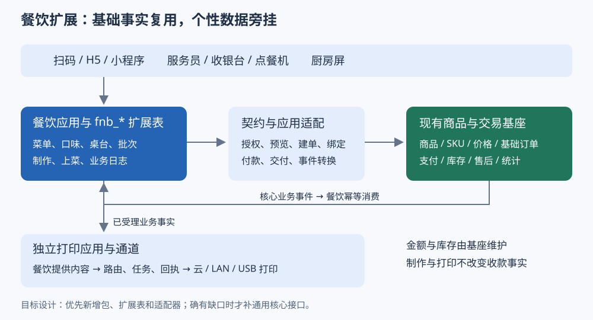

# 餐饮与商品订单基座的扩展边界与契约

> 状态：待评审 · 创建 2026-10-19 · 本轮仅整理模块关系与接入契约。
> 设计约束：菜品和订单复用当前基础能力；餐饮个性优先使用扩展表、独立包和应用适配；必要改动逐项列出，不以餐饮接入为由重构已有交易核心。
> 阅读关系：本册是餐饮接入的优先设计入口。[完整接入方案](./餐饮系统接入-基于当前订单主架构-2026-10-19.md)保留多终端、第三方及断网目标；其全面扩展收银、选配等建议按本册的依赖条件逐项启用，不作为普通点餐的统一前置条件。这里的“契约”指模块间的数据、调用、事件与责任约定。

## 一、核心关系

**餐饮菜品 = 基础商品和 SKU + 餐饮属性；餐饮交易 = 基础订单 + 餐饮业务关系；餐饮营业流程 = 台账、制作和打印组成的独立工作流。**

基础商品回答“卖什么、多少钱、能卖多少”；基础订单回答“谁买了什么、应付多少、付款与交付是否完成”；餐饮回答“哪桌点的、什么口味、哪个档口做、什么时候上菜”。一次点菜可以产生一笔基础交易，一次就餐可以包含多次点菜。

行业包通过契约调用基座，由适配器接到当前真实服务；基座的已发生事件返回餐饮工作流。打印消费工作流事实。核心不查询 `fnb_*` 表，餐饮不更新 `prd_*`、`ord_*` 或资金流水表。必须参与下单/取消原子校验的规则，则通过明确的通用扩展点接入，不能只靠前端或事后事件拦截。

| 基础事实 | 餐饮如何扩展 | 事实的唯一维护方 |
|---|---|---|
| 商品、SKU、门店上架、价格 | 关联菜品属性、菜单分类、做法、工位 | 商品域；餐饮展示组合视图 |
| 订单及行、金额与优惠快照 | 关联桌台、点单批次、口味数量明细 | 交易域；餐饮不重新计算应收 |
| 支付与退款 | 消费结果，编排收银入口 | 支付/售后域；厨房完成不等于收款成功 |
| 库存及销售统计 | 查询可售量，提供制作/交付事实 | 现有库存、交易与统计链；餐饮不再扣一份库存或累加一份基础销量 |
| 桌台、人数、开台、加菜 | 新表保存业务关系与状态 | 餐饮包 |
| 制作、等叫、催菜、出品、上菜 | 新表保存任务与数量 | 餐饮包；不新增到统一订单主状态中 |
| 打印设备、路由、任务、回执 | 新增共享打印能力；餐饮提供内容 | 打印应用包与渠道适配器 |

## 二、商品扩展合同

套餐、配料与组合、多类餐牌的字段和关系详见[餐饮菜品表设计与双语 ER 图](./餐饮菜品-表设计与双语ER图.md)。该模型是完整目标；本节先交付已有 SKU 和免费做法的顺序保留，收费组合需完成基座计价、库存展开与订单快照接入。

### 2.1 菜品不复制一套商品

| 内容 | 存放位置 | 规则 |
|---|---|---|
| 名称、图片、基础分类、SKU、规格、价格 | 现有商品能力 | 餐饮商品编辑界面调用现有维护服务；不新增 `fnb_price` 作为第二个定价来源 |
| 菜系、建议制作时间、默认工位、餐饮展示标签 | 拟新增 `fnb_goods_ext` | 以 `goods_no` 关联；门店差异另按 `(store_no, goods_no)` 配置，不改全局商品属性 |
| 早午晚菜单、展示顺序、终端可见范围 | 拟新增 `fnb_menu/fnb_menu_item` | 保存商品/SKU引用和时段，不复制标题价格；查询时与基座上架、可售规则求交 |
| 不加价的辣度、冰度、免葱 | 拟新增 `fnb_option_group/fnb_option` | 规则和选项归餐饮；实际选择在点单时冻结，厨房不查后来修改的选项名称 |
| 固定加价规格，例如大份/小份 | 现有 SKU | 有限、稳定的规格优先直接复用 SKU 定价、库存和金额快照 |
| 任意组合的收费选配 | 后续基座通用选配能力 | 不能只在扩展表加价后覆盖订单金额；商品报价、订单分摊、退款共同支持后再开放 |
| 当日停售/沽清 | 拟新增门店餐饮销售限制 | 是停售规则，不是实存；不能把库存清零后在次日凭旧数恢复 |

**第一阶段不要求重建商品定价模型。** 先交付现有 SKU 可表达的商品和免费做法；收费任意组合属于明确扩展项。旧方案的 `ord_item_modifier` 保留为该扩展的候选设计，不再作为所有餐饮菜单上线的前提。真正独立售卖的商品仍可作为正常订单行；不能用虚构商品掩盖缺失的选配计价。

### 2.2 下单校验不可绕过

餐饮菜单读取现有 `GoodsQueryPort` 门店快照，预览与建单继续由 `OrderService` 完成最终价格、优惠和库存判断。客户端只能传 SKU、数量、选项和业务上下文，不能传“餐饮最终价格”覆盖基座。

菜单时段、必选做法、停售若仅存在于餐饮入口，普通 `/mp/order` 仍可能绕过。涉及这些商品时，需要一个**提交前通用业务约束契约**：基座在最终建单前校验适用范围、配置版本和所选内容；餐饮实现该契约，不在订单里写 `if (industry == FOOD)`。模块缺失但商品有餐饮强约束时拒绝该商品下单，普通商品保持原行为。

配置更新和提交并发时，以提交事务校验的配置版本为准；已受理批次保持原快照。预览后价格变化须返回新的报价让顾客确认，不能静默替换已确认金额。

## 三、订单扩展合同

### 3.1 编号与关系

当前表名保留历史命名，新餐饮契约必须给出清楚的语义：

| 契约字段 | 当前基础映射 | 用途 |
|---|---|---|
| `paymentRootNo` | `ord_order.order_no` | 本次付款覆盖的交易集合 |
| `storeOrderNo` | `ord_sub_order.sub_order_no` | 一个门店的一笔基础交易 |
| `orderItemId` | `ord_item.id` | 商品成交行 |
| `checkNo` | 拟新增 `fnb_check` | 一次就餐台账，可含多个点单批次 |
| `batchNo` | 拟新增 `fnb_order_batch` | 一次明确提交，包括后续加菜 |
| `foodLineNo` | 拟新增 `fnb_order_line` | 点餐时的菜品、数量、口味快照和来源行 |

关系为：一台账包含多个批次；每批次关联创建结果中的支付根和门店订单；餐饮强制同店。快餐自取、外卖可没有台账，但仍有点单批次及制作任务。基础订单不能拿桌号作主键，也不往现有主单加一组桌台、档口、口味字段。

### 3.2 扩展表最小集合

| 拟新增表 | 保存什么 | 必须具备的约束 |
|---|---|---|
| `fnb_check` | 门店、桌台、人数、台账状态与版本 | 单店归属；结账冻结后不能直接追加订单 |
| `fnb_table/fnb_table_occupancy` | 桌台配置、当前占用 | 每桌一个活动占用；转台同时校验新旧桌 |
| `fnb_order_batch` | 来源、买家、操作员、终端、提交哈希、结果、核心单号 | 幂等作用域含门店和请求号；同键异参冲突；记录处理中状态 |
| `fnb_order_line` | 菜品/SKU引用、源行号、口味快照、数量、核心行映射 | 绑定的商品/门店与核心一致；数量不能超出核心成交行 |
| `fnb_kitchen_task` | 工位、制作任务、制作与交付数量、版本 | 批次/源行/工位/任务版本唯一；不因重放新增任务 |
| `fnb_action_log` | 催菜、叫起、退菜、转台等操作者和原因 | 只追加；逆向动作保留原事实 |
| `fnb_check_cart` | 同桌草稿及添加者 | 乐观锁；仅清除已提交的那组草稿，不清除他人新增内容 |

按启用能力创建所需表，不强迫无桌快餐使用桌台模块。扩展表使用仓库统一的审计、租户/门店范围和版本规范。

### 3.3 同 SKU 不同口味的关联

例如两杯同 SKU 奶茶，一杯少冰、一杯去冰：核心仍负责两杯的成交金额；餐饮保存两条各一杯的源行及口味。允许多条餐饮源行分配到同一核心成交行，但分配数量总和必须等于该行需要制作的数量。

不能按 SKU 查询后随便取第一条订单行，也不能依赖数据库返回顺序。先由应用适配器读取真实持久化行并返回稳定行 ID，餐饮按已冻结的 SKU/数量分配建立映射；如果核心行存在不同成交价、赠品或其他不可区分条件，则需要最小的通用 `sourceLineRef` 关联能力，否则拒绝歧义绑定。金额、赠品分类以核心行为准。

当前命令行只有 `goodsNo/skuNo/qty`，不能假定已有口味或源行透传字段；选配内容须进入餐饮提交哈希。赠品是否制作必须明确映射，不能因为不是顾客购物车行就漏给厨房。

### 3.4 两条状态轨道

基础订单沿当前付款、履约、完成、取消和退款流程；餐饮另记 `HELD/QUEUED/MAKING/READY/SERVED` 及撤菜数量。两条轨道在“受理、已付、已交付、已取消、退款结果”同步。

厨房出品不等于顾客收到；打印成功也不等于出品。堂食需增加 `DINE_IN` 的取值、能力判断和真实交付命令，最后仍走原状态转换门，不能用虚构快递单或直接 `update status` 完成。自取、配送沿现有对应履约方式，无需因餐饮另写一套。

## 四、包与应用适配边界

| 包/模块 | 职责 | 允许依赖 |
|---|---|---|
| `shop-industry-spi`（拟增） | 少量纯 DTO 和跨域接口；不一次实现旧案全部十二类 API | JDK；不暴露 Mapper、实体或事务对象 |
| `shop-industry-food`（拟增） | menu、check、ordering、kitchen、print-content 包及 `fnb_*` 数据 | 行业契约；独立行业包沿 ADR-019 同仓独立构建目标 |
| `shop-app/industrybridge/food`（拟增） | 鉴权、DTO转换、调用现有服务、行映射、事件适配 | 当前商品/订单/支付/履约服务与行业契约 |
| 共享打印应用包（拟增） | `prn_*` 配置、模板、任务、重试、回执、补打审计 | 通用事件/持久层及打印渠道契约 |
| `shop-channel/print`（拟增） | 云打印、LAN/USB 等渠道适配 | 仅通道协议，不包含桌台、厨房或交易业务判断 |

共享打印业务包的具体 Maven 归属在实施时按已有模块装配约束确定；先保持包边界，不因打印新增一个全套业务核心。这里纠正旧打印案将全部业务塞进 `shop-channel` 的倾向：该模块既有定位是外部适配。

新增入口按顾客、店员、设备分别授权，之后都进入同一个 `FoodOrderingService`。服务员身份不等于顾客身份；`createFor` 的调用方必须验证代客权限、目标买家和当前门店。点餐机不使用老板账号，厨房屏只有工位操作权限。

## 五、餐饮到核心的最小契约

下列是目标业务合同名称，**不是已存在的 Java 接口**。包装已有能力的适配可以先落地；标为缺口的方法只能在对应能力验收后开放。

| 契约 | 输入/输出核心内容 | 当前接线或缺口 |
|---|---|---|
| `FoodCatalog.query` | 门店、时段、入口 → 基础商品快照＋餐饮配置版本 | 组合 `GoodsQueryPort` 等已有查询与新扩展表 |
| `CoreOrder.quote` | 买家、门店、SKU/数量、合法履约方式 → 基座报价与可用付款方式 | 包装当前 `OrderService.preview/capability`；保留身份上下文 |
| `CoreOrder.place` | 相同基础参数＋幂等键 → 支付根、门店订单、稳定核心行与金额 | 包装当前 `OrderService.create/createFor`；不直接使用尚未完整接线的新建单内核 |
| `CoreOrder.findPlacement` | 提交号/幂等键 → 原建单结果或处理中 | 新增适配层提交意图查询；不得靠换键重建来处理未知结果 |
| `CorePayment.open/query` | 支付根、实际支付环境 → 参数/权威付款结果 | 复用现有 `pay/payResult` 与支付域；端上只发起、展示结果 |
| `CorePayment.confirmOffline` | 单店订单、操作人、实际收款登记 → 核心确认结果 | 适配 `MerchantOrderService.confirmOfflinePay`；当前不是任意金额、多渠道收款 API |
| `CoreFulfillment.deliver` | 核心订单/行、交付数量、操作人 → 交付结果 | 自取/配送包装已有能力；堂食补最小合同与守卫 |
| `CoreOrder.cancel/afterSale` | 基础订单、理由和操作人 → 核心处理结果 | 现有取消/售后；遵守当前仅整门店订单退款限制 |
| `Print.submit/status/reprint` | 场景、稳定事件号、结构化快照、目标范围 → 任务号/状态 | 新共享打印能力，业务已提交后异步执行 |

收款成功回写仍由可信支付链路执行，行业契约不向终端暴露任意 `markPaid`。库存锁定、付款分配、交付出库由已有订单/库存流程执行，餐饮不在 `place` 前后额外调一次 `stock.lock/confirm`。

若需跨买家预览或发起付款，而现有服务只接受当前登录买家，适配层不得伪装登录上下文；新增受权代办门面或让顾客接管付款会话。这是身份合同补充，不复制核心计价与支付代码。

## 六、线上和门店线下下单

### 6.1 先区分三个维度

| 维度 | 例子 | 相互关系 |
|---|---|---|
| 下单来源 | 手机扫码/H5、小程序；前台、服务员、点餐机 | 影响身份、交互与审计，不决定如何付款 |
| 收款方式 | 线上通道、当面现金等已有支持方式 | 门店线下点单仍可线上支付；手机点单也可选择获准的到店付款 |
| 网络状态 | 云端可达、仅局域网可达 | “线下下单”不等于“断网下单”；断网能力另需本地服务 |

### 6.2 在线顾客下单

扫门店/桌码 → 获取短时会话和菜单 → 选择商品/免费口味 → 基座预览 → 保存餐饮提交意图和快照 → 基座建单 → 绑定核心单号与行 → 顾客付款 → 核心确认付款 → 餐饮下达制作 → KDS和厨房打印 → 上菜/自取交付 → 核心完成 → 收银票或结账票。

下单返回 `POINTS_PROCESSING` 等处理中结果时只展示处理中，不能出票制作。厨房触发优先使用已发布的 `SubOrderPaid` 门店粒度事件，由桥接查询受权订单快照；它不是一个含全部菜品的事件，不向现有所有事件强塞餐饮字段。

### 6.3 门店线下点单，在线收款

店员或点餐机授权 → 确定真实买家/就餐主体 → 同一餐饮提交入口 → `createFor` → 顾客扫码支付或使用当前支持的通道 → 后续与线上顾客链路相同。

扫码枪扫顾客付款码属于支付通道的被扫能力，不等于扫描桌码点餐，也不能假定当前通道已支持。逐通道验证再开放；本阶段可先让顾客扫描本笔订单付款入口完成支付。

### 6.4 门店线下点单，当面先收款

餐饮入口选择已有获准的 OFFLINE 方式 → 核心建单 → 收银员实际收款 → 单店权限和完整付款影响集校验 → 调用已有当面付款确认 → 接收已付事实 → 后厨出票制作 → 交付完成。

现金登记可新增“收银操作审计”辅助表关联核心单号，但只记录收银员、凭证、现金实收与找零说明，不能自行决定核心已付或替代资金账。基础应收仍按订单；一笔单部分现金、部分线上不在这个现有确认接口的表达范围内。

### 6.5 先做后付

后付仍属于目标范围，但不能把先收款流程倒过来直接使用。餐饮可新增受理和制作记录；核心至少须支持：已受理单的取消守卫、非付款触发的库存承诺/耗用、后付真实交付记录及后续结清。

每次加菜新批次、新核心订单，台账聚合显示。仅展示合计后逐笔收款是分笔结账；一次付款覆盖多单、混合支付需要基座收银与资金分配合同。不得拿一次总流水逐单调用 `markPaid`，也不得让餐饮直接修改已建单金额。

未收款部分退菜需要基座认可的调整合同；已付部分退菜受当前全退政策限制。完整目标与缺口沿[完整接入方案 §五](./餐饮系统接入-基于当前订单主架构-2026-10-19.md)展开，不能因扩展表能存数据就认为核心已支持该场景。

### 6.6 断网和第三方的接点

此前确认的断网及第三方范围保留。二者都进入同一餐饮业务合同：第三方适配外部编号、事件与权限；边缘服务保存获准的本地提交事实，再经正式导入合同认领。不得把恢复同步重新当作一次普通下单、扣库存和厨房出票。

线上/门店联网点餐不依赖边缘部署。断网现金营业与第三方首家联调作为各自阶段交付；线上支付无可信结果时保持未知，不能凭终端点选标成功。

## 七、打印合同

### 7.1 内容与设备分开

餐饮组装 `PrintDocument`：门店、桌号/取餐号、批次号、核心订单号、发生时间、工位、商品及口味快照、数量、操作类型。收银金额取核心订单和真实收款结果；厨房票可不带金额。打印包按路由生成各设备任务，再由渠道适配器投递。

拟新增 `prn_device/prn_template/prn_route/prn_job/prn_attempt`，分别保存设备、模板、路由、业务任务与每次尝试。可复用旧打印方案的设计原则，但实施前统一名称，不同时维护两套同义设备表。

### 7.2 触发矩阵

| 业务事实 | 打印场景 | 内容与限制 |
|---|---|---|
| 先付单已核实付款，制作条件齐备 | 后厨分单、饮品标签、取餐号 | 基于冻结批次按工位拆单；仅首次下达生成制作票 |
| 后付受理及库存承诺成功 | 后厨分单 | 票面可标未结账；不因未付款漏出菜，也不因此生成已收款票 |
| 合法退菜/撤菜决定 | 撤菜条 | 原任务号、菜品数量和原因；制作逆向与资金结果分别表达 |
| 催菜/叫起 | 催菜单/叫起单 | 指向原制作任务，不能创建另一笔菜品销量 |
| 预结账 | 预结单 | 标“未付款/预结”，金额来自基座查询 |
| 单笔收款确认或整桌结清 | 收款凭条/结账票 | 明确打印范围；单笔已付不能被打印成整桌已付 |
| 人工补打 | 原场景补打 | 保留原内容、标补打、记操作人，不重新制作或改变订单 |

任务幂等键包含 `sourceEventId + scene + targetDevice + documentPart + copyIndex`。同设备按业务顺序执行；撤菜可优先但必须关联原任务。请求超时不等于没有出纸：先回查原任务，无法确认则显示“出票结果未知”，避免自动不断补打。

打印失败不会回滚已成立的订单或付款。收银/服务员端必须看到失败、未知与补打入口；没有匹配路由时告警并进入配置过的兜底打印机。打印完成只说明该设备的任务结果，不能直接把厨房任务改成 READY。

## 八、事务 幂等与事件的接入方式

提交前持久化 `batchNo/requestHash/frozenLines`，据此生成稳定的核心建单幂等键。订单创建成功后通过适配返回真实编号并绑定；超时则查询/重放同一请求恢复结果。**不把餐饮包装成任意大事务包住现有下单**：当前积分与跨域流程会感知调用方事务，必须遵循现有事务边界。

批次未绑定时先收到已付事件，保存待关联消费记录；关联完成后恢复，同一门店订单和场景最多下达一次。关系表、消费幂等记录、制作任务和待打印业务事件在餐饮本地事务中落定，再异步生成打印任务。核心回滚不会留下可制作批次，餐饮回滚不会要求顾客重新支付已成功订单。

复用已实现的 outbox 发布/接收接口与消费者去重，校验实际装配模式。状态机中的 emit 名称不代表已发出了业务事件；新接线必须落在实际发布与消费链路。跨支付库、库存库和边缘服务的动作使用原业务号恢复，不假定共享一个数据库事务。

## 九、最小改动清单和交付顺序

| 类型 | 内容 | 对当前核心的影响 |
|---|---|---|
| 直接复用 | 商品/SKU、门店价格、既有上架、报价、建单、付款、现有履约、整单售后 | 通过新增应用适配包装现有服务 |
| 新增扩展 | 餐饮属性、免费做法、菜单、台账、批次、制作、终端权限和打印 | 新包、新表、新页面、事件消费者与装配 |
| 最小必要补充 | `DINE_IN`、受权堂食交付、强制餐饮规则的提交校验、稳定行查询/关联、缺失的代办身份契约 | 只补已被具体场景证明必要的通用入口和能力判定；旧入口、默认行为和非餐饮单保持兼容 |
| 独立能力建设 | 任意收费选配、后付库存与取消约束、跨单一次收款、匿名主体、离线认领、已付部分退菜 | 逐项评审；不能将它们打包成先重写整个订单系统 |

实施顺序建议：①核心/餐饮契约与最小绑定 → ②现有 SKU＋免费做法＋线上/门店联网先付＋KDS/打印 → ③堂食交付及后付受理 → ④整桌收银、第三方与断网各自补齐。当前先把契约和关系定清，不在本轮执行实现。

销量也遵循同一来源：基础商品销量沿当前正式交易统计口径；餐饮“已点份数、已做份数、退菜损耗”另作可重建经营指标。后厨出票、补打、第三方回传或离线同步都不能重复增加基础销量。

### 验收必须证明的边界

1. 同一 SKU 在线顾客下单和店员代客下单，调用相同基座报价、落店和库存逻辑；差异仅来自明确的业务条件。
2. 同 SKU 不同口味的票面、制作数量和核心成交数量一致；没有基于行顺序的偶然映射。
3. 重试、晚到事件和补打均不重复订单、库存、销量和制作；付款成功但绑定中断可恢复。
4. 门店线下先收款可完整走通；未确认收款不出先付制作票；后付只有受理与库存合同就绪才开放。
5. 原零售流程、价格、支付及全退行为通过对应回归；餐饮能力关闭、模块未装时普通商品仍可正常交易。
6. 打印真机验证分工位、口味、中文、长票、断网、未知结果和补打；任务状态不能冒充制作/付款状态。

## 十、代码与原方案依据

本轮复核的实际入口为 `backend/shop-core/src/main/java/ai/neargo/shop/trade/api/mp/MpTradeController.java` 和 `trade/service/OrderService.java`、`trade/service/impl/OrderServiceImpl.java`；它们定义并执行当前真实下单命令。商品快照为 `backend/shop-base/src/main/java/ai/neargo/shop/spi/product/GoodsQueryPort.java`，事件为同模块的 `spi/trade/OrderEvents.java`，当面收款为 `MerchantOrderServiceImpl.confirmOfflinePay`。

设计继承[基础订单流与行业工作流组合模型](./TDD-基础订单流与行业工作流-组合模型.md)的双轨原则，并收窄[旧行业 SPI 草案](./shop-industry-spi-契约定稿.md)的首批范围。旧草案中的任意 `confirmOfflinePaid(channel, batchNo)`、`refundLine`、`resolvePrice` 等签名不能直接当成当前具备的能力；以本册的当前接线和缺口分类为准。打印细节参考[旧打印域方案](./TDD-打印域-方案与规格.md)，业务包与通道包的职责以本册为准。
