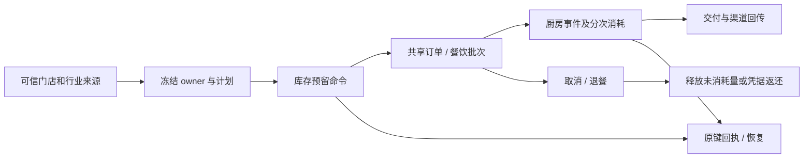

# 餐饮后端统一实施：代码清单与开发方案

> 根据 [数据库审查](./01-数据库审查与设计.md) 和 [API 清单](./02-API审查与清单.md) 编制。以下“新增”为计划类名，“修改”为已核实存在的类；实际命名、bean 条件和包层级遵循现有零售/餐饮代码规范。代码清单是设计，不能误认为已经实现。

## 1. 项目与依赖边界

```text
客户端 B/C/运营 → food-web Controller
                   ├─ 集成部署 → food-core Service/Mapper → FOOD 主数据源
                   └─ 独立部署 → food-web/foodclient 内部客户端 → food-server 内部 Controller
                                                         → food-core Service/Mapper
food-core → food-api / shop-base 公共合同
餐饮本地库存 →（默认关闭，可选异步）→ 进销存餐饮来源库存镜像
共享订单 shop-core → 可信行业库存权威路由 → FOOD 本地合同 / 原零售美业库存合同
统一渠道 commerce-* → 行业来源接口（FOOD 或 RETAIL） → 原商品/订单/库存 owner
报表 shop-report → 独立报表库；业务事实由受权限约束的来源服务提供
```

- 使用已有 `food-api`、`food-core`、`food-web`、`food-server`、`food-channel` 和 `food-commerce`；不建立第二套餐饮订单/商品系统。
- `food-core` mapper 参照嵌套 `FoodMappers`、`@MapperScan`、`foodSqlSessionTemplate`、平台主事务管理器和 `FoodDataScopeRegistration`；`food-web` 使用既有 `FoodBizStoreScope`/`FoodRequestScopeValidator`、`BizPerms`、`BizContext`。
- 避免 `food-api → food-core`、共享核心反向依赖餐饮实现。跨行业的最小接口放已有 `shop-base` SPI 或依赖方向允许的合同模块；餐饮特有 DTO 和实现留 `food-*`。
- CORE 不额外注册第二个 `InventoryDemandPlanPort`/`InventoryReservationPort`；用独立本地合同和明确权威路由，确保原有 Bean 唯一性。共享代码只扩展选择和恢复边界，现有 SKU、价格、试算、订单主体逻辑复用。

## 2. 数据与仓储对象

| 对象/位置 | 处理 | 职责与方法 |
| --- | --- | --- |
| `food-core/entity/FnbStockBalance` | 已有，修改 | 映射门店追踪/状态字段；禁止把 DTO 当实体直接覆盖审计和版本。 |
| `FnbStockItem`、`FnbStockReservation`、`FnbStockReservationItem`、`FnbStockCommand`、`FnbStockMovement` | 新增，位于 `food-core/entity` | 对齐已有 6 表及增量字段；继承平台 `BaseEntity` 和 `@TableName`；定义冻结与审计字段。 |
| `FoodMappers.StockBalanceMapper` | 已有，修改 | 复用 `lockBalance(entity,store,item)`、`replaceLockedBalance(...)`；补初始化、按页查询和必要批量锁定；更新前校验数量并检查影响行数。 |
| `FoodMappers.StockItemMapper` | 新增嵌套 Mapper | 按主体/SKU 和物料号查询及行锁；查历史引用、防重复身份与单位修改；分页查询。 |
| `FoodMappers.StockReservationMapper`、`StockReservationItemMapper` | 新增 | 按来源/预留号/叶引用锁定和查询；按固定顺序锁；条件推进状态及累计量。 |
| `FoodMappers.StockCommandMapper`、`StockMovementMapper` | 新增 | 按主体+门店+动作+原操作键查命令及唯一插入；流水追加、原消耗引用/累计返还校验、分页查询。不得提供业务删除路径。 |
| `FoodDataScopeRegistration`、`FoodSchemaValidator`、`FoodLocalStockSchemaContract` | 修改 | 登记新落地 Mapper 表、校验新列/索引/CHECK；核对 MySQL 和支持的兼容数据库元数据。 |
| FOOD/CORE 下一可用 Flyway | 新增 | 按数据库方案增量 DDL；`OrdCreateIntent`/`OrdIndustryOrderSource`/渠道准备实体与 Mapper 同步字段；不改 V33 及历史 migration。 |

## 3. 领域、DTO、服务与 Controller

### 3.1 餐饮业务域

计划在 `food-api` 新增 `FoodStockContracts`（或遵循现有分散 DTO 的等价结构）：

```java
record Scope(String entityNo, String storeNo) {}
record StockItemCommand(String itemKind, String skuNo, String name,
                        String baseUnit, String trackingMode) {}
record StockBalanceInit(String itemNo, String trackingMode, String status,
                        BigDecimal initialQty, String reasonCode, String reasonDetail) {}
record StockAdjust(BigDecimal delta, long version, String reasonCode, String reasonDetail) {}
record StockTarget(String leafRef, BigDecimal targetQty) {}
record StockOperation(String operationKey, String requestHash, String sourceRef,
                      long sourceVersion, long lifecycleVersion) {}
```

这些是计划合同，不代表最终 Java 源码已经存在；`entityNo`、`storeNo` 只在可信服务内传递，Controller 不从 body 绑定。完整 VO 包含 API 文档对应字段；返回快照必须能按持久化原回执重放。`targetQty` 的 issue/release/return 语义为各自累计目标，来源操作命令必须引用真实业务事实。

| 类 | 处理 | 主要方法 / 职责 |
| --- | --- | --- |
| `FoodLocalStockBalance`、`FoodLocalStockReservationProgress` | 已有，扩展或复用 | 现有余额、预留消耗/释放规则；补精度、返还累计和不追踪语义时保持不可变与已存在测试。 |
| `FoodStockItemPolicy`、`FoodStockLifecyclePolicy`、`FoodStockReturnPolicy` | 新增 `food-api/policy` | `validateItem(...)`、`validateTransition(...)`、`validateReturn(...)`；定义状态、单位、累计目标、损耗/可售处置规则，不做数据库或远程访问。 |
| `FoodStockItemService` / `FoodStockItemServiceImpl` | 新增 `food-api/service` / `food-core/service/impl` | `createItem(scope,actor,command,key)`、`updateItem(...)`、`getItem(...)`、`listItems(...)`；远程 SKU 读取在本地事务外，事务内核验授权快照和引用限制。 |
| `FoodStockBalanceService` / `FoodStockBalanceServiceImpl` | 新增 | `initialize(...)`、`changePolicy(...)`、`adjust(...)`、`getBalance(...)`、`listBalances(...)`、`listMovements(...)`；原子写命令/余额/流水及精确版本控制。 |
| `FoodStockReservationService` / `FoodStockReservationServiceImpl` | 新增 | `reserve(...)`、`confirm(...)`、`issue(...)`、`release(...)`、`returnIssued(...)`、`getReservation(...)`、`findCommand(...)`；多行按固定顺序加锁，保留快照/幂等回执。 |
| `FoodStockCommandExecutor` | 新增 `food-core/service/impl` | `execute(scope,action,key,hash,work)`、`find(...)`；长期幂等和统一错误映射，同事务内保存结果，不把公共短期幂等表当唯一凭据。 |
| `BizFoodStockItemController`、`BizFoodStockBalanceController` | 新增 `food-web/api/biz` | 实现 API 清单库存入口、门店范围/权限、操作者与幂等头校验；不让客户端指定 owner。 |
| `FoodStockAutoConfiguration` | 新增 `food-core/config` | 条件装配 service、主数据源及事务管理器；本地库存接入开关默认关闭，未完成链路不开放新单。 |

### 3.2 集成及独立部署内部合同

| 类 | 处理 | 主要方法 / 职责 |
| --- | --- | --- |
| `FoodLocalStockPort`、`FoodLocalStockInternalApi` | 新增允许的 SPI/合同模块 | 定义 availability/reserve/confirm/issue/release/returnIssued/findCommand；含 scope、来源、hash、版本、回执；不暴露管理权限。 |
| `FoodLocalStockPortImpl` | 新增 `food-core/port` | 用餐饮本地服务实现合同，禁止调用独立进销存。 |
| `InternalFoodLocalStockController` | 新增 `food-server/api` | 将认证内部请求交给本地 port；限制调用方、store scope、body 长度，拒绝外部伪造来源。 |
| `RemoteFoodStockItemService`、`RemoteFoodStockBalanceService` | 新增 `food-web/foodclient` | 参考现有 `RemoteModifierService` 和 `FoodClientConfiguration`，为独立 FOOD 部署转发 B 端管理能力到服务端内部合同；保留可信身份与 scope 签名。 |
| `RemoteFoodLocalStockPortImpl`、`FoodLocalStockClientConfiguration` | 在共享订单所在宿主的现有内部客户端层新增，具体装配位置实施前核对 | CORE 到独立 FOOD 的库存客户端、服务认证、超时/未知结果区分、按原键查回；不误用 `food-channel`（该模块现有职责偏向 FOOD 调用 CORE）。网络调用不得包在订单本地锁事务内。 |
| `FoodWebAutoConfiguration` / `FoodAutoConfiguration` 及对应 server/channel 配置 | 修改 | 按现有 profile、conditional 和 `META-INF/spring/...AutoConfiguration.imports` 接线；避免重复实例和默认成功实现。 |

### 3.2.1 拟定内部接口签名与传输对象

共享订单不应引用 `food-api` 的实现或 DTO。计划在 `backend/shop-base/src/main/java/ai/neargo/shop/spi/food/FoodLocalStockPort.java` 声明合同和不可变内嵌 record；FOOD 的管理 DTO 单独放 `food-api/dto`。接口是否按现有项目习惯拆成多个文件，由实现时的包依赖检查决定，不能引入循环依赖。

```java
interface FoodLocalStockPort {
    AvailabilityResult findAvailability(StockScope scope, List<ItemRef> items);
    StockReceipt reserve(StockScope scope, StockCommand command, StockPlan plan);
    StockReceipt confirm(StockScope scope, StockCommand command, String reservationNo);
    StockReceipt issue(StockScope scope, StockCommand command, String reservationNo,
                       List<StockTarget> targets);
    StockReceipt release(StockScope scope, StockCommand command, String reservationNo,
                         List<StockTarget> targets);
    StockReceipt returnIssued(StockScope scope, StockCommand command, String reservationNo,
                              List<ReturnTarget> targets);
    CommandLookup findCommand(StockScope scope, String action, String operationKey,
                              String requestHash);
}
```

| 合同对象 | 字段及说明 |
| --- | --- |
| `StockScope` | `entityNo,storeNo`；均由可信来源建立和校验，不从外部请求直接采信。 |
| `ItemRef` | `itemNo,baseUnit`；基础单位必须与被冻结物料一致。 |
| `StockCommand` | `operationKey,requestHash,sourceSystem,sourceNo,sourceVersion,lifecycleVersion`；调用方和来源凭据由内部服务认证上下文和原业务事实校验。 |
| `StockPlan` | `planHash,expiresAt?,leaves[]`；每叶 `leafRef,sourceComponentRef,itemNo,baseUnit,quantity,phase,definitionSnapshot,definitionHash`，快照大小和数量上限应按现有请求约束实施。 |
| `StockTarget` | `leafRef,targetQty`；为累计消耗或累计释放目标，不能从当前配置重算。 |
| `ReturnTarget` | `leafRef,originalMovementNo,targetQty,returnRef,disposition`；累计目标按原消耗流水控制，并检查叶级累计不超过消耗。 |
| `StockReceipt` | `commandNo,reservationNo,owner,planHash,status,lifecycleVersion,items[],movementRefs[]`；包含原始回执并支持同键重放。 |
| `AvailabilityResult` | 逐物料返回 `itemNo,baseUnit,status,availableQty?`；状态明确区分 TRACKED、UNTRACKED、UNCONFIGURED、DISABLED。 |
| `CommandLookup` | `status,receipt?`；区分 COMPLETED、IN_PROGRESS、NOT_FOUND、CONFLICT，运输超时作为未知结果处理。 |

上述 `owner` 仅为结果和原始记录的内部事实，不能作为外部输入；具体状态枚举与现有订单状态适配要在实现时完成映射，不得悄悄复用同名不同语义的值。

### 3.3 共享订单权威路由及恢复

| 类 | 处理 | 主要方法 / 职责 |
| --- | --- | --- |
| `StockOwner`、`StockOwnerRouter` | 新增共享合同与 `shop-core` 实现，具体路径按现有贸易分层 | `freeze(trustedIndustry,sourceFact)`、`forFrozenOwner(owner)`；仅 `FOOD_LOCAL` 与原 owner 的经过审查表示；UNKNOWN 不回退到任意库存。 |
| `IndustryOrderServiceImpl` | 修改 | 创建意图时先冻结 owner 并持久化；`prepare/reserve/confirm/cancel/recover` 使用冻结值；保留原 `stockAuthority=INDUSTRY_INVENTORY_V2` 协议语义，不直接替换。 |
| `IndustryChannelStockPreparation` | 修改 | 按受信渠道准入事实在首次预留前冻结并持久化；准备、撤销、超时查回以及原回执使用同一 owner。 |
| `IndustryFulfillmentServiceImpl` | 修改 | 按原订单冻结 owner 路由分次履约、出库和恢复，逐叶核验原计划与原回执；不能按当前开关选择。 |
| `IndustryChannelOrderServiceImpl`、`IndustryTransactionRecoveryServiceImpl`、`IndustryNonPaymentRecoveryJob` | 核实后修改 | 贯穿导入、取消、查回与恢复，禁止旧订单切到 FOOD 本地；无权威证据保持待处理。 |
| `OrdIndustryOrderSource`、`OrdCreateIntent`、渠道 preparation 对应实体/Mapper | 修改 | 写入/读取 owner 与证明，迁移旧值按原历史协议解释；不得根据客户端字段决定。 |

### 3.4 餐饮菜品、订单、厨房、售后与外送

| 类 | 处理 | 本批动作 |
| --- | --- | --- |
| `RecipeServiceImpl`、`RecipePublicationSource`、`ConfigRevisionServiceImpl` | 修改 | 将新餐饮配方/发布的物料事实切到本地；快照保存真实基本单位、版本与数量，校验禁用/单位不一致。 |
| `ModifierServiceImpl`、`ModifierInventoryMode`、`DiningChannelModifierDemand`、`DiningChannelProductionPlanBuilder` | 修改 | `SALES_SKU` 扣本地成品、`COMPONENTS` 展开本地成员、`NONE` 不扣；定价 SKU 与库存来源分离。兼容已有 null 模式和历史发布，防双扣与无界递归。 |
| `FoodChannelSourceFactsPortImpl`、`DiningOrderAuthorityServiceImpl` | 修改 | 本地/渠道使用一致的餐牌、价格、配方及库存来源；校验可信门店/主体及冻结版本。 |
| `ProductionConsumptionServiceImpl`、`KitchenTaskServiceImpl`、`KitchenReturnServiceImpl`、`DiningReturnServiceImpl` | 修改 | 按原叶分次消耗/释放/返还，保留厨房/退餐原始事件及处置凭据，损耗不默认返库。 |
| `DiningChannelOrderServiceImpl`、`DiningChannelSourceStore`、`DiningChannelFulfillmentServiceImpl`、`DiningChannelFulfillmentSignalPortImpl` | 复核/修改 | Mock 渠道订单接入原订单、厨房、本地库存；按已记录失败修正消息顺序、分次履约、重复及超时恢复。 |
| `OfflineDraftServiceImpl`、`OfflineDraftMapper`、购物车相关 service | 定位后修改 | 远程/商品事实在事务外读取；写入时重校验设备租约、fence 和会话，并原子保存重放回执与进度；继续默认关闭。 |
| `CounterCampaignFence`、`CampaignPortImpl` | 定位后修改 | 先确定结构异常原因和影响范围，仅修已确认缺陷，避免扩大营销引擎改造。 |
| `BizPrintJobController`、`FoodPrintDocumentAssembler`、共享 `PrintPort` | 复核/必要时修改 | 不建第二套打印队列；补对应单据来源、路由和失败/重打凭据，Mock 与真实设备状态严格区分。 |
| 桌台、日结、套餐、税和结算既有 Controller/Service | 复核/必要时修改 | 使用原接口和领域对象，依据待办逐项核验；发现缺陷先定位后定向改，不为“清单”制造空类。 |

### 3.5 通用渠道及报表

| 类 | 处理 | 本批动作 |
| --- | --- | --- |
| `CatalogPublicationServiceImpl`、`ChannelAvailabilityServiceImpl` | 复核/修改 | 发布时段、平台价及配料/套餐投影；库存查询使用行业来源事实，失败/过期不伪造可售。 |
| `ChannelOrderServiceImpl`、`ChannelFulfillmentServiceImpl`、`ChannelAfterSaleServiceImpl`、`CommerceRecoveryServiceImpl` | 复核/修改 | 保持通用流程、原单/原键、状态回传和恢复；Mock Gateway 替代外部平台，不伪造内部 owner。 |
| `MockCommercePlatform` | 复核/扩展 | 错签、超时但外部成功、重复/乱序回调、部分成功和重启；禁止默认生产装配。 |
| `DiningReportFactsPortAdapter`、`DiningKitchenReportFactsPortAdapter`、`ReportSourceCollectionServiceImpl` | 报表阶段修改 | 对接本地库存真实流水/余额与营业事实，记录时间水位、退款及优惠口径。 |
| `FoodReportDailyJob`、`ReportStorageServiceImpl`、`ReportQueryServiceImpl`、`BizDiningReportController` | 报表阶段复核/修改 | 每日汇总到独立报表库，重跑/补算、日周月和 Top N；复用现有调度与表，不新增每指标独立定时任务。 |

## 4. 流程与状态



所有阶段以可恢复的持久事实驱动；本地库存未就绪或结果未知不得默认下单成功。先吃后付/先付后吃只影响订单规则及资金状态，不代表本批执行真实支付。

## 5. 安全和兼容规则

- 菜品/SKU 身份与价格仍由共享商品提供，本地物料仅保存关联和库存单位；基础单位变化有历史引用时拒绝。
- 本地库存管理、预留及消费各自校验主体/门店、操作键、原业务号和权限；金额计算不在库存模块复制。
- 先查询原命令和冻结凭据；超时未知不得视为成功/失败后盲目换键。原订单字段缺失不以当前开关猜测 owner。
- 餐饮新单的库存事务不依赖进销存；同步开关启用时可异步投递至进销存独立镜像，不写原生余额。历史订单若依赖原进销存凭据，须受控沿原 owner 恢复。
- 真实外送平台、支付、打印厂家、PMS、离线收款/库存另立任务；真实成本缺失时不计算伪造利润。

## 6. 可选库存同步代码补充

新增 FOOD 同步配置、映射、基线、事件投递、恢复和 B 端 Controller；`shop-base` 增加独立镜像接收 SPI；`shop-inventory` 增加镜像、幂等回执、会话屏障、接收和商家查询。具体类及方法、部署路径和测试要求见[可选进销存库存同步方案](./04-可选进销存库存同步方案.md)。该能力与餐饮订单库存 owner 解耦，默认关闭；反向更新另立任务。

## 本轮实际类名对齐

| 代码 | 关键方法与职责 |
| --- | --- |
| CORE `FoodProductionStockService` | owner/consume/query/reverse；原订单/原配方叶验证、正常累计消耗、原子补耗、真实流水反向 |
| FOOD `FoodProductionInventoryRouter` | 按原 owner 分流；未知 owner 或缺少依赖拒绝处理；不回退另一个库存系统 |
| `FoodLocalStockInternalApi` / `InternalFoodLocalStockController` / `RemoteFoodLocalStockPort` | 12 个本地库存生命周期合同与独立部署适配 |
| `FoodStockManagementInternalApi` / `InternalFoodStockManagementController` | 19 个已存在 Service 方法的内部合同与转发 |
| `RemoteFoodStockManagementService` | 同时实现既有 Item/Balance 两个 Service；复用本地管理实现的职责划分 |
| `RemoteFoodStockSyncService` / `RemoteFoodStockReconciliationService` | 可选同步管理/对账 Service 远程适配 |
| `FoodStockClientConfiguration` / `FoodStockRemoteCalls` | standalone + enabled 条件装配，拒绝带宿主事务的远程调用，保留业务错误/未知结果 |
| `InventoryFoodStockProjectionPort.validateMappings` | 每批最多 200 项真实目标检查，接收 apply 时复用同一身份检查 |

这些类已编码和准备专项测试，不代表数据库迁移、独立运行、安全验收或上线完成。

## 追加实现与方法对齐

| 对象 | 主要方法 | 事务及职责 |
| --- | --- | --- |
| `FoodReturnStockServiceImpl` | apply/list/retry/recover | apply 先锁原退餐、明细与制作消耗，持久化意图后才调用库存；retry/recover 只重放原冻结请求。 |
| `FnbReturnStockDisposition` / `ReturnStockDispositionMapper` | 原意图/结果字段及标准 Mapper | FOOD V37；永久原键唯一，未知结果保留 claim。 |
| `BizFoodReturnStockController` | apply/list/retry | 商家门店范围，售后+库存双权限；不包含资金退款。 |
| `FoodReturnStockInternalApi` / `InternalFoodReturnStockController` / 远程退餐 Service | apply/list/retry | 独立部署内部令牌和 scope/actor 签名；集成部署直调同一 Service。 |
| `FoodLocalStockPort` / 本地实现 / 内部控制器 / 远程客户端 | issueDelta | 在预留头锁内计算原消耗+增量，防不同制作事件读同一旧累计值而漏扣。原 issue 保持累计语义。 |
| `FoodStockReportFactsPortAdapter` | readSnapshot | 按显式来源时区读取真实流水和余额，不追踪动作不算实物，缺成本不填零。 |
| `FoodStockReportInternalApi` / `InternalFoodStockReportController` | facts | 独立报表 worker 复用既有签名；来源未装配返回503，不能读取旧库存代替。 |
| `OfflineCartReplayPort` / `CheckCartServiceImpl` | prepareOfflineCreate/prepareOfflineReplace | 进程内闭包完成事务外事实准备；执行必须处于 owning write transaction，不能对外暴露“已准备令牌”。 |
| `OfflineDraftServiceImpl` | replay | 逐行原键、设备/租约/session 重校验，购物车与进度原子提交；KIOSK 不使用 QR 桌台目录校验。 |
| `DiningChannelModifierDemand` | compile/compilePriced | 容器与有价选择分别编译；COMPONENTS 只展开冻结成员，历史 SALES_SKU 保持根成品消耗。 |
| `FoodLocalDemandPlanAdapter` | reserve/acceptUnpaid/allocatePaid/issueTo/releaseTo/withdraw | 独立原 owner 对象，非全局第二 SPI；哈希前将到期时间固定至数据库毫秒精度；显式付款调用与库存查询状态区分。 |
| `FulfillmentStockIssueConsumer` | handle | 精确需求计划按原 owner 查验全部叶真实消耗/释放；确认既有证据，不发起第二次旧库存扣减。 |

恢复复用原 `PRODUCTION_RECOVERY` 任务，追加部分退餐处置恢复；同步复用统一 Outbox，报表复用已有每日任务。本批没有为每个动作新增定时任务。


## 2026-10-30 M04代码对账

- food-api：FoodStockSyncInternalApi、FoodStockSyncDispatchService；FoodOutboxRouting登记原库存handler和producer路由。
- food-core：原FoodStockSyncDispatcher实现分发合同，核对外层scope，复用原事务和回执逻辑。
- food-server：InternalFoodStockSyncController、Spring MVC FoodStockSyncDispatchValidator；无第二个runner。
- food-web：RemoteFoodStockSyncDispatcher；FoodStockClientConfiguration沿standalone和本地库存开关装配，现有签名器统一签名。无本地Mapper。
- inventory-svc：POM repackage执行ID与父级统一，保留普通JAR及exec可执行包。
- 测试：远程handler、范围拒绝、签名MVC、producer路由；verify-food-standalone-mysql.py验证实际JAR与MySQL9副本。前批2个引用food-core的原生夹具迁入food-embedded-test。

数据库0调整；验收结果和未覆盖范围登记07。


## 2026-10-30 Outbox收缩实施

UnifiedOutboxFacade.hasDelivery/FoodWriteGuardConfiguration跳过无真实订阅的18类默认归档。ManagementRepository/ManagementQueryServiceImpl直接存取V622命令账本，删除管理空消费者及配置。AfterCommit.runOutsideTransaction、打印Facade、OrderServiceImpl改为提交后直接触发原任务/意图；打印维护及积分恢复默认启用。FoodStockSyncPublisher/Worker/Dispatcher、StockSyncDeliveryMapper及配置复用原业务记录、短认领和事务外HTTP，PRODUCTION_RECOVERY负责恢复；food-channel新增InventoryFoodStockProjectionPortImpl复用独立inventory-client，food-core无client依赖。旧handler保留兼容，新库存producer通用路由移除。详见../../TDD-Outbox收缩与直接调用.md。


## 2026-10-30 E1生产耗用直接调用

E1：KitchenTaskServiceImpl.configureProduction及append中的提交后调用；ServiceEventMapper.ProductionSource/unconsumed；ProductionConsumptionServiceImpl.recover补首次缺口并分配有界预算。FoodOutboxRouting移除新生产handler目标；DiningProductionConsumer.supports=false，仅handle保留旧类型/稳定handlerId的历史delivery。通用Outbox接口和框架不改。验收补KitchenLifecycleAcceptanceTest、ProductionConsumptionTest及旧consumer/producer测试。


## 2026-10-30 E2工位状态与KDS直接写入

E2：FoodStationRuntimeServiceImpl移除OutboxPublisher，publish直接组装EventDraft并调用原FoodKdsService.append，复用cursor锁；FoodKdsAutoConfiguration移除publisher注入。FoodOutboxRouting删除工位新target；DiningKdsEventConsumer新supports排除工位，handle保留历史分支，打印owner只在实际需要打印后获取。测试：FoodStationRuntimePersistenceTest新增真实MySQL V18四场景；原工位、订阅、KDS流/消费者、原生厨房和producer断言同步。无新框架/任务/存储对象。
