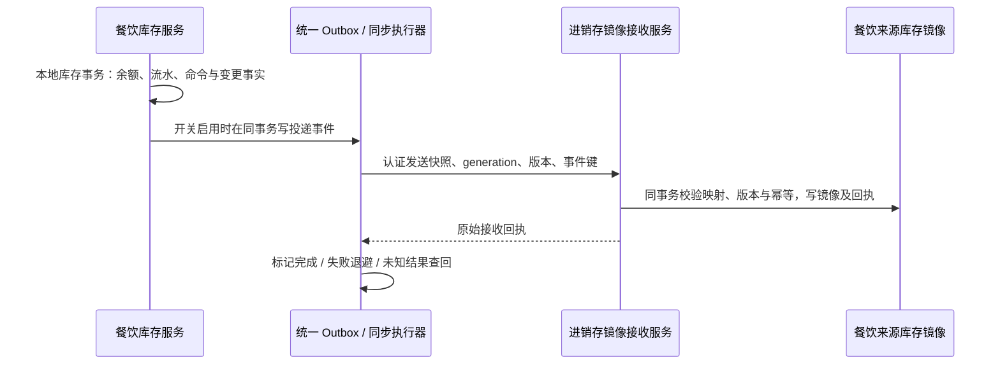

# 餐饮本地库存同步到进销存：可选方案

> 2026-10-29 需求补充：餐饮默认使用本地库存；商家可通过开关，将餐饮本地库存信息同步到进销存。本文件覆盖旧文档中“本期完全不做同步/联动另立任务”的限制。双向库存、进销存反向驱动餐饮库存仍不在本次范围。本方案尚未编码或上线。

## 1. 目标和边界

| 事项 | 方案 |
| --- | --- |
| 默认行为 | 商家门店同步开关默认为关闭；餐饮下单、预留、制作、退餐与可售判断只依赖餐饮本地库存。 |
| 开启后 | 以餐饮本地库存为来源，将物料身份、基础单位、跟踪/启用状态、门店实存、预留和变更版本等同步到进销存的**餐饮来源库存镜像**；进销存提供受权限约束的查询和同步状态。 |
| 库存权威 | 无论开关状态如何，餐饮本地库都是餐饮订单的库存权威；同步失败不回滚已成功的餐饮业务，不改变零售/美业原库存权威。 |
| 原生进销存账本 | 镜像作为独立数据来源保存并标识 `FOOD_LOCAL`。不直接覆盖 `inv_stock_balance`，不调用盘点/过账接口伪造入出库，也不把镜像数额无区分叠加到原生库存余额。 |
| 后续扩展 | 如果业务需要采购入库、调拨或盘点**反向修改餐饮余额**，或需要镜像参与进销存原生库存过账，须另行设计来源凭据、双向冲突及会计/成本归属；当前开关不代表支持这些能力。 |

这是对“同步库存信息”的可实施方案：进销存可看到餐饮库存和同步状态。若将来要求进销存原生采购、调拨、过账直接使用同一余额，需要额外的权威切换或凭据化过账合同；不能简单覆盖现有库存表。

## 2. 与现有代码的对齐

- 进销存已有 `InvStockBalance`，包括 `ownerId,itemId,locationId,onHandQuantity,reservedQuantity`；`StockPostingService` 明确实存只允许由单据过账修改，预留有独立语义。直接执行 `UPDATE inv_stock_balance` 会破坏原生单据与流水一致性。
- `MaterialCatalogQueryPort` 是进销存所属物料事实查询；`InventoryProductionPort`、`InventoryDemandPlanPort` 和 `InventoryReservationPort` 是既有生产/预留合同，不能把同步镜像当成这些合同的成功执行，也不应新增同类型全局 Bean。
- 餐饮已有 `foodOutboxPublisher` 和统一 Outbox 设施；优先复用现有事件投递/恢复，不再为每个库存变更建立独立定时任务。Outbox 的数据源及事件接收注册，需分别核对集成和独立部署配置。
- 进销存现有业务控制器 `BizStockController` 提供 `/biz/inventory/balances` 等原生库存查询；餐饮镜像先提供单独、显式来源的查询合同。是否将该入口展示在既有库存页面属于后续前端工作；不能声称当前原生余额接口已包含镜像。

## 3. 开关与同步规则

1. 同步开关按**商家主体+餐饮门店**配置，默认 `OFF`。门店和进销存接收范围必须经现有主体、门店、服务认证与 ACL 验证，不能由请求体跨主体指定。
2. 启用之前，检查接收端可用性、物料/单位及门店映射、权限、该目标是否仍由其他来源维护，并输出预检结果。物料允许明确映射到已有进销存物料，也允许只以餐饮来源身份展示；不自动创建进销存物料或猜测单位。
3. 用户开启后进入 `BOOTSTRAPPING`；为已有餐饮本地库存生成一次基线，并捕获开启后的变更，最终进入 `ACTIVE`。未知或未配置的库存不得同步为零；`UNTRACKED` 无数量、`DISABLED` 作为状态同步。同步期间餐饮继续正常营业。
4. 变更触发为餐饮库存余额或状态真实提交：初始化、人工调整、预留、消耗、释放、处置返还、停用和物料关键信息变更。每个同步消息承载提交后的**绝对快照与单物料递增版本**；接收端根据来源版本条件更新镜像，而非按增量盲目累加。
5. 同一餐饮物料映射到目标身份必须可追溯且一对一或按明确规则分区。禁止多个餐饮来源写入同一条无来源区分的镜像；多门店独立。SKU 相同不自动判定物料、单位或库位相同。 活动映射变更先冻结新修订，关闭旧 generation 并确认停用屏障，再启用新 generation 重建基线；期间餐饮本地正常营业。
6. 关闭时先将配置改为 `DISABLING`，停止产生新的投递任务，排空或撤销本地待发送项，并通过接收端确认 generation 的停用屏障，再报告 `OFF`。在途消息可能在屏障确认前完成，响应应区分 `DISABLING` 和真正 `OFF`；屏障之后旧 generation 必须被接收端拒绝。镜像保留并标记已停用/最后同步时间，不删除已有记录、不清零库存。若接收端不可用则显示待关闭，不伪称远端已停止。
7. 重新开启使用新的 `generation` 和基线；接收端保留上次版本和 generation，拒绝旧 generation、旧版本以及未知启用会话，不能让延迟消息覆盖新数据。暂停期间的变更以新基线覆盖，不自动补造历史流水。 `ERROR` 表示投递异常而非关闭；商家仍保持启用时后续变化仍须持久捕获。按需保留消息/原始事件证据，但不承诺开关关闭期间同步。
8. 开启或关闭只控制**异步同步**，不改变餐饮库存 owner、订单已冻结的库存权威、历史预留或进销存原生库存。商家可查看失败原因、重试和对账，失败只影响同步状态，不影响已提交的餐饮业务。

## 4. 数据库增量设计（拟新增，未迁移）

实施台账已明确采用同步投递业务记录，复用现有 Outbox 运输；审计复用 `fnb_action_log`，另补对账任务与差异明细以支持异步 API 和重启恢复。具体落表选择见[待开发清单 DB-07～15](./05-待开发API数据库代码与任务清单.md)，不创建重复的同步审计表。

### 4.1 餐饮业务库

| 表 | 用途与主要字段 | 约束 |
| --- | --- | --- |
| `fnb_stock_sync_config` | `tenant_no,entity_no,store_no,target_system,status,generation,baseline_cursor,last_error_code,enabled_at,disabled_at,version` | 主体+门店+目标系统唯一；`status` 建议 `OFF/BOOTSTRAPPING/ACTIVE/DISABLING/ERROR`；所有状态变更可审计。 |
| `fnb_stock_sync_mapping` | `entity_no,store_no,item_no,target_owner_ref?,target_location_ref?,target_item_ref?,source_unit,target_unit,mapping_revision,status` | 同一来源物料门店+目标唯一；目标身份按真实 owner/location/item 或明确来源身份约束，禁止冲突映射。单位不一致须提供可信、明确的转换关系；否则阻止同步。 |
| `fnb_stock_sync_item_state` | `entity_no,store_no,item_no,source_version,snapshot_hash,updated_at` | 门店+物料唯一；余额、门店状态和主体物料可同步字段改变时，在变更事务中推进受影响门店的版本。若现有版本能证明覆盖全部变化，可复用并取消此表。 |
| `fnb_stock_sync_delivery` | `sync_no,entity_no,store_no,item_no,generation,source_version,event_no,operation_key,payload_hash,status,attempts,next_attempt_at,last_error_code,ack_ref` | `event_no` 唯一，来源+generation+版本唯一；记录可重试/未知/成功回执。优先复用现有 Outbox 事件及消费者回执，只有无法表达门店级重试和对账时才追加此表，避免与 Outbox 重复维护任务。 |
| `fnb_stock_sync_audit` | `scope,actor,action,before_state,after_state,reason,occurred_at` | 如果已有 `fnb_action_log` 能记录所需真实变更则复用，不重复建表；保留启停、映射、人工重试和基线操作审计。 |

`source_version` 不能直接假设就是 MyBatis `version`：需要实现持久的、同一门店物料所有可同步变化都递增的版本；纯物料名称/单位或策略变化也必须推进来源版本。可采用专用单调序列字段或在同一个受锁的同步事实行维护，新增前核对现有字段。每个事件标识同时含不可复用的 `generation`、来源、版本和 event ID。

### 4.2 进销存数据库

| 表 | 用途与主要字段 | 约束 |
| --- | --- | --- |
| `inv_food_stock_projection` | `source_system='FOOD_LOCAL',source_entity_no,source_store_no,source_item_no,target_owner_id?,target_location_id?,target_item_id?,unit,tracking_mode,status,on_hand?,reserved_qty?,source_version,generation,source_updated_at,received_at` | 来源主体+门店+物料唯一；版本和 generation 条件更新；禁止跨主体映射和合并至原生余额。UNTRACKED 的数量为空，不表示无限或零。 |
| `inv_food_stock_sync_receipt` | `source_system,event_no,generation,payload_hash,result,applied_version,received_at` | 来源+event ID 唯一；同 ID 同内容回放原回执，同 ID 异内容冲突；与镜像更新在进销存本地事务内提交。 |
| `inv_food_stock_sync_session` | `source_entity_no,source_store_no,generation,status,activated_at,disabled_at` | 每门店持有当前有效 generation 与启停屏障；旧 generation 一律拒绝，停用屏障与镜像接收以同一接收侧事务/锁串行化。 |

如现有统一 Inbox/接收幂等机制已满足来源、长期回执、会话屏障和事务要求，复用对应基础表而非重复创建收件箱；需要通过源码与数据库契约核实，不能仅凭名称假定可用。同步表字段和索引纳入各自 Schema validator；FOOD/INVENTORY 新迁移使用各库下一可用版本，禁止更改既有迁移。

## 5. 并发、首轮基线与恢复

- **基线无遗漏**：启用时在本地事务中锁定并持久化新 generation、启用状态及基线扫描的稳定边界；库存写事务按同一配置锁协议决定是否记录事件。对边界前存在的物料按主键分页抓取带来源版本的真实快照，对边界后创建的物料由提交事件覆盖；记录扫描游标并可断点恢复。不得在分页期间整库加长锁。
- **基线与实时变更并发**：同一物料的快照和实时事件均有单调来源版本。接收端原子比较版本：大于当前版本才应用；相同版本须对比 payload hash，相同则幂等、不同则冲突；小于当前版本只确认过期，不覆盖更新的镜像。 版本只在同一 generation 内比较；切换 generation 时先验证会话屏障与基线，不按数值直接比较不同 generation。版本分配与来源事实更新同事务，否则无法证明无遗漏。
- **错误和重试**：使用原 `eventNo/operationKey` 重试；超时视为 `UNKNOWN`，先向接收端查询原回执或安全重放；限速、指数退避、可见错误与人工恢复，避免单门店失败阻塞其他门店。
- **启停屏障**：接收端按门店会话串行处理 `activate/apply/deactivate`；停用回执产生后任何旧 generation 的 apply 必须失败。跨服务不可假设在一个本地事务中同时完成；异步状态必须暴露待确认/超时恢复。
- **对账**：按门店、物料、generation 和版本比较两侧快照；比较状态、单位和数量，记录缺失、滞后、冲突和映射错误。修复使用原键重试或经授权重新生成新 generation 基线，不能静默覆盖进销存原生账本。
- **授权与审计**：同步命令来源是可信餐饮服务并绑定主体和门店；启停/改映射/重试/对账需商家库存管理权限，服务间使用现有内部签名和授权机制；不把凭证写入消息或日志。

## 6. API 清单（拟新增）

餐饮商家端路径前缀 `/biz/x/food/stores/{storeNo}`；入参不接受可信 `entityNo`、`actor`，写操作需 `Idempotency-Key`。

| 方法 | 路由 | 输入 | 输出 |
| --- | --- | --- | --- |
| GET | `/stock-sync/config` | 无 | `enabled,status,generation,version,lastSuccessAt,lastErrorCode,backlog` |
| PUT | `/stock-sync/config` | `enabled,version,reason?` | `status,generation,operationNo,version`；关闭可返回 DISABLING，不冒充已完成 |
| POST | `/stock-sync:preflight` | `targetSystem` | `allowed,issues[],mappingSummary`；只读，不开启 |
| GET | `/stock-sync/mappings` | `page,size,itemNo?,status?` | 映射及版本分页结果 |
| PUT | `/stock-sync/mappings/{itemNo}` | `targetOwnerRef?,targetLocationRef?,targetItemRef?,sourceUnit,targetUnit,conversion?,version` | 映射版本及校验状态；映射变更触发安全重同步 |
| GET | `/stock-sync/deliveries` | `page,size,status?,itemNo?,from?,to?` | 同步条目、来源版本、状态、时间和错误码 |
| POST | `/stock-sync/deliveries/{syncNo}:retry` | `reason?` | 原投递状态/回执；不得换键重复应用 |
| POST | `/stock-sync:reconcile` | `itemNos?`，为空表示当前门店 | `reconciliationNo,status`；受限规模，异步执行 |
| GET | `/stock-sync/reconciliations/{reconciliationNo}` | 无 | 对账进度、差异数量与明细分页引用 |

内部拟新增 `InventoryFoodStockProjectionPort`/`InventoryFoodStockProjectionInternalApi`：`activate(scope,generation,key)`、`apply(scope,generation,eventNo,hash,snapshot)`、`queryReceipt(scope,eventNo,hash)`、`deactivate(scope,generation,key)`、`queryProjection(scope,itemRefs)`。进销存提供签名认证的内部 Controller，响应返回接受/过期/冲突/停用等明确状态、`appliedVersion,receiptNo`；不得直接把内部接口开放给外部平台。

进销存商家侧拟新增独立查询 `GET /biz/inventory/food-stock-projections` 和 `GET /biz/inventory/food-stock-projections/{sourceItemNo}`：输入门店/过滤/分页，输出来源、物料、单位、状态、实存、预留、来源版本及同步时间；使用既有 `BizPerms.STOCK` 和 `InventoryAclService`，以来源门店授权并禁止跨主体访问。API 与表在实施前需检查冲突和已有权限模型。

## 7. 代码清单与任务顺序

| 模块/对象 | 计划内容 |
| --- | --- |
| FOOD `FoodStockSyncService` / `FoodStockSyncServiceImpl` | 配置启停、映射、预检、基线、对账、手动重试；状态变化走行锁、版本和审计。 |
| FOOD `FoodStockSyncConfig/Mapping/Delivery`、`FoodMappers` | 对应实体和 Mapper，审计优先复用 `fnb_action_log`；记录来源版本和重试事实。 |
| FOOD `FoodStockSyncEvent` / `FoodStockSyncPublisher` | 库存提交事务中发布真实变更；预留和释放也更新预留快照；禁用时不投递。复用平台 Outbox。 |
| FOOD `FoodStockSyncDispatcher` / `FoodStockSyncRecoveryService` | 处理基线、投递、未知回执查回、退避和停用屏障；复用既有 Outbox worker/恢复机制，默认不新增每店定时任务。 |
| FOOD `BizFoodStockSyncController`、配置 DTO | 提供商家启停、映射、查询、重试和对账 API，沿用现有权限与门店范围控制。 |
| `shop-base` `InventoryFoodStockProjectionPort` 与内部 API | 只定义镜像同步与回执合同，独立于原有库存预留/消耗 SPI。 |
| `shop-inventory` `FoodStockProjectionServiceImpl`、Mapper、接收 Controller | 在进销存本地事务中校验会话屏障、来源版本、幂等回执及物料映射，写入独立镜像；不调用 `StockPostingService` 修改原生余额。 |
| `shop-inventory` `BizFoodStockProjectionController` / 查询 Service | 提供权限隔离的餐饮镜像查询；前端展示后置。 |
| FOOD/INVENTORY 配置与客户端 | 集成模式使用本地适配，独立部署使用内部签名/服务发现/HTTP 客户端；无可用接收端时保留可恢复待同步状态。 |

开发批次加入库存本地服务之后、最终集中测试之前：先完成配置/映射/会话/镜像及迁移，再完成事件与基线/重试，最后接入进销存查询和权限。报表仍排在业务后面；所有编码完成后统一编译和集中测试。

## 8. 验收矩阵

- 默认关闭：本地预留、下单、制作和退餐不请求进销存、不写入镜像或原生库存；进销存不可用不阻断餐饮营业。
- 开启后：多门店、原料及 SKU、小数单位、预留/消耗/释放/返还均产生正确最终快照，进销存镜像可查询且可识别来源；原生 `inv_stock_balance` 和原有库存单据保持不变。
- 基线并发：分页期间发生新增、调整、停用与删除/归档，最终版本正确且无遗漏；未知/不追踪不能写为 0 库存。
- 幂等和乱序：同事件重复、同 ID 异内容、旧版本、新版本先到、超时但接收已提交；重试不重复累计且不能覆盖新事实。
- 开关边界：启用中、关闭中、已关闭、重启和再次启用；旧 generation 在停用确认后不再可应用；暂停时营业不受影响。
- 权限隔离：跨主体/门店、无权限操作和伪造内部签名均拒绝；映射缺失或单位不兼容产生可见错误，不写错误镜像。
- 故障和恢复：进销存断网、FOOD/INVENTORY 重启、消息积压、消费者重试及对账补偿后最终一致；不改变任何原始业务成功结果。
- 正确性边界：进销存镜像可用不意味着原生采购、调拨、盘点可以修改餐饮本地库存，也不意味着财务成本已同步。
