# 餐饮系统数据库设计

## 当前交付证据

记录日期：2026-10-25。生产已核验提交：`fef7f00982c978819645a527d26b819d343d8aab`（`fef7f0098`），餐饮集成部署；迁移基线 FOOD V25 / CORE V581 / INVENTORY V14来自既有迁移核验记录，本节不代表持续在线监测。

状态分开阅读：代码已交付；专项验证见验收矩阵；生产部署已核验；终端、真实设备和跨owner完整营业验收仍待完成。报表生产未启用，本批未发布支付资金能力。后文V15、H5/PICKUP及CODED_PENDING_VERIFICATION保留为历史切片/完整目标验收状态，不表示当前所有后端尚未编译测试，也不表示所有完整目标均已交付。

本地新增修复尚未提交或部署；待发布迁移 CORE V587 / INVENTORY V15。旧规则目录失配须显式新发布，不能静默放宽。见[本轮原生记录](../餐饮非支付原生链路验收记录.md)。

证据：[验收执行及发布记录](../TDD-餐饮功能验收与接口测试.md) · [逐项验收矩阵](./餐饮功能验收标准与证据矩阵.md) · [实际公开API](./餐饮系统-实际公开API对照.md) · [BIZ迁移及交付记录](../TDD-餐饮系统-BIZ01-12-交付验证.md)。

> 历史与源码发现口径： 源码核对：2026-10-25；云端基线 FOOD V15（83张业务表＋历史表＝84张），源码迁移目标 FOOD V25 / CORE V587 / INVENTORY V15（仅源码发现，不代表已部署）。交付核验状态：DEPLOYED_EMBEDDED_VERIFIED；独立适配/原生专项及发布进展见交付验证记录，历史 V1/73 仅为当时初始化记录。PLANNED 对象保留为目标，不代表实现。
> 由 `node scripts/gen-food-system-design.mjs` 生成；真源：[设计源](./schema/food-system-design.json)。实际 API、方法与迁移从原源码发现；不执行迁移。

## 零、按业务模块阅读

先查主责模块，再查表字段或接口编号。13个业务模块与A–L持久化域不是一一对应；模块可协作调用相同服务，不能据此复制实体。109项追踪结果：目标已定义32项，依赖共享/核心合同60项，尚缺专项设计17项。以上均为设计状态，非实现验收。

| 模块 | 名称 | 需求数 | 关联表数 | 关联API数 |
|---|---|---|---|---|
| MOD-01 | 桌台与就餐管理 | 8 | 24 | 40 |
| MOD-02 | 菜品与餐牌管理 | 12 | 27 | 41 |
| MOD-03 | 点餐与订单管理 | 9 | 18 | 30 |
| MOD-04 | 厨房与履约管理 | 10 | 10 | 17 |
| MOD-05 | 收银与结账管理 | 11 | 7 | 13 |
| MOD-06 | 退餐与售后管理 | 8 | 8 | 12 |
| MOD-07 | 打印、通知与设备管理 | 8 | 13 | 3 |
| MOD-08 | 班次与现金管理 | 4 | 5 | 5 |
| MOD-09 | 营业日、日结与对账管理 | 6 | 6 | 6 |
| MOD-10 | 经营报表管理 | 14 | 3 | 4 |
| MOD-11 | 专项业态管理 | 6 | 10 | 8 |
| MOD-12 | 第三方接入与离线营业 | 7 | 8 | 7 |
| MOD-13 | 营业配置与权限治理 | 6 | 7 | 7 |

逐需求表/API引用与未决缺口见API册第八节；首三模块扩展及评审结论见[评审对齐记录](../TDD-餐饮系统-数据库与API评审对齐.md)。

## 一、总览与复用边界

共119张候选表，按领域分图；先看归属，再看字段。只新增行业业务和缺失共享能力，不复制商品价格、库存、订单金额或资金账。

| 基础事实 | 复用对象 | 餐饮关联 |
|---|---|---|
| 商品与销售规格 | prd_goods.goods_no / prd_sku.sku_no | dish、菜单、套餐、收费配料 |
| 属性字典 | prd_spec_dim.dim_no / prd_spec_value.value_no | 免费做法选择，规则仍由餐饮授权 |
| 门店上架价格库存 | prd_store_goods / prd_store_price / prd_store_stock及库存服务 | 只通过端口读取，不另建价格库存账 |
| 支付根与门店订单 | ord_order.order_no / ord_sub_order.sub_order_no | 核心绑定及结账范围 |
| 成交行 | ord_item.id | food_line分配表 |
| 身份资源审批会员营销票据资金 | 各权威服务，编号由正式合同定义 | 只保存ref，表名不臆造 |
| 自然日报表 | rpt_daily_store / rpt_daily_goods / rpt_job_watermark | 原口径保留；新增餐饮指标投影在共享报表库 |

## 二、公共字段与索引规范

沿BaseEntity的表使用公共字段；明确usesBaseEntity=false的追加迁移表按完整物理字段及primaryKey展示，不补造id或审计列。原公共约定：id自增、tenant_no、审计、version及deleted；entity_no是业务范围不是租户。物理主键为id；业务号唯一，不直接用旧草案PK替换物理主键。下列公共字段合并到每张表，已显式列出的字段不重复。本文是逻辑设计，不是已执行的生产DDL。

| 字段 | 类型 | 约束/意义 |
|---|---|---|
| id | bigint | BaseEntity自增物理主键，不对外不进URL |
| tenant_no | varchar(32) | 沿用BaseEntity，一期MAIN；不是entity_no，不另启租户体系 |
| entity_no | varchar(32) | 当前主体或业务发生时主体快照，不等于账号和支付商户号 |
| created_at | datetime(3) | 沿用MetaObjectHandler及现有LocalDateTime持久化约定 |
| created_by | varchar(32) | 当前认证业务键；按现有填充规则，作业SYSTEM |
| updated_at | datetime(3) | 沿用公共填充 |
| updated_by | varchar(32) | 沿用公共填充 |
| version | bigint | BaseEntity乐观锁 |
| deleted | int | BaseEntity逻辑删除；签核和事实表禁止业务归档覆盖历史 |

公共字段均NOT NULL；id为PK，其余业务可空以字典为准。外部业务号/幂等键以二进制或大小写敏感排序规则存储，避免幂等键大小写被合并。JSON只存冻结展示、受限配置或引用，不作为金额权威。金额bigint为最小单位且必须有币种上下文；数量decimal须单位、精度与核心能力一致；营业事件保留可还原时刻与业务时区/规则版本；持久化沿用现有LocalDateTime和数据源时区约定，先验证UTC转换，不私自改变全项目时间语义。

每表默认追加审计索引(entity_no,created_at,id)，含store_no表追加(entity_no,store_no,updated_at,id)；按父子查询字段追加(entity_no,parent_no,id)。唯一业务号按当前全局编号生成，跨主体查询仍必须加entity_no。静态配置仅停用不删除；流水和正式签核禁止软删覆盖，保留策略另审。

活动桌容量、活动钱箱、活跃应收范围与边缘写者依赖仲裁行锁/CAS及受控写入口，MySQL可空唯一键不能替代这些并发守卫。按需落地占用槽/预占行，实施DDL中必须给出原子SQL及竞态测试。

## 三、分域表关系

箭头表示显式逻辑引用，跨图及跨库引用见字段字典。每图不超过8表；没有箭头的表仍可经服务合同关联，不意味着同一事务。

### 营业配置 Store Operations 1

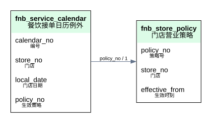

`fnb_store_policy` 门店营业策略；`fnb_service_calendar` 餐饮接单日历例外。跨模块编号通过受权服务验证，避免跨库外键或直接JOIN。

### 餐品餐牌 Food Catalog 1

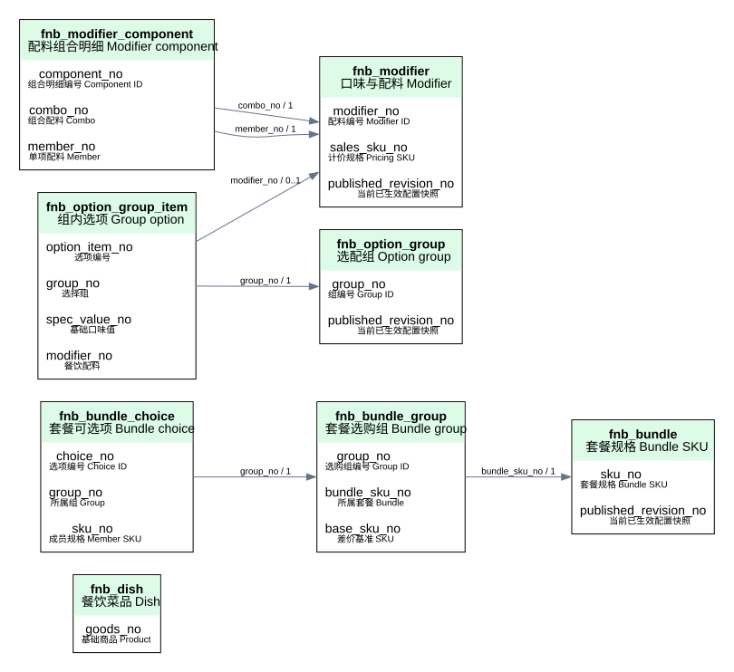

`fnb_dish` 餐饮菜品 Dish；`fnb_bundle` 套餐规格 Bundle SKU；`fnb_bundle_group` 套餐选购组 Bundle group；`fnb_bundle_choice` 套餐可选项 Bundle choice；`fnb_modifier` 口味与配料 Modifier；`fnb_modifier_component` 配料组合明细 Modifier component；`fnb_option_group` 选配组 Option group；`fnb_option_group_item` 组内选项 Group option。跨模块编号通过受权服务验证，避免跨库外键或直接JOIN。

### 餐品餐牌 Food Catalog 2

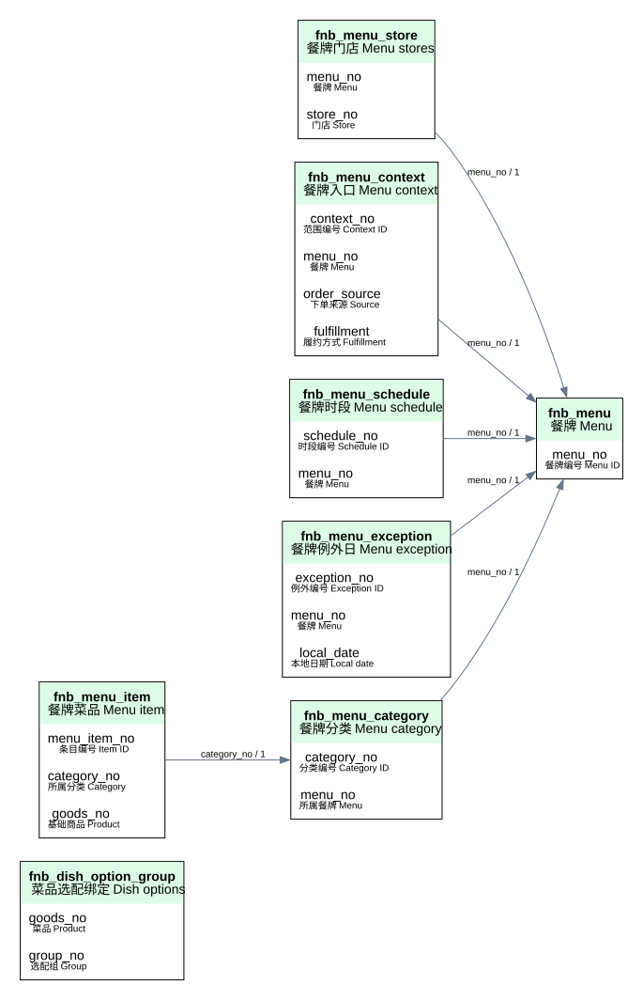

`fnb_dish_option_group` 菜品选配绑定 Dish options；`fnb_menu` 餐牌 Menu；`fnb_menu_store` 餐牌门店 Menu stores；`fnb_menu_context` 餐牌入口 Menu context；`fnb_menu_schedule` 餐牌时段 Menu schedule；`fnb_menu_exception` 餐牌例外日 Menu exception；`fnb_menu_category` 餐牌分类 Menu category；`fnb_menu_item` 餐牌菜品 Menu item。跨模块编号通过受权服务验证，避免跨库外键或直接JOIN。

### 餐品餐牌 Food Catalog 3

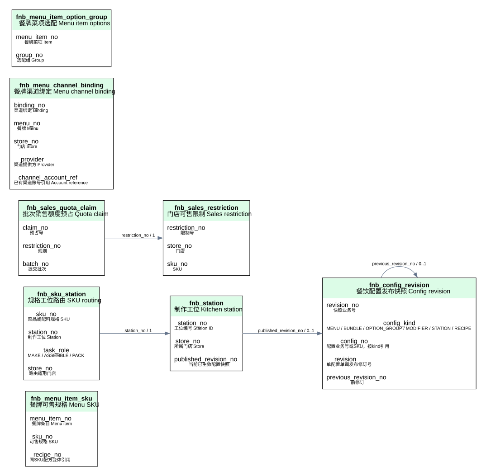

`fnb_menu_item_sku` 餐牌可售规格 Menu SKU；`fnb_station` 制作工位 Kitchen station；`fnb_sku_station` 规格工位路由 SKU routing；`fnb_config_revision` 餐饮配置发布快照 Config revision；`fnb_sales_restriction` 门店可售限制 Sales restriction；`fnb_sales_quota_claim` 批次销售额度预占 Quota claim；`fnb_menu_channel_binding` 餐牌渠道绑定 Menu channel binding；`fnb_menu_item_option_group` 餐牌菜项选配 Menu item options。跨模块编号通过受权服务验证，避免跨库外键或直接JOIN。

### 餐品餐牌 Food Catalog 4

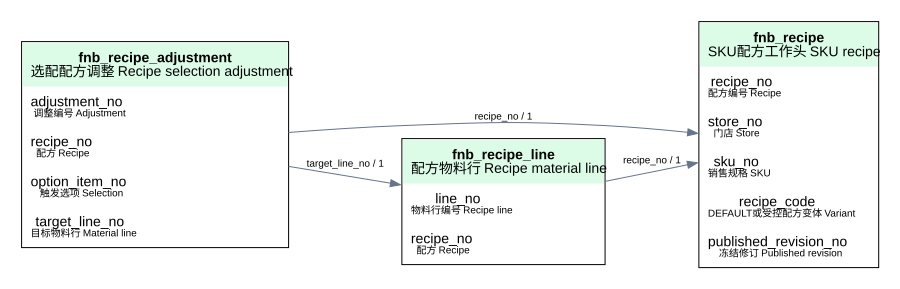

`fnb_recipe` SKU配方工作头 SKU recipe；`fnb_recipe_line` 配方物料行 Recipe material line；`fnb_recipe_adjustment` 选配配方调整 Recipe selection adjustment。跨模块编号通过受权服务验证，避免跨库外键或直接JOIN。

### 就餐资源 Dining 1

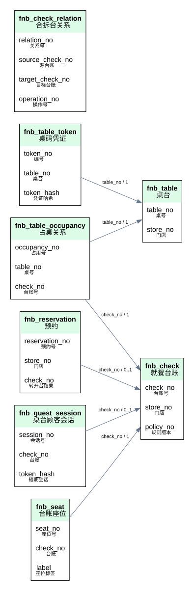

`fnb_table` 桌台；`fnb_table_token` 桌码凭证；`fnb_reservation` 预约；`fnb_check` 就餐台账；`fnb_table_occupancy` 占桌关系；`fnb_check_relation` 合拆台关系；`fnb_guest_session` 桌台顾客会话；`fnb_seat` 台账座位。跨模块编号通过受权服务验证，避免跨库外键或直接JOIN。

### 就餐资源 Dining 2

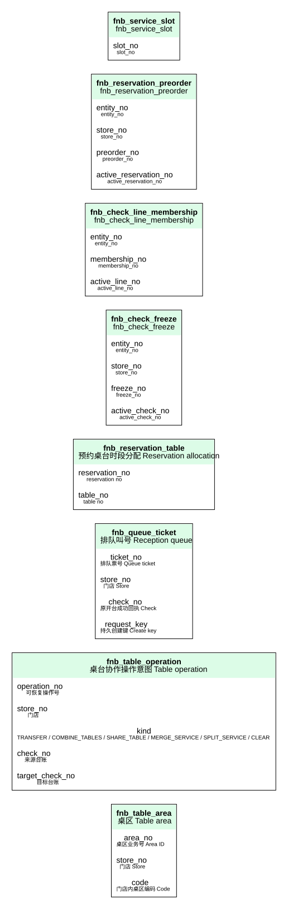

`fnb_table_area` 桌区 Table area；`fnb_table_operation` 桌台协作操作意图 Table operation；`fnb_queue_ticket` 排队叫号 Reception queue；`fnb_reservation_table` 预约桌台时段分配 Reservation allocation；`fnb_check_freeze` fnb_check_freeze；`fnb_check_line_membership` fnb_check_line_membership；`fnb_reservation_preorder` fnb_reservation_preorder；`fnb_service_slot` fnb_service_slot。跨模块编号通过受权服务验证，避免跨库外键或直接JOIN。

### 就餐资源 Dining 3

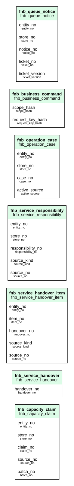

`fnb_capacity_claim` fnb_capacity_claim；`fnb_service_handover` fnb_service_handover；`fnb_service_handover_item` fnb_service_handover_item；`fnb_service_responsibility` fnb_service_responsibility；`fnb_operation_case` fnb_operation_case；`fnb_business_command` fnb_business_command；`fnb_queue_notice` fnb_queue_notice。跨模块编号通过受权服务验证，避免跨库外键或直接JOIN。

### 点餐 Ordering 1

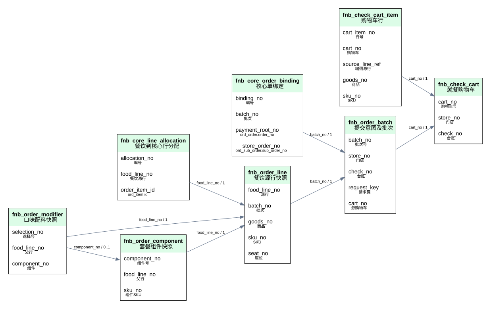

`fnb_check_cart` 就餐购物车；`fnb_check_cart_item` 购物车行；`fnb_order_batch` 提交意图及批次；`fnb_core_order_binding` 核心单绑定；`fnb_order_line` 餐饮源行快照；`fnb_core_line_allocation` 餐饮到核心行分配；`fnb_order_component` 套餐组件快照；`fnb_order_modifier` 口味配料快照。跨模块编号通过受权服务验证，避免跨库外键或直接JOIN。

### 点餐 Ordering 2

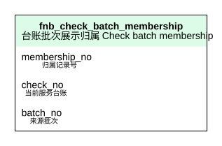

`fnb_check_batch_membership` 台账批次展示归属 Check batch membership；`fnb_scheduled_dispatch` fnb_scheduled_dispatch；`fnb_fee_source_binding` fnb_fee_source_binding；`fnb_cart_delivery` fnb_cart_delivery；`fnb_fee_contract_claim` fnb_fee_contract_claim。跨模块编号通过受权服务验证，避免跨库外键或直接JOIN。

### 制作履约 Kitchen 1

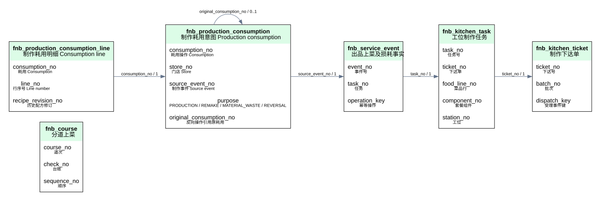

`fnb_course` 分道上菜；`fnb_kitchen_ticket` 制作下达单；`fnb_kitchen_task` 工位制作任务；`fnb_service_event` 出品上菜及损耗事实；`fnb_production_consumption` 制作耗用意图 Production consumption；`fnb_production_consumption_line` 制作耗用明细 Consumption line。跨模块编号通过受权服务验证，避免跨库外键或直接JOIN。

### 结账编排 Checkout 1

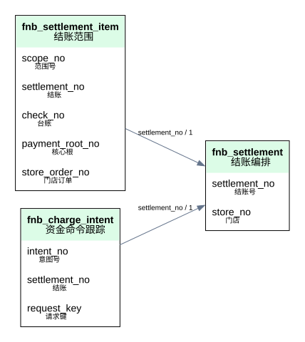

`fnb_settlement` 结账编排；`fnb_settlement_item` 结账范围；`fnb_charge_intent` 资金命令跟踪；`fnb_business_share_plan` AA业务份额 Business share plan。跨模块编号通过受权服务验证，避免跨库外键或直接JOIN。

### 退餐内控 Returns 1

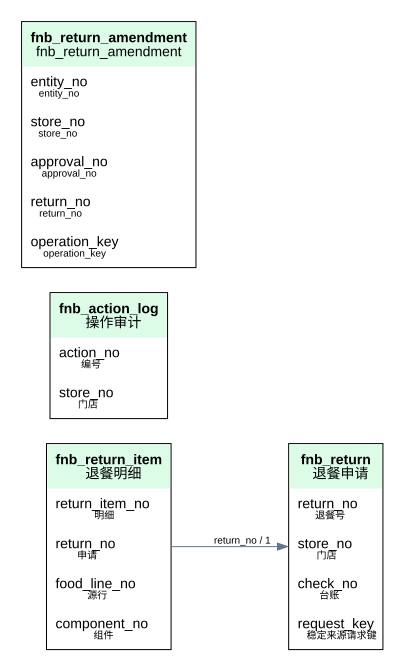

`fnb_return` 退餐申请；`fnb_return_item` 退餐明细；`fnb_action_log` 操作审计；`fnb_return_amendment` fnb_return_amendment。跨模块编号通过受权服务验证，避免跨库外键或直接JOIN。

### 打印设备 Printing 1

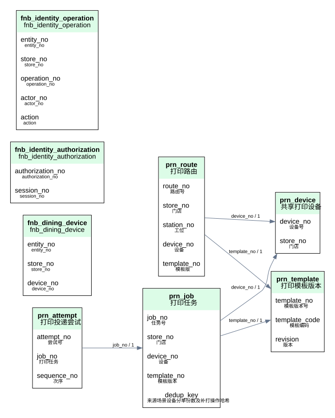

`prn_device` 共享打印设备；`prn_template` 打印模板版本；`prn_route` 打印路由；`prn_job` 打印任务；`prn_attempt` 打印投递尝试；`fnb_dining_device` fnb_dining_device；`fnb_identity_authorization` fnb_identity_authorization；`fnb_identity_operation` fnb_identity_operation。跨模块编号通过受权服务验证，避免跨库外键或直接JOIN。

### 打印设备 Printing 2

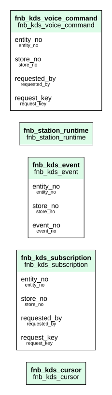

`fnb_kds_cursor` fnb_kds_cursor；`fnb_kds_subscription` fnb_kds_subscription；`fnb_kds_event` fnb_kds_event；`fnb_station_runtime` fnb_station_runtime；`fnb_kds_voice_command` fnb_kds_voice_command。跨模块编号通过受权服务验证，避免跨库外键或直接JOIN。

### 营业日与日结 Closing 1

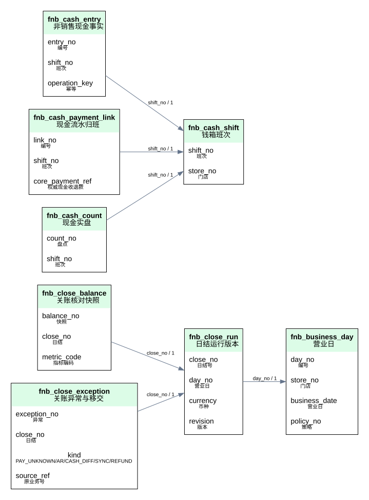

`fnb_business_day` 营业日；`fnb_cash_shift` 钱箱班次；`fnb_cash_entry` 非销售现金事实；`fnb_cash_payment_link` 现金流水归班；`fnb_cash_count` 现金实盘；`fnb_close_run` 日结运行版本；`fnb_close_balance` 关账核对快照；`fnb_close_exception` 关账异常与移交。跨模块编号通过受权服务验证，避免跨库外键或直接JOIN。

### 营业日与日结 Closing 2

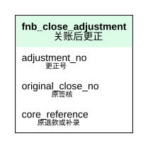

`fnb_close_adjustment` 关账后更正。跨模块编号通过受权服务验证，避免跨库外键或直接JOIN。

### 经营分析 Reporting 1

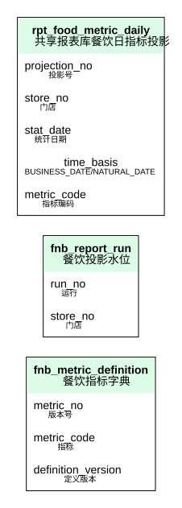

`fnb_metric_definition` 餐饮指标字典；`fnb_report_run` 餐饮投影水位；`rpt_food_metric_daily` 共享报表库餐饮日指标投影。跨模块编号通过受权服务验证，避免跨库外键或直接JOIN。

### 集成运行 Integration 1

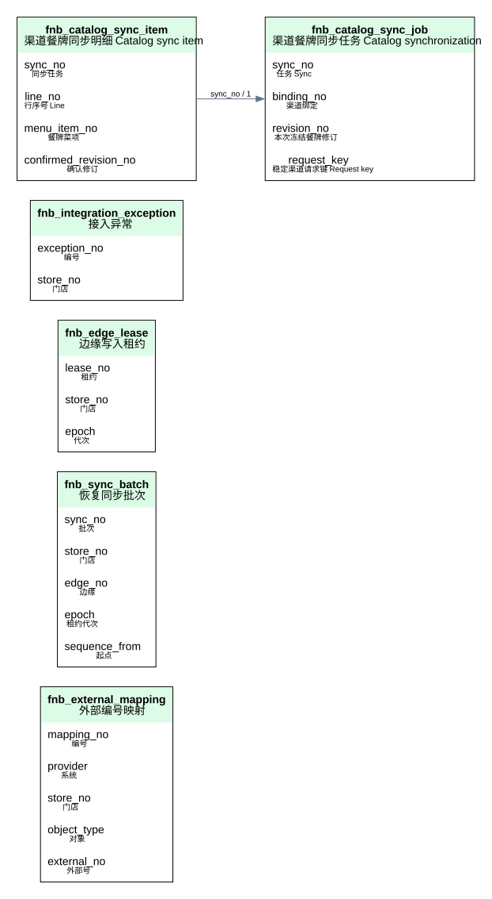

`fnb_external_mapping` 外部编号映射；`fnb_sync_batch` 恢复同步批次；`fnb_edge_lease` 边缘写入租约；`fnb_integration_exception` 接入异常；`fnb_catalog_sync_job` 渠道餐牌同步任务 Catalog synchronization；`fnb_catalog_sync_item` 渠道餐牌同步明细 Catalog sync item。跨模块编号通过受权服务验证，避免跨库外键或直接JOIN。

### 业态专项 Formats 1

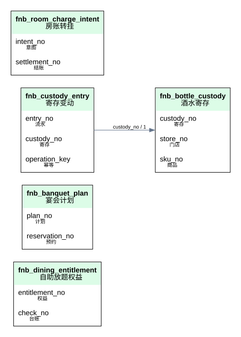

`fnb_dining_entitlement` 自助放题权益；`fnb_banquet_plan` 宴会计划；`fnb_bottle_custody` 酒水寄存；`fnb_custody_entry` 寄存变动；`fnb_room_charge_intent` 房账转挂；`fnb_business_organization` fnb_business_organization；`fnb_service_form` fnb_service_form；`fnb_service_attendee` fnb_service_attendee。跨模块编号通过受权服务验证，避免跨库外键或直接JOIN。

### 业态专项 Formats 2

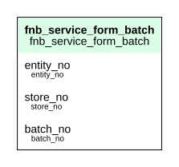

`fnb_service_form_batch` fnb_service_form_batch。跨模块编号通过受权服务验证，避免跨库外键或直接JOIN。

## 四、逐表字段与约束

**MOD-01 桌台与就餐管理 查表索引：** `fnb_check`、`fnb_check_batch_membership`、`fnb_check_relation`、`fnb_guest_session`、`fnb_reservation`、`fnb_seat`、`fnb_table`、`fnb_table_area`、`fnb_table_occupancy`、`fnb_table_operation`、`fnb_table_token`、`fnb_queue_ticket`、`fnb_reservation_table`、`fnb_check_freeze`、`fnb_check_line_membership`、`fnb_reservation_preorder`、`fnb_service_slot`、`fnb_capacity_claim`、`fnb_service_handover`、`fnb_service_handover_item`、`fnb_service_responsibility`、`fnb_operation_case`、`fnb_business_command`、`fnb_queue_notice`。

**MOD-02 菜品与餐牌管理 查表索引：** `fnb_bundle`、`fnb_bundle_choice`、`fnb_bundle_group`、`fnb_config_revision`、`fnb_dish`、`fnb_dish_option_group`、`fnb_menu`、`fnb_menu_category`、`fnb_menu_context`、`fnb_menu_exception`、`fnb_menu_item`、`fnb_menu_item_sku`、`fnb_menu_schedule`、`fnb_menu_store`、`fnb_modifier`、`fnb_modifier_component`、`fnb_option_group`、`fnb_option_group_item`、`fnb_order_line`、`fnb_sales_quota_claim`、`fnb_sales_restriction`、`fnb_store_policy`、`fnb_menu_channel_binding`、`fnb_menu_item_option_group`、`fnb_recipe`、`fnb_recipe_line`、`fnb_recipe_adjustment`。

**MOD-03 点餐与订单管理 查表索引：** `fnb_charge_intent`、`fnb_check`、`fnb_check_cart`、`fnb_check_cart_item`、`fnb_core_line_allocation`、`fnb_guest_session`、`fnb_order_batch`、`fnb_order_component`、`fnb_order_line`、`fnb_order_modifier`、`fnb_return`、`fnb_return_item`、`fnb_seat`、`fnb_settlement`、`fnb_scheduled_dispatch`、`fnb_fee_source_binding`、`fnb_cart_delivery`、`fnb_fee_contract_claim`。

**MOD-04 厨房与履约管理 查表索引：** `fnb_course`、`fnb_kitchen_task`、`fnb_kitchen_ticket`、`fnb_order_batch`、`fnb_order_component`、`fnb_return_item`、`fnb_service_event`、`fnb_store_policy`、`fnb_production_consumption`、`fnb_production_consumption_line`。

**MOD-05 收银与结账管理 查表索引：** `fnb_cash_payment_link`、`fnb_cash_shift`、`fnb_charge_intent`、`fnb_room_charge_intent`、`fnb_settlement`、`fnb_settlement_item`、`fnb_business_share_plan`。

**MOD-06 退餐与售后管理 查表索引：** `fnb_action_log`、`fnb_charge_intent`、`fnb_check_cart_item`、`fnb_close_adjustment`、`fnb_order_batch`、`fnb_return`、`fnb_return_item`、`fnb_return_amendment`。

**MOD-07 打印、通知与设备管理 查表索引：** `prn_attempt`、`prn_device`、`prn_job`、`prn_route`、`prn_template`、`fnb_dining_device`、`fnb_identity_authorization`、`fnb_identity_operation`、`fnb_kds_cursor`、`fnb_kds_subscription`、`fnb_kds_event`、`fnb_station_runtime`、`fnb_kds_voice_command`。

**MOD-08 班次与现金管理 查表索引：** `fnb_cash_count`、`fnb_cash_entry`、`fnb_cash_payment_link`、`fnb_cash_shift`、`fnb_close_exception`。

**MOD-09 营业日、日结与对账管理 查表索引：** `fnb_business_day`、`fnb_close_adjustment`、`fnb_close_balance`、`fnb_close_exception`、`fnb_close_run`、`fnb_report_run`。

**MOD-10 经营报表管理 查表索引：** `fnb_metric_definition`、`fnb_report_run`、`rpt_food_metric_daily`。

**MOD-11 专项业态管理 查表索引：** `fnb_banquet_plan`、`fnb_bottle_custody`、`fnb_charge_intent`、`fnb_custody_entry`、`fnb_dining_entitlement`、`fnb_room_charge_intent`、`fnb_business_organization`、`fnb_service_form`、`fnb_service_attendee`、`fnb_service_form_batch`。

**MOD-12 第三方接入与离线营业 查表索引：** `fnb_action_log`、`fnb_edge_lease`、`fnb_external_mapping`、`fnb_integration_exception`、`fnb_store_policy`、`fnb_sync_batch`、`fnb_catalog_sync_job`、`fnb_catalog_sync_item`。

**MOD-13 营业配置与权限治理 查表索引：** `fnb_action_log`、`fnb_business_day`、`fnb_check_cart`、`fnb_config_revision`、`fnb_sales_restriction`、`fnb_service_calendar`、`fnb_store_policy`。

### fnb_dish · 餐饮菜品 Dish

归属：餐饮域 B。合并公共字段；下面仅列业务列。

| 字段 | 类型 | 必填 | 含义/逻辑引用 | 引入/变更 |
|---|---|---|---|---|
| `goods_no` | varchar(32) | 是 | 基础商品 Product → `prd_goods.goods_no` | V1 |
| `dish_kind` | varchar(16) | 是 | 类型 SINGLE / BUNDLE / ADDON | V1 |
| `prep_seconds` | int | 是 | 建议制作秒数 Prep seconds | V1 |
| `status` | varchar(16) | 是 | 配置状态 Status | V1 |
| `presentation` | json | 是 | 餐饮别名/多语言/标签/过敏展示覆盖；基础图文仍引用商品 | V1 |
| `measurement_policy` | json | 是 | 单位及称重允差，成交计量须核心支持 | V1 |
| `config_version` | bigint | 是 | 餐饮属性规则版本 | V1 |

唯一键：`(goods_no)`。

约束：配置版本冻结；关联对象同主体，SKU必须属于指定商品；具体选择规则见旧菜品模型，以下修订优先。

### fnb_bundle · 套餐规格 Bundle SKU

归属：餐饮域 B。合并公共字段；下面仅列业务列。

| 字段 | 类型 | 必填 | 含义/逻辑引用 | 引入/变更 |
|---|---|---|---|---|
| `sku_no` | varchar(32) | 是 | 套餐规格 Bundle SKU → `prd_sku.sku_no` | V1 |
| `config_version` | bigint | 是 | 配置版本 Version | V1 |
| `status` | varchar(16) | 是 | 状态 Status | V1 |
| `published_revision_no` | varchar(32) | 否 | 当前已生效配置快照 → `fnb_config_revision.revision_no` | V1 |

唯一键：`(sku_no)`。

约束：配置版本冻结；关联对象同主体，SKU必须属于指定商品；具体选择规则见旧菜品模型，以下修订优先。

### fnb_bundle_group · 套餐选购组 Bundle group

归属：餐饮域 B。合并公共字段；下面仅列业务列。

| 字段 | 类型 | 必填 | 含义/逻辑引用 | 引入/变更 |
|---|---|---|---|---|
| `group_no` | varchar(32) | 是 | 选购组编号 Group ID | V1 |
| `bundle_sku_no` | varchar(32) | 是 | 所属套餐 Bundle → `fnb_bundle.sku_no` | V1 |
| `name` | varchar(64) | 是 | 组名 Group name | V1 |
| `min_qty` | decimal(18,6) | 是 | 最少选几份 Minimum | V1 |
| `max_qty` | decimal(18,6) | 是 | 最多选几份 Maximum | V1 |
| `base_sku_no` | varchar(32) | 否 | 差价基准 SKU → `prd_sku.sku_no` | V1 |
| `sort_no` | int | 是 | 展示顺序 Sort | V1 |

唯一键：`(group_no)`。

约束：配置版本冻结；关联对象同主体，SKU必须属于指定商品；具体选择规则见旧菜品模型，以下修订优先。；草稿子关系按业务唯一键upsert/差集更新，不能统一逻辑删除再插入导致唯一键冲突；受控物理替换仅限未发布工作头，已发布快照永不修改。

### fnb_bundle_choice · 套餐可选项 Bundle choice

归属：餐饮域 B。合并公共字段；下面仅列业务列。

| 字段 | 类型 | 必填 | 含义/逻辑引用 | 引入/变更 |
|---|---|---|---|---|
| `choice_no` | varchar(32) | 是 | 选项编号 Choice ID | V1 |
| `group_no` | varchar(32) | 是 | 所属组 Group → `fnb_bundle_group.group_no` | V1 |
| `sku_no` | varchar(32) | 是 | 成员规格 Member SKU → `prd_sku.sku_no` | V1 |
| `units_per_pick` | decimal(12,3) | 是 | 每次选择份数 Units | V1 |
| `min_qty` | decimal(18,6) | 是 | 单项最少选择 Min picks | V1 |
| `max_qty` | decimal(18,6) | 是 | 单项最多选择 Max picks | V1 |
| `default_qty` | decimal(18,6) | 是 | 默认选择 Default picks | V1 |
| `price_mode` | varchar(24) | 是 | 计价 INCLUDED / ADD_SKU / DIFF_BASE | V1 |
| `sort_no` | int | 是 | 顺序 Sort | V1 |

唯一键：`(group_no, sku_no)`；`(choice_no)`。

约束：配置版本冻结；关联对象同主体，SKU必须属于指定商品；具体选择规则见旧菜品模型，以下修订优先。；草稿子关系按业务唯一键upsert/差集更新，不能统一逻辑删除再插入导致唯一键冲突；受控物理替换仅限未发布工作头，已发布快照永不修改。

### fnb_modifier · 口味与配料 Modifier

归属：餐饮域 B。合并公共字段；下面仅列业务列。

| 字段 | 类型 | 必填 | 含义/逻辑引用 | 引入/变更 |
|---|---|---|---|---|
| `modifier_no` | varchar(32) | 是 | 配料编号 Modifier ID | V1 |
| `name` | varchar(64) | 是 | 名称 Name | V1 |
| `kind` | varchar(16) | 是 | 类型 ADDON / COMBO；免费口味复用SPEC_VALUE | V1 |
| `sales_sku_no` | varchar(32) | 否 | 计价规格 Pricing SKU → `prd_sku.sku_no` | V1 |
| `status` | varchar(16) | 是 | 状态 Status | V1 |
| `published_revision_no` | varchar(32) | 否 | 当前已生效配置快照 → `fnb_config_revision.revision_no` | V1 |

唯一键：`(modifier_no)`。

约束：kind仅ADDON/COMBO；收费对象引用sales_sku_no；口味值复用prd_spec_value，不另建字典。

### fnb_modifier_component · 配料组合明细 Modifier component

归属：餐饮域 B。合并公共字段；下面仅列业务列。

| 字段 | 类型 | 必填 | 含义/逻辑引用 | 引入/变更 |
|---|---|---|---|---|
| `component_no` | varchar(32) | 是 | 组合明细编号 Component ID | V1 |
| `combo_no` | varchar(32) | 是 | 组合配料 Combo → `fnb_modifier.modifier_no` | V1 |
| `member_no` | varchar(32) | 是 | 单项配料 Member → `fnb_modifier.modifier_no` | V1 |
| `quantity` | decimal(12,3) | 是 | 每组合用量 Quantity | V1 |

唯一键：`(combo_no, member_no)`；`(component_no)`。

约束：配置版本冻结；关联对象同主体，SKU必须属于指定商品；具体选择规则见旧菜品模型，以下修订优先。；草稿子关系按业务唯一键upsert/差集更新，不能统一逻辑删除再插入导致唯一键冲突；受控物理替换仅限未发布工作头，已发布快照永不修改。

### fnb_option_group · 选配组 Option group

归属：餐饮域 B。合并公共字段；下面仅列业务列。

| 字段 | 类型 | 必填 | 含义/逻辑引用 | 引入/变更 |
|---|---|---|---|---|
| `group_no` | varchar(32) | 是 | 组编号 Group ID | V1 |
| `name` | varchar(64) | 是 | 组名 | V1 |
| `min_qty` | decimal(18,6) | 是 | 最少总选择量 | V1 |
| `max_qty` | decimal(18,6) | 是 | 最多总选择量 | V1 |
| `published_revision_no` | varchar(32) | 否 | 当前已生效配置快照 → `fnb_config_revision.revision_no` | V1 |
| `status` | varchar(16) | 是 | DRAFT / ACTIVE / DISABLED | V1 |
| `selection_rules` | json | 是 | 有schema的互斥/依赖约束，按选项号引用 | V1 |

唯一键：`(group_no)`。

约束：配置版本冻结；关联对象同主体，SKU必须属于指定商品；具体选择规则见旧菜品模型，以下修订优先。

### fnb_option_group_item · 组内选项 Group option

归属：餐饮域 B。合并公共字段；下面仅列业务列。

| 字段 | 类型 | 必填 | 含义/逻辑引用 | 引入/变更 |
|---|---|---|---|---|
| `option_item_no` | varchar(32) | 是 | 选项编号 | V1 |
| `group_no` | varchar(32) | 是 | 选择组 → `fnb_option_group.group_no` | V1 |
| `source_kind` | varchar(16) | 是 | SPEC_VALUE/MODIFIER | V1 |
| `spec_value_no` | varchar(64) | 否 | 基础口味值 → `prd_spec_value.value_no` | V1 / V3 |
| `modifier_no` | varchar(32) | 否 | 餐饮配料 → `fnb_modifier.modifier_no` | V1 |
| `max_qty` | decimal(18,6) | 是 | 单项上限 | V1 |
| `default_qty` | decimal(18,6) | 是 | 默认数量 | V1 |
| `sort_no` | int | 是 | 排序 | V1 |
| `min_qty` | decimal(18,6) | 是 | 本选项最小选择量 | V1 |

唯一键：`(option_item_no)`；`(group_no, spec_value_no)`；`(group_no, modifier_no)`。

约束：source_kind决定且仅允许一个引用非空；SPEC_VALUE须经prd_spec_dim语义及组绑定校验；不直接用PROP描述值作为顾客选择授权。；草稿子关系按业务唯一键upsert/差集更新，不能统一逻辑删除再插入导致唯一键冲突；受控物理替换仅限未发布工作头，已发布快照永不修改。

### fnb_dish_option_group · 菜品选配绑定 Dish options

归属：餐饮域 B。合并公共字段；下面仅列业务列。

| 字段 | 类型 | 必填 | 含义/逻辑引用 | 引入/变更 |
|---|---|---|---|---|
| `goods_no` | varchar(32) | 是 | 菜品 Product → `fnb_dish.goods_no` | V1 |
| `group_no` | varchar(32) | 是 | 选配组 Group → `fnb_option_group.group_no` | V1 |
| `sort_no` | int | 是 | 顺序 Sort | V1 |

唯一键：`(goods_no, group_no)`。

约束：配置版本冻结；关联对象同主体，SKU必须属于指定商品；具体选择规则见旧菜品模型，以下修订优先。；草稿子关系按业务唯一键upsert/差集更新，不能统一逻辑删除再插入导致唯一键冲突；受控物理替换仅限未发布工作头，已发布快照永不修改。

### fnb_menu · 餐牌 Menu

归属：餐饮域 B。合并公共字段；下面仅列业务列。

| 字段 | 类型 | 必填 | 含义/逻辑引用 | 引入/变更 |
|---|---|---|---|---|
| `menu_no` | varchar(32) | 是 | 餐牌编号 Menu ID | V1 |
| `name` | varchar(64) | 是 | 名称 Name | V1 |
| `menu_type` | varchar(16) | 是 | 类型 STANDARD / TIME / SEASON / EVENT | V1 |
| `timezone` | varchar(64) | 是 | 时区 Time zone | V1 |
| `valid_from` | date | 否 | 生效日 Valid from | V1 |
| `valid_to` | date | 否 | 结束日 Valid to | V1 |
| `priority` | int | 是 | 互斥组内优先级 Priority | V1 |
| `exclusive_group` | varchar(32) | 否 | 互斥餐牌组 Exclusive group | V1 |
| `status` | varchar(16) | 是 | DRAFT / PUBLISHED / DISABLED | V1 |
| `config_version` | bigint | 是 | 配置版本 Version | V1 |
| `published_revision_no` | varchar(32) | 否 | 当前已生效配置快照 → `fnb_config_revision.revision_no` | V1 |

唯一键：`(menu_no)`。

约束：配置版本冻结；关联对象同主体，SKU必须属于指定商品；具体选择规则见旧菜品模型，以下修订优先。

### fnb_menu_store · 餐牌门店 Menu stores

归属：餐饮域 B。合并公共字段；下面仅列业务列。

| 字段 | 类型 | 必填 | 含义/逻辑引用 | 引入/变更 |
|---|---|---|---|---|
| `menu_no` | varchar(32) | 是 | 餐牌 Menu → `fnb_menu.menu_no` | V1 |
| `store_no` | varchar(32) | 是 | 门店 Store → `mch_store.store_no` | V1 |
| `override_revision_no` | varchar(32) | 否 | 获准门店差异快照 → `fnb_config_revision.revision_no` | V1 |

唯一键：`(menu_no, store_no)`。

约束：配置版本冻结；关联对象同主体，SKU必须属于指定商品；具体选择规则见旧菜品模型，以下修订优先。；草稿子关系按业务唯一键upsert/差集更新，不能统一逻辑删除再插入导致唯一键冲突；受控物理替换仅限未发布工作头，已发布快照永不修改。

### fnb_menu_context · 餐牌入口 Menu context

归属：餐饮域 B。合并公共字段；下面仅列业务列。

| 字段 | 类型 | 必填 | 含义/逻辑引用 | 引入/变更 |
|---|---|---|---|---|
| `context_no` | varchar(32) | 是 | 范围编号 Context ID | V1 |
| `menu_no` | varchar(32) | 是 | 餐牌 Menu → `fnb_menu.menu_no` | V1 |
| `order_source` | varchar(24) | 是 | 下单来源 Source | V1 |
| `fulfillment` | varchar(24) | 是 | 履约方式 Fulfillment | V1 |
| `channel_binding_no` | varchar(32) | 否 | 外送绑定；本地为空 → `fnb_menu_channel_binding.binding_no` | V7 |
| `channel_scope_key` | varchar(32) | 是 | 服务端归一为LOCAL或绑定号 | V7 |
| `price_policy_ref` | varchar(64) | 否 | 报价权威价格策略引用 | V7 |

唯一键：`(menu_no, order_source, fulfillment, channel_scope_key)`；`(context_no)`。

约束：配置版本冻结；关联对象同主体，SKU必须属于指定商品；具体选择规则见旧菜品模型，以下修订优先。；草稿子关系按业务唯一键upsert/差集更新，不能统一逻辑删除再插入导致唯一键冲突；受控物理替换仅限未发布工作头，已发布快照永不修改。；channel_scope_key不接受客户端设置，LOCAL与绑定号归一；外送不得回退堂食价，策略未受权核验保持草稿。

### fnb_menu_schedule · 餐牌时段 Menu schedule

归属：餐饮域 B。合并公共字段；下面仅列业务列。

| 字段 | 类型 | 必填 | 含义/逻辑引用 | 引入/变更 |
|---|---|---|---|---|
| `schedule_no` | varchar(32) | 是 | 时段编号 Schedule ID | V1 |
| `menu_no` | varchar(32) | 是 | 餐牌 Menu → `fnb_menu.menu_no` | V1 |
| `weekday` | tinyint | 是 | 周一至周日 1-7 | V1 |
| `start_time` | time | 是 | 开始时间 Start | V1 |
| `end_time` | time | 是 | 结束时间 End | V1 |
| `end_day_offset` | tinyint | 是 | 跨日偏移 0 / 1 | V1 |

唯一键：`(schedule_no)`。

约束：配置版本冻结；关联对象同主体，SKU必须属于指定商品；具体选择规则见旧菜品模型，以下修订优先。；草稿子关系按业务唯一键upsert/差集更新，不能统一逻辑删除再插入导致唯一键冲突；受控物理替换仅限未发布工作头，已发布快照永不修改。

### fnb_menu_exception · 餐牌例外日 Menu exception

归属：餐饮域 B。合并公共字段；下面仅列业务列。

| 字段 | 类型 | 必填 | 含义/逻辑引用 | 引入/变更 |
|---|---|---|---|---|
| `exception_no` | varchar(32) | 是 | 例外编号 Exception ID | V1 |
| `menu_no` | varchar(32) | 是 | 餐牌 Menu → `fnb_menu.menu_no` | V1 |
| `local_date` | date | 是 | 本地日期 Local date | V1 |
| `mode` | varchar(16) | 是 | CLOSED / OPEN | V1 |
| `start_time` | time | 否 | 营业开始 Start | V1 |
| `end_time` | time | 否 | 营业结束 End | V1 |
| `end_day_offset` | tinyint | 是 | 跨日偏移 Offset | V1 |

唯一键：`(menu_no, local_date)`；`(exception_no)`。

约束：配置版本冻结；关联对象同主体，SKU必须属于指定商品；具体选择规则见旧菜品模型，以下修订优先。；草稿子关系按业务唯一键upsert/差集更新，不能统一逻辑删除再插入导致唯一键冲突；受控物理替换仅限未发布工作头，已发布快照永不修改。

### fnb_menu_category · 餐牌分类 Menu category

归属：餐饮域 B。合并公共字段；下面仅列业务列。

| 字段 | 类型 | 必填 | 含义/逻辑引用 | 引入/变更 |
|---|---|---|---|---|
| `category_no` | varchar(32) | 是 | 分类编号 Category ID | V1 |
| `menu_no` | varchar(32) | 是 | 所属餐牌 Menu → `fnb_menu.menu_no` | V1 |
| `name` | varchar(64) | 是 | 名称 Name | V1 |
| `sort_no` | int | 是 | 顺序 Sort | V1 |

唯一键：`(category_no)`。

约束：配置版本冻结；关联对象同主体，SKU必须属于指定商品；具体选择规则见旧菜品模型，以下修订优先。；草稿子关系按业务唯一键upsert/差集更新，不能统一逻辑删除再插入导致唯一键冲突；受控物理替换仅限未发布工作头，已发布快照永不修改。

### fnb_menu_item · 餐牌菜品 Menu item

归属：餐饮域 B。合并公共字段；下面仅列业务列。

| 字段 | 类型 | 必填 | 含义/逻辑引用 | 引入/变更 |
|---|---|---|---|---|
| `menu_item_no` | varchar(32) | 是 | 条目编号 Item ID | V1 |
| `category_no` | varchar(32) | 是 | 所属分类 Category → `fnb_menu_category.category_no` | V1 |
| `goods_no` | varchar(32) | 是 | 基础商品 Product → `prd_goods.goods_no` | V1 |
| `sort_no` | int | 是 | 顺序 Sort | V1 |
| `enabled` | boolean | 是 | 是否启用 Enabled | V1 |
| `sku_scope` | varchar(16) | 是 | ALL / EXPLICIT；EXPLICIT必须非空 | V1 |
| `option_mode` | varchar(16) | 是 | INHERIT / REPLACE；REPLACE空组禁选 | V6 |
| `price_overrides` | json | 否 | Published restaurant menu SKU price overrides; no native product price mutation | V25 |

唯一键：`(category_no, goods_no)`；`(menu_item_no)`。

约束：配置版本冻结；关联对象同主体，SKU必须属于指定商品；具体选择规则见旧菜品模型，以下修订优先。；草稿子关系按业务唯一键upsert/差集更新，不能统一逻辑删除再插入导致唯一键冲突；受控物理替换仅限未发布工作头，已发布快照永不修改。

### fnb_menu_item_sku · 餐牌可售规格 Menu SKU

归属：餐饮域 B。合并公共字段；下面仅列业务列。

| 字段 | 类型 | 必填 | 含义/逻辑引用 | 引入/变更 |
|---|---|---|---|---|
| `menu_item_no` | varchar(32) | 是 | 餐牌条目 Menu item → `fnb_menu_item.menu_item_no` | V1 |
| `sku_no` | varchar(32) | 是 | 可售规格 SKU → `prd_sku.sku_no` | V1 |
| `selection_mode` | varchar(16) | 是 | EXPLICIT；空白名单语义存父项 | V1 |
| `recipe_no` | varchar(32) | 否 | 同SKU配方变体引用 → `fnb_recipe.recipe_no` | V6 |

唯一键：`(menu_item_no, sku_no)`。

约束：配置版本冻结；关联对象同主体，SKU必须属于指定商品；具体选择规则见旧菜品模型，以下修订优先。；草稿子关系按业务唯一键upsert/差集更新，不能统一逻辑删除再插入导致唯一键冲突；受控物理替换仅限未发布工作头，已发布快照永不修改。

### fnb_station · 制作工位 Kitchen station

归属：餐饮域 B。合并公共字段；下面仅列业务列。

| 字段 | 类型 | 必填 | 含义/逻辑引用 | 引入/变更 |
|---|---|---|---|---|
| `station_no` | varchar(32) | 是 | 工位编号 Station ID | V1 |
| `store_no` | varchar(32) | 是 | 所属门店 Store → `mch_store.store_no` | V1 |
| `name` | varchar(64) | 是 | 名称 Name | V1 |
| `station_type` | varchar(24) | 是 | HOT / COLD / BAR / PACK | V1 |
| `enabled` | boolean | 是 | 启用 Enabled | V1 |
| `published_revision_no` | varchar(32) | 否 | 当前已生效配置快照 → `fnb_config_revision.revision_no` | V1 |

唯一键：`(station_no)`。

约束：配置版本冻结；关联对象同主体，SKU必须属于指定商品；具体选择规则见旧菜品模型，以下修订优先。

### fnb_sku_station · 规格工位路由 SKU routing

归属：餐饮域 B。合并公共字段；下面仅列业务列。

| 字段 | 类型 | 必填 | 含义/逻辑引用 | 引入/变更 |
|---|---|---|---|---|
| `sku_no` | varchar(32) | 是 | 菜品或配料规格 SKU → `prd_sku.sku_no` | V1 |
| `station_no` | varchar(32) | 是 | 制作工位 Station → `fnb_station.station_no` | V1 |
| `task_role` | varchar(16) | 是 | MAKE / ASSEMBLE / PACK | V1 |
| `route_version` | bigint | 是 | 路由版本 Version | V1 |
| `store_no` | varchar(32) | 是 | 路由适用门店 → `mch_store.store_no` | V1 |

唯一键：`(store_no, sku_no, station_no, task_role)`。

约束：配置版本冻结；关联对象同主体，SKU必须属于指定商品；具体选择规则见旧菜品模型，以下修订优先。；草稿子关系按业务唯一键upsert/差集更新，不能统一逻辑删除再插入导致唯一键冲突；受控物理替换仅限未发布工作头，已发布快照永不修改。；派工时按受理瞬间route_version冻结路由到ticket/task，即使当前头被改也不能重算旧任务目标。

### fnb_store_policy · 门店营业策略

归属：餐饮域 A。合并公共字段；下面仅列业务列。

| 字段 | 类型 | 必填 | 含义/逻辑引用 | 引入/变更 |
|---|---|---|---|---|
| `policy_no` | varchar(32) | 是 | 策略号 | V1 |
| `store_no` | varchar(32) | 是 | 门店 → `mch_store.store_no` | V1 |
| `timezone` | varchar(64) | 是 | IANA时区 | V1 |
| `cutover_minute` | int | 是 | 营业日切点 | V1 |
| `effective_from` | datetime(3) | 是 | 生效时刻 | V1 |
| `pay_policy` | varchar(16) | 是 | PREPAY/POSTPAY | V1 |
| `capabilities` | json | 是 | 能力码集合 | V1 |
| `settings` | json | 是 | 版本化限额与审批策略 | V1 |

唯一键：`(policy_no)`；`(store_no, effective_from)`。

约束：发布前校验切点0至1439；新增版本不覆盖已生效历史；timezone仅餐饮营业日核算时区，不替代全局营业时间；pay_policy是先后付流程而非门店offlinePayEnabled开关，须与基础能力求交

### fnb_service_calendar · 餐饮接单日历例外

归属：餐饮域 A。合并公共字段；下面仅列业务列。

| 字段 | 类型 | 必填 | 含义/逻辑引用 | 引入/变更 |
|---|---|---|---|---|
| `calendar_no` | varchar(32) | 是 | 编号 | V1 |
| `store_no` | varchar(32) | 是 | 门店 → `mch_store.store_no` | V1 |
| `local_date` | date | 是 | 门店日期 | V1 |
| `mode` | varchar(16) | 是 | OPEN/CLOSED | V1 |
| `intervals` | json | 是 | 受限营业时段数组 | V1 |
| `policy_no` | varchar(32) | 是 | 生效策略 → `fnb_store_policy.policy_no` | V1 |

唯一键：`(calendar_no)`；`(store_no, local_date)`。

约束：只限制餐饮接单餐段，不维护门店营业时间；与mch_store状态和openHours求交。OpenHours解析null不是营业许可；严格接单时提示完善共享营业配置。通用结构化营业时间另由商户域扩展，不能由此表反向成为全局真源。

### fnb_table · 桌台

归属：餐饮域 C。合并公共字段；下面仅列业务列。

| 字段 | 类型 | 必填 | 含义/逻辑引用 | 引入/变更 |
|---|---|---|---|---|
| `table_no` | varchar(32) | 是 | 桌号 | V1 |
| `store_no` | varchar(32) | 是 | 门店 → `mch_store.store_no` | V1 |
| `capacity` | int | 是 | 座位 | V1 |
| `resource_no` | varchar(32) | 否 | 共享资源引用 | V1 |
| `status` | varchar(16) | 是 | ACTIVE/DISABLED | V1 |
| `area_no` | varchar(32) | 是 | 桌区 Area → `fnb_table_area.area_no` | V1 |
| `code` | varchar(32) | 是 | 门店内桌台编码 Code | V1 |
| `name` | varchar(64) | 是 | 展示名称 Name | V1 |
| `sort_no` | int | 是 | 排序 Sort | V1 |
| `turnover_state` | varchar(16) | 是 | IDLE / IN_USE / NEEDS_CLEANING | V1 |

唯一键：`(table_no)`；`(store_no, code)`。

约束：status仅ACTIVE/DISABLED配置状态；turnover_state是服务端维护的资源投影，不是支付状态。锁定桌台仲裁行核验活动占用座位总和不超过capacity；有占用禁止停用/归档/缩容。清台不得删除未结应收；同店桌号编码终身不复用。

### fnb_table_token · 桌码凭证

归属：餐饮域 C。合并公共字段；下面仅列业务列。

| 字段 | 类型 | 必填 | 含义/逻辑引用 | 引入/变更 |
|---|---|---|---|---|
| `token_no` | varchar(32) | 是 | 编号 | V1 |
| `table_no` | varchar(32) | 是 | 桌台 → `fnb_table.table_no` | V1 |
| `token_hash` | varbinary(64) | 是 | 凭证哈希 | V1 |
| `expires_at` | datetime(3) | 是 | 过期 | V1 |
| `revoked_at` | datetime(3) | 否 | 吊销时间 | V1 |
| `revoked_reason` | varchar(255) | 否 | 吊销原因 | V1 |

唯一键：`(token_no)`；`(token_hash)`。

约束：只存哈希，不把长期桌码当登录凭据

### fnb_reservation · 预约

归属：餐饮域 C。合并公共字段；下面仅列业务列。

| 字段 | 类型 | 必填 | 含义/逻辑引用 | 引入/变更 |
|---|---|---|---|---|
| `reservation_no` | varchar(32) | 是 | 预约号 | V1 |
| `store_no` | varchar(32) | 是 | 门店 → `mch_store.store_no` | V1 |
| `resource_hold_no` | varchar(32) | 否 | 共享占位号 | V1 |
| `buyer_no` | varchar(32) | 否 | 真实顾客 | V1 |
| `contact_ref` | varchar(64) | 是 | 加密联系方式引用 | V1 |
| `party_size` | int | 是 | 人数 | V1 |
| `start_at` | datetime(3) | 是 | 开始 | V1 |
| `end_at` | datetime(3) | 是 | 结束 | V1 |
| `status` | varchar(24) | 是 | HELD/CONFIRMED/ARRIVED/CANCELLED/NO_SHOW | V1 |
| `deposit_ref` | varchar(64) | 否 | 核心订金引用 | V1 |
| `check_no` | varchar(32) | 否 | 转开台结果 → `fnb_check.check_no` | V1 |
| `request_key` | varchar(64) | 否 | request key | V11 |
| `request_hash` | varchar(64) | 否 | request hash | V11 |

唯一键：`(reservation_no)`；`(entity_no, store_no, request_key)`。

约束：Local FOOD appointments use actual area/table locks and bounded membership; external resource/deposit/buyer-bound records remain fenced; arrival joins original check transaction.

### fnb_check · 就餐台账

归属：餐饮域 C。合并公共字段；下面仅列业务列。

| 字段 | 类型 | 必填 | 含义/逻辑引用 | 引入/变更 |
|---|---|---|---|---|
| `check_no` | varchar(32) | 是 | 台账号 | V1 |
| `store_no` | varchar(32) | 是 | 门店 → `mch_store.store_no` | V1 |
| `business_date` | date | 是 | 开台营业日 | V1 |
| `policy_no` | varchar(32) | 是 | 规则版本 → `fnb_store_policy.policy_no` | V1 |
| `party_size` | int | 是 | 人数 | V1 |
| `pay_mode` | varchar(16) | 是 | PREPAY/POSTPAY | V1 |
| `status` | varchar(24) | 是 | OPEN/SETTLING/CLOSED/MERGED/VOIDED | V1 |
| `opened_at` | datetime(3) | 是 | 开台时间 | V1 |
| `closed_at` | datetime(3) | 否 | 关闭时间 | V1 |
| `service_employee_no` | varchar(32) | 否 | 获准服务员工引用 | V1 |
| `service_state` | varchar(16) | 是 | OPEN / NEEDS_CLEANING / RELEASED；与结清状态分开 | V1 |

唯一键：`(check_no)`。

约束：无应收定价字段；业务状态与结清状态由核心余额和在途结果共同守卫

### fnb_table_occupancy · 占桌关系

归属：餐饮域 C。合并公共字段；下面仅列业务列。

| 字段 | 类型 | 必填 | 含义/逻辑引用 | 引入/变更 |
|---|---|---|---|---|
| `occupancy_no` | varchar(32) | 是 | 占用号 | V1 |
| `table_no` | varchar(32) | 是 | 桌号 → `fnb_table.table_no` | V1 |
| `check_no` | varchar(32) | 是 | 台账号 → `fnb_check.check_no` | V1 |
| `seats` | int | 是 | 占座数 | V1 |
| `sharing_mode` | varchar(16) | 是 | EXCLUSIVE / SHARED；V2新增，历史占用按EXCLUSIVE回填 | V2 |
| `started_at` | datetime(3) | 是 | 开始 | V1 |
| `ended_at` | datetime(3) | 否 | 结束 | V1 |
| `resource_claim_no` | varchar(32) | 否 | 资源仲裁号 | V1 |

唯一键：`(occupancy_no)`。

约束：锁定桌台仲裁行检查容量；不设活动table_no唯一以支持拼桌

### fnb_check_relation · 合拆台关系

归属：餐饮域 C。合并公共字段；下面仅列业务列。

| 字段 | 类型 | 必填 | 含义/逻辑引用 | 引入/变更 |
|---|---|---|---|---|
| `relation_no` | varchar(32) | 是 | 关系号 | V1 |
| `source_check_no` | varchar(32) | 是 | 源台账 | V1 |
| `target_check_no` | varchar(32) | 是 | 目标台账 | V1 |
| `kind` | varchar(16) | 是 | MERGE/SPLIT | V1 |
| `operation_no` | varchar(32) | 是 | 操作号 | V1 |
| `reason` | varchar(255) | 是 | 原因 | V1 |

唯一键：`(relation_no)`；`(operation_no, source_check_no, target_check_no)`。

约束：保留原归属，禁止关系环，不直接搬已付核心单

### fnb_guest_session · 桌台顾客会话

归属：餐饮域 C。合并公共字段；下面仅列业务列。

| 字段 | 类型 | 必填 | 含义/逻辑引用 | 引入/变更 |
|---|---|---|---|---|
| `session_no` | varchar(32) | 是 | 会话号 | V1 |
| `check_no` | varchar(32) | 否 | 台账 → `fnb_check.check_no` | V1 |
| `buyer_no` | varchar(32) | 否 | 顾客 | V1 |
| `device_no` | varchar(32) | 否 | 终端 | V1 |
| `token_hash` | varbinary(64) | 是 | 短期会话 | V1 |
| `expires_at` | datetime(3) | 是 | 有效期 | V1 |
| `scope` | json | 是 | 范围 | V1 |
| `store_no` | varchar(32) | 是 | 门店 Store → `mch_store.store_no` | V1 |
| `table_no` | varchar(32) | 否 | 扫码桌台，可未开台 → `fnb_table.table_no` | V1 |
| `revoked_at` | datetime(3) | 否 | 主动结束/设备清理时间 | V1 |

唯一键：`(session_no)`；`(token_hash)`。

约束：终端结束即失效，不存明文token

### fnb_seat · 台账座位

归属：餐饮域 C。合并公共字段；下面仅列业务列。

| 字段 | 类型 | 必填 | 含义/逻辑引用 | 引入/变更 |
|---|---|---|---|---|
| `seat_no` | varchar(32) | 是 | 座位号 | V1 |
| `check_no` | varchar(32) | 是 | 台账 → `fnb_check.check_no` | V1 |
| `label` | varchar(32) | 是 | 座位标签 | V1 |
| `guest_ref` | varchar(32) | 否 | 临时顾客引用 | V1 |

唯一键：`(seat_no)`；`(check_no, label)`。

约束：同主体、引用有效、状态转换受聚合守卫；配置修改不影响历史快照。

### fnb_check_cart · 就餐购物车

归属：餐饮域 D。合并公共字段；下面仅列业务列。

| 字段 | 类型 | 必填 | 含义/逻辑引用 | 引入/变更 |
|---|---|---|---|---|
| `cart_no` | varchar(32) | 是 | 购物车号 | V1 |
| `store_no` | varchar(32) | 是 | 门店 → `mch_store.store_no` | V1 |
| `check_no` | varchar(32) | 否 | 台账 → `fnb_check.check_no` | V1 |
| `session_no` | varchar(32) | 否 | 无台会话 | V1 |
| `status` | varchar(16) | 是 | OPEN/SUBMITTING/CLOSED | V1 |
| `buyer_no` | varchar(32) | 否 | 真实买家/获准匿名主体 | V1 |
| `order_source` | varchar(24) | 是 | CASHIER / WAITER / QR_H5 / MINI_APP / KIOSK | V1 |
| `fulfillment` | varchar(16) | 是 | DINE_IN / PICKUP / DELIVERY | V1 |
| `scheduled_at` | datetime(3) | 否 | 预约出餐时点 | V1 |

唯一键：`(cart_no)`。

约束：check或session至少有一项；提交采用CAS版本

### fnb_check_cart_item · 购物车行

归属：餐饮域 D。合并公共字段；下面仅列业务列。

| 字段 | 类型 | 必填 | 含义/逻辑引用 | 引入/变更 |
|---|---|---|---|---|
| `cart_item_no` | varchar(32) | 是 | 行号 | V1 |
| `cart_no` | varchar(32) | 是 | 购物车 → `fnb_check_cart.cart_no` | V1 |
| `source_line_ref` | varchar(64) | 是 | 端侧源行 | V1 |
| `goods_no` | varchar(32) | 是 | 商品 → `prd_goods.goods_no` | V1 |
| `sku_no` | varchar(32) | 是 | SKU → `prd_sku.sku_no` | V1 |
| `qty` | decimal(18,6) | 是 | 数量 | V1 |
| `seat_no` | varchar(32) | 否 | 座位 → `fnb_seat.seat_no` | V1 |
| `course_no` | varchar(32) | 否 | 道次 → `fnb_course.course_no` | V1 |
| `selection` | json | 是 | 选配引用数量与版本 | V1 |
| `added_by` | varchar(32) | 是 | 实际添加人 | V1 |

唯一键：`(cart_item_no)`；`(cart_no, source_line_ref)`。

约束：核心普通下单qty是int，小数数量不能直接透传须计量契约

### fnb_order_batch · 提交意图及批次

归属：餐饮域 D。合并公共字段；下面仅列业务列。

| 字段 | 类型 | 必填 | 含义/逻辑引用 | 引入/变更 |
|---|---|---|---|---|
| `batch_no` | varchar(32) | 是 | 批次号 | V1 |
| `store_no` | varchar(32) | 是 | 门店 → `mch_store.store_no` | V1 |
| `check_no` | varchar(32) | 否 | 台账 → `fnb_check.check_no` | V1 |
| `request_key` | varchar(64) | 是 | 请求键 | V1 |
| `request_hash` | char(64) | 是 | 规范参数哈希 | V1 |
| `source` | varchar(24) | 是 | 入口 | V1 |
| `buyer_no` | varchar(32) | 否 | 真实买家 | V1 |
| `operator_no` | varchar(32) | 是 | 实际操作人 | V1 |
| `status` | varchar(24) | 是 | PREPARED / PLACING / UNKNOWN / BOUND / ACCEPTED / CANCEL_PENDING / CANCELLED / FAILED | V1 |
| `frozen_request` | json | 是 | 提交原始快照 | V1 |
| `accepted_at` | datetime(3) | 否 | 受理时间 | V1 |
| `cart_no` | varchar(32) | 是 | 源购物车 → `fnb_check_cart.cart_no` | V1 |
| `cart_version` | bigint | 是 | 选定草稿版本 | V1 |
| `quote_ref` | varchar(64) | 是 | 核心报价引用 | V1 |
| `quote_hash` | char(64) | 是 | 确认范围摘要 | V1 |
| `business_date` | date | 是 | 本批实际营业日，不覆盖开台日 | V1 |
| `policy_no` | varchar(32) | 是 | 批次规则快照 → `fnb_store_policy.policy_no` | V1 |
| `fulfillment` | varchar(16) | 是 | DINE_IN / PICKUP / DELIVERY | V1 |
| `pay_mode` | varchar(16) | 是 | PREPAY / POSTPAY | V1 |
| `scheduled_at` | datetime(3) | 否 | 计划出餐时刻 | V1 |
| `actor_realm` | varchar(16) | 是 | MERCHANT / CONSUMER / DEVICE / SYSTEM | V1 |
| `payer_ref` | varchar(64) | 否 | 资金权威提供实际付款人引用 | V1 |
| `quota_claim_refs` | json | 是 | 此批额度预占引用，绑定限制与量 | V1 |
| `next_recovery_at` | datetime(3) | 否 | 原请求投影下次恢复时间（短事务抢占后调用权威服务） | V8 |
| `party_no` | varchar(32) | 否 | Original anonymous dining session; not a platform account | V23 |

唯一键：`(batch_no)`；`(store_no, request_key)`。

约束：同键异参409；身份缺口不以店长或虚假顾客替代

### fnb_core_order_binding · 核心单绑定

归属：餐饮域 D。合并公共字段；下面仅列业务列。

| 字段 | 类型 | 必填 | 含义/逻辑引用 | 引入/变更 |
|---|---|---|---|---|
| `binding_no` | varchar(32) | 是 | 编号 | V1 |
| `batch_no` | varchar(32) | 是 | 批次 → `fnb_order_batch.batch_no` | V1 |
| `payment_root_no` | varchar(32) | 是 | ord_order.order_no → `ord_order.order_no` | V1 |
| `store_order_no` | varchar(32) | 是 | ord_sub_order.sub_order_no → `ord_sub_order.sub_order_no` | V1 |
| `status` | varchar(16) | 是 | BOUND/REVERSED | V1 |

唯一键：`(binding_no)`；`(batch_no, store_order_no)`；`(store_order_no)`。

约束：允许按人预分单产生多个根，所有绑定同门店

### fnb_order_line · 餐饮源行快照

归属：餐饮域 D。合并公共字段；下面仅列业务列。

| 字段 | 类型 | 必填 | 含义/逻辑引用 | 引入/变更 |
|---|---|---|---|---|
| `food_line_no` | varchar(32) | 是 | 源行 | V1 |
| `batch_no` | varchar(32) | 是 | 批次 → `fnb_order_batch.batch_no` | V1 |
| `goods_no` | varchar(32) | 是 | 商品 → `prd_goods.goods_no` | V1 |
| `sku_no` | varchar(32) | 是 | SKU → `prd_sku.sku_no` | V1 |
| `qty` | decimal(18,6) | 是 | 数量 | V1 |
| `seat_no` | varchar(32) | 否 | 座位 → `fnb_seat.seat_no` | V1 |
| `course_no` | varchar(32) | 否 | 道次 → `fnb_course.course_no` | V1 |
| `selection_version` | bigint | 是 | 配置版本 | V1 |
| `display_snapshot` | json | 是 | 名称菜单单位等历史展示 | V1 |
| `source_line_ref` | varchar(64) | 是 | 提交源行号 | V1 |
| `config_revision_nos` | json | 是 | 口味/套餐/餐牌冻结版本号 | V1 |
| `unit` | varchar(16) | 是 | 成交计量单位 | V1 |

唯一键：`(food_line_no)`；`(batch_no, source_line_ref)`。

约束：源行与核心行经分配表关联不按SKU取第一行

### fnb_core_line_allocation · 餐饮到核心行分配

归属：餐饮域 D。合并公共字段；下面仅列业务列。

| 字段 | 类型 | 必填 | 含义/逻辑引用 | 引入/变更 |
|---|---|---|---|---|
| `allocation_no` | varchar(32) | 是 | 编号 | V1 |
| `food_line_no` | varchar(32) | 是 | 餐饮源行 → `fnb_order_line.food_line_no` | V1 |
| `order_item_id` | bigint | 是 | ord_item.id → `ord_item.id` | V1 |
| `qty` | decimal(18,6) | 是 | 分配量 | V1 |
| `core_snapshot_hash` | char(64) | 是 | 核心成交快照指纹 | V1 |
| `core_amount_minor` | bigint | 是 | 核心原成交分配金额缓存，非餐饮自行计价 | V1 |
| `currency` | char(3) | 是 | 核心成交币种 | V1 |
| `unit` | varchar(16) | 是 | 核心分配数量单位 | V1 |
| `source_component_ref` | char(64) | 否 | 包含MAIN主项的原计价组件标识 | V8 |

唯一键：`(allocation_no)`；`(food_line_no, order_item_id)`。

约束：每核心行分配数量守恒；不同价格赠品不能歧义绑定 V8新增来源元数据可空只为兼容历史；新服务必须完整写入。请求原键跨通用幂等缓存过期仍唯一。

### fnb_order_component · 套餐组件快照

归属：餐饮域 D。合并公共字段；下面仅列业务列。

| 字段 | 类型 | 必填 | 含义/逻辑引用 | 引入/变更 |
|---|---|---|---|---|
| `component_no` | varchar(32) | 是 | 组件号 | V1 |
| `food_line_no` | varchar(32) | 是 | 父行 → `fnb_order_line.food_line_no` | V1 |
| `choice_no` | varchar(32) | 否 | 套餐配置引用 | V1 / V15 |
| `sku_no` | varchar(32) | 是 | 组件SKU → `prd_sku.sku_no` | V1 |
| `qty` | decimal(18,6) | 是 | 展开数量 | V1 |
| `selection_snapshot` | json | 是 | 选择与单位快照 | V1 |
| `component_kind` | varchar(24) | 是 | component kind | V15 |
| `source_component_ref` | varchar(64) | 否 | source component ref | V15 |

唯一键：`(component_no)`。

约束：同主体、引用有效、状态转换受聚合守卫；配置修改不影响历史快照。

### fnb_order_modifier · 口味配料快照

归属：餐饮域 D。合并公共字段；下面仅列业务列。

| 字段 | 类型 | 必填 | 含义/逻辑引用 | 引入/变更 |
|---|---|---|---|---|
| `selection_no` | varchar(32) | 是 | 选择号 | V1 |
| `food_line_no` | varchar(32) | 是 | 父行 → `fnb_order_line.food_line_no` | V1 |
| `component_no` | varchar(32) | 否 | 组件 → `fnb_order_component.component_no` | V1 |
| `source_kind` | varchar(16) | 是 | SPEC_VALUE/MODIFIER | V1 |
| `source_no` | varchar(64) | 是 | 源编号 | V1 / V15 |
| `qty` | decimal(18,6) | 是 | 选择量 | V1 |
| `selection_snapshot` | json | 是 | 名称组合与原规则快照 | V1 |

唯一键：`(selection_no)`。

约束：互斥引用由source_kind和源字典校验，不能从JSON重算应收

### fnb_course · 分道上菜

归属：餐饮域 E。合并公共字段；下面仅列业务列。

| 字段 | 类型 | 必填 | 含义/逻辑引用 | 引入/变更 |
|---|---|---|---|---|
| `course_no` | varchar(32) | 是 | 道次 | V1 |
| `check_no` | varchar(32) | 是 | 台账 → `fnb_check.check_no` | V1 |
| `name` | varchar(64) | 是 | 道次名 | V1 |
| `sequence_no` | int | 是 | 顺序 | V1 |
| `status` | varchar(16) | 是 | HELD/FIRED/CLOSED | V1 |

唯一键：`(course_no)`；`(check_no, sequence_no)`。

约束：同主体、引用有效、状态转换受聚合守卫；配置修改不影响历史快照。

### fnb_kitchen_ticket · 制作下达单

归属：餐饮域 E。合并公共字段；下面仅列业务列。

| 字段 | 类型 | 必填 | 含义/逻辑引用 | 引入/变更 |
|---|---|---|---|---|
| `ticket_no` | varchar(32) | 是 | 下达号 | V1 |
| `batch_no` | varchar(32) | 是 | 批次 → `fnb_order_batch.batch_no` | V1 |
| `dispatch_key` | varchar(64) | 是 | 受理事件键 | V1 |
| `kind` | varchar(16) | 是 | MAKE/REMAKE | V1 |
| `original_ticket_no` | varchar(32) | 否 | 原单 | V1 |
| `status` | varchar(24) | 是 | QUEUED/ACTIVE/CLOSED | V1 |

唯一键：`(ticket_no)`；`(dispatch_key)`。

约束：同主体、引用有效、状态转换受聚合守卫；配置修改不影响历史快照。

### fnb_kitchen_task · 工位制作任务

归属：餐饮域 E。合并公共字段；下面仅列业务列。

| 字段 | 类型 | 必填 | 含义/逻辑引用 | 引入/变更 |
|---|---|---|---|---|
| `task_no` | varchar(32) | 是 | 任务号 | V1 |
| `ticket_no` | varchar(32) | 是 | 下达单 → `fnb_kitchen_ticket.ticket_no` | V1 |
| `food_line_no` | varchar(32) | 是 | 菜品行 → `fnb_order_line.food_line_no` | V1 |
| `component_no` | varchar(32) | 否 | 套餐组件 → `fnb_order_component.component_no` | V1 |
| `station_no` | varchar(32) | 是 | 工位 → `fnb_station.station_no` | V1 |
| `route_version` | bigint | 是 | 路由版本 | V1 |
| `qty` | decimal(18,6) | 是 | 目标量 | V1 |
| `making_qty` | decimal(18,6) | 是 | 制作量 | V1 |
| `ready_qty` | decimal(18,6) | 是 | 出品量 | V1 |
| `served_qty` | decimal(18,6) | 是 | 上菜量 | V1 |
| `void_qty` | decimal(18,6) | 是 | 撤销量 | V1 |
| `status` | varchar(16) | 是 | HELD/QUEUED/MAKING/READY/SERVED/VOIDED | V1 |
| `task_part_key` | varchar(96) | 是 | 非空源行/组件稳定键 | V1 |
| `task_role` | varchar(16) | 是 | MAKE / ASSEMBLE / PACK | V1 |

唯一键：`(task_no)`；`(ticket_no, task_part_key, station_no, task_role)`。

约束：可空组件唯一键须用非空scope_key实现；数量均非负，非互斥累计量不能简单相加；task_part_key由food_line_no与可选component_no规范生成，非空；重放唯一键不能依赖MySQL可空列。

### fnb_service_event · 出品上菜及损耗事实

归属：餐饮域 E。合并公共字段；下面仅列业务列。

| 字段 | 类型 | 必填 | 含义/逻辑引用 | 引入/变更 |
|---|---|---|---|---|
| `event_no` | varchar(32) | 是 | 事件号 | V1 |
| `task_no` | varchar(32) | 是 | 任务 → `fnb_kitchen_task.task_no` | V1 |
| `action` | varchar(24) | 是 | START/READY/SERVE/HOLD/FIRE/URGE/VOID/LOSS | V1 |
| `qty` | decimal(18,6) | 是 | 本次数量 | V1 |
| `operation_key` | varchar(64) | 是 | 幂等操作 | V1 |
| `reason` | varchar(255) | 否 | 原因 | V1 |
| `inventory_doc_no` | varchar(32) | 否 | 核心库存凭据 | V1 |
| `custody_snapshot` | text | 否 | custody snapshot | V12 |
| `source_request_hash` | varchar(64) | 否 | source_request_hash | V19 |
| `ready_loss_qty` | decimal(24,6) | 否 | Null legacy LOSS was entirely ready food; new events freeze exact stage quantity | V19 |

唯一键：`(event_no)`；`(operation_key)`。

约束：事件只追加；先保存任务CAS和事实再异步推动核心履约

### fnb_settlement · 结账编排

归属：餐饮域 F。合并公共字段；下面仅列业务列。

| 字段 | 类型 | 必填 | 含义/逻辑引用 | 引入/变更 |
|---|---|---|---|---|
| `settlement_no` | varchar(32) | 是 | 结账号 | V1 |
| `store_no` | varchar(32) | 是 | 门店 → `mch_store.store_no` | V1 |
| `currency` | char(3) | 是 | 币种 | V1 |
| `status` | varchar(24) | 是 | DRAFT/FROZEN/COLLECTING/SETTLED/CANCELLED | V1 |
| `scope_hash` | char(64) | 是 | 冻结范围指纹 | V1 |
| `quote_ref` | varchar(64) | 是 | 权威报价 | V1 |
| `due_minor` | bigint | 是 | 冻结应收快照 | V1 |
| `core_cashier_ref` | varchar(64) | 否 | 核心收银引用 | V1 |
| `expires_at` | datetime(3) | 是 | 报价有效期 | V1 |
| `request_key` | varchar(64) | 否 | 稳定结账请求键 | V8 |
| `request_hash` | char(64) | 否 | 不可变请求摘要 | V8 |
| `request_snapshot` | json | 否 | 原单范围与应收冻结快照 | V8 |
| `buyer_no` | varchar(32) | 否 | 原登录买家 | V8 |
| `next_recovery_at` | datetime(3) | 否 | 原请求投影下次恢复时间（短事务抢占后调用权威服务） | V8 |

唯一键：`(settlement_no)`；`(entity_no, store_no, request_key)`。

约束：金额是快照不再定价；冻结时防止同应收重复占用 V8新增来源元数据可空只为兼容历史；新服务必须完整写入。请求原键跨通用幂等缓存过期仍唯一。

### fnb_settlement_item · 结账范围

归属：餐饮域 F。合并公共字段；下面仅列业务列。

| 字段 | 类型 | 必填 | 含义/逻辑引用 | 引入/变更 |
|---|---|---|---|---|
| `scope_no` | varchar(32) | 是 | 范围号 | V1 |
| `settlement_no` | varchar(32) | 是 | 结账 → `fnb_settlement.settlement_no` | V1 |
| `check_no` | varchar(32) | 否 | 台账 → `fnb_check.check_no` | V1 |
| `payment_root_no` | varchar(32) | 是 | 核心根 → `ord_order.order_no` | V1 |
| `store_order_no` | varchar(32) | 是 | 门店订单 → `ord_sub_order.sub_order_no` | V1 |
| `allocation_ref` | varchar(64) | 否 | 核心行分摊引用 | V1 |
| `due_minor` | bigint | 是 | 权威应收快照 | V1 |
| `core_version` | varchar(64) | 是 | 核心版本 | V1 |
| `scope_key` | varchar(128) | 是 | 核心应收范围规范键，整单使用固定FULL标识 | V1 |

唯一键：`(scope_no)`；`(settlement_no, scope_key)`。

约束：活动占用使用CAS范围锁键，不能只依赖此唯一键防双收；scope_key含门店单及规范FULL/核心分配引用，不能因allocation_ref=NULL绕过本结账范围去重；跨结账占用仍由核心仲裁。

### fnb_charge_intent · 资金命令跟踪

归属：餐饮域 F。合并公共字段；下面仅列业务列。

| 字段 | 类型 | 必填 | 含义/逻辑引用 | 引入/变更 |
|---|---|---|---|---|
| `intent_no` | varchar(32) | 是 | 意图号 | V1 |
| `settlement_no` | varchar(32) | 是 | 结账 → `fnb_settlement.settlement_no` | V1 |
| `kind` | varchar(24) | 是 | PAY/DEPOSIT_APPLY/REFUND/AR_TRANSFER | V1 |
| `request_key` | varchar(64) | 是 | 请求键 | V1 |
| `core_reference` | varchar(64) | 否 | 权威收款分配或应收引用 | V1 |
| `status` | varchar(24) | 是 | PREPARED/SENT/CONFIRMED/UNKNOWN/FAILED | V1 |
| `request_hash` | char(64) | 是 | 参数哈希 | V1 |
| `cash_shift_no` | varchar(32) | 否 | 现金当班 → `fnb_cash_shift.shift_no` | V1 |
| `request_snapshot` | json | 是 | 受控支付工具/请求金额/现金凭据引用；敏感凭据只存加密引用 | V1 |

唯一键：`(intent_no)`；`(settlement_no, request_key)`。

约束：不保存第二套成功流水，不开放任意markPaid接口

### fnb_return · 退餐申请

归属：餐饮域 G。合并公共字段；下面仅列业务列。

| 字段 | 类型 | 必填 | 含义/逻辑引用 | 引入/变更 |
|---|---|---|---|---|
| `return_no` | varchar(32) | 是 | 退餐号 | V1 |
| `store_no` | varchar(32) | 是 | 门店 → `mch_store.store_no` | V1 |
| `check_no` | varchar(32) | 否 | 台账 → `fnb_check.check_no` | V1 |
| `reason` | varchar(255) | 是 | 必填原因 | V1 |
| `approval_ref` | varchar(64) | 否 | 共享审批 | V1 |
| `status` | varchar(24) | 是 | REQUESTED/APPROVED/REJECTED/PROCESSING/COMPLETED | V1 |
| `financial_status` | varchar(24) | 是 | NONE/PENDING/UNKNOWN/COMPLETED/FAILED | V1 |
| `core_case_ref` | varchar(64) | 否 | 售后或调整引用 | V1 |
| `kitchen_status` | varchar(24) | 是 | 厨房轨道 PENDING / VOIDING / HANDLED / FAILED | V1 |
| `batch_no` | varchar(32) | 否 | 原餐饮批次 | V8 |
| `buyer_no` | varchar(32) | 否 | 原登录买家 | V8 |
| `request_key` | varchar(64) | 否 | 稳定来源请求键 | V8 |
| `request_hash` | char(64) | 否 | 不可变请求摘要 | V8 |
| `request_snapshot` | json | 否 | 原请求与来源冻结快照 | V8 |
| `next_recovery_at` | datetime(3) | 否 | 原请求投影下次恢复时间（短事务抢占后调用权威服务） | V8 |

唯一键：`(return_no)`；`(entity_no, store_no, request_key)`。

约束：资金和厨房进度分别守卫；通过审批不等于退款成功 V8新增来源元数据可空只为兼容历史；新服务必须完整写入。请求原键跨通用幂等缓存过期仍唯一。

### fnb_return_item · 退餐明细

归属：餐饮域 G。合并公共字段；下面仅列业务列。

| 字段 | 类型 | 必填 | 含义/逻辑引用 | 引入/变更 |
|---|---|---|---|---|
| `return_item_no` | varchar(32) | 是 | 明细 | V1 |
| `return_no` | varchar(32) | 是 | 申请 → `fnb_return.return_no` | V1 |
| `food_line_no` | varchar(32) | 是 | 源行 → `fnb_order_line.food_line_no` | V1 |
| `component_no` | varchar(32) | 否 | 组件 → `fnb_order_component.component_no` | V1 |
| `qty` | decimal(18,6) | 是 | 退量 | V1 |
| `kitchen_disposition` | varchar(16) | 是 | CANCEL/LOSS/KEEP/REMAKE | V1 |
| `core_line_allocation_ref` | varchar(64) | 否 | 退款分摊凭据 | V1 |

唯一键：`(return_item_no)`。

约束：并发锁源行容量，累计申请预占及完成量不得超可退量

### fnb_action_log · 操作审计

归属：餐饮域 G。合并公共字段；下面仅列业务列。

| 字段 | 类型 | 必填 | 含义/逻辑引用 | 引入/变更 |
|---|---|---|---|---|
| `action_no` | varchar(32) | 是 | 编号 | V1 |
| `store_no` | varchar(32) | 是 | 门店 → `mch_store.store_no` | V1 |
| `object_type` | varchar(32) | 是 | 对象类型 | V1 |
| `object_no` | varchar(32) | 是 | 对象号 | V1 |
| `action` | varchar(32) | 是 | 动作 | V1 |
| `operator_no` | varchar(32) | 是 | 操作人 | V1 |
| `request_no` | varchar(64) | 是 | 请求 | V1 |
| `reason` | varchar(255) | 否 | 原因 | V1 |
| `before_ref` | varchar(64) | 否 | 前快照指纹 | V1 |
| `after_ref` | varchar(64) | 否 | 后快照指纹 | V1 |

唯一键：`(action_no)`。

约束：只追加，敏感详情按公共审计保留策略脱敏

### fnb_business_day · 营业日

归属：餐饮域 I。合并公共字段；下面仅列业务列。

| 字段 | 类型 | 必填 | 含义/逻辑引用 | 引入/变更 |
|---|---|---|---|---|
| `day_no` | varchar(32) | 是 | 编号 | V1 |
| `store_no` | varchar(32) | 是 | 门店 → `mch_store.store_no` | V1 |
| `business_date` | date | 是 | 营业日 | V1 |
| `policy_no` | varchar(32) | 是 | 策略 → `fnb_store_policy.policy_no` | V1 |
| `starts_at` | datetime(3) | 是 | UTC开始 | V1 |
| `ends_at` | datetime(3) | 是 | UTC结束 | V1 |
| `status` | varchar(16) | 是 | OPEN/CLOSING/CLOSED | V1 |
| `current_close_refs` | json | 是 | 受控币种到当前正式close_no映射，只是权威签核指针不是金额账 | V1 |

唯一键：`(day_no)`；`(store_no, business_date)`。

约束：跨午夜与夏令时冻结边界；签核锁定day行，在同币种下CAS更换当前正式close_no指针；旧SIGNED内容不覆盖且不删除，重审以previous_close_no形成链。

### fnb_cash_shift · 钱箱班次

归属：餐饮域 I。合并公共字段；下面仅列业务列。

| 字段 | 类型 | 必填 | 含义/逻辑引用 | 引入/变更 |
|---|---|---|---|---|
| `shift_no` | varchar(32) | 是 | 班次 | V1 |
| `store_no` | varchar(32) | 是 | 门店 → `mch_store.store_no` | V1 |
| `drawer_no` | varchar(32) | 是 | 钱箱设备引用 | V1 |
| `owner_no` | varchar(32) | 是 | 责任人 | V1 |
| `currency` | char(3) | 是 | 币种 | V1 |
| `opening_minor` | bigint | 是 | 备用金 | V1 |
| `status` | varchar(16) | 是 | OPEN/COUNTING/HANDED_OVER | V1 |
| `opened_at` | datetime(3) | 是 | 开班 | V1 |
| `closed_at` | datetime(3) | 否 | 交班 | V1 |

唯一键：`(shift_no)`。

约束：活动钱箱行加锁，唯一活动持有人，协作操作仍记实际人

### fnb_cash_entry · 非销售现金事实

归属：餐饮域 I。合并公共字段；下面仅列业务列。

| 字段 | 类型 | 必填 | 含义/逻辑引用 | 引入/变更 |
|---|---|---|---|---|
| `entry_no` | varchar(32) | 是 | 编号 | V1 |
| `shift_no` | varchar(32) | 是 | 班次 → `fnb_cash_shift.shift_no` | V1 |
| `kind` | varchar(24) | 是 | FLOAT_IN/EXPENSE/DEPOSIT/TRANSFER | V1 |
| `amount_minor` | bigint | 是 | 正金额 | V1 |
| `direction` | varchar(8) | 是 | IN/OUT | V1 |
| `voucher_ref` | varchar(64) | 是 | 凭证 | V1 |
| `approval_ref` | varchar(64) | 否 | 审批 | V1 |
| `operation_key` | varchar(64) | 是 | 幂等 | V1 |

唯一键：`(entry_no)`；`(operation_key)`。

约束：销售收退款从核心流水映射，绝不再插同金额非销售入账

### fnb_cash_payment_link · 现金流水归班

归属：餐饮域 I。合并公共字段；下面仅列业务列。

| 字段 | 类型 | 必填 | 含义/逻辑引用 | 引入/变更 |
|---|---|---|---|---|
| `link_no` | varchar(32) | 是 | 编号 | V1 |
| `shift_no` | varchar(32) | 是 | 班次 → `fnb_cash_shift.shift_no` | V1 |
| `core_payment_ref` | varchar(64) | 是 | 权威现金收退款 | V1 |
| `kind` | varchar(16) | 是 | PAY/REFUND | V1 |
| `occurred_at` | datetime(3) | 是 | 真实时间 | V1 |

唯一键：`(link_no)`；`(core_payment_ref)`。

约束：现金净收由权威流水计算，换班不重复归属

### fnb_cash_count · 现金实盘

归属：餐饮域 I。合并公共字段；下面仅列业务列。

| 字段 | 类型 | 必填 | 含义/逻辑引用 | 引入/变更 |
|---|---|---|---|---|
| `count_no` | varchar(32) | 是 | 盘点 | V1 |
| `shift_no` | varchar(32) | 是 | 班次 → `fnb_cash_shift.shift_no` | V1 |
| `counted_minor` | bigint | 是 | 实盘 | V1 |
| `expected_minor` | bigint | 是 | 当时系统应有快照 | V1 |
| `difference_minor` | bigint | 是 | 实盘减应有 | V1 |
| `counted_by` | varchar(32) | 是 | 盘点人 | V1 |
| `accepted_by` | varchar(32) | 否 | 接班人 | V1 |
| `approval_ref` | varchar(64) | 否 | 差异审批 | V1 |

唯一键：`(count_no)`。

约束：盘点不覆盖现金流水，盲盘不提前返回系统应有

### fnb_close_run · 日结运行版本

归属：餐饮域 I。合并公共字段；下面仅列业务列。

| 字段 | 类型 | 必填 | 含义/逻辑引用 | 引入/变更 |
|---|---|---|---|---|
| `close_no` | varchar(32) | 是 | 日结号 | V1 |
| `day_no` | varchar(32) | 是 | 营业日 → `fnb_business_day.day_no` | V1 |
| `currency` | char(3) | 是 | 币种 | V1 |
| `revision` | int | 是 | 版本 | V1 |
| `status` | varchar(24) | 是 | DRAFT/CHECKING/REVIEW/SIGNED/FAILED | V1 |
| `source_watermark` | json | 是 | 各域截至水位 | V1 |
| `snapshot_hash` | char(64) | 是 | 结果指纹 | V1 |
| `signed_by` | varchar(32) | 否 | 签核人 | V1 |
| `signed_at` | datetime(3) | 否 | 签核时间 | V1 |
| `previous_close_no` | varchar(32) | 否 | 前版 | V1 |

唯一键：`(close_no)`；`(day_no, currency, revision)`。

约束：正式版不可更新，后续更正生成新版本；day状态不是全币种签核依据

### fnb_close_balance · 关账核对快照

归属：餐饮域 I。合并公共字段；下面仅列业务列。

| 字段 | 类型 | 必填 | 含义/逻辑引用 | 引入/变更 |
|---|---|---|---|---|
| `balance_no` | varchar(32) | 是 | 快照 | V1 |
| `close_no` | varchar(32) | 是 | 日结 → `fnb_close_run.close_no` | V1 |
| `metric_code` | varchar(48) | 是 | 指标编码 | V1 |
| `amount_minor` | bigint | 否 | 金额 | V1 |
| `count_value` | decimal(18,6) | 否 | 数量 | V1 |
| `source_ref` | varchar(255) | 是 | 来源证据 | V1 |

唯一键：`(balance_no)`；`(close_no, metric_code)`。

约束：金额币种来自close，快照不替代权威资金

### fnb_close_exception · 关账异常与移交

归属：餐饮域 I。合并公共字段；下面仅列业务列。

| 字段 | 类型 | 必填 | 含义/逻辑引用 | 引入/变更 |
|---|---|---|---|---|
| `exception_no` | varchar(32) | 是 | 异常 | V1 |
| `close_no` | varchar(32) | 是 | 日结 → `fnb_close_run.close_no` | V1 |
| `kind` | varchar(32) | 是 | PAY_UNKNOWN/AR/CASH_DIFF/SYNC/REFUND | V1 |
| `source_ref` | varchar(64) | 是 | 原业务号 | V1 |
| `status` | varchar(24) | 是 | OPEN/ASSIGNED/CARRIED/RESOLVED | V1 |
| `owner_no` | varchar(32) | 否 | 责任人 | V1 |
| `approval_ref` | varchar(64) | 否 | 例外审批 | V1 |
| `next_day_no` | varchar(32) | 否 | 结转日 | V1 |
| `disposition_reason` | varchar(255) | 否 | disposition reason | V13 |
| `proposed_by` | varchar(32) | 否 | proposed by | V13 |
| `approved_by` | varchar(32) | 否 | approved by | V13 |
| `approved_at` | datetime(3) | 否 | approved at | V13 |

唯一键：`(exception_no)`；`(close_no, kind, source_ref)`。

约束：强制关账不修改支付未知为成功

### fnb_close_adjustment · 关账后更正

归属：餐饮域 I。合并公共字段；下面仅列业务列。

| 字段 | 类型 | 必填 | 含义/逻辑引用 | 引入/变更 |
|---|---|---|---|---|
| `adjustment_no` | varchar(32) | 是 | 更正号 | V1 |
| `original_close_no` | varchar(32) | 是 | 原签核 | V1 |
| `current_day_no` | varchar(32) | 是 | 发生营业日 | V1 |
| `core_reference` | varchar(64) | 是 | 原退款或补录 | V1 |
| `reason` | varchar(255) | 是 | 原因 | V1 |
| `approval_ref` | varchar(64) | 是 | 审批 | V1 |
| `source_hash` | char(64) | 否 | Verified immutable original source evidence | V17 |

唯一键：`(adjustment_no)`；`(original_close_no, core_reference)`。

约束：调整只追加并引出新签核版本

### fnb_metric_definition · 餐饮指标字典

归属：餐饮域 J。合并公共字段；下面仅列业务列。

| 字段 | 类型 | 必填 | 含义/逻辑引用 | 引入/变更 |
|---|---|---|---|---|
| `metric_no` | varchar(32) | 是 | 版本号 | V1 |
| `metric_code` | varchar(48) | 是 | 指标 | V1 |
| `definition_version` | int | 是 | 定义版本 | V1 |
| `time_basis` | varchar(24) | 是 | BUSINESS_DATE/OCCURRED_DATE | V1 |
| `definition` | json | 是 | 受控口径表达式 | V1 |
| `status` | varchar(16) | 是 | DRAFT/PUBLISHED | V1 |

唯一键：`(metric_no)`；`(metric_code, definition_version)`。

约束：不是任意SQL执行器

### fnb_report_run · 餐饮投影水位

归属：餐饮域 J。合并公共字段；下面仅列业务列。

| 字段 | 类型 | 必填 | 含义/逻辑引用 | 引入/变更 |
|---|---|---|---|---|
| `run_no` | varchar(32) | 是 | 运行 | V1 |
| `store_no` | varchar(32) | 是 | 门店 → `mch_store.store_no` | V1 |
| `business_date` | date | 是 | 日期 | V1 |
| `metric_version` | int | 是 | 指标版 | V1 |
| `watermark` | json | 是 | 源水位 | V1 |
| `status` | varchar(16) | 是 | RUNNING/COMPLETE/PARTIAL/FAILED | V1 |
| `result_ref` | varchar(64) | 是 | 共享报表投影引用 | V1 |

唯一键：`(run_no)`。

约束：业务日重算可替换投影不可覆盖已签核日结

### fnb_external_mapping · 外部编号映射

归属：餐饮域 K。合并公共字段；下面仅列业务列。

| 字段 | 类型 | 必填 | 含义/逻辑引用 | 引入/变更 |
|---|---|---|---|---|
| `mapping_no` | varchar(32) | 是 | 编号 | V1 |
| `provider` | varchar(32) | 是 | 系统 | V1 |
| `store_no` | varchar(32) | 是 | 门店 → `mch_store.store_no` | V1 |
| `object_type` | varchar(24) | 是 | 对象 | V1 |
| `external_no` | varchar(64) | 是 | 外部号 | V1 |
| `internal_no` | varchar(32) | 是 | 内部号 | V1 |
| `authority` | varchar(24) | 是 | 权威角色 | V1 |
| `channel_scope_key` | varchar(32) | 是 | LOCAL或获准渠道绑定号 | V1 |
| `mapping_revision_no` | varchar(32) | 是 | 不可变映射修订编号 | V1 |

唯一键：`(mapping_no)`；`(provider, store_no, channel_scope_key, object_type, external_no, mapping_revision_no)`。

约束：渠道账号范围及不可变映射修订参与去重；回流订单使用购买时映射，不猜最新；无可识别旧修订按协议兼容或挂异常。

### fnb_sync_batch · 恢复同步批次

归属：餐饮域 K。合并公共字段；下面仅列业务列。

| 字段 | 类型 | 必填 | 含义/逻辑引用 | 引入/变更 |
|---|---|---|---|---|
| `sync_no` | varchar(32) | 是 | 批次 | V1 |
| `store_no` | varchar(32) | 是 | 门店 → `mch_store.store_no` | V1 |
| `edge_no` | varchar(32) | 是 | 边缘 | V1 |
| `epoch` | bigint | 是 | 租约代次 | V1 |
| `sequence_from` | bigint | 是 | 起点 | V1 |
| `sequence_to` | bigint | 是 | 终点 | V1 |
| `payload_hash` | char(64) | 是 | 哈希 | V1 |
| `status` | varchar(24) | 是 | RECEIVED/CLAIMING/COMPLETE/CONFLICT | V1 |

唯一键：`(sync_no)`；`(edge_no, epoch, sequence_from, sequence_to)`。

约束：逐业务号认领去重，拒绝过期租约新写入

### fnb_edge_lease · 边缘写入租约

归属：餐饮域 K。合并公共字段；下面仅列业务列。

| 字段 | 类型 | 必填 | 含义/逻辑引用 | 引入/变更 |
|---|---|---|---|---|
| `lease_no` | varchar(32) | 是 | 租约 | V1 |
| `store_no` | varchar(32) | 是 | 门店 → `mch_store.store_no` | V1 |
| `edge_no` | varchar(32) | 是 | 节点 | V1 |
| `epoch` | bigint | 是 | 代次 | V1 |
| `expires_at` | datetime(3) | 是 | 有效期 | V1 |
| `capability_snapshot` | json | 是 | 允许额度和能力 | V1 |
| `status` | varchar(16) | 是 | ACTIVE/EXPIRED/REVOKED | V1 |

唯一键：`(lease_no)`；`(store_no, epoch)`。

约束：门店仲裁槽CAS，只一个当前权威；失效现金事实按专门认领处理

### fnb_integration_exception · 接入异常

归属：餐饮域 K。合并公共字段；下面仅列业务列。

| 字段 | 类型 | 必填 | 含义/逻辑引用 | 引入/变更 |
|---|---|---|---|---|
| `exception_no` | varchar(32) | 是 | 编号 | V1 |
| `store_no` | varchar(32) | 是 | 门店 → `mch_store.store_no` | V1 |
| `provider` | varchar(32) | 是 | 外部系统 | V1 |
| `source_ref` | varchar(64) | 是 | 来源 | V1 |
| `kind` | varchar(32) | 是 | 类型 | V1 |
| `status` | varchar(16) | 是 | OPEN/RESOLVED | V1 |
| `owner_no` | varchar(32) | 否 | 处理人 | V1 |
| `resolution_ref` | varchar(64) | 否 | 恢复操作 | V1 |

唯一键：`(exception_no)`。

约束：同主体、引用有效、状态转换受聚合守卫；配置修改不影响历史快照。

### fnb_dining_entitlement · 自助放题权益

归属：餐饮域 L。合并公共字段；下面仅列业务列。

| 字段 | 类型 | 必填 | 含义/逻辑引用 | 引入/变更 |
|---|---|---|---|---|
| `entitlement_no` | varchar(32) | 是 | 权益 | V1 |
| `check_no` | varchar(32) | 是 | 台账 → `fnb_check.check_no` | V1 |
| `core_order_ref` | varchar(32) | 是 | 消费订单 | V1 |
| `person_class` | varchar(16) | 是 | ADULT/CHILD/OTHER | V1 |
| `persons` | int | 是 | 人数 | V1 |
| `starts_at` | datetime(3) | 是 | 入场 | V1 |
| `expires_at` | datetime(3) | 是 | 到期 | V1 |
| `rule_snapshot` | json | 是 | 频控宽限与费用规则 | V1 |
| `status` | varchar(16) | 是 | ACTIVE/EXPIRED/CLOSED | V1 |

唯一键：`(entitlement_no)`。

约束：儿童条件由门店明示，限时到期不删已下订单

### fnb_banquet_plan · 宴会计划

归属：餐饮域 L。合并公共字段；下面仅列业务列。

| 字段 | 类型 | 必填 | 含义/逻辑引用 | 引入/变更 |
|---|---|---|---|---|
| `plan_no` | varchar(32) | 是 | 计划 | V1 |
| `reservation_no` | varchar(32) | 是 | 预约 → `fnb_reservation.reservation_no` | V1 |
| `menu_snapshot` | json | 是 | 菜单版本明细 | V1 |
| `guaranteed_persons` | int | 是 | 保证人数 | V1 |
| `actual_persons` | int | 否 | 实际人数 | V1 |
| `core_quote_ref` | varchar(64) | 是 | 合同报价 | V1 |
| `deposit_ref` | varchar(64) | 否 | 核心订金 | V1 |
| `status` | varchar(16) | 是 | DRAFT/CONFIRMED/EXECUTING/CLOSED | V1 |

唯一键：`(plan_no)`。

约束：加席与合同价仍经核心报价

### fnb_bottle_custody · 酒水寄存

归属：餐饮域 L。合并公共字段；下面仅列业务列。

| 字段 | 类型 | 必填 | 含义/逻辑引用 | 引入/变更 |
|---|---|---|---|---|
| `custody_no` | varchar(32) | 是 | 寄存 | V1 |
| `store_no` | varchar(32) | 是 | 门店 → `mch_store.store_no` | V1 |
| `owner_ref` | varchar(32) | 是 | 授权客户 | V1 |
| `sku_no` | varchar(32) | 是 | 商品 → `prd_sku.sku_no` | V1 |
| `unit` | varchar(16) | 是 | 单位 | V1 |
| `remaining_qty` | decimal(18,6) | 是 | 余量 | V1 |
| `expires_at` | datetime(3) | 是 | 期限 | V1 |
| `status` | varchar(16) | 是 | ACTIVE/CLOSED | V1 |

唯一键：`(custody_no)`。

约束：并发取出锁余量，寄存非新销售

### fnb_custody_entry · 寄存变动

归属：餐饮域 L。合并公共字段；下面仅列业务列。

| 字段 | 类型 | 必填 | 含义/逻辑引用 | 引入/变更 |
|---|---|---|---|---|
| `entry_no` | varchar(32) | 是 | 流水 | V1 |
| `custody_no` | varchar(32) | 是 | 寄存 → `fnb_bottle_custody.custody_no` | V1 |
| `kind` | varchar(16) | 是 | DEPOSIT/WITHDRAW/LOSS | V1 |
| `qty` | decimal(18,6) | 是 | 正数量 | V1 |
| `operation_key` | varchar(64) | 是 | 幂等 | V1 |
| `reason` | varchar(255) | 否 | 原因 | V1 |

唯一键：`(entry_no)`；`(operation_key)`。

约束：同主体、引用有效、状态转换受聚合守卫；配置修改不影响历史快照。

### fnb_room_charge_intent · 房账转挂

归属：餐饮域 L。合并公共字段；下面仅列业务列。

| 字段 | 类型 | 必填 | 含义/逻辑引用 | 引入/变更 |
|---|---|---|---|---|
| `intent_no` | varchar(32) | 是 | 意图 | V1 |
| `settlement_no` | varchar(32) | 是 | 结账 → `fnb_settlement.settlement_no` | V1 |
| `property_no` | varchar(32) | 是 | 酒店 | V1 |
| `room_ref` | varchar(64) | 是 | 脱敏房账 | V1 |
| `core_ar_ref` | varchar(64) | 否 | 核心应收 | V1 |
| `external_ref` | varchar(64) | 否 | PMS结果 | V1 |
| `status` | varchar(24) | 是 | PREPARED/SENT/CONFIRMED/UNKNOWN/FAILED | V1 |

唯一键：`(intent_no)`。

约束：PMS未确认不当作收款成功

### prn_device · 共享打印设备

归属：共享能力候选，非餐饮私有表。合并公共字段；下面仅列业务列。

| 字段 | 类型 | 必填 | 含义/逻辑引用 | 引入/变更 |
|---|---|---|---|---|
| `device_no` | varchar(32) | 是 | 设备号 | 原设计 |
| `store_no` | varchar(32) | 是 | 门店 → `mch_store.store_no` | 原设计 |
| `vendor` | varchar(32) | 是 | 厂商 | 原设计 |
| `connection_type` | varchar(16) | 是 | CLOUD/LAN/USB | 原设计 |
| `credential_ref` | varchar(64) | 是 | 密钥服务引用 | 原设计 |
| `status` | varchar(16) | 是 | ACTIVE/DISABLED | 原设计 |
| `capabilities` | json | 是 | 纸宽切纸标签能力 | 原设计 |

唯一键：`(device_no)`。

约束：统一旧prn_printer命名，只保留一套设备定义

### prn_template · 打印模板版本

归属：共享能力候选，非餐饮私有表。合并公共字段；下面仅列业务列。

| 字段 | 类型 | 必填 | 含义/逻辑引用 | 引入/变更 |
|---|---|---|---|---|
| `template_no` | varchar(32) | 是 | 模板版本号 | 原设计 |
| `template_code` | varchar(32) | 是 | 模板编码 | 原设计 |
| `revision` | int | 是 | 版本 | 原设计 |
| `scene` | varchar(32) | 是 | 场景 | 原设计 |
| `content` | text | 是 | 受限模板 | 原设计 |
| `status` | varchar(16) | 是 | DRAFT/PUBLISHED | 原设计 |

唯一键：`(template_no)`；`(entity_no, template_code, revision)`。

约束：白名单渲染，不能执行任意表达式

### prn_route · 打印路由

归属：共享能力候选，非餐饮私有表。合并公共字段；下面仅列业务列。

| 字段 | 类型 | 必填 | 含义/逻辑引用 | 引入/变更 |
|---|---|---|---|---|
| `route_no` | varchar(32) | 是 | 路由号 | 原设计 |
| `store_no` | varchar(32) | 是 | 门店 → `mch_store.store_no` | 原设计 |
| `scene` | varchar(32) | 是 | 场景 | 原设计 |
| `station_no` | varchar(32) | 否 | 工位 → `fnb_station.station_no` | 原设计 |
| `device_no` | varchar(32) | 是 | 设备 → `prn_device.device_no` | 原设计 |
| `template_no` | varchar(32) | 是 | 模板版 → `prn_template.template_no` | 原设计 |
| `copies` | int | 是 | 份数 | 原设计 |
| `match_rule` | json | 是 | 受限匹配条件 | 原设计 |

唯一键：`(route_no)`。

约束：路由零命中显式告警；同一目标份数规则确定

### prn_job · 打印任务

归属：共享能力候选，非餐饮私有表。合并公共字段；下面仅列业务列。

| 字段 | 类型 | 必填 | 含义/逻辑引用 | 引入/变更 |
|---|---|---|---|---|
| `job_no` | varchar(32) | 是 | 任务号 | 原设计 |
| `store_no` | varchar(32) | 是 | 门店 → `mch_store.store_no` | 原设计 |
| `source_event_no` | varchar(64) | 是 | 来源事件 | 原设计 |
| `scene` | varchar(32) | 是 | 场景 | 原设计 |
| `device_no` | varchar(32) | 是 | 设备 → `prn_device.device_no` | 原设计 |
| `part_no` | varchar(32) | 是 | 分单号 | 原设计 |
| `copy_index` | int | 是 | 份序号 | 原设计 |
| `template_no` | varchar(32) | 是 | 模板版本 → `prn_template.template_no` | 原设计 |
| `document_snapshot` | json | 是 | 打印内容 | 原设计 |
| `status` | varchar(24) | 是 | PENDING/SENT/SUCCESS/UNKNOWN/FAILED | 原设计 |
| `original_job_no` | varchar(32) | 否 | 人工补打原任务 | 原设计 |
| `dedup_key` | char(64) | 是 | 来源场景设备分单份数及补打操作哈希 | 原设计 |

唯一键：`(job_no)`；`(dedup_key)`。

约束：人工补打使用新操作号且引用原任务，票面标补打

### prn_attempt · 打印投递尝试

归属：共享能力候选，非餐饮私有表。合并公共字段；下面仅列业务列。

| 字段 | 类型 | 必填 | 含义/逻辑引用 | 引入/变更 |
|---|---|---|---|---|
| `attempt_no` | varchar(32) | 是 | 尝试号 | 原设计 |
| `job_no` | varchar(32) | 是 | 打印任务 → `prn_job.job_no` | 原设计 |
| `sequence_no` | int | 是 | 次序 | 原设计 |
| `channel_job_no` | varchar(64) | 否 | 通道任务 | 原设计 |
| `status` | varchar(24) | 是 | SENT/SUCCESS/UNKNOWN/FAILED | 原设计 |
| `response_code` | varchar(64) | 否 | 脱敏错误 | 原设计 |
| `started_at` | datetime(3) | 是 | 开始 | 原设计 |
| `finished_at` | datetime(3) | 否 | 结束 | 原设计 |

唯一键：`(attempt_no)`；`(job_no, sequence_no)`。

约束：超时先回查，不盲目重复投递

### fnb_table_area · 桌区 Table area

归属：餐饮域 C。合并公共字段；下面仅列业务列。

| 字段 | 类型 | 必填 | 含义/逻辑引用 | 引入/变更 |
|---|---|---|---|---|
| `area_no` | varchar(32) | 是 | 桌区业务号 Area ID | V1 |
| `store_no` | varchar(32) | 是 | 门店 Store → `mch_store.store_no` | V1 |
| `code` | varchar(32) | 是 | 门店内桌区编码 Code | V1 |
| `name` | varchar(64) | 是 | 名称 Name | V1 |
| `sort_no` | int | 是 | 排序 Sort | V1 |
| `status` | varchar(16) | 是 | ACTIVE / DISABLED | V1 |

唯一键：`(area_no)`；`(store_no, code)`。

约束：同主体同门店；有启用桌台或活动占用时禁止停用/归档；历史关联保留；编码归档后不复用。

### fnb_table_operation · 桌台协作操作意图 Table operation

归属：餐饮域 C。合并公共字段；下面仅列业务列。

| 字段 | 类型 | 必填 | 含义/逻辑引用 | 引入/变更 |
|---|---|---|---|---|
| `operation_no` | varchar(32) | 是 | 可恢复操作号 | V1 |
| `store_no` | varchar(32) | 是 | 门店 → `mch_store.store_no` | V1 |
| `kind` | varchar(24) | 是 | TRANSFER / COMBINE_TABLES / SHARE_TABLE / MERGE_SERVICE / SPLIT_SERVICE / CLEAR | V1 |
| `check_no` | varchar(32) | 是 | 来源台账 → `fnb_check.check_no` | V1 |
| `target_check_no` | varchar(32) | 否 | 目标台账 → `fnb_check.check_no` | V1 |
| `request_key` | varchar(64) | 是 | 幂等键 | V1 |
| `request_hash` | char(64) | 是 | 参数哈希 | V1 |
| `expected_versions` | json | 是 | 受控台账/桌台版本集合 | V1 |
| `target_scope` | json | 是 | 桌台/人数/座位配置，不包含资金迁移 | V1 |
| `resource_operation_ref` | varchar(64) | 否 | 资源仲裁操作引用 | V1 |
| `status` | varchar(24) | 是 | PREPARED / CLAIMING / APPLIED / RECOVERING / FAILED | V1 |
| `reason` | varchar(255) | 是 | 原因 | V1 |

唯一键：`(operation_no)`；`(store_no, kind, request_key)`。

约束：先申请目标资源后释放来源，外部成功本地失败可按原operation_no查询恢复。不可覆盖源订单的check_no、业务主体或付款归属。冻结/未知资金台账的协作按结账合同拒绝或显式受控解冻。

### fnb_config_revision · 餐饮配置发布快照 Config revision

归属：餐饮域 B。合并公共字段；下面仅列业务列。

| 字段 | 类型 | 必填 | 含义/逻辑引用 | 引入/变更 |
|---|---|---|---|---|
| `revision_no` | varchar(32) | 是 | 快照业务号 | V1 |
| `config_kind` | varchar(24) | 是 | MENU / BUNDLE / OPTION_GROUP / MODIFIER / STATION / RECIPE | V1 |
| `config_no` | varchar(32) | 是 | 配置业务号或SKU，按kind引用 | V1 |
| `revision` | bigint | 是 | 单配置单调发布修订号 | V1 |
| `content_schema` | int | 是 | 冻结文档结构版本 | V1 |
| `definition_snapshot` | json | 是 | 完整聚合定义及引用发布版本，不存资金真源 | V1 |
| `content_hash` | char(64) | 是 | 规范内容摘要 | V1 |
| `effective_at` | datetime(3) | 是 | 计划生效 | V1 |
| `status` | varchar(16) | 是 | SCHEDULED / EFFECTIVE / CANCELLED | V1 |
| `previous_revision_no` | varchar(32) | 否 | 前修订 → `fnb_config_revision.revision_no` | V1 |
| `scope_store_nos` | json | 是 | 冻结的授权适用门店集合，配置头归主体 | V1 |

唯一键：`(revision_no)`；`(entity_no, config_kind, config_no, revision)`。

约束：关系表保存当前草稿/头；发布事务校验完整聚合并冻结子表及依赖快照版本。可售目录按时点解析已发布快照，不读取可变草稿；下单保存revision_no。已发布内容不可改，回滚以旧内容发布新修订；暂停是门控，不篡改快照。

### fnb_sales_restriction · 门店可售限制 Sales restriction

归属：餐饮域 B。合并公共字段；下面仅列业务列。

| 字段 | 类型 | 必填 | 含义/逻辑引用 | 引入/变更 |
|---|---|---|---|---|
| `restriction_no` | varchar(32) | 是 | 限制号 | V1 |
| `store_no` | varchar(32) | 是 | 门店 → `mch_store.store_no` | V1 |
| `sku_no` | varchar(32) | 是 | SKU → `prd_sku.sku_no` | V1 |
| `mode` | varchar(16) | 是 | SOLD_OUT / QUOTA / PREORDER_LIMIT | V1 |
| `business_date` | date | 否 | 每日额度归期，非每日规则可空 | V1 |
| `quota_qty` | decimal(18,6) | 否 | 限制总量 | V1 |
| `reserved_qty` | decimal(18,6) | 是 | 未终结批次占用额度，初值0 | V1 |
| `consumed_qty` | decimal(18,6) | 是 | 已受理额度，初值0 | V1 |
| `starts_at` | datetime(3) | 是 | 开始 | V1 |
| `expires_at` | datetime(3) | 否 | 结束 | V1 |
| `status` | varchar(16) | 是 | ACTIVE / CLEARED / EXPIRED | V1 |
| `reason` | varchar(255) | 是 | 原因 | V1 |
| `order_source` | varchar(32) | 否 | 可空，空表示全部来源 | V7 |
| `fulfillment` | varchar(32) | 否 | 可空，空表示全部履约 | V7 |

唯一键：`(restriction_no)`。

约束：同SKU同类同时间范围的有效规则在店/SKU仲裁行下修改。额度预占以批次幂等，事务条件reserved+consumed<=quota，消费/释放各一次；清除只能释放该限制，不修改物理库存。正式实施复用共享可售能力时迁移映射本对象，不双记额度。

### fnb_check_batch_membership · 台账批次展示归属 Check batch membership

归属：餐饮域 D。合并公共字段；下面仅列业务列。

| 字段 | 类型 | 必填 | 含义/逻辑引用 | 引入/变更 |
|---|---|---|---|---|
| `membership_no` | varchar(32) | 是 | 归属记录号 | V1 |
| `check_no` | varchar(32) | 是 | 当前服务台账 → `fnb_check.check_no` | V1 |
| `batch_no` | varchar(32) | 是 | 来源批次 → `fnb_order_batch.batch_no` | V1 |
| `attached_at` | datetime(3) | 是 | 关联生效 | V1 |
| `detached_at` | datetime(3) | 否 | 结束，可空 | V1 |
| `operation_no` | varchar(32) | 是 | 协作或首次受理操作号 | V1 |

唯一键：`(membership_no)`。

约束：批次check_no为原始成交就餐快照不改；协作展示归属通过本表追加，锁batch行保证仅一个活动归属。付过款的资金订单不迁移，结账必须按原始核心scope查询应收。移动前核验源和目标台账版本及冻结范围。

### fnb_sales_quota_claim · 批次销售额度预占 Quota claim

归属：餐饮域 B。合并公共字段；下面仅列业务列。

| 字段 | 类型 | 必填 | 含义/逻辑引用 | 引入/变更 |
|---|---|---|---|---|
| `claim_no` | varchar(32) | 是 | 预占号 | V1 |
| `restriction_no` | varchar(32) | 是 | 规则 → `fnb_sales_restriction.restriction_no` | V1 |
| `batch_no` | varchar(32) | 是 | 提交批次 → `fnb_order_batch.batch_no` | V1 |
| `quantity` | decimal(18,6) | 是 | 正额度数量 | V1 |
| `status` | varchar(16) | 是 | RESERVED / CONSUMED / RELEASED | V1 |

唯一键：`(claim_no)`；`(restriction_no, batch_no)`。

约束：预占与批次PREPARED同一餐饮事务；锁定规则容量行并以唯一键去重。核心UNKNOWN保留预占，确认受理转消费；确认未建单/取消才释放；状态条件更新保证各转换一次。已售退餐是否回补额度由规则决定，不自动等同库存回补。

### fnb_menu_channel_binding · 餐牌渠道绑定 Menu channel binding

归属：餐饮域 B。实施状态：MIGRATION_V7（提供V7迁移，业务库执行单独验收）。合并公共字段；下面仅列业务列。

| 字段 | 类型 | 必填 | 含义/逻辑引用 | 引入/变更 |
|---|---|---|---|---|
| `binding_no` | varchar(32) | 是 | 渠道绑定 Binding | V7 |
| `menu_no` | varchar(32) | 是 | 餐牌 Menu → `fnb_menu.menu_no` | V7 |
| `store_no` | varchar(32) | 是 | 门店 Store → `mch_store.store_no` | V7 |
| `provider` | varchar(32) | 是 | 渠道提供方 Provider | V7 |
| `channel_account_ref` | varchar(64) | 是 | 已有渠道账号引用 Account reference | V7 |
| `external_store_ref` | varchar(64) | 是 | 外部门店 External store | V7 |
| `status` | varchar(16) | 是 | DRAFT / ACTIVE / DISABLED；ACTIVE必须权威验真 | V7 |

唯一键：`(binding_no)`；`(menu_no, store_no, provider, channel_account_ref)`。

约束：账号和门店必须归当前主体；只存已验真的外部引用，不存密钥；Keeta仅规划，当前不能上传或宣称已联通。

### fnb_menu_item_option_group · 餐牌菜项选配 Menu item options

归属：餐饮域 B。实施状态：MIGRATION_V6（提供V6迁移，业务库执行单独验收）。合并公共字段；下面仅列业务列。

| 字段 | 类型 | 必填 | 含义/逻辑引用 | 引入/变更 |
|---|---|---|---|---|
| `menu_item_no` | varchar(32) | 是 | 餐牌菜项 Item → `fnb_menu_item.menu_item_no` | V6 |
| `group_no` | varchar(32) | 是 | 选配组 Group → `fnb_option_group.group_no` | V6 |
| `sort_no` | int | 是 | 顺序 Sort | V6 |

唯一键：`(menu_item_no, group_no)`。

约束：INHERIT读取商品默认组；REPLACE只读取本项显式组，空组即禁选，不回退；发布冻结组修订。

### fnb_recipe · SKU配方工作头 SKU recipe

归属：餐饮域 B。实施状态：MIGRATION_V4（提供V4迁移，业务库执行单独验收）。合并公共字段；下面仅列业务列。

| 字段 | 类型 | 必填 | 含义/逻辑引用 | 引入/变更 |
|---|---|---|---|---|
| `recipe_no` | varchar(32) | 是 | 配方编号 Recipe | V4 |
| `store_no` | varchar(32) | 是 | 门店 Store → `mch_store.store_no` | V4 |
| `sku_no` | varchar(32) | 是 | 销售规格 SKU → `prd_sku.sku_no` | V4 |
| `recipe_code` | varchar(32) | 是 | DEFAULT或受控配方变体 Variant | V4 |
| `yield_qty` | decimal(18,6) | 是 | 基准产出 Positive yield | V4 |
| `yield_unit` | varchar(16) | 是 | 产出单位 Controlled unit | V4 |
| `config_version` | bigint | 是 | 配方内容版本 Configuration version | V4 |
| `published_revision_no` | varchar(32) | 否 | 冻结修订 Published revision → `fnb_config_revision.revision_no` | V4 |
| `status` | varchar(16) | 是 | DRAFT / ACTIVE / DISABLED | V4 |

唯一键：`(recipe_no)`；`(store_no, sku_no, recipe_code)`。

约束：同门店SKU只有一个DEFAULT；变体经菜单SKU显式引用；历史内容冻结在ConfigRevision，不从当前工作头回算旧单。 RECIPE-01A只维护DRAFT；yield_unit=EA表示SKU配置份数，不是物理单位权威；选配调整与发布待后续。

### fnb_recipe_line · 配方物料行 Recipe material line

归属：餐饮域 B。实施状态：MIGRATION_V4（提供V4迁移，业务库执行单独验收）。合并公共字段；下面仅列业务列。

| 字段 | 类型 | 必填 | 含义/逻辑引用 | 引入/变更 |
|---|---|---|---|---|
| `line_no` | varchar(32) | 是 | 物料行编号 Recipe line | V4 |
| `recipe_no` | varchar(32) | 是 | 配方 Recipe → `fnb_recipe.recipe_no` | V4 |
| `item_ref` | varchar(32) | 是 | 进销存物料引用 Inventory item | V4 |
| `qty` | decimal(18,6) | 是 | 每基准产出净用量 Net requirement | V4 |
| `unit` | varchar(16) | 是 | 权威物料单位 Material unit | V4 |
| `conversion_ref` | varchar(64) | 否 | 保留真实换算引用；本批NULL Reserved true conversion reference | V4 |
| `loss_rate` | decimal(12,6) | 是 | 投入损失比例 0<=rate<1 | V4 |
| `material_definition_hash` | varchar(64) | 是 | 物料定义内容摘要 Material definition hash (not CAS/conversion) | V4 |
| `sort_no` | int | 是 | 草稿行顺序 Draft line order | V4 |

唯一键：`(line_no)`；`(recipe_no, line_no)`。

约束：qty为净用量，毛需求=净需求/(1-loss_rate)；损失不混用加成比例；单位/精度归进销存，不能截断；物料不是另建销售商品。 RECIPE-01A仅baseUom，definitionHash独立保存不是换算修订，conversion_ref为NULL；小数草稿不代表整数库存可扣料。

### fnb_recipe_adjustment · 选配配方调整 Recipe selection adjustment

归属：餐饮域 B。实施状态：MIGRATION_V5（提供V5迁移，业务库执行单独验收）。合并公共字段；下面仅列业务列。

| 字段 | 类型 | 必填 | 含义/逻辑引用 | 引入/变更 |
|---|---|---|---|---|
| `adjustment_no` | varchar(32) | 是 | 调整编号 Adjustment | V5 |
| `recipe_no` | varchar(32) | 是 | 配方 Recipe → `fnb_recipe.recipe_no` | V5 |
| `option_item_no` | varchar(32) | 是 | 触发选项 Selection → `fnb_option_group_item.option_item_no` | V5 |
| `target_line_no` | varchar(32) | 是 | 目标物料行 Material line → `fnb_recipe_line.line_no` | V5 |
| `action` | varchar(16) | 是 | SET / ADD / REMOVE | V5 |
| `qty` | decimal(18,6) | 否 | SET/ADD非负量，REMOVE为空 | V5 |
| `unit` | varchar(16) | 是 | 与目标物料一致 Unit | V5 |
| `sort_no` | int | 是 | 草稿调整顺序 Draft adjustment order | V5 |
| `option_identity_hash` | varchar(64) | 是 | 选项来源语义身份摘要 Option semantic identity hash (not CAS) | V5 |

唯一键：`(adjustment_no)`；`(recipe_no, option_item_no, target_line_no)`。

约束：先唯一SET或原值再合计ADD；REMOVE与其他同目标调整互斥；不允许负需求，不能猜少糖等于50%。 RECIPE-01B仅维护工作配置；省略/null保留，[]清空；同主体有效工作选项及本配方行，编号不可重绑。跨选项冲突在实际选择求值时处理，不提前误判互斥口味。 既有调整保留option_identity_hash，不允许选项删后同号换来源；新来源需新调整号。

### fnb_production_consumption · 制作耗用意图 Production consumption

归属：餐饮域 E。实施状态：MIGRATION_V9（提供V9迁移，业务库执行单独验收）。合并公共字段；下面仅列业务列。

| 字段 | 类型 | 必填 | 含义/逻辑引用 | 引入/变更 |
|---|---|---|---|---|
| `consumption_no` | varchar(32) | 是 | 耗用操作 Consumption | V9 |
| `store_no` | varchar(32) | 是 | 门店 Store → `mch_store.store_no` | V9 |
| `source_event_no` | varchar(32) | 是 | 制作事件 Source event → `fnb_service_event.event_no` | V9 |
| `purpose` | varchar(24) | 是 | PRODUCTION / REMAKE / MATERIAL_WASTE / REVERSAL | V9 |
| `request_hash` | char(64) | 是 | 不可变请求摘要 Request hash | V9 |
| `status` | varchar(16) | 是 | PREPARED / SUBMITTED / UNKNOWN / BLOCKED / CONFIRMED / FAILED | V9 |
| `inventory_operation_ref` | varchar(64) | 否 | 库存权威操作号 | V9 |
| `original_consumption_no` | varchar(32) | 否 | 反向操作引用原耗用 → `fnb_production_consumption.consumption_no` | V9 |
| `business_date` | date | 是 | 营业日 Business date | V9 |
| `occurred_at` | datetime(3) | 是 | 原事件真实发生时刻 Occurred at | V9 |
| `request_snapshot` | json | 是 | 不可变原请求/真实库存回执 | V9 |
| `receipt_snapshot` | json | 否 | 不可变原请求/真实库存回执 | V9 |
| `reversal_event_no` | varchar(32) | 否 | reversal_event_no | V19 |
| `reversal_hash` | varchar(64) | 否 | reversal_hash | V19 |
| `reversal_snapshot` | json | 否 | reversal_snapshot | V19 |

唯一键：`(consumption_no)`；`(source_event_no, purpose)`；`(entity_no, store_no, reversal_event_no)`。

约束：源事件和同参请求幂等；仅追加更正；退款不返原料；CONFIRMED须全部行有真实库存回执，UNKNOWN原键查询；领料不冒充逐菜实耗。 当前库存仍预留成品SKU，没有唯一原料叶子计划证明时仅BLOCKED理论量，不调用原料扣库，禁止成品与原料双扣。

### fnb_production_consumption_line · 制作耗用明细 Consumption line

归属：餐饮域 E。实施状态：MIGRATION_V9（提供V9迁移，业务库执行单独验收）。合并公共字段；下面仅列业务列。

| 字段 | 类型 | 必填 | 含义/逻辑引用 | 引入/变更 |
|---|---|---|---|---|
| `consumption_no` | varchar(32) | 是 | 耗用 Consumption → `fnb_production_consumption.consumption_no` | V9 |
| `line_no` | int | 是 | 行序号 Line number | V9 |
| `component_path` | varchar(255) | 是 | 制作实例及组件路径 Instance path | V9 |
| `item_ref` | varchar(64) | 是 | 进销存物料引用 Material | V9 |
| `theory_qty` | decimal(24,6) | 是 | 冻结配方理论量 Theory quantity | V9 / V19 |
| `unit` | varchar(16) | 是 | 权威单位 Unit | V9 |
| `recipe_revision_no` | varchar(32) | 否 | 历史配方修订 | V9 / V19 |
| `inventory_receipt_ref` | varchar(64) | 否 | 实际回执及行引用 Receipt | V9 |
| `actual_qty` | decimal(24,6) | 否 | 库存确认量，未知为空 | V9 / V19 |
| `cost_minor` | bigint | 否 | 权威历史总成本最小单位，未知为空 | V9 |
| `currency` | char(3) | 否 | 权威成本币种，未知为空 | V9 |
| `status` | varchar(16) | 是 | PENDING / CONFIRMED / FAILED | V9 |

唯一键：`(consumption_no, line_no)`。

约束：实际量/成本只能回填受权回执，不构成第二本库存账；配方理论量和领料量不能伪装实耗，缺成本为空而非零。

### fnb_queue_ticket · 排队叫号 Reception queue

归属：餐饮域 C。实施状态：MIGRATION_V10（提供V10迁移，业务库执行单独验收）。合并公共字段；下面仅列业务列。

| 字段 | 类型 | 必填 | 含义/逻辑引用 | 引入/变更 |
|---|---|---|---|---|
| `ticket_no` | varchar(32) | 是 | 排队票号 Queue ticket | V10 |
| `store_no` | varchar(32) | 是 | 门店 Store | V10 |
| `business_date` | date | 是 | 原营业日 Business date | V10 |
| `party_size` | int | 是 | 就餐人数 Party size | V10 |
| `contact_ref` | varchar(64) | 否 | 已有联系引用，不存明文秘密 Contact reference | V10 |
| `status` | varchar(16) | 是 | WAITING / CALLED / SEATING / SEATED / CANCELLED / NO_SHOW | V10 |
| `called_at` | datetime(3) | 否 | 真实叫号时间 Called at | V10 |
| `check_no` | varchar(32) | 否 | 原开台成功回执 Check → `fnb_check.check_no` | V10 |
| `request_key` | char(64) | 是 | 持久创建键 Create key | V10 |
| `request_hash` | char(64) | 是 | 原请求摘要 Request hash | V10 |
| `seat_request` | json | 否 | 冻结原开台命令 Original check request | V10 |
| `seat_actor_no` | varchar(32) | 否 | 原认证开台人 Actor | V10 |
| `seat_request_hash` | char(64) | 否 | 冻结开台摘要 Seating hash | V10 |

唯一键：`(ticket_no)`；`(entity_no, store_no, request_key)`。

约束：原键创建永久幂等；新就座锁定原票后，在同一food primary事务内调用CheckService.openQueuedCheck，仅限内部Java调用，不能经HTTP/remote；原开台、SEATED、queue动作与outbox同提交。冲突整体回滚，原CALLED票可重选；不把永久SEATING作为新流程。 旧SEATING仅兼容原冻结命令/OPEN_CHECK原键回执恢复；未知保持未知，不创建替代开台。新seat走同primary原子事务。 开台仅复用既有owner，不伪造占用/通知，排队号不用于取餐。

### fnb_reservation_table · 预约桌台时段分配 Reservation allocation

归属：餐饮域 C。实施状态：MIGRATION_V11（提供V11迁移，业务库执行单独验收）。合并公共字段；下面仅列业务列。

| 字段 | 类型 | 必填 | 含义/逻辑引用 | 引入/变更 |
|---|---|---|---|---|
| `store_no` | varchar(32) | 是 | store no | V11 |
| `reservation_no` | varchar(32) | 是 | reservation no → `fnb_reservation.reservation_no` | V11 |
| `table_no` | varchar(32) | 是 | table no | V11 |

唯一键：`(entity_no, reservation_no, table_no, deleted)`。

约束：CODED_PENDING_VERIFICATION; local nonpayment business fact; no external resource hold or money authority

### fnb_business_share_plan · AA业务份额 Business share plan

归属：餐饮域 F。实施状态：MIGRATION_V14（提供V14迁移，业务库执行单独验收）。合并公共字段；下面仅列业务列。

| 字段 | 类型 | 必填 | 含义/逻辑引用 | 引入/变更 |
|---|---|---|---|---|
| `store_no` | varchar(32) | 是 | store no | V14 |
| `check_no` | varchar(32) | 是 | check no → `fnb_check.check_no` | V14 |
| `plan_no` | varchar(32) | 是 | plan no | V14 |
| `active_check_no` | varchar(32) | 否 | active check no → `fnb_check.check_no` | V14 |
| `request_hash` | char(64) | 是 | request hash | V14 |
| `request_key` | char(64) | 是 | request key | V14 |
| `status` | varchar(32) | 是 | status | V14 |
| `mode` | varchar(16) | 是 | mode | V14 |
| `currency` | char(3) | 是 | currency | V14 |
| `original_amount_minor` | bigint | 是 | original amount minor | V14 |
| `source_hash` | char(64) | 是 | source hash | V14 |
| `plan_hash` | char(64) | 是 | plan hash | V14 |
| `source_snapshot` | json | 是 | source snapshot | V14 |
| `division_snapshot` | json | 是 | division snapshot | V14 |
| `definition_snapshot` | json | 是 | definition snapshot | V14 |
| `reason` | varchar(255) | 是 | reason | V14 |
| `confirmed_by` | varchar(32) | 否 | confirmed by | V14 |
| `cancelled_by` | varchar(32) | 否 | cancelled by | V14 |
| `cancellation_reason` | varchar(255) | 否 | cancellation reason | V14 |
| `effective_amount_minor` | bigint | 否 | Confirmed CORE effective source amount, original amount remains unchanged | V24 |

唯一键：`(plan_no)`；`(entity_no, store_no, active_check_no)`；`(entity_no, store_no, request_key)`。

约束：CODED_PENDING_VERIFICATION; local nonpayment business fact; no external resource hold or money authority

### fnb_dining_device · fnb_dining_device

归属：餐饮域 H。实施状态：MIGRATION_V16（提供V16迁移，业务库执行单独验收）。合并公共字段；下面仅列业务列。

| 字段 | 类型 | 必填 | 含义/逻辑引用 | 引入/变更 |
|---|---|---|---|---|
| `id` | bigint | 是 | id | V16 |
| `tenant_no` | varchar(32) | 是 | tenant_no | V16 |
| `created_at` | datetime(3) | 是 | created_at | V16 |
| `created_by` | varchar(32) | 是 | created_by | V16 |
| `updated_at` | datetime(3) | 是 | updated_at | V16 |
| `updated_by` | varchar(32) | 是 | updated_by | V16 |
| `version` | bigint | 是 | version | V16 |
| `deleted` | int | 是 | deleted | V16 |
| `entity_no` | varchar(32) | 是 | entity_no | V16 |
| `store_no` | varchar(32) | 是 | store_no | V16 |
| `device_no` | varchar(32) | 是 | device_no | V16 |
| `display_name` | varchar(64) | 是 | display_name | V16 |
| `status` | varchar(16) | 是 | status | V16 |
| `generation` | bigint | 是 | generation | V16 |
| `credential_hash` | varbinary(64) | 是 | credential_hash | V16 |

唯一键：`(entity_no, store_no, device_no)`。

约束：按实际追加迁移与Service守卫实施；本批未编译、测试或部署。

### fnb_identity_authorization · fnb_identity_authorization

归属：餐饮域 H。实施状态：MIGRATION_V16（提供V16迁移，业务库执行单独验收）。合并公共字段；下面仅列业务列。

| 字段 | 类型 | 必填 | 含义/逻辑引用 | 引入/变更 |
|---|---|---|---|---|
| `id` | bigint | 是 | id | V16 |
| `tenant_no` | varchar(32) | 是 | tenant_no | V16 |
| `created_at` | datetime(3) | 是 | created_at | V16 |
| `created_by` | varchar(32) | 是 | created_by | V16 |
| `updated_at` | datetime(3) | 是 | updated_at | V16 |
| `updated_by` | varchar(32) | 是 | updated_by | V16 |
| `version` | bigint | 是 | version | V16 |
| `deleted` | int | 是 | deleted | V16 |
| `entity_no` | varchar(32) | 是 | entity_no | V16 |
| `store_no` | varchar(32) | 是 | store_no | V16 |
| `authorization_no` | varchar(32) | 是 | authorization_no | V16 |
| `session_no` | varchar(32) | 是 | session_no | V16 |
| `kind` | varchar(16) | 是 | kind | V16 |
| `device_no` | varchar(32) | 否 | device_no | V16 |
| `device_generation` | bigint | 是 | device_generation | V16 |
| `display_name` | varchar(64) | 是 | display_name | V16 |
| `issued_by` | varchar(32) | 是 | issued_by | V16 |
| `status` | varchar(16) | 是 | status | V16 |

唯一键：`(session_no)`；`(authorization_no)`。

约束：按实际追加迁移与Service守卫实施；本批未编译、测试或部署。

### fnb_identity_operation · fnb_identity_operation

归属：餐饮域 H。实施状态：MIGRATION_V16（提供V16迁移，业务库执行单独验收）。合并公共字段；下面仅列业务列。

| 字段 | 类型 | 必填 | 含义/逻辑引用 | 引入/变更 |
|---|---|---|---|---|
| `id` | bigint | 是 | id | V16 |
| `tenant_no` | varchar(32) | 是 | tenant_no | V16 |
| `created_at` | datetime(3) | 是 | created_at | V16 |
| `created_by` | varchar(32) | 是 | created_by | V16 |
| `updated_at` | datetime(3) | 是 | updated_at | V16 |
| `updated_by` | varchar(32) | 是 | updated_by | V16 |
| `version` | bigint | 是 | version | V16 |
| `deleted` | int | 是 | deleted | V16 |
| `entity_no` | varchar(32) | 是 | entity_no | V16 |
| `store_no` | varchar(32) | 是 | store_no | V16 |
| `operation_no` | varchar(32) | 是 | operation_no | V16 |
| `actor_no` | varchar(32) | 是 | actor_no | V16 |
| `action` | varchar(32) | 是 | action | V16 |
| `request_key_hash` | varchar(64) | 是 | request_key_hash | V16 |
| `request_hash` | varchar(64) | 是 | request_hash | V16 |
| `result_json` | mediumtext | 否 | result_json | V16 |

唯一键：`(operation_no)`；`(entity_no, store_no, actor_no, action, request_key_hash)`。

约束：按实际追加迁移与Service守卫实施；本批未编译、测试或部署。

### fnb_check_freeze · fnb_check_freeze

归属：餐饮域 C。实施状态：MIGRATION_V17（提供V17迁移，业务库执行单独验收）。按迁移列出完整字段；主键 id。

| 字段 | 类型 | 必填 | 含义/逻辑引用 | 引入/变更 |
|---|---|---|---|---|
| `id` | bigint | 是 | id | V17 |
| `tenant_no` | varchar(32) | 是 | tenant_no | V17 |
| `entity_no` | varchar(32) | 是 | entity_no | V17 |
| `created_at` | datetime(3) | 是 | created_at | V17 |
| `created_by` | varchar(32) | 是 | created_by | V17 |
| `updated_at` | datetime(3) | 是 | updated_at | V17 |
| `updated_by` | varchar(32) | 是 | updated_by | V17 |
| `version` | bigint | 是 | version | V17 |
| `deleted` | int | 是 | deleted | V17 |
| `store_no` | varchar(32) | 是 | store_no | V17 |
| `freeze_no` | varchar(32) | 是 | freeze_no | V17 |
| `check_no` | varchar(32) | 是 | check_no | V17 |
| `active_check_no` | varchar(32) | 否 | active_check_no | V17 |
| `source_hash` | char(64) | 是 | source_hash | V17 |
| `status` | varchar(16) | 是 | status | V17 |
| `reason` | varchar(255) | 是 | reason | V17 |

唯一键：`(freeze_no)`；`(entity_no, store_no, active_check_no)`。

约束：按实际追加迁移与Service守卫实施；本批未编译、测试或部署。

### fnb_check_line_membership · fnb_check_line_membership

归属：餐饮域 C。实施状态：MIGRATION_V17（提供V17迁移，业务库执行单独验收）。按迁移列出完整字段；主键 id。

| 字段 | 类型 | 必填 | 含义/逻辑引用 | 引入/变更 |
|---|---|---|---|---|
| `id` | bigint | 是 | id | V17 |
| `tenant_no` | varchar(32) | 是 | tenant_no | V17 |
| `entity_no` | varchar(32) | 是 | entity_no | V17 |
| `created_at` | datetime(3) | 是 | created_at | V17 |
| `created_by` | varchar(32) | 是 | created_by | V17 |
| `updated_at` | datetime(3) | 是 | updated_at | V17 |
| `updated_by` | varchar(32) | 是 | updated_by | V17 |
| `version` | bigint | 是 | version | V17 |
| `deleted` | int | 是 | deleted | V17 |
| `store_no` | varchar(32) | 是 | store_no | V17 |
| `membership_no` | varchar(32) | 是 | membership_no | V17 |
| `check_no` | varchar(32) | 是 | check_no | V17 |
| `batch_no` | varchar(32) | 是 | batch_no | V17 |
| `food_line_no` | varchar(32) | 是 | food_line_no | V17 |
| `active_line_no` | varchar(32) | 否 | active_line_no | V17 |
| `source_seat_no` | varchar(32) | 否 | source_seat_no | V17 |
| `qty` | decimal(18,6) | 是 | qty | V17 |
| `unit` | varchar(16) | 是 | unit | V17 |
| `operation_no` | varchar(32) | 是 | operation_no | V17 |
| `attached_at` | datetime(3) | 是 | attached_at | V17 |
| `detached_at` | datetime(3) | 否 | detached_at | V17 |

唯一键：`(membership_no)`；`(entity_no, active_line_no)`。

约束：按实际追加迁移与Service守卫实施；本批未编译、测试或部署。

### fnb_reservation_preorder · fnb_reservation_preorder

归属：餐饮域 C。实施状态：MIGRATION_V17（提供V17迁移，业务库执行单独验收）。按迁移列出完整字段；主键 id。

| 字段 | 类型 | 必填 | 含义/逻辑引用 | 引入/变更 |
|---|---|---|---|---|
| `id` | bigint | 是 | id | V17 |
| `tenant_no` | varchar(32) | 是 | tenant_no | V17 |
| `entity_no` | varchar(32) | 是 | entity_no | V17 |
| `created_at` | datetime(3) | 是 | created_at | V17 |
| `created_by` | varchar(32) | 是 | created_by | V17 |
| `updated_at` | datetime(3) | 是 | updated_at | V17 |
| `updated_by` | varchar(32) | 是 | updated_by | V17 |
| `version` | bigint | 是 | version | V17 |
| `deleted` | int | 是 | deleted | V17 |
| `store_no` | varchar(32) | 是 | store_no | V17 |
| `preorder_no` | varchar(32) | 是 | preorder_no | V17 |
| `reservation_no` | varchar(32) | 是 | reservation_no | V17 |
| `active_reservation_no` | varchar(32) | 否 | active_reservation_no | V17 |
| `status` | varchar(16) | 是 | status | V17 |
| `cutoff_at` | datetime(3) | 是 | cutoff_at | V17 |
| `selection_snapshot` | json | 是 | selection_snapshot | V17 |
| `cart_no` | varchar(32) | 否 | cart_no | V17 |
| `batch_no` | varchar(32) | 否 | batch_no | V17 |
| `prepare_actor` | varchar(32) | 否 | prepare_actor | V17 |
| `convert_actor` | varchar(32) | 否 | convert_actor | V17 |
| `conversion_hash` | char(64) | 否 | conversion_hash | V17 |
| `conversion_request` | json | 否 | conversion_request | V17 |
| `cancellation_reason` | varchar(255) | 否 | cancellation_reason | V17 |

唯一键：`(preorder_no)`；`(entity_no, store_no, active_reservation_no)`。

约束：按实际追加迁移与Service守卫实施；本批未编译、测试或部署。

### fnb_service_slot · fnb_service_slot

归属：餐饮域 C。实施状态：MIGRATION_V17（提供V17迁移，业务库执行单独验收）。按迁移列出完整字段；主键 id。

| 字段 | 类型 | 必填 | 含义/逻辑引用 | 引入/变更 |
|---|---|---|---|---|
| `id` | bigint | 是 | id | V17 |
| `tenant_no` | varchar(32) | 是 | tenant_no | V17 |
| `entity_no` | varchar(32) | 是 | entity_no | V17 |
| `created_at` | datetime(3) | 是 | created_at | V17 |
| `created_by` | varchar(32) | 是 | created_by | V17 |
| `updated_at` | datetime(3) | 是 | updated_at | V17 |
| `updated_by` | varchar(32) | 是 | updated_by | V17 |
| `version` | bigint | 是 | version | V17 |
| `deleted` | int | 是 | deleted | V17 |
| `store_no` | varchar(32) | 是 | store_no | V17 |
| `slot_no` | varchar(32) | 是 | slot_no | V17 |
| `starts_at` | datetime(3) | 是 | starts_at | V17 |
| `ends_at` | datetime(3) | 是 | ends_at | V17 |
| `order_cutoff_at` | datetime(3) | 是 | order_cutoff_at | V17 |
| `dispatch_at` | datetime(3) | 是 | dispatch_at | V17 |
| `capacity` | decimal(18,6) | 是 | capacity | V17 |
| `reserved_qty` | decimal(18,6) | 是 | reserved_qty | V17 |
| `consumed_qty` | decimal(18,6) | 是 | consumed_qty | V17 |
| `unit` | varchar(16) | 是 | unit | V17 |
| `status` | varchar(16) | 是 | status | V17 |

唯一键：`(slot_no)`。

约束：按实际追加迁移与Service守卫实施；本批未编译、测试或部署。

### fnb_capacity_claim · fnb_capacity_claim

归属：餐饮域 C。实施状态：MIGRATION_V17（提供V17迁移，业务库执行单独验收）。按迁移列出完整字段；主键 id。

| 字段 | 类型 | 必填 | 含义/逻辑引用 | 引入/变更 |
|---|---|---|---|---|
| `id` | bigint | 是 | id | V17 |
| `tenant_no` | varchar(32) | 是 | tenant_no | V17 |
| `entity_no` | varchar(32) | 是 | entity_no | V17 |
| `created_at` | datetime(3) | 是 | created_at | V17 |
| `created_by` | varchar(32) | 是 | created_by | V17 |
| `updated_at` | datetime(3) | 是 | updated_at | V17 |
| `updated_by` | varchar(32) | 是 | updated_by | V17 |
| `version` | bigint | 是 | version | V17 |
| `deleted` | int | 是 | deleted | V17 |
| `store_no` | varchar(32) | 是 | store_no | V17 |
| `claim_no` | varchar(32) | 是 | claim_no | V17 |
| `slot_no` | varchar(32) | 是 | slot_no | V17 |
| `source_no` | varchar(32) | 是 | source_no | V17 |
| `quantity` | decimal(18,6) | 是 | quantity | V17 |
| `status` | varchar(16) | 是 | status | V17 |
| `batch_no` | varchar(32) | 否 | batch_no | V17 |

唯一键：`(claim_no)`；`(entity_no, store_no, source_no)`；`(entity_no, store_no, batch_no)`。

约束：按实际追加迁移与Service守卫实施；本批未编译、测试或部署。

### fnb_service_handover · fnb_service_handover

归属：餐饮域 C。实施状态：MIGRATION_V17（提供V17迁移，业务库执行单独验收）。按迁移列出完整字段；主键 id。

| 字段 | 类型 | 必填 | 含义/逻辑引用 | 引入/变更 |
|---|---|---|---|---|
| `id` | bigint | 是 | id | V17 |
| `tenant_no` | varchar(32) | 是 | tenant_no | V17 |
| `entity_no` | varchar(32) | 是 | entity_no | V17 |
| `created_at` | datetime(3) | 是 | created_at | V17 |
| `created_by` | varchar(32) | 是 | created_by | V17 |
| `updated_at` | datetime(3) | 是 | updated_at | V17 |
| `updated_by` | varchar(32) | 是 | updated_by | V17 |
| `version` | bigint | 是 | version | V17 |
| `deleted` | int | 是 | deleted | V17 |
| `store_no` | varchar(32) | 是 | store_no | V17 |
| `handover_no` | varchar(32) | 是 | handover_no | V17 |
| `from_actor` | varchar(32) | 是 | from_actor | V17 |
| `receiver_no` | varchar(32) | 是 | receiver_no | V17 |
| `status` | varchar(16) | 是 | status | V17 |
| `source_hash` | char(64) | 是 | source_hash | V17 |
| `reason` | varchar(255) | 是 | reason | V17 |
| `decided_by` | varchar(32) | 否 | decided_by | V17 |
| `decided_at` | datetime(3) | 否 | decided_at | V17 |

唯一键：`(handover_no)`。

约束：按实际追加迁移与Service守卫实施；本批未编译、测试或部署。

### fnb_service_handover_item · fnb_service_handover_item

归属：餐饮域 C。实施状态：MIGRATION_V17（提供V17迁移，业务库执行单独验收）。按迁移列出完整字段；主键 id。

| 字段 | 类型 | 必填 | 含义/逻辑引用 | 引入/变更 |
|---|---|---|---|---|
| `id` | bigint | 是 | id | V17 |
| `tenant_no` | varchar(32) | 是 | tenant_no | V17 |
| `entity_no` | varchar(32) | 是 | entity_no | V17 |
| `created_at` | datetime(3) | 是 | created_at | V17 |
| `created_by` | varchar(32) | 是 | created_by | V17 |
| `updated_at` | datetime(3) | 是 | updated_at | V17 |
| `updated_by` | varchar(32) | 是 | updated_by | V17 |
| `version` | bigint | 是 | version | V17 |
| `deleted` | int | 是 | deleted | V17 |
| `store_no` | varchar(32) | 是 | store_no | V17 |
| `item_no` | varchar(32) | 是 | item_no | V17 |
| `handover_no` | varchar(32) | 是 | handover_no | V17 |
| `source_kind` | varchar(24) | 是 | source_kind | V17 |
| `source_no` | varchar(32) | 是 | source_no | V17 |
| `source_hash` | char(64) | 是 | source_hash | V17 |

唯一键：`(item_no)`；`(entity_no, handover_no, source_kind, source_no)`。

约束：按实际追加迁移与Service守卫实施；本批未编译、测试或部署。

### fnb_service_responsibility · fnb_service_responsibility

归属：餐饮域 C。实施状态：MIGRATION_V17（提供V17迁移，业务库执行单独验收）。按迁移列出完整字段；主键 id。

| 字段 | 类型 | 必填 | 含义/逻辑引用 | 引入/变更 |
|---|---|---|---|---|
| `id` | bigint | 是 | id | V17 |
| `tenant_no` | varchar(32) | 是 | tenant_no | V17 |
| `entity_no` | varchar(32) | 是 | entity_no | V17 |
| `created_at` | datetime(3) | 是 | created_at | V17 |
| `created_by` | varchar(32) | 是 | created_by | V17 |
| `updated_at` | datetime(3) | 是 | updated_at | V17 |
| `updated_by` | varchar(32) | 是 | updated_by | V17 |
| `version` | bigint | 是 | version | V17 |
| `deleted` | int | 是 | deleted | V17 |
| `store_no` | varchar(32) | 是 | store_no | V17 |
| `responsibility_no` | varchar(32) | 是 | responsibility_no | V17 |
| `source_kind` | varchar(24) | 是 | source_kind | V17 |
| `source_no` | varchar(32) | 是 | source_no | V17 |
| `owner_no` | varchar(32) | 是 | owner_no | V17 |
| `handover_no` | varchar(32) | 是 | handover_no | V17 |

唯一键：`(responsibility_no)`；`(entity_no, store_no, source_kind, source_no)`。

约束：按实际追加迁移与Service守卫实施；本批未编译、测试或部署。

### fnb_operation_case · fnb_operation_case

归属：餐饮域 C。实施状态：MIGRATION_V17（提供V17迁移，业务库执行单独验收）。按迁移列出完整字段；主键 id。

| 字段 | 类型 | 必填 | 含义/逻辑引用 | 引入/变更 |
|---|---|---|---|---|
| `id` | bigint | 是 | id | V17 |
| `tenant_no` | varchar(32) | 是 | tenant_no | V17 |
| `entity_no` | varchar(32) | 是 | entity_no | V17 |
| `created_at` | datetime(3) | 是 | created_at | V17 |
| `created_by` | varchar(32) | 是 | created_by | V17 |
| `updated_at` | datetime(3) | 是 | updated_at | V17 |
| `updated_by` | varchar(32) | 是 | updated_by | V17 |
| `version` | bigint | 是 | version | V17 |
| `deleted` | int | 是 | deleted | V17 |
| `store_no` | varchar(32) | 是 | store_no | V17 |
| `case_no` | varchar(32) | 是 | case_no | V17 |
| `source_kind` | varchar(24) | 是 | source_kind | V17 |
| `source_no` | varchar(32) | 是 | source_no | V17 |
| `active_source` | char(64) | 否 | active_source | V17 |
| `owner_no` | varchar(32) | 是 | owner_no | V17 |
| `status` | varchar(16) | 是 | status | V17 |
| `source_hash` | char(64) | 是 | source_hash | V17 |
| `resolution_hash` | char(64) | 否 | resolution_hash | V17 |
| `reason` | varchar(255) | 是 | reason | V17 |
| `resolution_reason` | varchar(255) | 否 | resolution_reason | V17 |

唯一键：`(case_no)`；`(entity_no, store_no, active_source)`。

约束：按实际追加迁移与Service守卫实施；本批未编译、测试或部署。

### fnb_business_command · fnb_business_command

归属：餐饮域 C。实施状态：MIGRATION_V17（提供V17迁移，业务库执行单独验收）。按迁移列出完整字段；主键 id。

| 字段 | 类型 | 必填 | 含义/逻辑引用 | 引入/变更 |
|---|---|---|---|---|
| `id` | bigint | 是 | id | V17 |
| `scope_hash` | char(64) | 是 | scope_hash | V17 |
| `request_key_hash` | char(64) | 是 | request_key_hash | V17 |
| `actor_no` | varchar(32) | 是 | actor_no | V17 |
| `request_hash` | char(64) | 是 | request_hash | V17 |
| `result_json` | json | 否 | result_json | V17 |
| `created_at` | datetime(3) | 是 | created_at | V17 |

唯一键：`(scope_hash, request_key_hash)`。

约束：按实际追加迁移与Service守卫实施；本批未编译、测试或部署。

### fnb_scheduled_dispatch · fnb_scheduled_dispatch

归属：餐饮域 D。实施状态：MIGRATION_V17（提供V17迁移，业务库执行单独验收）。按迁移列出完整字段；主键 id。

| 字段 | 类型 | 必填 | 含义/逻辑引用 | 引入/变更 |
|---|---|---|---|---|
| `id` | bigint | 是 | id | V17 |
| `tenant_no` | varchar(32) | 是 | tenant_no | V17 |
| `entity_no` | varchar(32) | 是 | entity_no | V17 |
| `store_no` | varchar(32) | 是 | store_no | V17 |
| `batch_no` | varchar(32) | 是 | batch_no | V17 |
| `status` | varchar(16) | 是 | status | V17 |
| `dispatch_at` | datetime(3) | 是 | dispatch_at | V17 |
| `next_attempt_at` | datetime(3) | 是 | next_attempt_at | V17 |
| `attempts` | int | 是 | attempts | V17 |
| `last_error` | varchar(64) | 否 | last_error | V17 |
| `created_at` | datetime(3) | 是 | created_at | V17 |
| `updated_at` | datetime(3) | 是 | updated_at | V17 |
| `created_by` | varchar(32) | 是 | created_by | V17 |
| `updated_by` | varchar(32) | 是 | updated_by | V17 |
| `version` | bigint | 是 | version | V17 |

唯一键：`(entity_no, store_no, batch_no)`。

约束：按实际追加迁移与Service守卫实施；本批未编译、测试或部署。

### fnb_queue_notice · fnb_queue_notice

归属：餐饮域 C。实施状态：MIGRATION_V17（提供V17迁移，业务库执行单独验收）。按迁移列出完整字段；主键 id。

| 字段 | 类型 | 必填 | 含义/逻辑引用 | 引入/变更 |
|---|---|---|---|---|
| `id` | bigint | 是 | id | V17 |
| `tenant_no` | varchar(32) | 是 | tenant_no | V17 |
| `entity_no` | varchar(32) | 是 | entity_no | V17 |
| `store_no` | varchar(32) | 是 | store_no | V17 |
| `notice_no` | varchar(32) | 是 | notice_no | V17 |
| `ticket_no` | varchar(32) | 是 | ticket_no | V17 |
| `ticket_version` | bigint | 是 | ticket_version | V17 |
| `contact_ref` | varchar(64) | 是 | contact_ref | V17 |
| `status` | varchar(16) | 是 | status | V17 |
| `provider_ref` | varchar(128) | 否 | provider_ref | V17 |
| `last_error` | varchar(64) | 否 | last_error | V17 |
| `next_attempt_at` | datetime(3) | 是 | next_attempt_at | V17 |
| `created_at` | datetime(3) | 是 | created_at | V17 |
| `updated_at` | datetime(3) | 是 | updated_at | V17 |
| `created_by` | varchar(32) | 是 | created_by | V17 |
| `updated_by` | varchar(32) | 是 | updated_by | V17 |
| `version` | bigint | 是 | version | V17 |

唯一键：`(notice_no)`；`(entity_no, store_no, ticket_no, ticket_version)`。

约束：按实际追加迁移与Service守卫实施；本批未编译、测试或部署。

### fnb_kds_cursor · fnb_kds_cursor

归属：餐饮域 H。实施状态：MIGRATION_V18（提供V18迁移，业务库执行单独验收）。按迁移列出完整字段；主键 entity_no,store_no。

| 字段 | 类型 | 必填 | 含义/逻辑引用 | 引入/变更 |
|---|---|---|---|---|
| `entity_no` | varchar(32) | 是 | entity_no | V18 |
| `store_no` | varchar(32) | 是 | store_no | V18 |
| `sequence_no` | bigint | 是 | sequence_no | V18 |

唯一键：。

约束：按实际追加迁移与Service守卫实施；本批未编译、测试或部署。

### fnb_kds_subscription · fnb_kds_subscription

归属：餐饮域 H。实施状态：MIGRATION_V18（提供V18迁移，业务库执行单独验收）。按迁移列出完整字段；主键 subscription_no。

| 字段 | 类型 | 必填 | 含义/逻辑引用 | 引入/变更 |
|---|---|---|---|---|
| `subscription_no` | varchar(32) | 是 | subscription_no | V18 |
| `entity_no` | varchar(32) | 是 | entity_no | V18 |
| `store_no` | varchar(32) | 是 | store_no | V18 |
| `device_no` | varchar(32) | 是 | device_no | V18 |
| `actor_no` | varchar(32) | 是 | actor_no | V18 |
| `stations` | varchar(4000) | 是 | stations | V18 |
| `device_version` | bigint | 是 | device_version | V18 |
| `expires_at` | datetime(3) | 是 | expires_at | V18 |
| `status` | varchar(16) | 是 | status | V18 |
| `version` | bigint | 是 | version | V18 |
| `requested_by` | varchar(32) | 是 | requested_by | V18 |
| `request_key` | varchar(128) | 是 | request_key | V18 |
| `request_hash` | varchar(64) | 是 | request_hash | V18 |
| `revoke_key` | varchar(128) | 否 | revoke_key | V18 |
| `revoke_reason` | varchar(255) | 否 | revoke_reason | V18 |
| `revoked_by` | varchar(32) | 否 | revoked_by | V18 |

唯一键：`(entity_no, store_no, requested_by, request_key)`。

约束：按实际追加迁移与Service守卫实施；本批未编译、测试或部署。

### fnb_kds_event · fnb_kds_event

归属：餐饮域 H。实施状态：MIGRATION_V18（提供V18迁移，业务库执行单独验收）。按迁移列出完整字段；主键 entity_no,store_no,sequence_no。

| 字段 | 类型 | 必填 | 含义/逻辑引用 | 引入/变更 |
|---|---|---|---|---|
| `entity_no` | varchar(32) | 是 | entity_no | V18 |
| `store_no` | varchar(32) | 是 | store_no | V18 |
| `sequence_no` | bigint | 是 | sequence_no | V18 |
| `event_no` | varchar(64) | 是 | event_no | V18 |
| `station_no` | varchar(32) | 否 | station_no | V18 |
| `event_type` | varchar(40) | 是 | event_type | V18 |
| `source_no` | varchar(32) | 是 | source_no | V18 |
| `source_version` | bigint | 是 | source_version | V18 |
| `payload` | mediumtext | 是 | payload | V18 |
| `occurred_at` | datetime(3) | 是 | occurred_at | V18 |

唯一键：`(entity_no, store_no, event_no)`。

约束：按实际追加迁移与Service守卫实施；本批未编译、测试或部署。

### fnb_station_runtime · fnb_station_runtime

归属：餐饮域 H。实施状态：MIGRATION_V18（提供V18迁移，业务库执行单独验收）。按迁移列出完整字段；主键 entity_no,store_no,station_no。

| 字段 | 类型 | 必填 | 含义/逻辑引用 | 引入/变更 |
|---|---|---|---|---|
| `entity_no` | varchar(32) | 是 | entity_no | V18 |
| `store_no` | varchar(32) | 是 | store_no | V18 |
| `station_no` | varchar(32) | 是 | station_no | V18 |
| `status` | varchar(16) | 是 | status | V18 |
| `version` | bigint | 是 | version | V18 |

唯一键：。

约束：按实际追加迁移与Service守卫实施；本批未编译、测试或部署。

### fnb_kds_voice_command · fnb_kds_voice_command

归属：餐饮域 H。实施状态：MIGRATION_V18（提供V18迁移，业务库执行单独验收）。按迁移列出完整字段；主键 command_no。

| 字段 | 类型 | 必填 | 含义/逻辑引用 | 引入/变更 |
|---|---|---|---|---|
| `entity_no` | varchar(32) | 是 | entity_no | V18 |
| `store_no` | varchar(32) | 是 | store_no | V18 |
| `station_no` | varchar(32) | 是 | station_no | V18 |
| `command_no` | varchar(32) | 是 | command_no | V18 |
| `action` | varchar(16) | 是 | action | V18 |
| `status` | varchar(16) | 是 | status | V18 |
| `source_version` | bigint | 是 | source_version | V18 |
| `reason` | varchar(255) | 是 | reason | V18 |
| `device_no` | varchar(32) | 否 | device_no | V18 |
| `voice_text` | varchar(128) | 否 | voice_text | V18 |
| `requested_by` | varchar(32) | 是 | requested_by | V18 |
| `request_key` | varchar(128) | 是 | request_key | V18 |
| `request_hash` | varchar(64) | 是 | request_hash | V18 |
| `created_at` | datetime(3) | 是 | created_at | V18 |
| `claim_actor` | varchar(32) | 否 | claim_actor | V18 |
| `lease_token` | varchar(64) | 否 | lease_token | V18 |
| `lease_until` | datetime(3) | 否 | lease_until | V18 |
| `response_code` | varchar(64) | 否 | response_code | V18 |

唯一键：`(entity_no, store_no, requested_by, request_key)`。

约束：按实际追加迁移与Service守卫实施；本批未编译、测试或部署。

### fnb_return_amendment · fnb_return_amendment

归属：餐饮域 G。实施状态：MIGRATION_V20（提供V20迁移，业务库执行单独验收）。合并公共字段；下面仅列业务列。

| 字段 | 类型 | 必填 | 含义/逻辑引用 | 引入/变更 |
|---|---|---|---|---|
| `id` | bigint | 是 | id | V20 |
| `tenant_no` | varchar(32) | 是 | tenant_no | V20 |
| `entity_no` | varchar(32) | 是 | entity_no | V20 |
| `store_no` | varchar(32) | 是 | store_no | V20 |
| `approval_no` | varchar(32) | 是 | approval_no | V20 |
| `return_no` | varchar(32) | 是 | return_no | V20 |
| `actor_no` | varchar(32) | 是 | actor_no | V20 |
| `operation_key` | varchar(64) | 是 | operation_key | V20 |
| `request_hash` | varchar(64) | 是 | request_hash | V20 |
| `source_hash` | varchar(64) | 是 | source_hash | V20 |
| `request_snapshot` | json | 是 | request_snapshot | V20 |
| `command_snapshot` | json | 否 | command_snapshot | V20 |
| `receipt_snapshot` | json | 否 | receipt_snapshot | V20 |
| `status` | varchar(24) | 是 | status | V20 |
| `replacement_cart_no` | varchar(32) | 否 | replacement_cart_no | V20 |
| `replacement_batch_no` | varchar(32) | 否 | replacement_batch_no | V20 |
| `replacement_order_no` | varchar(32) | 否 | replacement_order_no | V20 |
| `replacement_key` | varchar(64) | 否 | replacement_key | V20 |
| `replacement_hash` | varchar(64) | 否 | replacement_hash | V20 |
| `created_at` | datetime | 是 | created_at | V20 |
| `created_by` | varchar(32) | 是 | created_by | V20 |
| `updated_at` | datetime | 是 | updated_at | V20 |
| `updated_by` | varchar(32) | 是 | updated_by | V20 |
| `version` | bigint | 是 | version | V20 |
| `deleted` | int | 是 | deleted | V20 |

唯一键：`(approval_no)`；`(entity_no, store_no, return_no)`；`(entity_no, store_no, operation_key)`。

约束：按实际追加迁移与Service守卫实施；本批未编译、测试或部署。

### fnb_fee_source_binding · fnb_fee_source_binding

归属：餐饮域 D。实施状态：MIGRATION_V21（提供V21迁移，业务库执行单独验收）。按迁移列出完整字段；主键 id。

| 字段 | 类型 | 必填 | 含义/逻辑引用 | 引入/变更 |
|---|---|---|---|---|
| `id` | bigint | 是 | id | V21 |
| `tenant_no` | varchar(32) | 是 | tenant_no | V21 |
| `entity_no` | varchar(32) | 是 | entity_no | V21 |
| `store_no` | varchar(32) | 是 | store_no | V21 |
| `binding_no` | varchar(32) | 是 | binding_no | V21 |
| `check_no` | varchar(32) | 否 | check_no | V21 |
| `binding_scope` | varchar(32) | 是 | binding_scope | V21 |
| `rule_no` | varchar(32) | 是 | rule_no | V21 |
| `revision_no` | varchar(32) | 是 | revision_no | V21 |
| `kind` | varchar(16) | 是 | kind | V21 |
| `unit` | varchar(16) | 是 | unit | V21 |
| `package_quantity` | decimal(18,6) | 否 | package_quantity | V21 |
| `basis_source_refs` | json | 是 | basis_source_refs | V21 |
| `waiver_evidence` | varchar(255) | 否 | waiver_evidence | V21 |
| `enabled` | boolean | 是 | enabled | V21 |
| `created_at` | datetime(3) | 是 | created_at | V21 |
| `updated_at` | datetime(3) | 是 | updated_at | V21 |
| `created_by` | varchar(32) | 是 | created_by | V21 |
| `updated_by` | varchar(32) | 是 | updated_by | V21 |
| `version` | bigint | 是 | version | V21 |
| `deleted` | int | 是 | deleted | V21 |
| `contract_scope_no` | varchar(32) | 否 | contract_scope_no | V21 |

唯一键：`(binding_no)`；`(entity_no, store_no, binding_scope, rule_no)`。

约束：按实际追加迁移与Service守卫实施；本批未编译、测试或部署。

### fnb_cart_delivery · fnb_cart_delivery

归属：餐饮域 D。实施状态：MIGRATION_V22（提供V22迁移，业务库执行单独验收）。合并公共字段；下面仅列业务列。

| 字段 | 类型 | 必填 | 含义/逻辑引用 | 引入/变更 |
|---|---|---|---|---|
| `id` | bigint | 是 | id | V22 |
| `tenant_no` | varchar(32) | 是 | tenant_no | V22 |
| `entity_no` | varchar(32) | 是 | entity_no | V22 |
| `store_no` | varchar(32) | 是 | store_no | V22 |
| `created_at` | datetime(3) | 是 | created_at | V22 |
| `created_by` | varchar(32) | 是 | created_by | V22 |
| `updated_at` | datetime(3) | 是 | updated_at | V22 |
| `updated_by` | varchar(32) | 是 | updated_by | V22 |
| `version` | bigint | 是 | version | V22 |
| `deleted` | int | 是 | deleted | V22 |
| `cart_no` | varchar(32) | 是 | cart_no | V22 |
| `receiver_name` | varchar(64) | 是 | receiver_name | V22 |
| `receiver_phone` | varchar(32) | 是 | receiver_phone | V22 |
| `address` | varchar(512) | 是 | address | V22 |
| `delivery_instruction` | varchar(255) | 否 | delivery_instruction | V22 |
| `lat_e6` | int | 否 | lat_e6 | V22 |
| `lng_e6` | int | 否 | lng_e6 | V22 |
| `command_history` | mediumtext | 是 | command_history | V22 |

唯一键：`(entity_no, store_no, cart_no)`。

约束：按实际追加迁移与Service守卫实施；本批未编译、测试或部署。

### fnb_business_organization · fnb_business_organization

归属：餐饮域 L。实施状态：MIGRATION_V24（提供V24迁移，业务库执行单独验收）。按迁移列出完整字段；主键 id。

| 字段 | 类型 | 必填 | 含义/逻辑引用 | 引入/变更 |
|---|---|---|---|---|
| `id` | bigint | 是 | id | V24 |
| `tenant_no` | varchar(32) | 是 | tenant_no | V24 |
| `entity_no` | varchar(32) | 是 | entity_no | V24 |
| `store_no` | varchar(32) | 是 | store_no | V24 |
| `created_at` | datetime(3) | 是 | created_at | V24 |
| `updated_at` | datetime(3) | 是 | updated_at | V24 |
| `created_by` | varchar(32) | 是 | created_by | V24 |
| `updated_by` | varchar(32) | 是 | updated_by | V24 |
| `version` | bigint | 是 | version | V24 |
| `deleted` | int | 是 | deleted | V24 |
| `organization_no` | varchar(32) | 是 | organization_no | V24 |
| `name` | varchar(128) | 是 | name | V24 |
| `contact_ref` | varchar(64) | 是 | contact_ref | V24 |
| `external_ref` | varchar(64) | 是 | external_ref | V24 |
| `status` | varchar(16) | 是 | status | V24 |

唯一键：`(organization_no)`；`(entity_no, store_no, external_ref)`。

约束：按实际追加迁移与Service守卫实施；本批未编译、测试或部署。

### fnb_service_form · fnb_service_form

归属：餐饮域 L。实施状态：MIGRATION_V24（提供V24迁移，业务库执行单独验收）。按迁移列出完整字段；主键 id。

| 字段 | 类型 | 必填 | 含义/逻辑引用 | 引入/变更 |
|---|---|---|---|---|
| `id` | bigint | 是 | id | V24 |
| `tenant_no` | varchar(32) | 是 | tenant_no | V24 |
| `entity_no` | varchar(32) | 是 | entity_no | V24 |
| `store_no` | varchar(32) | 是 | store_no | V24 |
| `created_at` | datetime(3) | 是 | created_at | V24 |
| `updated_at` | datetime(3) | 是 | updated_at | V24 |
| `created_by` | varchar(32) | 是 | created_by | V24 |
| `updated_by` | varchar(32) | 是 | updated_by | V24 |
| `version` | bigint | 是 | version | V24 |
| `deleted` | int | 是 | deleted | V24 |
| `form_no` | varchar(32) | 是 | form_no | V24 |
| `kind` | varchar(16) | 是 | kind | V24 |
| `status` | varchar(16) | 是 | status | V24 |
| `reservation_no` | varchar(32) | 否 | reservation_no | V24 |
| `slot_no` | varchar(32) | 否 | slot_no | V24 |
| `menu_no` | varchar(32) | 否 | menu_no | V24 |
| `menu_revision_no` | varchar(32) | 否 | menu_revision_no | V24 |
| `menu_snapshot` | json | 否 | menu_snapshot | V24 |
| `guaranteed_persons` | int | 是 | guaranteed_persons | V24 |
| `actual_persons` | int | 否 | actual_persons | V24 |
| `check_no` | varchar(32) | 否 | check_no | V24 |
| `active_check_no` | varchar(32) | 否 | active_check_no | V24 |
| `starts_at` | datetime(3) | 是 | starts_at | V24 |
| `ends_at` | datetime(3) | 是 | ends_at | V24 |
| `entered_at` | datetime(3) | 否 | entered_at | V24 |
| `left_at` | datetime(3) | 否 | left_at | V24 |
| `organization_no` | varchar(32) | 否 | organization_no | V24 |
| `contact_ref` | varchar(64) | 否 | contact_ref | V24 |
| `max_entries_per_person` | int | 是 | max_entries_per_person | V24 |
| `cancel_target` | varchar(16) | 否 | cancel_target | V24 |
| `cancel_reason` | varchar(255) | 否 | cancel_reason | V24 |
| `source_transition` | varchar(32) | 否 | source_transition | V24 |

唯一键：`(form_no)`；`(entity_no, store_no, active_check_no)`。

约束：按实际追加迁移与Service守卫实施；本批未编译、测试或部署。

### fnb_service_attendee · fnb_service_attendee

归属：餐饮域 L。实施状态：MIGRATION_V24（提供V24迁移，业务库执行单独验收）。按迁移列出完整字段；主键 id。

| 字段 | 类型 | 必填 | 含义/逻辑引用 | 引入/变更 |
|---|---|---|---|---|
| `id` | bigint | 是 | id | V24 |
| `tenant_no` | varchar(32) | 是 | tenant_no | V24 |
| `entity_no` | varchar(32) | 是 | entity_no | V24 |
| `store_no` | varchar(32) | 是 | store_no | V24 |
| `created_at` | datetime(3) | 是 | created_at | V24 |
| `updated_at` | datetime(3) | 是 | updated_at | V24 |
| `created_by` | varchar(32) | 是 | created_by | V24 |
| `updated_by` | varchar(32) | 是 | updated_by | V24 |
| `version` | bigint | 是 | version | V24 |
| `deleted` | int | 是 | deleted | V24 |
| `attendee_no` | varchar(32) | 是 | attendee_no | V24 |
| `form_no` | varchar(32) | 是 | form_no | V24 |
| `guest_ref` | varchar(64) | 是 | guest_ref | V24 |
| `seat_no` | varchar(32) | 否 | seat_no | V24 |
| `person_class` | varchar(16) | 是 | person_class | V24 |
| `status` | varchar(8) | 是 | status | V24 |
| `entry_count` | int | 是 | entry_count | V24 |

唯一键：`(attendee_no)`；`(entity_no, store_no, form_no, guest_ref)`。

约束：按实际追加迁移与Service守卫实施；本批未编译、测试或部署。

### fnb_service_form_batch · fnb_service_form_batch

归属：餐饮域 L。实施状态：MIGRATION_V24（提供V24迁移，业务库执行单独验收）。按迁移列出完整字段；主键 id。

| 字段 | 类型 | 必填 | 含义/逻辑引用 | 引入/变更 |
|---|---|---|---|---|
| `id` | bigint | 是 | id | V24 |
| `tenant_no` | varchar(32) | 是 | tenant_no | V24 |
| `entity_no` | varchar(32) | 是 | entity_no | V24 |
| `store_no` | varchar(32) | 是 | store_no | V24 |
| `created_at` | datetime(3) | 是 | created_at | V24 |
| `updated_at` | datetime(3) | 是 | updated_at | V24 |
| `created_by` | varchar(32) | 是 | created_by | V24 |
| `updated_by` | varchar(32) | 是 | updated_by | V24 |
| `version` | bigint | 是 | version | V24 |
| `deleted` | int | 是 | deleted | V24 |
| `form_no` | varchar(32) | 是 | form_no | V24 |
| `batch_no` | varchar(32) | 是 | batch_no | V24 |
| `source_hash` | char(64) | 是 | source_hash | V24 |

唯一键：`(entity_no, store_no, batch_no)`。

约束：按实际追加迁移与Service守卫实施；本批未编译、测试或部署。

### fnb_fee_contract_claim · fnb_fee_contract_claim

归属：餐饮域 D。实施状态：MIGRATION_V21（提供V21迁移，业务库执行单独验收）。按迁移列出完整字段；主键 id。

| 字段 | 类型 | 必填 | 含义/逻辑引用 | 引入/变更 |
|---|---|---|---|---|
| `id` | bigint | 是 | id | V21 |
| `entity_no` | varchar(32) | 是 | entity_no | V21 |
| `store_no` | varchar(32) | 是 | store_no | V21 |
| `cart_no` | varchar(32) | 是 | cart_no | V21 |
| `cart_version` | bigint | 是 | cart_version | V21 |
| `rule_no` | varchar(32) | 是 | rule_no | V21 |
| `revision_no` | varchar(32) | 是 | revision_no | V21 |
| `scope_no` | varchar(32) | 是 | scope_no | V21 |
| `kind` | varchar(16) | 是 | kind | V21 |
| `quantity` | decimal(20,6) | 是 | quantity | V21 |
| `source_hash` | char(64) | 是 | source_hash | V21 |
| `created_at` | datetime(3) | 是 | created_at | V21 |

唯一键：`(entity_no, store_no, cart_no, cart_version, rule_no)`。

约束：按实际追加迁移与Service守卫实施；本批未编译、测试或部署。

### fnb_catalog_sync_job · 渠道餐牌同步任务 Catalog synchronization

归属：餐饮域 K。实施状态：PLANNED（尚未迁移）。合并公共字段；下面仅列业务列。

| 字段 | 类型 | 必填 | 含义/逻辑引用 | 引入/变更 |
|---|---|---|---|---|
| `sync_no` | varchar(32) | 是 | 任务 Sync | 原设计 |
| `binding_no` | varchar(32) | 是 | 渠道绑定 → `fnb_menu_channel_binding.binding_no` | 原设计 |
| `revision_no` | varchar(32) | 是 | 本次冻结餐牌修订 → `fnb_config_revision.revision_no` | 原设计 |
| `request_key` | varchar(64) | 是 | 稳定渠道请求键 Request key | 原设计 |
| `payload_hash` | char(64) | 是 | 冻结负载摘要 Payload hash | 原设计 |
| `external_request_ref` | varchar(64) | 否 | 渠道原请求引用 | 原设计 |
| `status` | varchar(16) | 是 | PREPARED / SUBMITTED / PARTIAL / UNKNOWN / CONFIRMED / FAILED | 原设计 |

唯一键：`(sync_no)`；`(binding_no, revision_no)`；`(binding_no, request_key)`。

约束：本地发布和远端确认分开；原键查询不盲目重发；当前Keeta仅规划，不提供伪造成功的适配。

### fnb_catalog_sync_item · 渠道餐牌同步明细 Catalog sync item

归属：餐饮域 K。实施状态：PLANNED（尚未迁移）。合并公共字段；下面仅列业务列。

| 字段 | 类型 | 必填 | 含义/逻辑引用 | 引入/变更 |
|---|---|---|---|---|
| `sync_no` | varchar(32) | 是 | 同步任务 → `fnb_catalog_sync_job.sync_no` | 原设计 |
| `line_no` | int | 是 | 行序号 Line | 原设计 |
| `menu_item_no` | varchar(32) | 是 | 餐牌菜项 → `fnb_menu_item.menu_item_no` | 原设计 |
| `external_object_ref` | varchar(64) | 否 | 外部对象引用 | 原设计 |
| `status` | varchar(16) | 是 | PENDING / CONFIRMED / FAILED | 原设计 |
| `error_code` | varchar(64) | 否 | 脱敏错误码 | 原设计 |
| `confirmed_revision_no` | varchar(32) | 否 | 确认修订 → `fnb_config_revision.revision_no` | 原设计 |

唯一键：`(sync_no, line_no)`。

约束：旧修订回调不得覆盖新修订；PARTIAL保留每项结果，不能把HTTP200视为全量同步成功。

### rpt_food_metric_daily · 共享报表库餐饮日指标投影

归属：共享能力候选，非餐饮私有表。实施状态：PLANNED（尚未迁移）。合并公共字段；下面仅列业务列。

| 字段 | 类型 | 必填 | 含义/逻辑引用 | 引入/变更 |
|---|---|---|---|---|
| `projection_no` | varchar(32) | 是 | 投影号 | 原设计 |
| `store_no` | varchar(32) | 是 | 门店 → `mch_store.store_no` | 原设计 |
| `stat_date` | date | 是 | 统计日期 | 原设计 |
| `time_basis` | varchar(24) | 是 | BUSINESS_DATE/NATURAL_DATE | 原设计 |
| `metric_code` | varchar(48) | 是 | 指标编码 | 原设计 |
| `metric_version` | int | 是 | 口径版 | 原设计 |
| `dimension_key` | char(64) | 是 | 规范维度哈希 | 原设计 |
| `dimensions` | json | 是 | 工位菜品餐段渠道等白名单维度 | 原设计 |
| `currency` | char(3) | 是 | 金额币种或非金额XXX | 原设计 |
| `value` | decimal(24,6) | 是 | 指标值 | 原设计 |
| `source_watermark` | varchar(255) | 是 | 源水位 | 原设计 |
| `run_no` | varchar(32) | 是 | 计算运行 | 原设计 |

唯一键：`(projection_no)`；`(entity_no, store_no, stat_date, time_basis, metric_code, metric_version, dimension_key, currency)`。

约束：金额指标必须整数最小单位；投影可重建，不替换既有自然日rpt_daily_store

## 五、事务、恢复与数据安全

1. 点单先保存批次和请求哈希，调用核心建单后绑定；超时查询同键恢复。受理与厨房任务/事件在餐饮事务落定；outbox与消费去重复用公共设施，不另造通用事件总线。
2. 核心行分配及退餐数量须锁定同一源行容量或CAS聚合版本；同SKU不同价格、赠品不能仅靠SKU分配。
3. 结账预占核心应收范围，收款意图落库后调用资金域；调用后未回写可用原业务号查询恢复。取消结账与支付回调竞争由资金权威合同决定，不凭前端状态解冻。
4. 日结冻结水位与证据，签核不覆盖；晚到事件产生新版本或当前日调整。签核快照与可重算报表投影分开保存。
5. 非销售现金表不重复存销售收款；资金流水归班映射唯一。跨班跨日归属分别计算，备用金与押金不计营收。
6. 联系人、凭证、PMS授权与设备密钥只存加密引用；所有查询绑定entity_no及获准门店，不依赖报表库隐式拦截器。

配置发布：当前关系表是草稿头，fnb_config_revision保存聚合完整定义及依赖发布号的不可变快照；可售读取已发布内容，回滚发布新修订。桌台协作用fnb_table_operation保存意图与恢复；批次原始归属和核心资金不可覆盖。销售配额以fnb_sales_quota_claim对每批幂等预占，UNKNOWN不释放；制作与结账去重键使用非空规范键，不能依赖MySQL NULL唯一行为。

候选模型需在正式迁移前补充每表容量、物理分区/归档、索引执行计划和锁SQL；本轮不执行数据库迁移。表名与外部引用以本源为当前评审草案，不能叠加旧表清单。
