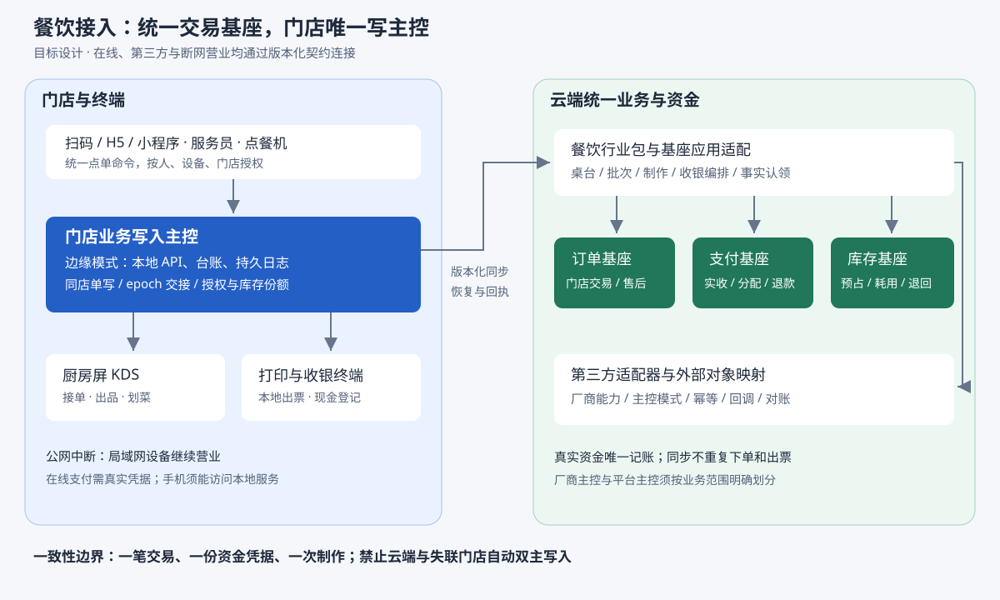

# 餐饮系统接入方案

> 状态：待评审 · 2026-10-19 · 以当前工作区代码为核对基线，正文中的新增对象、接口与流程均为目标设计。
> **本轮设计约束收敛**：先读[餐饮与商品订单基座的扩展边界与契约](./餐饮与商品订单基座-扩展边界与契约.md)。优先复用已实现能力，通过扩展表、独立包及适配器接入；本册保留完整目标，任意收费选配、整桌混合收银和离线认领按对应阶段建设，不作为普通线上/门店联网点餐的统一前提。冲突处以契约册的最小改动边界为准。
> 范围：自建餐饮、多终端在线协同、第三方餐饮系统对接、门店断网营业。用户已确认四项均需覆盖；本轮交付方案，不实施业务代码。
> 上游：[订单状态机](../TDD-订单状态机.md) · [当前目标状态机](../../superpowers/specs/2026-10-14-订单状态机-完整方案.md) · [ADR-031 门店拆单](../ADR/ADR-031-子单按门店拆与运费按商品门店计算.md) · [ADR-019 行业包边界](../ADR/ADR-019-行业工作流做成独立行业包.md)

## 一、结论与范围

沿用“一套订单、支付、库存主干”，增加餐饮工作流、终端接入、第三方适配和门店边缘服务。菜品与交易金额归商品及订单域，收退款凭据归支付域；餐饮负责桌台、就餐台账、点单批次和制作。点餐机、服务员终端、扫码点餐、H5 和厨房屏使用同一套业务命令，区别在身份、权限、交互和硬件。

**完整目标同时支持先付后做和先做后付；后付不能靠模拟支付成功实现。** 多次加菜对应多笔交易，一桌结账对应一次收银会话；真实收款通过基座资金分配凭据覆盖各笔交易。断网时由门店唯一的本地写入服务接管已授权范围，云端恢复后认领事实，不能把本地交易当作新下单再次计价、扣库存或出厨房票。

### 1.1 场景与终端

| 场景 | 终端 | 付款与制作 | 核心对象 |
|---|---|---|---|
| 快餐、茶饮自助 | 点餐机、扫码/H5、小程序 | 先付款，后下达制作；现金由有权限人员确认 | 单次点单批次、门店订单、取餐号 |
| 正餐、火锅 | 服务员手持/PAD、桌码/H5、前台 | 多次加菜、即点即做、整桌后付 | 桌台、台账、多批次、收银会话 |
| 自取、商家配送、快递 | H5、小程序、已有 C 端 | 先付，制作完成后进入相应交付链 | 普通门店订单、制作任务；不强套桌台台账 |
| 后厨与传菜 | 厨房大屏 KDS、档口屏、传菜屏 | 接单、等叫、叫起、出品、划菜、撤菜 | 工位、制作任务、数量与动作日志 |
| 第三方餐饮软件 | 厂商 API/Webhook、门店连接器 | 按该店选定的业务主控模式执行 | 外部映射、同步任务、对账差异 |
| 公网中断营业 | 门店局域网内的上述终端 | 本地下单、制作、打印、现金登记；线上支付凭真实结果 | 边缘日志、本地账、离线授权与恢复批次 |

扫码是进入门店/桌台的方式，H5 是运行载体，两者不分别建设订单系统。顾客手机若没有门店局域网连接，公网中断期间不能保证继续访问门店本地系统；店内设备仍可营业。局域网或边缘主机本身也故障时，进入人工应急流程，不能声称所有断网条件下均可用。

## 二、原方案位置与修订依据

### 2.1 找到的原方案

| 文档 | 保留的价值 | 本次修订关系 |
|---|---|---|
| [餐饮包场景与工作流](./TDD-餐饮包-场景与工作流.md) | 六类场景、桌台台账、加减退菜、KDS、多人购物车 | 业务场景来源；接线、资金与库存按本方案重整 |
| [行业化扩展 餐饮与服务业](../TDD-行业化扩展-餐饮与服务业.md) | 行业能力按门店开通、工作流独立、共享会员和交易 | 保留边界；“主干只改两处”不再成立 |
| [订单域多行业完整方案](./TDD-订单域-多行业完整方案.md) | 加料选配进入订单快照、混合收款归基座 | `ord_payment`、`ord_item_modifier` 是旧目标设计，不能视作现有表 |
| [行业包机制与装配](./TDD-行业包-机制与装配.md) | 插件可剔除、契约隔离 | 作为目标装配约束，不能当作已有 SPI |
| [打印域方案](./TDD-打印域-方案与规格.md) | 路由、可靠任务、补打、冲销语义 | 保留目标原则；仍需实施设备与任务通道 |
| [多端多通道总方案](./多端多通道-平台能力总方案.md) | 端能力与支付环境区分 | 扩展餐饮终端身份；不把端标识当授权 |

旧餐饮正文自己已注明 `fnb_payment` 和“加料作为独立订单行”作废，但正文仍保留旧流程。新实现应读本方案的有效口径，不能把旧正文片段拼接成实现合同。

### 2.2 当前代码证据

以下路径均相对仓库根目录，列的是实际符号及行为。源文件注释中“本阶段仅定义”与实际接线需分开判断。

| 现状 | 代码定位 | 对餐饮的影响 |
|---|---|---|
| 活跃下单入口调用 `OrderService.create` | `backend/shop-core/src/main/java/ai/neargo/shop/trade/api/mp/MpTradeController.java`；`trade/service/impl/OrderServiceImpl.java#createFor/doCreate` | 适配器先接当前服务；不能仅凭 `order/` 新目录就认定全面切换完成 |
| 实际下单命令是 `OrderService.CreateOrderCommand` | `trade/service/OrderService.java`；含 `storeChoices`、`payScene`、活动与地址选择 | `trade/order/command/CreateOrderCommand.java` 另有精简命令，不能混用；新增餐饮字段要进入实际校验和哈希 |
| 一支付聚合下含多门店交易 | `trade/entity/OrdOrder.java`、`OrdSubOrder.java`；`trade/order/service/create/OrderSplitter.java` | `ord_order.order_no` 对应支付聚合；`ord_sub_order.sub_order_no` 才是门店交易。新餐饮关系同时保存两者，不能只写含义模糊的 `order_no` |
| 新下单内核已有部分组件，尚非完整入口 | `trade/order/service/OrderCommandService.java`；`trade/order/service/create/CreateOrderHandler.java` | 后者只编排已解析购物行，未包含完整定价、营销入口；不直接以它绕过现有下单校验 |
| 状态机与 CAS 门已存在并用于业务写入 | `trade/order/machine/`、`trade/order/transition/TradeStatusWriter.java`、`StateTransitionGate.java` | 行业不得直接改订单状态；实际 writer 使用 `SignalPublisher.NONE`，机器的 emit 不等于已发布业务事件 |
| 业务事件实际由服务显式发布 | `OrderServiceImpl` 发布 `OrderCreated`、`OrderPaid`、`SubOrderPaid`；`backend/shop-app/src/main/java/ai/neargo/shop/config/OutboxEventRoutes.java` | 餐饮事件必须接入实际 outbox 路由和消费，不可仅写状态机信号名 |
| 线上支付只接受已核实资金事实 | `trade/order/service/lifecycle/impl/PaymentLifecycleServiceImpl.java#requireConfirmed`；`backend/pay/pay-domain/.../entity/StlPayment.java` | 按支付聚合、买家、金额、币种、流水匹配；一笔整桌收款目前不能直接逐单 `markPaid` |
| 当面付款限制一门店且校验完整影响集 | `trade/service/impl/MerchantOrderServiceImpl.java#confirmOfflinePay`；`trade/order/policy/PaymentImpactPolicy.java` | 不可用数据域过滤后的局部集合确认整笔跨店款，也不可把线上整桌付款伪装成多笔 OFFLINE |
| 支付待处理包括 `POINTS_PENDING` | `PaymentMachine.java`；`OrderServiceImpl#createFor` | 下单返回不必然代表已可支付、可制作；积分处理中不得下达厨房 |
| 超时关闭只扫描 `WAIT_PAY`、`POINTS_PENDING` | `OrderServiceImpl#closeExpiredOrders`；`PaymentMachine.java` | 旧案“先改 WAIT_OFFLINE_PAY 自动取消”不再是当前任务；后付取消授权仍需收紧 |
| 履约取值尚无 `DINE_IN` | `backend/shop-base/.../common/Fulfillments.java` | 要补商品可选项、下单、状态投影、权限动作和交付链；不能只补文案 |
| 行内选配尚未进入订单实体/命令 | `trade/entity/OrdItem.java`；`OrderService.CreateOrderCommand.Item` | 付费加料必须先补商品约束、计价、库存和退款，不能仅塞厨房 JSON |
| 库存已有生命周期版本及独立预占 TTL | `backend/shop-base/.../spi/product/StockPort.java`；`backend/shop-app/.../invbridge/port/InventoryStockPort.java`；`backend/shop-inventory/.../ReservationServiceImpl.java#expireOverdue` | 当前桥接预占期限 30 分钟；V2 付款分配、交付出库不能当作一次旧式扣减，后付需新增业务授权 |
| 当前退款入口仅全门店订单退款 | `trade/order/refund/service/BasicRefundPolicy.java#full/validateRequest`；`trade/order/refund/service/impl/RefundPreparationServiceImpl.java` | 既有“有订单行和退款行”不等于已开放部分退款；餐饮已付部分退菜是额外能力，不可直接承诺复用 |
| 当前无已装配的餐饮插件 | `backend/pom.xml`；仓库未见 `backend-plugins/`、餐饮表迁移和能力常量实现 | 行业包、桌台、KDS、打印等是待建能力 |
| B/C 端已有共享网络与订单展示策略 | `packages/shared/src/net/http-client.ts`、`src/strategies/order-view.ts`；`b-app/src/api/`、`c-app/src/api/` | 复用基础层；需新增餐饮页面和视图合同 |
| “offline”目录/页面不等于断网收银 | `b-app/offline/` 是原生离线打包；`b-app/src/pages/offline-sale/index.vue` 明确只记库存出库、不问价不收款 | 断网交易服务需新建；不能拿已有线下卖出再扣一次餐饮库存 |

当前目标状态机文档也明确部分数量闭合、退款决定和跨聚合协议仍待接线。另见最新的[退款结清 M1 契约](../订单退款结清-M1流程与契约.md)：2026-10-19 业务范围已收敛为整门店订单退款，版本2结清协议默认关闭。餐饮依赖的能力要以代码及场景验收为准，不能因设计已有章节就勾选完成。

### 2.3 旧结论的有效口径

| 旧结论 | 本次处理 |
|---|---|
| 台账、制作、桌台独立；交易复用 | 保留，并增加点单批次与收银编排 |
| `DINE_IN` 已能靠一个常量接入 | 修正：当前不存在；完成交付事实和结算触发验证后才可开放 |
| 后付逐单 `markPaid`，混合记 `MIXED` 即可 | 废弃为直接实现办法；新增基座收银、分配与退款原路凭据 |
| 订单与支付主干一行不改 | 废弃；多单结账、后付交付、离线认领需要明确扩展 |
| 未付减菜整单取消重下无风险 | 限制：只适用于整批未下达、未制作、未交付的可取消单；部分已做的批次禁止整批重建 |
| 沽清置库存 0，次日恢复 | 废弃；沽清是停售控制，不能凭昨日数量恢复实存 |
| 加料只是厨房附属内容 | 废弃；收费、用料必须进入基座快照与库存需求，厨房只消费快照 |
| 插件契约、打印与能力模型已具备 | 修正为待建目标，并逐项装配验收 |

## 三、架构与实施方式选择

### 3.1 方案比较

| 方案 | 优点 | 代价与选择 |
|---|---|---|
| 统一交易基座＋餐饮工作流＋门店边缘服务＋第三方适配 | 统一交易、会员、售后和对账；兼容自建与已有软件 | 推荐；必须补收银分配、后付履约、离线认领合同 |
| 每种终端/厂商各自保存订单和支付，云端只做汇总 | 厂商初接较快 | 长期形成多份金额与退款真源；仅允许作为明确标识的外部交易投影，不能混成内部订单 |
| 仅扩现有 C/B 页面、所有请求直连云端 | 在线先付交付较快 | 无法满足门店断网和第三方控制权要求，可作为第一阶段子集，不能宣称完整餐饮交付 |

### 3.2 目标结构

门店每个业务分区只有一个写入主控。自建模式由餐饮工作流主控；边缘模式由门店服务串行接单，云端负责统一账与同步；第三方主控模式由指定厂商承接相应业务，平台不向同一厨房再次下达。图中连接表示目标契约，并不表示这些模块已存在。

| 层 | 目标职责 | 依赖边界 |
|---|---|---|
| 终端接入 | 顾客、店员、设备、第三方分别认证；统一命令与 DTO | 不能因客户端声明 `KIOSK/KDS` 获得权限 |
| 餐饮行业包 | 桌台、台账、菜单时段、批次、制作任务、催菜、交付编排 | 只依赖契约，不能 import 基座实体或更新交易表 |
| 基座应用适配 | 包装当前订单、支付、库存、会员、售后能力；执行事务与授权 | 适配器位于 `shop-app`；不得把餐饮金额计算分散进各端 |
| 共享设备通道 | 打印机、任务、回执、失败重试；终端登记与凭据 | 厨房业务内容由餐饮提供，渠道只负责送达 |
| 门店边缘服务 | 局域网 API、唯一写序列、本地账与 KDS、打印、离线授权、恢复 | 不连接云库，不绕过云端交易/库存接口 |
| 第三方适配 | 厂商认证、对象映射、能力探测、回调去重、投递、对账 | 厂商字段不进入统一订单主干 |

行业包沿 ADR-019 的目标：`backend/shop-industry-spi` 为独立契约，`backend-plugins/shop-industry-food` 为同仓独立构建项目。它们当前尚未创建；边缘服务独立部署，通过版本化 API 同步。零售在没有餐饮 jar、没有边缘服务的情况下必须可启动。

## 四、统一业务对象与规则

### 4.1 数据归属和编号

| 对象 | 归属 | 目标字段与约束 |
|---|---|---|
| 餐饮配置 | 行业/门店能力 | 按店开启桌台、KDS、后付、扫码、边缘、厂商模式；默认关闭，不挪用支付准入的 `sys_industry` |
| 桌台与占用 | 餐饮；未来经资源契约复用 | `table_no/store_no/area/status`；活动占用关系唯一，转台原子占新放旧；不因桌号相同跨店复用 |
| `fnb_check` 台账 | 餐饮 | `check_no/store_no/table_no/owner_ref/pay_timing/status/version/business_date`；无桌快餐可不建台账 |
| 台账成员与购物车 | 餐饮 | `check_no/participant_no/added_by/cart_line_no/version`；购物车是意图，不锁库存、不等于订单 |
| `fnb_order_batch` | 餐饮 | `batch_no/check_no?/source/terminal_no/operator_no/buyer_ref/request_hash/status/authority_epoch`；每次提交一个批次 |
| `fnb_batch_order` | 餐饮 | `batch_no/pay_no/sub_order_no/store_no`；明确关联支付聚合与门店交易，重复绑定受唯一约束 |
| 行餐饮快照 | 餐饮 | `order_item_id/batch_no/modifier_snapshot/station_snapshot`；正式交易行生成前使用稳定 `source_line_no`，同步后映射 |
| 制作任务 | 餐饮 | `task_no/source_line_no/order_item_id?/station_no/qty/ready_qty/served_qty/void_qty/version`；一次行可拆工位任务 |
| 行为日志 | 餐饮 | `action_no/check_no?/task_no?/action/qty/reason/operator_no/device_no/occurred_at/received_at`；只追加 |
| 餐品价格、选配、金额分摊 | 商品/交易基座 | 服务端解析、下单快照、金额守恒；免费口味也留结构化快照，不只拼备注 |
| 收银会话与分配 | 交易/支付基座 | 本方案建议新增，见 §5；餐饮持 `checkout_no`，不另建资金账本 |
| 终端 | 共享设备域 | `device_no/store_no/type/credential_ref/status/allowed_actions/station_scope`；可吊销且按店绑定 |
| 外部绑定 | 集成适配 | `(provider, merchant_ref, store_ref, object_type, external_no)` 唯一；保存内部号、版本及同步来源 |
| 边缘日志与同步游标 | 边缘/同步域 | `(store_no, edge_no, epoch, seq)` 唯一；含 `event_id/schema_version/request_hash/result`，重放返回原结果 |

上述为逻辑模型和必需约束，不是可直接执行的迁移 DDL。迁移还应对齐仓库主键、软删除、乐观锁、数据域、索引和独立数据库规范。

### 4.2 商品与库存

菜品继续用 `prd_goods/prd_sku`。SKU 表达真实规格，做法与加料用选配规则表达；选配约束、价格及用料由服务端校验。新增行快照（可沿用旧案 `ord_item_modifier` 的意图）必须同时接报价、实付分摊、退款和结算，不能先让前端自算加价。

餐饮适配下单强制落当前门店：利用当前 `storeChoices` 后还须核实实际拆单结果全部属于该店；不能把“非法 storeChoices 被忽略后回落默认店”的兼容行为用于餐饮。菜单时段只收窄可售集合；商品上架与库存仍由现有主干校验。

沽清新增“营业日停售”规则，作为可售闸门与库存约束取交集；它不保存第二份实存，也不执行库存归零/恢复。停售状态必须在真正下单处校验，并传播给第三方和边缘。套餐、选配用料和原料 BOM 分开：先复用可销售 SKU 库存；需扣原料时另立配方版本、耗用与损耗凭据，不能宣称选配 JSON 已解决原料管理。

### 4.3 身份与权限

区分 `buyerRef`（交易归属）、`payerRef`（实际付款者）、`operatorRef`（操作人）、`participantRef`（同桌参与人）和 `deviceNo`。多人共同选菜不等于所有人都有整桌退款权，也不等于可以使用桌主积分或券。

在线第一阶段沿用有效买家账号；点餐机/店员代客有独立授权和审计。现有运营代客服务有手机号、权限和履约限制，不能直接当作餐饮店员接口。匿名餐饮与离线临时顾客引入范围受限的就餐主体，不能伪造手机号或全店共用一个会员；云端交易主干需支持其归属、售后查询和认领，完成后才能启用匿名模式。

桌码只提供门店和桌台定位，服务端签发短时就餐会话。离店/结台撤销会话，敏感动作校验成员与角色。KDS 只读工位菜品及必要桌号，无订单支付凭证与客户联系方式；服务员加菜、退菜审批、收银和退款分开授权。

### 4.4 制作与交付

制作任务：`HELD → QUEUED → MAKING → READY → SERVED`，叫起由 HELD 到 QUEUED；撤销记录具体数量及原因，催菜不改制作状态。各数量之和受约束，已出品不可伪装成未制作，剩余未服务数量不能为负。工位拆分不重复销售数量；菜品完成条件由其必需工位任务聚合。

先付订单只有付款与库存授权满足后才创建制作任务；后付订单由“后付受理成功”事件触发，不等付款。下达以批次/源行/工位/版本幂等，打印、KDS、第三方订阅同一份已受理事实，不能各自生成一套订单。

`READY` 是厨房出品，`SERVED` 是交付事实，订单 `COMPLETED` 是交易生命周期结果。堂食新增 `DINE_IN` 及受权交付命令，逐行记交付，再经当前订单串行点和 CAS 门判断完成；不造快递包裹、不拿核销码自动当作已上菜。后付时先记真实交付，待收款结清后再推进交易完成。自取/配送继续走既有对应交付链，KDS 不直接改物流状态。

## 五、先付 后付与多单收银

### 5.1 先付链路

选菜 → 报价和能力校验 → 固化点单批次及幂等键 → 基座创建支付聚合、门店订单与行 → 若积分处理中则等待恢复 → 发起真实支付 → 验证成功凭据 → 发布已付事件 → 确认库存授权 → 餐饮生成制作任务 → 出品/交付 → 订单完成。

批次关联必须在事件消费时可识别。优先同源事务写关联和 outbox；若基座当前事务包装不能支持，先持久化提交意图，使用同一幂等键恢复原结果并补关联；早到事件落待关联队列重试。禁止先出厨房票再补交易绑定。

下单或支付结果未知时查询同一提交意图；不能换键重建。取消成功才释放相应资源；迟到付款进入现有支付异常处置链，不能自动向已取消桌台出菜。

### 5.2 后付的主干前置能力

建议单独增加后付受理政策，与支付渠道分开：`payTiming=BEFORE_SERVICE/AFTER_SERVICE` 是交易条件，`payMode/channel` 是怎样收钱。`WAIT_OFFLINE_PAY` 当前仅表示待当面确认，不能永久充当“后付且将来可线上支付”的完整语义。

| 需要增加的合同 | 最低行为 | 防止的问题 |
|---|---|---|
| 后付受理 | 按店能力授权；保存交易条件、价格、赊销责任和受理事实 | 前端自行宣布可先做菜 |
| 未收款制作/交付授权 | 后付受理单可记录制作与交付，订单主状态仍不谎称已付 | 钱没到却触发积分、分账或交易完成 |
| 库存生命周期 | 受理后预占不得按普通 30 分钟超时释放；生产/交付耗用有独立幂等凭据，收款不再重复扣减 | 正在吃的菜被释放重卖，或结账时二次出库 |
| 取消和未收款调整 | 有制作/交付事实后，普通买家取消、平台代客取消、关单均须读取受理约束；减菜生成核心认可的调整凭据 | 取消已吃未付款单释放库存，或取消重下导致重复制作 |
| 后付支付发起及认领 | 可为受理交易建立收银会话，通过真实收款分配凭据结清 | 当前 `pay()` 仅接受 WAIT_PAY，无法给后付桌账直接收线上款 |

库存调整应扩展当前版本化生命周期，保留不可变订单快照；不能简单延长付款截止时间代替库存契约。生产前未用部分可释放；已经制作或上桌的退菜进入损耗/报损或实际退回流程，不能默认恢复可售库存。涉及独立库存库时采用持久化命令与确认回执，未知结果不宣布受理完成。

### 5.3 基座收银会话与资金分配

建议基座新增三个逻辑对象，物理表名在详细设计阶段按交易库和支付库分别落实：

| 对象 | 保存内容 | 核心约束 |
|---|---|---|
| `CheckoutSession` | 门店、币种、买家/付款者关系、交易集合、各单未结金额、冻结版本、应收、状态 | 一店一币种；受影响交易完整授权；同一待收范围只能被一个活动会话冻结 |
| `PaymentAllocation` | 收款凭据号、收银会话号、各支付聚合/门店订单分配额、状态、退款占用 | 一笔成功收款的分配总额不得超过实收；各单分配不得超过其未结应收 |
| `CheckoutAdjustment` | 未收款退菜/抹零/优惠的批准、行与数量/金额范围、版本及理由 | 交易基座重算受影响金额与权益；餐饮不得直接改历史行价格 |

结账协议：

1. 台账 `OPEN → SETTLING`，阻止新提交；已进入提交意图的请求必须先落定或明确排除，不能漏算正在提交的加菜。
2. 基座当前读锁定所有受影响交易与有效调整，生成确定的应收快照及 `checkoutVersion`。资源按固定顺序加锁，外部支付 IO 不持有数据库锁。
3. 每笔现金或线上收款均保存独立且可审计的资金凭据；混合支付由多条凭据构成。现金来自有权限的实际收款登记，线上只能由支付域核实。
4. 支付域以会话为业务引用保存真实收款及不可变分配。不能将一笔真实流水复制成 N 笔“成功收款”；不能只记一个 `MIXED` 字符串。
5. 交易侧通过新的分配证明接口核对各支付聚合应收和实收覆盖，逐单幂等投影已付，再按既有交付事实完成交易。当前 `requireConfirmed` 是整笔等额匹配，必须增加正式分配路径，不能关闭原校验。
6. 跨支付库/交易库采用可恢复编排：资金成功但订单未投影时显示“已收款，记账处理中”，继续恢复原会话；不得提示顾客再付。全部订单投影完成后台账 `CLOSED`，释放桌台并出小票。

会话状态至少区分 `FROZEN/PAYING/PARTIALLY_PAID/RECONCILING/SETTLED/CANCELLED`。支付结果未知必须回查；已收部分款不能简单撤回 OPEN，须先处置该款或建立带余额承接的新版本。付款页面、终端轮询和人工查询都返回同一会话事实。

算例：两次加菜未结 8000、4000 分，现金 5000＋线上 7000。分配可为第一单现金 5000＋线上 3000、第二单线上 4000，总额始终 12000。第一单退款时最多按原资金分配与已退/预占余额执行，现金和线上各走对应逆向；不能对两个订单分别以“线上 7000 已成功”为证推进支付。

### 5.4 退菜 并台 拆单与权益

未下达的草稿可改；已受理后加菜永远新批次。未付退菜走核心认可的未收款调整，不直接改金额、不伪造退款；已付整门店订单退款走现有售后决定与真实退款账。**已付部分退菜目前不支持**，需另行确认是否重新开放部分退款范围，再补数量闭合、原资金分配、权益和结算合同；不得绕过当前全退校验，也不通过“每道菜强拆一单”规避限制。厨房撤销数量与资金处理关联但独立，已做菜的损耗不因退款自动回库。

转台只移动占用。并台先校验同店、同付款条件及无活动收银会话，保留原台账和批次来源，生成新结账范围；不改订单归属和买家。不支持通过并台跨店收款。下单前按参与人拆批可做；已受理后的按人 AA/按菜拆账需分配级结算和退款能力，后续阶段开放，不能靠复制订单实现。

后付第一阶段关闭跨批次整桌券、顾客积分抵扣、储值与复杂抹零；待基座明确跨单分摊、授权及退款后再打开。在线先付沿现有已支持的优惠能力。赠送积分、营销、会员升级和结算只消费正式已付/完成事实，不消费厨房出品或边缘“已收现金未认领”事件。

## 六、多终端接口与实时同步

以下均为拟增量契约，路径按现有单数命名约定表达意图，不代表接口已实现；实现时须加入契约生成和权限矩阵。

| 接入面 | 拟提供的命令与查询 | 权限范围 |
|---|---|---|
| 顾客 `/mp/food`，H5 共用业务合同 | 解析桌码、加入会话、菜单、购物车、报价、提交批次、制作进度、发起结账、查询结果 | 本人/当前台账会话，不由请求中的 userNo 决定身份 |
| 店员 `/biz/food` | 开台、转并台、代客点单、催菜、退菜申请/审批、现金登记、结台 | 当前授权门店和动作；退款、抹零、收款单独授权 |
| 设备接入 `/device/food` | 点餐机菜单/报价/提交；KDS 队列、接单、出品；设备心跳 | 设备凭据＋门店＋工位；点餐机不得拿老板全权账号 |
| 基座交易/收银契约 | `place/quote/acceptDeferred/freezeCheckout/openPayment/confirmAllocation/adjustUnpaid/recordHandoff` | 基座应用适配器重新授权；不是任意客户端可调的内部函数 |
| 同步接入 | 以游标拉增量、按事件 ID 查询、批量补传、恢复批次状态 | 门店边缘身份与 epoch，不能覆盖其他门店 |

统一命令信封：`commandId/storeNo/checkNo?/batchNo?/expectedVersion/source/terminalNo/operatorRef/authorityEpoch/schemaVersion`，正文只传选购与操作意图。金额由服务端或被授权的边缘计价版本产生；请求重放须比较哈希，复用同键换内容返回冲突。

来源分三维：`orderSource`（扫码/点餐机/店员/第三方）、`clientPlatform`（H5/小程序/原生）、`paymentScene`（实际支付环境）。现有 `X-Client` 仅作展示/策略提示，不作为设备认证，也不能把 `KDS` 传进支付场景充当新支付方式。

实时通道优先使用“版本化查询＋SSE 通知”，无法保持长连接时退回游标轮询；双向设备通信需要时再引 WebSocket。事件含 `eventId/aggregateNo/aggregateVersion/storeNo/occurredAt`；先拉快照再从对应游标补事件，发现缺口重新拉取。推送只提示有变化，持久化查询结果才是事实。边缘模式的同店客户端连同一局域网网关，不能各维护可独立结账的副本。

前端落点：`c-app` 新增扫码菜单/台账/进度/结账页面，`b-app` 新增桌台/服务员/收银；点餐机和 KDS 使用适配大屏及触摸交互的专门入口，共用 `packages/shared` 的合同与状态解释。支付 SDK、扫码枪、USB/LAN 打印封装为终端能力适配，不把硬件分支塞进订单服务。

## 七、第三方餐饮系统接入

### 7.1 每店明确主控模式

| 模式 | 订单及制作主控 | 平台处理 |
|---|---|---|
| 平台主控＋第三方执行 | 平台交易与餐饮服务 | 厂商接收制作/打印任务并回传状态；不得再创建一笔独立收费订单 |
| 第三方主控＋平台承接正式交易 | 第三方点单，平台通过受权导入形成核心交易 | 必须在交易发生前约定商品价格、买家、收款及库存归属，采用同一来源号认领，不能无合同直接回填成功 |
| 第三方既有交易仅展示对账 | 第三方全权交易与资金 | 保存单独的外部交易投影；不伪装内部 PAID，不自动参加平台积分、退款和结算 |

一家店可以按明确的订单来源/业务范围划分主控，但同一笔交易、同一库存份额和同一制作任务不得双主控。启停或切换厂商前清空/移交待下达批次与收银会话，记录主控版本。

### 7.2 适配器能力合同

每个厂商声明是否支持菜单/SKU映射、选配、订单创建、受理查询、制作状态、退菜、退款、桌台、库存/停售、Webhook、幂等查询和离线连接器。按能力开放功能，不假设所有厂商接口一致。首家厂商需要其真实接口文档、测试账号和回调环境才能完成字段级适配，本轮不虚构厂商签名或支持范围。

适配器统一执行：凭据认证与轮换 → 验签/时间窗/重放校验 → 原始报文留存与脱敏 → 映射统一命令 → 授权与状态检查 → 幂等落库 → 异步执行 → 回执/对账。外部接口超时先按来源号查询，不直接再创建；无法按号查询的厂商，未知结果进入人工确认，避免多做一份菜或重复扣款。

防回环：事件携带 `originSystem/externalNo/correlationId`，外部导入后的投影更新不能再次作为新订单回推。外部退款只是申请或经过验证的资金事实；退款批准及内部状态仍走本系统定义的决定/执行协议。

每日按营业日对账订单、实收、退款、撤菜、交付数量与库存凭据；外部时间、接收时间和版本分别保存。接入既有进销存 OpenAPI 时复用其可用的认证/审计模式，不能把库存 OpenAPI 当作现成的餐饮交易 API。

## 八、门店断网营业

### 8.1 拓扑和单写规则

真正的断网营业需要可持续运行的门店服务与本地持久化，不能仅缓存 H5 页面或把每台终端请求排队。建议门店主机运行边缘服务，使用具备事务、WAL 和备份的本地数据库；终端通过局域网访问，KDS 与 LAN/USB 打印由该服务编排。安装包/静态资源预缓存只解决页面打开，不能代替本地交易账。

边缘营业模式在在线时也由边缘服务担任本店现场业务写主控，云端远程请求转交门店并等待受理。公网中断后云端把远程订单保留为待门店受理或明确暂停受理，不能在云端与边缘各开同一桌、各承诺同一库存。

主控使用持久化 `authorityEpoch` 和交接记录。**不能仅凭云端租约超时就提升云端为现场主控**：失联边缘仍可能合法营业。接管必须确认旧主停写/完成隔离，或通过可执行的 fencing 机制拒绝旧写入；做不到则暂停冲突业务，不能自动双写。第三方主控门店使用其受支持的本地连接器或厂商边缘节点；缺少离线接口时不能并行启用平台边缘接管同一批业务。

### 8.2 离线能力矩阵

| 动作 | 公网断开且局域网正常 | 限制 |
|---|---|---|
| 桌台、点菜、加菜、制作、划菜 | 支持 | 使用已同步菜单、价格、角色和授权版本；本地唯一写主 |
| 店内扫码/H5 | 条件支持 | 手机接入门店局域网且已具备可访问的本地域名/HTTPS、页面与会话；未做到时转店员或点餐机，不承诺自动从公共域名切换 |
| 厨房/收银打印 | 支持本地打印 | 仅云打印厂商不可达时不能保证出纸；任务落盘并显示失败，改走已配置的本地机 |
| 现金收款与结台 | 支持本地登记 | 门店授权、金额限额、收银员记录及交班账；云端认领前不发平台积分和结算 |
| 微信/支付宝等线上付款 | 取得可信结果时支持 | 门店公网断开不等于顾客手机无网；终端无可信回执时记 UNKNOWN/PENDING，回查或有权人工核验，不凭截图/点选记成功 |
| 刷卡/扫码枪硬件收款 | 按通道能力 | 需终端及支付通道确认的交易证据；扫描支付码本身不是收款成功 |
| 储值、积分抵扣、券、退款 | 默认不在断网时执行 | 需另建防双花离线额度/资产托管协议才可开放；不能靠旧余额缓存扣减 |
| 云端会员新建/跨店权益 | 延后 | 用范围受限临时就餐主体；恢复后经授权关联，不冒用共享会员 |
| 云端实时库存 | 使用预留给门店的离线可售份额 | 云端销售不得重复使用此份额；份额耗尽停止承诺或走审批留痕，不能无限负库存 |

离线菜单、税费/优惠规则、权限、库存份额与金额限额以版本化授权包下发，带有效期、门店、设备和可执行范围；到期或签名无效则停止新增受限交易，保留查询、打印和恢复。经营是否允许超限现金赊销需明确政策，不能由某台终端自行放行。

### 8.3 本地提交与恢复协议

本地一次事务持久化点单意图、报价版本、稳定业务号、本地可售份额扣占、台账关系和 outbox；提交成功后再送 KDS/打印。标识使用可离线生成且带门店命名空间的全局唯一 ID，本地显示短号另存，不能要求断网时向云端申请号段。动作保留人员、设备、实际发生时间和服务接收时间。

恢复顺序：

1. 验证门店主控 epoch、授权包和连续序列，云端返回已接收游标；发现缺号请求补齐，不跳到最新。
2. 先认领配置/临时主体映射和批次，再导入交易及不可变价格快照、库存凭据，随后认领真实收款，最后投影交付/完成与报表。各阶段可查询、可重试。
3. 使用专门的“已发生交易认领”契约，不调用普通 `create()` 重算当日价格。云端验证原授权、菜单版本、算术、离线限额、库存份额和来源号，合法事实按原快照入账；不合法或超额进入差异账，不能悄悄改价或删除已经做出的菜。
4. 资金认领以唯一凭据归属和分配为依据；本地登记现金走受权现金导入，线上必须核实渠道凭据。先报线上 PENDING 后补现金时，应提示重复支付风险；迟到线上成功进入差异处置，不再对同一应收自动结清两次。
5. 云端返回每条事件的 `accepted/alreadyAccepted/quarantined` 和原结果映射；边缘收到持久 ACK 才推进游标，保留日志供对账。重复导入不新开订单、不重复出库、不重复打印、不重复赠分。

本地已完成、云端尚未认领时，前台显示“门店已结账，待云端同步”；失败记录仍占用库存份额和可解释的差异账。价格冲突保留双方版本，库存冲突保留实际出品事实，资金冲突先核实实际款项；不以最后写入者覆盖。

## 九、可靠性 事件与打印

餐饮拟新增 `BatchAccepted/KitchenReleased/TaskReady/ItemServed/ItemVoided/CheckoutFrozen/CheckClosed` 等事件。后付受理、制作下达和资金事件分别命名，不能都叫 `OrderPaid`。事务内写业务事实和 outbox；跨库写入按持久化命令/回执恢复，不假定一个 Spring 事务覆盖交易、支付、库存和边缘。

复用当前已实现的 `OutboxPublisher/OutboxIngress/UnifiedOutboxFacade` 及稳定来源号、哈希、消费者 Inbox，不再为餐饮新造一套云端消息引擎。装配与来源模式参考[Outbox 统一投递方案](../TDD-Outbox统一投递与封装.md)，该文档记录生产仍处 legacy 模式；本方案未读生产配置，不能据此宣布 unified 已启用。餐饮上线须验证实际启用模式的路由及消费者，边缘入站同样使用明确的来源身份和幂等合同。

台账事件按 `FOOD_CHECK:checkNo` 排序，非台账批次按 `FOOD_BATCH:batchNo` 排序，资金沿现有支付/订单流；不要求门店全局串行。批次关联和分配记录连接不同事件流，消费者需要版本、幂等及缺口处理，不能依赖“先收到了付款消息所以关联必然存在”。

打印三种重复分开：系统重投复用原任务；未知出票结果先回查/显式展示；人工补打新建任务并标“补打”，不得重新触发制作。任务唯一键至少包含事件、场景、目标设备、分单/份数标识；多台打印机不能因只按事件去重而漏票。

撤菜同时撤销未发送任务；已出纸发送冲销条并更新 KDS。云打印未知结果不能无限自动重发。真机验收覆盖中文、做法、加料、长菜单、切纸、多工位、断网恢复和重复回执，云端同步不能重印断网时已出的厨房票。

## 十、分期落地与验收

完整范围不缩减，分阶段关闭依赖；各阶段完成均以场景证据为准。下表是方案依赖与交付门槛，不是已批准的编码计划。

| 阶段 | 工作内容 | 退出条件 |
|---|---|---|
| P0 契约与现状收口 | 对齐当前订单/售后未完成项；确定买家与代客、DINE_IN、选配、设备、事件和行业装配 | 活跃入口和事务边界明确；依赖的订单能力有测试证据；无餐饮包零售仍可启动 |
| P1 在线先付多终端 | 点餐机、服务员、扫码/H5、KDS、打印；先付堂食/自取 | 同笔提交只产生一笔交易和一组制作任务；付款失败不出菜；真机打印通过 |
| P2 后付与整桌收银 | 后付受理、库存生命周期、交付事实、未收款调整、收银会话、资金分配、整单退款 | 开台→两次加菜→未付款部分退菜→混合支付→结台；断点可恢复，无假付款和重复出库；已付款部分退菜按 §十一另行确认 |
| P3 首家第三方 | 选厂商与模式，实施映射、签名、回调、受理查询、对账 | 同一单双向重放不重复；超时未知可查询/隔离；钱、菜、库存各一主控 |
| P4 门店边缘与断网 | 唯一现场写主、授权包、离线库存份额、局域网端、现金、同步认领与防双写 | 公网断开期间持续点菜/制作/本地出票/现金结台；恢复后总额、数量、账与打印均不重复 |
| P5 扩展与运营 | 更多厂商、整桌权益、拆账/AA、套餐换菜、配方耗用、行业报表 | 每项按独立合同与回归验收；不因已有一店通过就默认全厂商全终端支持 |

### 10.1 必测业务证据

| 验收场景 | 必须断言的结果 |
|---|---|
| 点餐机/服务员/手机同时操作同一桌 | 同一版本下台账一致；同批次只提交一次，别人的尚未提交草稿不被错误清空 |
| 同键换菜单/口味/付款条件 | 返回冲突，不复用另一笔交易结果 |
| 付款成功回调重复、积分仍处理中、关联事件早到 | 厨房只下达一次；积分待处理不制作；缺关联可恢复 |
| 后付用餐超过当前 30 分钟预占期限 | 未耗用库存不被普通超时释放；已制作耗用不再可售；收款不二次扣库 |
| 后付单被顾客/平台取消 | 已受理/制作事实阻止普通整笔取消，按受权退菜或异常处置执行 |
| 加菜与结账并发 | 提交意图有明确归属，冻结快照无漏单；多终端不能各收全款 |
| 两单、多笔混合付款、其中一单退款 | 收款与分配总额守恒，按原路/现金逆向，不超退、不造 N 笔成功收款 |
| 先上菜后付款、部分菜撤销 | 交付数量与交易终态按规则闭合；没有快递假包裹；无不应发生的库存回补 |
| KDS/打印/第三方回调乱序重投 | 工位及份数不重复；补打不重做；撤单后不被旧消息恢复制作 |
| 公网断开、本地服务重启、同步 ACK 丢失 | 本地已提交账可恢复；日志不丢；补传仅认领一次；不重印、不重扣、不重赠 |
| 云端尝试在失联边缘仍营业时接管 | 无合法交接/fencing 时拒绝第二写主，线上订单不被假装门店已接单 |
| 第三方创建超时且无法查单 | 标为未知并待确认，不盲目再建；外部投影不自动变平台已付交易 |
| 禁用餐饮/吊销设备/越门店工位访问 | 默认关闭有效；设备不能访问其他门店或执行收退款；零售原有场景不受影响 |

报表区分应收、实收、欠收、退款、损耗、未同步与外部投影；后付已出菜未收款不能计入平台已收 GMV。营业日、时区和日切规则由门店配置版本确定，不能用同步到达时间把昨晚收入算到今天。

## 十一、取舍与待确认事项

本次明确选择复用交易资金主干，允许为真实新语义增加合同；保留行业包隔离，增加一个承担断网一致性责任的门店服务；第三方按能力和主控模式接入。暂缓的是整桌复杂权益、交易后 AA、配方原料和自动灾备接管，不是用户要求的第三方或断网营业。

以下不阻止方案评审，但阻止相应功能上线，需在详细合同中定案：

| 事项 | 本方案默认/建议 | 影响的阶段 |
|---|---|---|
| 首家第三方名称、接口与版本 | 按适配器合同先定义；取得实际文档后做厂商映射 | P3 |
| 门店硬件与本地服务运维 | 专用常开主机、局域网、本地打印、备份；明确谁负责升级和故障 | P4 |
| 离线时间、金额、库存额度及授权过期 | 按店显式配置，无限额/无授权不开放离线新增交易 | P4 |
| 匿名顾客与会员认领 | 独立就餐主体，不能共享会员；合法认领后才开放会员权益 | 匿名点单、P4 |
| 先吃后付跑单、赠菜与抹零责任 | 店方审批与差异账；不把欠款改为支付成功 | P2 |
| 现金登记、线上未知结果的人工核验 | 收银权限＋凭据＋交班对账；截图不构成在线支付成功凭证 | P2/P4 |
| 已付部分退菜是否重新开放 | 当前保持仅整门店订单退款；若确需支持，另行确认并扩展核心售后能力，不由餐饮插件绕过 | 已付部分退菜上线前 |
| 内部导入交易与外部只读投影的结算边界 | 只有完成正式认领和资金核实的交易进入平台对应结算链 | P3/P4 |
| 桌码/H5 在局域网的地址、证书与首次加载 | 作为现场部署验收项；未打通时店员/点餐机承接离线点单 | P4 |

下一步应先评审本方案的主控模式、后付收银分配和离线授权边界，再拆分别可验收的实施计划。旧方案不作为这些尚未确认政策的默认授权。
