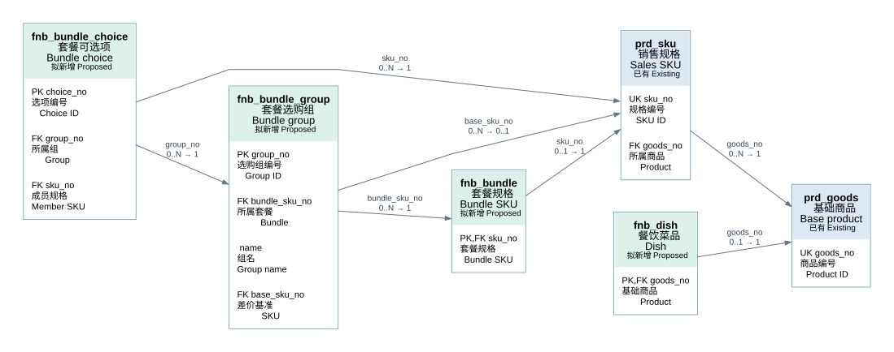
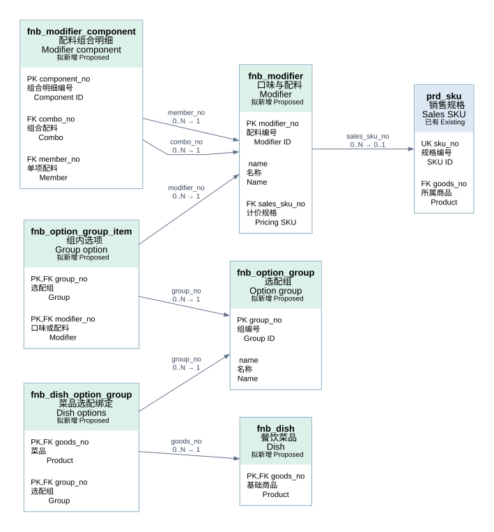
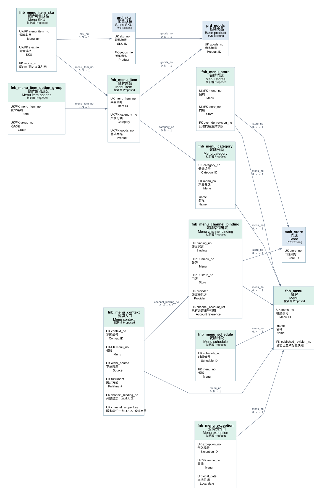
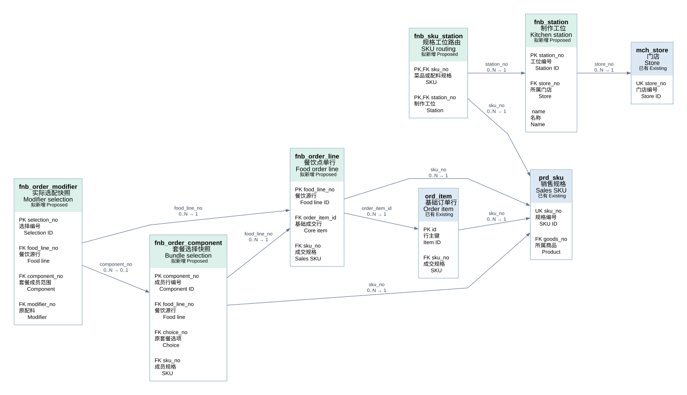

# 餐饮菜品表设计与双语 ER 图 Food Catalog Schema

> 状态：待评审 Proposed · 2026-10-19。基础商品字段取当前实体的关联字段投影，新增表均未实施。
> 由 `node scripts/gen-food-catalog-erd.mjs` 生成，勿手改；真源：[模型契约 Schema](./schema/food-catalog.schema.json)。
> 上游：[餐饮与商品订单基座契约](./餐饮与商品订单基座-扩展边界与契约.md)。本册补充套餐、配料组合与多类餐牌的完整目标，收费选配须完成基座接入才能上线。

生成依赖：Graphviz WASM @viz-js/viz@3.31.0。可在临时目录安装，通过环境变量 FOOD_ER_VIZ_MODULE 指向其 dist/viz.js，无需修改业务项目依赖。

## 一、设计结论 Design overview

菜品、套餐和可售配料都引用基础商品与 SKU。餐饮扩展保存套餐选择规则、口味配料组合、餐牌可见范围和工位；不复制商品主数据、门店价格或库存账。

本模型有 **22 张拟新增表、4 张已有表的关联投影**。ER 图按四个主题展开；英文表名与中文业务名称同时显示。箭头从引用表指向被引用表，标注每个父对象可拥有的子行数与每个子行的父对象数。FK 为逻辑关系，不表示已建立数据库外键；跨模块仍由服务校验。

### 套餐 Bundle

套餐自身有基础商品和销售 SKU；每个套餐 SKU 有多个选购组（主食、饮料、小吃），每组配置最少/最多份数及可选 SKU。固定套餐把唯一成员设为必选，任选套餐通过多个候选和数量上下限表达。第一版禁止套餐嵌套套餐，避免价格与耗用递归。例：午餐套餐 39 元，主食任选 1、饮料任选 1、小吃最多 2；最终选择另存订单成员快照。

### 配料与组合 Modifiers and combos

FLAVOR 是免费做法，例如少冰；ADDON 是单项加料，例如珍珠，对应基础销售 SKU；COMBO 是有独立计价 SKU 的配料组合，例如珍珠+椰果。组合明细指向单项 ADDON 并保存用量。选配组表达糖度单选、配料多选及数量上限；菜品绑定可复用的选配组。成员配料不再叠加收费，组合价格仅收一次。可选的配料组合用选配组让顾客自由组合，固定组合用 COMBO 明细表达；不需要嵌套组。

### 餐牌 Menu types

STANDARD 常规、TIME 时段、SEASON 季节、EVENT 活动餐牌均为同一模型。门店、下单来源、履约方式独立限定适用范围；TIME 可配多个周时段，季节/活动使用日期范围，节假日用例外日覆盖。晚 22:00 至次日 02:00 用 end_day_offset=1。餐牌分类与基础商品分类分开，菜单不存另一套价格。

### 计价与库存 Pricing and stock

套餐基础价、单项配料价、组合配料价都读基础 SKU 的门店/活动有效价格。套餐选项可 INCLUDED（已含）、ADD_SKU（追加成员当前价）、DIFF_BASE（相对组内基准 SKU 的非负差价）。金额必须由交易基座认可的报价扩展统一计算并冻结，不能让餐饮直接覆盖订单金额；当前核心没有完整组合计价接线，本设计不是零改动即可运行。套餐和组合按实际选中的叶子 SKU 汇总库存需求，容器 SKU 不同时扣同一份成员库存；配料数量单位与库存单位必须一致，存在原料克重换算时另接配方/物料系统。

### 下单快照 Order snapshots

基础 ord_item 保留成交事实；fnb_order_line 关联它；套餐成员与选配分别存快照。每个套餐实例的不同选择保留独立 food_line_no：同 SKU 两份套餐选了不同饮料时，不能合并成丢失归属的一组选择。配料可作用于整道菜，也可绑定某个套餐成员；口味、成员展开、当时价格、分摊与配置版本都需要冻结。按成员制作与库存展开，不重复增加套餐销售笔数。

## 二、分组 ER 图 ER diagrams

### 菜品与套餐 Dishes & Bundles

同一基础商品下可有多个套餐规格；套餐按 SKU 定义选购组。组和候选均有数量约束；两个指向 SKU 的关系分别表达候选商品与差价基准。

### 口味配料与组合 Modifiers & Combos

菜品和选配组是多对多，组和配料也是多对多。组合表两次引用配料表，分别表示组合头与成员；只允许 COMBO → ADDON。免费口味不需要销售 SKU。

### 多种餐牌与时段 Menus & Schedules

餐牌通过门店和入口范围决定在哪可见，通过周时段和例外日决定何时可售。餐牌条目引用商品，可通过白名单限制 SKU；同一商品可以进入多份餐牌。

### 工位与成交快照 Stations & Snapshots

工位按店定义，SKU 与工位为多对多。订单快照独立于当前配置，生产历史不随配置变化。图中仅展示本分组内部关联，套餐选项/配料的跨组引用见字段表。打印设备与任务沿独立打印域，本模型不复制打印表。

## 三、字段与约束 Tables and constraints

新增表统一包含 `entity_no` 主体范围、`created_at/updated_at` 审计时间及 `version` 乐观锁版本（表内已列版本字段除外）。下列 PK 是建议逻辑主键；若实现采用仓库统一 `id`，这些业务键仍须保持唯一。已有表仅展示本设计使用的字段，未改造其主键。所有必填/可空以表中说明为准；关联对象必须同主体，门店归属由当前商户权限校验。配置停用保留编号，不级联删除历史快照。

### 基础商品 Base product · prd_goods

已有表 Existing — 仅关联字段投影。

|字段 Field|类型 Type|含义 Meaning|键与关联 Key / Reference|可空 Nullable|
|---|---|---|---|---|
|`goods_no`|varchar(32)|商品编号 Product ID|UK|否 No|
|`entity_no`|varchar(32)|主体 Merchant|—|否 No|
|`title`|varchar(255)|商品名称 Name|—|否 No|

### 销售规格 Sales SKU · prd_sku

已有表 Existing — 仅关联字段投影。

|字段 Field|类型 Type|含义 Meaning|键与关联 Key / Reference|可空 Nullable|
|---|---|---|---|---|
|`sku_no`|varchar(32)|规格编号 SKU ID|UK|否 No|
|`goods_no`|varchar(32)|所属商品 Product|FK → `prd_goods.goods_no`|否 No|
|`price`|bigint|基础售价 Minor units|—|否 No|
|`spec`|varchar(255)|规格说明 Specification|—|否 No|

### 门店 Store · mch_store

已有表 Existing — 仅关联字段投影。

|字段 Field|类型 Type|含义 Meaning|键与关联 Key / Reference|可空 Nullable|
|---|---|---|---|---|
|`store_no`|varchar(32)|门店编号 Store ID|UK|否 No|

### 基础订单行 Order item · ord_item

已有表 Existing — 仅关联字段投影。

|字段 Field|类型 Type|含义 Meaning|键与关联 Key / Reference|可空 Nullable|
|---|---|---|---|---|
|`id`|bigint|行主键 Item ID|PK|否 No|
|`sku_no`|varchar(32)|成交规格 SKU|FK → `prd_sku.sku_no`|否 No|
|`qty`|int|成交数量 Quantity|—|否 No|
|`amount`|bigint|成交金额 Amount|—|否 No|

### 餐饮菜品 Dish · fnb_dish

拟新增 Proposed — 餐饮扩展。

|字段 Field|类型 Type|含义 Meaning|键与关联 Key / Reference|可空 Nullable|
|---|---|---|---|---|
|`goods_no`|varchar(32)|基础商品 Product|PK,FK → `prd_goods.goods_no`|否 No|
|`dish_kind`|varchar(16)|类型 SINGLE / BUNDLE / ADDON|—|否 No|
|`prep_seconds`|int|建议制作秒数 Prep seconds|—|否 No|
|`status`|varchar(16)|配置状态 Status|—|否 No|

### 套餐规格 Bundle SKU · fnb_bundle

拟新增 Proposed — 餐饮扩展。

|字段 Field|类型 Type|含义 Meaning|键与关联 Key / Reference|可空 Nullable|
|---|---|---|---|---|
|`sku_no`|varchar(32)|套餐规格 Bundle SKU|PK,FK → `prd_sku.sku_no`|否 No|
|`config_version`|bigint|配置版本 Version|—|否 No|
|`status`|varchar(16)|状态 Status|—|否 No|

### 套餐选购组 Bundle group · fnb_bundle_group

拟新增 Proposed — 餐饮扩展。

|字段 Field|类型 Type|含义 Meaning|键与关联 Key / Reference|可空 Nullable|
|---|---|---|---|---|
|`group_no`|varchar(32)|选购组编号 Group ID|PK|否 No|
|`bundle_sku_no`|varchar(32)|所属套餐 Bundle|FK → `fnb_bundle.sku_no`|否 No|
|`name`|varchar(64)|组名 Group name|—|否 No|
|`min_qty`|int|最少选几份 Minimum|—|否 No|
|`max_qty`|int|最多选几份 Maximum|—|否 No|
|`base_sku_no`|varchar(32)|差价基准 SKU|FK → `prd_sku.sku_no`|是 Yes|
|`sort_no`|int|展示顺序 Sort|—|否 No|

### 套餐可选项 Bundle choice · fnb_bundle_choice

拟新增 Proposed — 餐饮扩展。

|字段 Field|类型 Type|含义 Meaning|键与关联 Key / Reference|可空 Nullable|
|---|---|---|---|---|
|`choice_no`|varchar(32)|选项编号 Choice ID|PK|否 No|
|`group_no`|varchar(32)|所属组 Group|FK → `fnb_bundle_group.group_no`|否 No|
|`sku_no`|varchar(32)|成员规格 Member SKU|FK → `prd_sku.sku_no`|否 No|
|`units_per_pick`|decimal(12,3)|每次选择份数 Units|—|否 No|
|`min_qty`|int|单项最少选择 Min picks|—|否 No|
|`max_qty`|int|单项最多选择 Max picks|—|否 No|
|`default_qty`|int|默认选择 Default picks|—|否 No|
|`price_mode`|varchar(24)|计价 INCLUDED / ADD_SKU / DIFF_BASE|—|否 No|
|`sort_no`|int|顺序 Sort|—|否 No|

唯一约束 Unique：`(group_no, sku_no)`。

### 口味与配料 Modifier · fnb_modifier

拟新增 Proposed — 餐饮扩展。

|字段 Field|类型 Type|含义 Meaning|键与关联 Key / Reference|可空 Nullable|
|---|---|---|---|---|
|`modifier_no`|varchar(32)|配料编号 Modifier ID|PK|否 No|
|`name`|varchar(64)|名称 Name|—|否 No|
|`kind`|varchar(16)|类型 FLAVOR / ADDON / COMBO|—|否 No|
|`sales_sku_no`|varchar(32)|计价规格 Pricing SKU|FK → `prd_sku.sku_no`|是 Yes|
|`status`|varchar(16)|状态 Status|—|否 No|

### 配料组合明细 Modifier component · fnb_modifier_component

拟新增 Proposed — 餐饮扩展。

|字段 Field|类型 Type|含义 Meaning|键与关联 Key / Reference|可空 Nullable|
|---|---|---|---|---|
|`component_no`|varchar(32)|组合明细编号 Component ID|PK|否 No|
|`combo_no`|varchar(32)|组合配料 Combo|FK → `fnb_modifier.modifier_no`|否 No|
|`member_no`|varchar(32)|单项配料 Member|FK → `fnb_modifier.modifier_no`|否 No|
|`quantity`|decimal(12,3)|每组合用量 Quantity|—|否 No|

唯一约束 Unique：`(combo_no, member_no)`。

### 选配组 Option group · fnb_option_group

拟新增 Proposed — 餐饮扩展。

|字段 Field|类型 Type|含义 Meaning|键与关联 Key / Reference|可空 Nullable|
|---|---|---|---|---|
|`group_no`|varchar(32)|组编号 Group ID|PK|否 No|
|`name`|varchar(64)|名称 Name|—|否 No|
|`min_qty`|int|最少选几项 Minimum|—|否 No|
|`max_qty`|int|最多选几项 Maximum|—|否 No|

### 组内选项 Group option · fnb_option_group_item

拟新增 Proposed — 餐饮扩展。

|字段 Field|类型 Type|含义 Meaning|键与关联 Key / Reference|可空 Nullable|
|---|---|---|---|---|
|`group_no`|varchar(32)|选配组 Group|PK,FK → `fnb_option_group.group_no`|否 No|
|`modifier_no`|varchar(32)|口味或配料 Modifier|PK,FK → `fnb_modifier.modifier_no`|否 No|
|`max_qty`|int|单项最多几份 Max units|—|否 No|
|`default_qty`|int|默认几份 Default units|—|否 No|
|`sort_no`|int|顺序 Sort|—|否 No|

### 菜品选配绑定 Dish options · fnb_dish_option_group

拟新增 Proposed — 餐饮扩展。

|字段 Field|类型 Type|含义 Meaning|键与关联 Key / Reference|可空 Nullable|
|---|---|---|---|---|
|`goods_no`|varchar(32)|菜品 Product|PK,FK → `fnb_dish.goods_no`|否 No|
|`group_no`|varchar(32)|选配组 Group|PK,FK → `fnb_option_group.group_no`|否 No|
|`sort_no`|int|顺序 Sort|—|否 No|

### 餐牌 Menu · fnb_menu

拟新增 Proposed — 餐饮扩展。

|字段 Field|类型 Type|含义 Meaning|键与关联 Key / Reference|可空 Nullable|
|---|---|---|---|---|
|`menu_no`|varchar(32)|餐牌编号 Menu ID|PK|否 No|
|`name`|varchar(64)|名称 Name|—|否 No|
|`menu_type`|varchar(16)|类型 STANDARD / TIME / SEASON / EVENT|—|否 No|
|`timezone`|varchar(64)|时区 Time zone|—|否 No|
|`valid_from`|date|生效日 Valid from|—|是 Yes|
|`valid_to`|date|结束日 Valid to|—|是 Yes|
|`priority`|int|互斥组内优先级 Priority|—|否 No|
|`exclusive_group`|varchar(32)|互斥餐牌组 Exclusive group|—|是 Yes|
|`status`|varchar(16)|DRAFT / PUBLISHED / DISABLED|—|否 No|
|`config_version`|bigint|配置版本 Version|—|否 No|

### 餐牌门店 Menu stores · fnb_menu_store

拟新增 Proposed — 餐饮扩展。

|字段 Field|类型 Type|含义 Meaning|键与关联 Key / Reference|可空 Nullable|
|---|---|---|---|---|
|`menu_no`|varchar(32)|餐牌 Menu|PK,FK → `fnb_menu.menu_no`|否 No|
|`store_no`|varchar(32)|门店 Store|PK,FK → `mch_store.store_no`|否 No|

### 餐牌入口 Menu context · fnb_menu_context

拟新增 Proposed — 餐饮扩展。

|字段 Field|类型 Type|含义 Meaning|键与关联 Key / Reference|可空 Nullable|
|---|---|---|---|---|
|`context_no`|varchar(32)|范围编号 Context ID|PK|否 No|
|`menu_no`|varchar(32)|餐牌 Menu|FK → `fnb_menu.menu_no`|否 No|
|`order_source`|varchar(24)|下单来源 Source|—|否 No|
|`fulfillment`|varchar(24)|履约方式 Fulfillment|—|否 No|

唯一约束 Unique：`(menu_no, order_source, fulfillment)`。

### 餐牌时段 Menu schedule · fnb_menu_schedule

拟新增 Proposed — 餐饮扩展。

|字段 Field|类型 Type|含义 Meaning|键与关联 Key / Reference|可空 Nullable|
|---|---|---|---|---|
|`schedule_no`|varchar(32)|时段编号 Schedule ID|PK|否 No|
|`menu_no`|varchar(32)|餐牌 Menu|FK → `fnb_menu.menu_no`|否 No|
|`weekday`|tinyint|周一至周日 1-7|—|否 No|
|`start_time`|time|开始时间 Start|—|否 No|
|`end_time`|time|结束时间 End|—|否 No|
|`end_day_offset`|tinyint|跨日偏移 0 / 1|—|否 No|

### 餐牌例外日 Menu exception · fnb_menu_exception

拟新增 Proposed — 餐饮扩展。

|字段 Field|类型 Type|含义 Meaning|键与关联 Key / Reference|可空 Nullable|
|---|---|---|---|---|
|`exception_no`|varchar(32)|例外编号 Exception ID|PK|否 No|
|`menu_no`|varchar(32)|餐牌 Menu|FK → `fnb_menu.menu_no`|否 No|
|`local_date`|date|本地日期 Local date|—|否 No|
|`mode`|varchar(16)|CLOSED / OPEN|—|否 No|
|`start_time`|time|营业开始 Start|—|是 Yes|
|`end_time`|time|营业结束 End|—|是 Yes|
|`end_day_offset`|tinyint|跨日偏移 Offset|—|否 No|

唯一约束 Unique：`(menu_no, local_date)`。

### 餐牌分类 Menu category · fnb_menu_category

拟新增 Proposed — 餐饮扩展。

|字段 Field|类型 Type|含义 Meaning|键与关联 Key / Reference|可空 Nullable|
|---|---|---|---|---|
|`category_no`|varchar(32)|分类编号 Category ID|PK|否 No|
|`menu_no`|varchar(32)|所属餐牌 Menu|FK → `fnb_menu.menu_no`|否 No|
|`name`|varchar(64)|名称 Name|—|否 No|
|`sort_no`|int|顺序 Sort|—|否 No|

### 餐牌菜品 Menu item · fnb_menu_item

拟新增 Proposed — 餐饮扩展。

|字段 Field|类型 Type|含义 Meaning|键与关联 Key / Reference|可空 Nullable|
|---|---|---|---|---|
|`menu_item_no`|varchar(32)|条目编号 Item ID|PK|否 No|
|`category_no`|varchar(32)|所属分类 Category|FK → `fnb_menu_category.category_no`|否 No|
|`goods_no`|varchar(32)|基础商品 Product|FK → `prd_goods.goods_no`|否 No|
|`sort_no`|int|顺序 Sort|—|否 No|
|`enabled`|boolean|是否启用 Enabled|—|否 No|

唯一约束 Unique：`(category_no, goods_no)`。

### 餐牌可售规格 Menu SKU · fnb_menu_item_sku

拟新增 Proposed — 餐饮扩展。

|字段 Field|类型 Type|含义 Meaning|键与关联 Key / Reference|可空 Nullable|
|---|---|---|---|---|
|`menu_item_no`|varchar(32)|餐牌条目 Menu item|PK,FK → `fnb_menu_item.menu_item_no`|否 No|
|`sku_no`|varchar(32)|可售规格 SKU|PK,FK → `prd_sku.sku_no`|否 No|

### 制作工位 Kitchen station · fnb_station

拟新增 Proposed — 餐饮扩展。

|字段 Field|类型 Type|含义 Meaning|键与关联 Key / Reference|可空 Nullable|
|---|---|---|---|---|
|`station_no`|varchar(32)|工位编号 Station ID|PK|否 No|
|`store_no`|varchar(32)|所属门店 Store|FK → `mch_store.store_no`|否 No|
|`name`|varchar(64)|名称 Name|—|否 No|
|`station_type`|varchar(24)|HOT / COLD / BAR / PACK|—|否 No|
|`enabled`|boolean|启用 Enabled|—|否 No|

### 规格工位路由 SKU routing · fnb_sku_station

拟新增 Proposed — 餐饮扩展。

|字段 Field|类型 Type|含义 Meaning|键与关联 Key / Reference|可空 Nullable|
|---|---|---|---|---|
|`sku_no`|varchar(32)|菜品或配料规格 SKU|PK,FK → `prd_sku.sku_no`|否 No|
|`station_no`|varchar(32)|制作工位 Station|PK,FK → `fnb_station.station_no`|否 No|
|`task_role`|varchar(16)|MAKE / ASSEMBLE / PACK|—|否 No|
|`route_version`|bigint|路由版本 Version|—|否 No|

### 餐饮点单行 Food order line · fnb_order_line

拟新增 Proposed — 餐饮扩展。

|字段 Field|类型 Type|含义 Meaning|键与关联 Key / Reference|可空 Nullable|
|---|---|---|---|---|
|`food_line_no`|varchar(32)|餐饮源行 Food line ID|PK|否 No|
|`order_item_id`|bigint|基础成交行 Core item|FK → `ord_item.id`|否 No|
|`sku_no`|varchar(32)|成交规格 Sales SKU|FK → `prd_sku.sku_no`|否 No|
|`qty`|int|成交份数 Quantity|—|否 No|
|`config_version`|bigint|配置版本 Version|—|否 No|
|`menu_snapshot`|json|餐牌来源快照 Menu snapshot|—|否 No|

### 套餐选择快照 Bundle selection · fnb_order_component

拟新增 Proposed — 餐饮扩展。

|字段 Field|类型 Type|含义 Meaning|键与关联 Key / Reference|可空 Nullable|
|---|---|---|---|---|
|`component_no`|varchar(32)|成员行编号 Component ID|PK|否 No|
|`food_line_no`|varchar(32)|餐饮源行 Food line|FK → `fnb_order_line.food_line_no`|否 No|
|`choice_no`|varchar(32)|原套餐选项 Choice|FK → `fnb_bundle_choice.choice_no`|否 No|
|`sku_no`|varchar(32)|成员规格 SKU|FK → `prd_sku.sku_no`|否 No|
|`quantity`|decimal(12,3)|成员数量 Quantity|—|否 No|
|`selection_snapshot`|json|名称计价快照 Selection snapshot|—|否 No|

### 实际选配快照 Modifier selection · fnb_order_modifier

拟新增 Proposed — 餐饮扩展。

|字段 Field|类型 Type|含义 Meaning|键与关联 Key / Reference|可空 Nullable|
|---|---|---|---|---|
|`selection_no`|varchar(32)|选择编号 Selection ID|PK|否 No|
|`food_line_no`|varchar(32)|餐饮源行 Food line|FK → `fnb_order_line.food_line_no`|否 No|
|`component_no`|varchar(32)|套餐成员范围 Component|FK → `fnb_order_component.component_no`|是 Yes|
|`modifier_no`|varchar(32)|原配料 Modifier|FK → `fnb_modifier.modifier_no`|否 No|
|`quantity`|decimal(12,3)|选择数量 Quantity|—|否 No|
|`modifier_snapshot`|json|口味配料及展开快照 Snapshot|—|否 No|

## 四、发布与交易不变量 Validation rules

1. 所有新增配置表按 entity_no 隔离；关联商品、配料、门店和工位须属于同一主体。SKU 必须属于引用的商品；跨租户关系禁止写入。
2. 已存在表字段类型为设计引用投影，不是 ALTER TABLE；新表 PK/FK 为逻辑合同，实施需按仓库主键、数据域、审计及软删除规范落迁移。
3. 发布套餐必须有至少一个组，每组有可用候选；0≤min_qty≤max_qty，max_qty>0，默认选择满足组和候选上下限。固定项 min=max；按套餐每份计算，再乘购买份数。
4. fnb_bundle 的 SKU 必须属于 dish_kind=BUNDLE 的餐饮商品。成员候选不允许 BUNDLE；配料组合禁止自引用、嵌套 COMBO 和重复成员，quantity>0。
5. FLAVOR.sales_sku_no 必须为空；ADDON/COMBO 必填有效 SKU。COMBO 必须至少一个成员。收费组合的成员只展开制作/耗用，不再累加成员售价。
6. 组内同配料唯一；default_qty 在 0..max_qty 内。组 min/max 按选择份数求和，不按不同选项个数求和。要限制单选可令 max_qty=1。
7. price_mode=DIFF_BASE 时所属组 base_sku_no 必填；差价=max(0,候选有效单价-基准有效单价)，按 units_per_pick 和选择份数计算；基准与候选须同币种、可比销售单位。不支持负差价退款，另行设计折让规则。
8. 成交总额由核心报价产生：套餐基价+候选追加/差价+所选配料费用，再应用统一优惠分摊；内部金额使用最小货币单位，数量计算及舍入规则由核心统一。金额只计一次；库存按展开的叶子需求聚合一次。
9. 门店价、上架与库存使用现有基础规则；菜单展示不绕过下单校验。复杂组合下单必须先扩展报价、行关联与库存需求合同，不能只保存几张扩展表即宣称可售。
10. 一个餐牌发布后必须显式绑定门店和 context；context 可用受控 ALL 枚举表示不限，不用空值猜测。来源包括扫码、H5、点餐机、店员、第三方；履约方式必须来自基座合法取值。
11. 非 TIME 餐牌无 schedule 表示营业日内全天；TIME 必须有时段。日期范围按时区中的营业起始日计算；区间左闭右开，跨午夜归开始日。例外日 CLOSED 禁售，OPEN 的起止时间必填并替换该开始日周规则；每个开始日仅一条例外。
12. 无 exclusive_group 的餐牌可同时展示；同店、同入口、同履约且同互斥组时取最高 priority，可能重叠且同优先级的配置发布时拒绝。跨餐牌相同商品可分别展示，提交时必须携带准确 menu_item_no。
13. menu_item_sku 无行表示该商品的全部可售 SKU；有行表示严格白名单，不能引用其他商品的 SKU。停售由统一可售校验处理，不通过菜单恢复实际库存。
14. 套餐候选和配料不要求另作为餐牌独立条目显示，但必须通过其门店基础上架/可售与库存校验；已下架的成员不能因在套餐里就绕过基础限制。
15. 各 SKU 工位路由按 station 所属门店过滤，允许多工位协作；发布时校验需要制作的 SKU 有可用路由。工位快照与实际改派记录属于制作任务域，不在本图重复建表。
16. fnb_order_component.choice_no 必须属于该订单行套餐配置；fnb_order_modifier.component_no 非空时必须属于同 food_line_no，所选组须绑定该成员菜品。消费与补打只读冻结快照，不依赖配置当前名称。
17. 所有金额快照都引用核心核定的结果，JSON 仅存不可变事实；配置查询/关联用关系表。订单快照存配置号、版本、名称、价格依据和数量单位，禁止只存 JSON 而无可追溯编号。
18. 当前售后仍按已有整门店订单退款边界；套餐成员不因有快照行就自动拥有独立退款权。开放部分退套餐需另行确认并建设分摊与权益逆向。
19. 建议索引：所有引用列；menu(status,entity_no)、menu_store(store_no,menu_no)、menu_schedule(menu_no,weekday)、station(store_no,enabled)、order_line(order_item_id)、order_component(food_line_no)、order_modifier(food_line_no,component_no)。业务唯一键见各表；停用保留记录，重新启用更新原配置避免软删除重复键。
