# 数据库 ER 图

> 由 `npm run gen:erd` 从 Flyway 迁移生成，**请勿手改**。
> 图为 SVG，任何环境都能打开；改表后重跑即可，不会漂移。

## 一、总览

全库 **430** 张表、**808** 条引用关系，分 **16** 个域。
按「被引用次数」分三条带 —— **不是有向无环图**：域之间存在环
（`cmt → mkt → usr → cmt`），强行分层会画错。

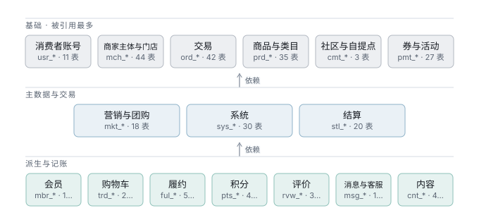

| 域 | 前缀 | 表数 | 被几个域引用 |
|---|---|---:|---:|
| 消费者账号 | `usr_*` | 11 | 17 |
| 商家主体与门店 | `mch_*` | 38 | 17 |
| 社区与自提点 | `cmt_*` | 3 | 7 |
| 商品与类目 | `prd_*` | 34 | 8 |
| 购物车 | `trd_*` | 2 | 0 |
| 交易 | `ord_*` | 58 | 10 |
| 履约 | `ful_*` | 5 | 0 |
| 营销与团购 | `mkt_*` | 17 | 4 |
| 积分 | `pts_*` | 41 | 0 |
| 结算 | `stl_*` | 18 | 3 |
| 评价 | `rvw_*` | 3 | 0 |
| 消息与客服 | `msg_*` | 1 | 0 |
| 内容 | `cnt_*` | 4 | 0 |
| 会员 | `mbr_*` | 14 | 1 |
| 券与活动 | `pmt_*` | 30 | 5 |
| 系统 | `sys_*` | 30 | 6 |

> `usr` 被 17 个域引用 —— 它是全库的锚点。改它的主键或语义，影响面是全局的。

## 二、分域

### 消费者账号 `usr_*`（11 张）

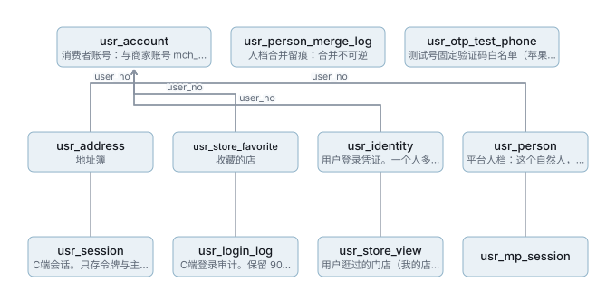

| 表 | 说明 |
|---|---|
| `usr_address` | 地址簿 |
| `usr_store_favorite` | 收藏的店 |
| `usr_account` | 消费者账号：与商家账号 mch_account 彻底独立，不关联 |
| `usr_identity` | 用户登录凭证。一个人多条，新增来源只是多一行，不再改表 |
| `usr_person` | 平台人档：这个自然人，以已验证的手机号为准 |
| `usr_person_merge_log` | 人档合并留痕：合并不可逆 |
| `usr_session` | C端会话。只存令牌与主体，身份由 usr_account 现读 |
| `usr_login_log` | C端登录审计。保留 90 天。IP/UA 记这里不记会话表 |
| `usr_otp_test_phone` | 测试号固定验证码白名单（苹果审核演示账号用） |
| `usr_store_view` | 用户逛过的门店（我的店 · 分享效果） |
| `usr_mp_session` | — |

**跨域引用**：`usr_store_favorite.entity_no` → `mch_entity`、`usr_store_favorite.store_no` → `mch_store`、`usr_account.community_no` → `cmt_community`、`usr_account.pickup_no` → `cmt_pickup_point`、`usr_account.entity_no` → `mch_entity`、`usr_store_view.store_no` → `mch_store`、`usr_store_view.entity_no` → `mch_entity`

### 商家主体与门店 `mch_*`（38 张）

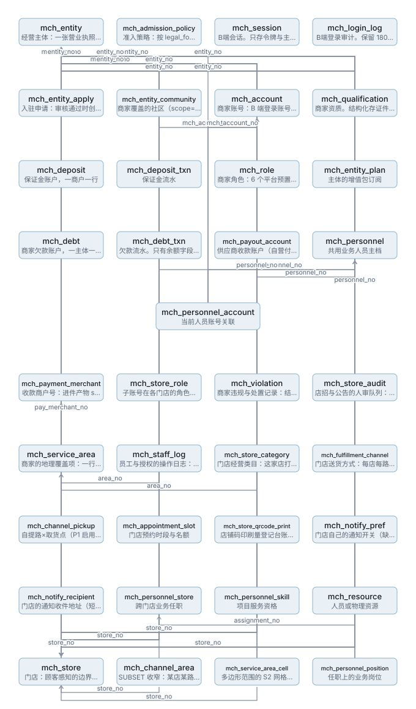

| 表 | 说明 |
|---|---|
| `mch_entity` | 经营主体：一张营业执照的经营实体。收款商户号在 mch_payment_merchant，门店经 mch_store.entity_no 关联（可切换执照） |
| `mch_entity_apply` | 入驻申请：审核通过时创建 mch_entity 并回填 entity_no（幂等判据应按本表，不按人） |
| `mch_entity_community` | 商家覆盖的社区（scope=COMMUNITY 时生效） |
| `mch_payment_merchant` | 收款商户号：进件产物 sub_mchid，每主体×每通道一条。全库唯一合法的 merchant 用法 |
| `mch_account` | 商家账号：B 端登录账号（login_phone 注册，与消费者账号彻底独立）。当前一行同时承载对主体的成员关系，门店角色见 mch_store_role |
| `mch_store_role` | 子账号在各门店的角色（每店一个角色） |
| `mch_store` | 门店：顾客感知的边界（地址/营业时间/库存/评价/履约）。关联主体可切换（换执照店照开）；每主体恰好一个默认店 |
| `mch_violation` | 商家违规与处置记录：结论在 mch_entity.breach_count，事实在这里 |
| `mch_store_audit` | 店招与公告的人审队列：只有机审命中的才进来 |
| `mch_qualification` | 商家资质。结构化存证件类型/编号/有效期，供到期扫描与上架校验 |
| `mch_admission_policy` | 准入策略：按 legal_form 档位配置，不按商户配置 |
| `mch_deposit` | 保证金账户，一商户一行 |
| `mch_deposit_txn` | 保证金流水 |
| `mch_service_area` | 商家的地理覆盖项：一行一条，可跨粒度组合 |
| `mch_staff_log` | 员工与授权的操作日志：谁在什么时候把谁的角色改成了什么 |
| `mch_role` | 商家角色：6 个平台预置（只读）+ 商家自定义 |
| `mch_entity_plan` | 主体的增值包订阅 |
| `mch_store_category` | 门店经营类目：这家店打算卖哪几类 |
| `mch_fulfillment_channel` | 门店送货方式：每店每路一行的开关与配置 |
| `mch_channel_pickup` | 自提路×取货点（P1 启用）。本店地址刻意不落行：门店地址天然是取货地址，存两份是漂移的起点 |
| `mch_channel_area` | SUBSET 收窄：某店某路只适用哪些范围项（P2 启用） |
| `mch_appointment_slot` | 门店预约时段与名额 |
| `mch_session` | B端会话。只存令牌与主体，身份由 mch_account 现读 |
| `mch_login_log` | B端登录审计。保留 180 天 |
| `mch_debt` | 商家欠款账户，一主体一行。与保证金方向相反，不合表 |
| `mch_debt_txn` | 欠款流水。只有余额字段的账户是不可审计的 |
| `mch_store_qrcode_print` | 店铺码印刷量登记台账（线下事实，运营录入） |
| `mch_payout_account` | 供应商收款账户（自营付款用，账号密文存储） |
| `mch_notify_pref` | 门店自己的通知开关（缺行=开） |
| `mch_notify_recipient` | 门店的通知收件地址（短信 / 邮件 / 企微群） |
| `mch_service_area_cell` | 多边形范围的 S2 网格派生表（可由 mch_service_area.geometry 重建） |
| `mch_management_space` | — |
| `mch_management_grant` | — |
| `mch_brand` | — |
| `mch_brand_store_binding` | — |
| `mch_brand_change` | — |
| `mch_brand_financial_activation` | — |
| `mch_brand_financial_change` | — |

**跨域引用**：`mch_entity_apply.user_no` → `usr_account`、`mch_entity_community.community_no` → `cmt_community`、`mch_account.user_no` → `usr_account`、`mch_store_category.category_no` → `prd_category`、`mch_channel_pickup.pickup_no` → `cmt_pickup_point`、`mch_session.user_no` → `usr_account`、`mch_login_log.user_no` → `usr_account`、`mch_brand_financial_activation.issuer_no` → `sv_issuer`

### 社区与自提点 `cmt_*`（3 张）

| 表 | 说明 |
|---|---|
| `cmt_community` | 社区 |
| `cmt_pickup_point` | 自提点（ADR-005） |
| `cmt_community_apply` | 商家提报的新社区，审过才进 cmt_community |

**跨域引用**：`cmt_pickup_point.group_no` → `mkt_group_buy`、`cmt_community_apply.entity_no` → `mch_entity`

### 商品与类目 `prd_*`（34 张）

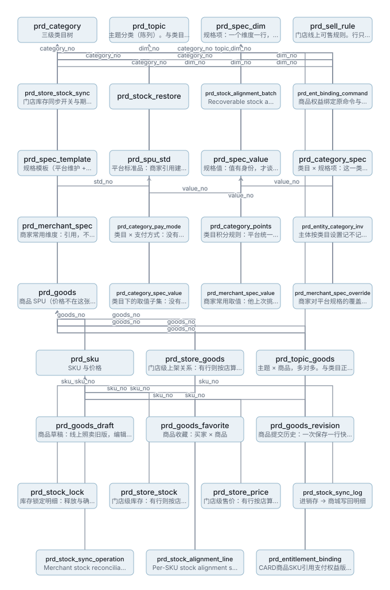

| 表 | 说明 |
|---|---|
| `prd_category` | 三级类目树 |
| `prd_goods` | 商品 SPU（价格不在这张表） |
| `prd_sku` | SKU 与价格 |
| `prd_spec_template` | 规格模板（平台维护 + 商家自存） |
| `prd_stock_lock` | 库存锁定明细：释放与确认据此幂等 |
| `prd_store_stock` | 门店级库存：有行则按店算，一条都没有则回退主体总量 |
| `prd_store_goods` | 门店级上架关系：有行则按店算，一条都没有则回退主体级 on_sale |
| `prd_spu_std` | 平台标准品：商家引用建品的模子，无价无库存 |
| `prd_store_price` | 门店级售价：有行按店算，无行回退主体价（与库存相反，视为 0 就是白送） |
| `prd_topic` | 主题分类（陈列）。与类目正交，与活动分开：摆到一起 ≠ 降价 |
| `prd_topic_goods` | 主题 × 商品，多对多。与类目正交：一件豆浆既是预包装食品，也是早餐必备 |
| `prd_spec_dim` | 规格项：一个维度一行，通用维度全站只有这一份 |
| `prd_spec_value` | 规格值：值有身份，才谈得上聚合、排序与比价 |
| `prd_category_spec` | 类目 × 规格项：这一类目用哪些维度、谁是主维度 |
| `prd_category_spec_value` | 类目下的取值子集：没有行 = 该维度全部值都能选 |
| `prd_merchant_spec` | 商家常用维度：引用，不是副本 |
| `prd_merchant_spec_value` | 商家常用取值：他上次挑过的那几档，下次建品排在前面 |
| `prd_merchant_spec_override` | 商家对平台规格的覆盖（用哪几个/什么顺序/叫什么） |
| `prd_category_pay_mode` | 类目 × 支付方式：没有行即放行，插 allowed=0 才是禁止 |
| `prd_category_points` | 类目积分规则：平台统一按类目管理，商家不配 |
| `prd_goods_draft` | 商品草稿：线上照卖旧版，编辑落这里。发布=事务换版+物理删行 |
| `prd_goods_favorite` | 商品收藏：买家 × 商品 |
| `prd_entity_category_inv` | 主体按类目设置记不记库存。稀疏：没有行 = 平台默认。行只改不删，唯一键不含 deleted |
| `prd_sell_rule` | 门店线上可售规则。行只改不删，唯一键不含 deleted |
| `prd_store_stock_sync` | 门店库存同步开关与期初对齐 |
| `prd_stock_sync_log` | 进销存 → 商城写回明细 |
| `prd_goods_revision` | 商品提交历史：一次保存一行快照。发布不留痕是此前查不到「发过什么」的根因 |
| `prd_stock_restore` | — |
| `prd_stock_sync_operation` | Merchant stock reconciliation operation and recoverable result |
| `prd_stock_alignment_batch` | Recoverable stock alignment preview and confirmation |
| `prd_stock_alignment_line` | Per-SKU stock alignment snapshot and resumable result |
| `prd_entitlement_binding` | CARD商品SKU引用支付权益版本，不重复保存余次规则 |
| `prd_ent_binding_command` | 商品权益绑定原命令与成功回执 |
| `prd_sku_pricing_policy` | — |

**跨域引用**：`prd_goods.entity_no` → `mch_entity`、`prd_goods.store_no` → `mch_store`、`prd_sku.entity_no` → `mch_entity`、`prd_spec_template.entity_no` → `mch_entity`、`prd_stock_lock.store_no` → `mch_store`、`prd_store_stock.store_no` → `mch_store`、`prd_store_stock.entity_no` → `mch_entity`、`prd_store_goods.store_no` → `mch_store`、`prd_store_goods.entity_no` → `mch_entity`、`prd_store_price.store_no` → `mch_store`、`prd_store_price.entity_no` → `mch_entity`、`prd_topic_goods.entity_no` → `mch_entity`、`prd_spec_dim.entity_no` → `mch_entity`、`prd_spec_value.entity_no` → `mch_entity`、`prd_merchant_spec.entity_no` → `mch_entity`、`prd_merchant_spec_value.entity_no` → `mch_entity`、`prd_merchant_spec_override.merchant_no` → `mch_entity`、`prd_goods_draft.entity_no` → `mch_entity`、`prd_goods_favorite.user_no` → `usr_account`、`prd_entity_category_inv.entity_no` → `mch_entity`、`prd_sell_rule.store_no` → `mch_store`、`prd_store_stock_sync.store_no` → `mch_store`、`prd_store_stock_sync.entity_no` → `mch_entity`、`prd_stock_sync_log.store_no` → `mch_store`、`prd_goods_revision.entity_no` → `mch_entity`、`prd_stock_sync_operation.entity_no` → `mch_entity`、`prd_stock_sync_operation.store_no` → `mch_store`、`prd_stock_alignment_batch.entity_no` → `mch_entity`、`prd_stock_alignment_batch.store_no` → `mch_store`、`prd_entitlement_binding.template_version_no` → `ent_template_version`、`prd_sku_pricing_policy.entity_no` → `mch_entity`、`prd_sku_pricing_policy.store_no` → `mch_store`

### 购物车 `trd_*`（2 张）

| 表 | 说明 |
|---|---|
| `trd_cart_item` | 购物车（不存价，读时实时算） |
| `trd_shipping_upload` | 微信发货信息录入的上报台账 |

**跨域引用**：`trd_cart_item.user_no` → `usr_account`、`trd_cart_item.goods_no` → `prd_goods`、`trd_cart_item.sku_no` → `prd_sku`、`trd_shipping_upload.order_no` → `ord_order`、`trd_shipping_upload.out_trade_no` → `stl_payment`

### 交易 `ord_*`（58 张）

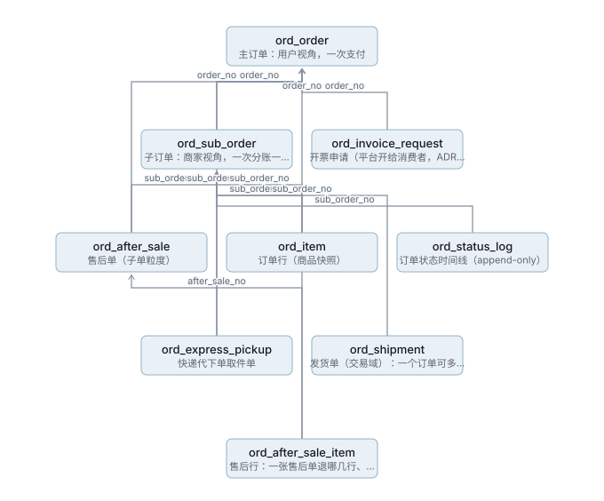

| 表 | 说明 |
|---|---|
| `ord_after_sale` | 售后单（子单粒度） |
| `ord_item` | 订单行（商品快照） |
| `ord_order` | 主订单：用户视角，一次支付 |
| `ord_status_log` | 订单状态时间线（append-only） |
| `ord_sub_order` | 子订单：商家视角，一次分账一条履约链 |
| `ord_invoice_request` | 开票申请（平台开给消费者，ADR-017 §3.4 条件 2） |
| `ord_express_pickup` | 快递代下单取件单 |
| `ord_shipment` | 发货单（交易域）：一个订单可多次发货/多包裹，每张关联一条物流运单 |
| `ord_after_sale_item` | 售后行：一张售后单退哪几行、各几件、各多少钱 |
| `ord_create_intent` | — |
| `ord_payment_resolution` | — |
| `ord_refund_execution` | — |
| `ord_points_refund_execution` | Immutable source refund preparation and execution phase |
| `ord_points_integration_policy` | — |
| `ord_points_command` | — |
| `ord_points_binding` | — |
| `ord_points_source_counter` | — |
| `ord_points_source_fact` | — |
| `ord_points_placement` | — |
| `ord_points_refund_binding` | — |
| `ord_points_recovery_cursor` | — |
| `ord_points_refund_retry` | — |
| `ord_points_work_cursor` | — |
| `ord_refund_coupon_scope` | — |
| `ord_refund_obligation` | — |
| `ord_ent_authorization` | core本人消费授权及其待确认意图 |
| `ord_ent_source_decision` | core成功/取消唯一决策；同成功源跨修订不可重复 |
| `ord_card_sale_snapshot` | Frozen paid-card order-unit entitlement facts |
| `ord_ent_order_use` | 核心订单权益协调，不持有权益余额 |
| `ord_ent_payment_seal` | 发起支付后禁止改价 |
| `ord_ent_service_order` | 核心服务核销业务源，不代表现金订单收入 |
| `ord_legacy_coupon_checkout` | — |
| `ord_points_earn_rule` | — |
| `ord_points_earn_rule_revision` | — |
| `ord_pricing_template` | — |
| `ord_pricing_template_revision` | — |
| `ord_store_pricing_config` | — |
| `ord_store_pricing_revision` | — |
| `ord_price_quote` | — |
| `ord_price_quote_line` | — |
| `ord_price_quote_allocation` | — |
| `ord_pricing_funding_source` | — |
| `ord_industry_order_source` | — |
| `ord_industry_fulfillment` | — |
| `ord_manual_price_policy` | — |
| `ord_manual_price_adjustment` | — |
| `ord_industry_fulfillment_progress` | — |
| `ord_industry_amendment` | — |
| `ord_industry_amendment_line` | — |
| `ord_industry_receivable_adjustment` | — |
| `ord_industry_fee_line_adjustment` | — |
| `ord_pricing_fee_rule` | — |
| `ord_pricing_fee_revision` | — |
| `ord_pricing_fee_scope` | — |
| `ord_pricing_fee_application` | — |
| `ord_pricing_fee_advice` | — |
| `ord_pricing_fee_reconciliation` | — |
| `ord_print_fact` | 订单事务内冻结的不可变打印事实 |

**跨域引用**：`ord_after_sale.user_no` → `usr_account`、`ord_after_sale.entity_no` → `mch_entity`、`ord_item.goods_no` → `prd_goods`、`ord_item.sku_no` → `prd_sku`、`ord_item.category_no` → `prd_category`、`ord_item.shipment_no` → `lgs_waybill`、`ord_order.user_no` → `usr_account`、`ord_order.community_no` → `cmt_community`、`ord_sub_order.user_no` → `usr_account`、`ord_sub_order.entity_no` → `mch_entity`、`ord_sub_order.pickup_no` → `cmt_pickup_point`、`ord_sub_order.group_no` → `mkt_group_buy`、`ord_sub_order.store_no` → `mch_store`、`ord_sub_order.community_no` → `cmt_community`、`ord_sub_order.period_no` → `pmt_period`、`ord_invoice_request.user_no` → `usr_account`、`ord_express_pickup.pickup_no` → `cmt_pickup_point`、`ord_express_pickup.entity_no` → `mch_entity`、`ord_express_pickup.store_no` → `mch_store`、`ord_shipment.shipment_no` → `lgs_waybill`、`ord_create_intent.user_no` → `usr_account`、`ord_payment_resolution.payment_no` → `stl_payment`、`ord_payment_resolution.user_no` → `usr_account`、`ord_refund_execution.origin_payment_no` → `stl_payment`、`ord_refund_execution.payment_no` → `stl_payment`、`ord_points_refund_execution.cash_payment_no` → `stl_payment`、`ord_points_integration_policy.store_no` → `mch_store`、`ord_points_binding.store_no` → `mch_store`、`ord_points_source_fact.event_no` → `sys_outbox`、`ord_points_source_fact.store_no` → `mch_store`、`ord_points_refund_binding.cash_payment_no` → `stl_payment`、`ord_refund_coupon_scope.coupon_no` → `mkt_coupon`、`ord_ent_authorization.user_no` → `usr_account`、`ord_ent_authorization.entity_no` → `mch_entity`、`ord_ent_authorization.store_no` → `mch_store`、`ord_ent_source_decision.user_no` → `usr_account`、`ord_ent_source_decision.entity_no` → `mch_entity`、`ord_ent_source_decision.store_no` → `mch_store`、`ord_card_sale_snapshot.user_no` → `usr_account`、`ord_card_sale_snapshot.entity_no` → `mch_entity`、`ord_card_sale_snapshot.store_no` → `mch_store`、`ord_card_sale_snapshot.goods_no` → `prd_goods`、`ord_card_sale_snapshot.sku_no` → `prd_sku`、`ord_card_sale_snapshot.template_version_no` → `ent_template_version`、`ord_ent_order_use.entity_no` → `mch_entity`、`ord_ent_order_use.user_no` → `usr_account`、`ord_ent_service_order.entity_no` → `mch_entity`、`ord_ent_service_order.store_no` → `mch_store`、`ord_ent_service_order.user_no` → `usr_account`、`ord_legacy_coupon_checkout.user_no` → `usr_account`、`ord_legacy_coupon_checkout.entity_no` → `mch_entity`、`ord_store_pricing_config.entity_no` → `mch_entity`、`ord_store_pricing_config.store_no` → `mch_store`、`ord_store_pricing_revision.entity_no` → `mch_entity`、`ord_store_pricing_revision.store_no` → `mch_store`、`ord_price_quote.entity_no` → `mch_entity`、`ord_price_quote.store_no` → `mch_store`、`ord_price_quote_line.goods_no` → `prd_goods`、`ord_price_quote_line.sku_no` → `prd_sku`、`ord_pricing_funding_source.entity_no` → `mch_entity`、`ord_pricing_funding_source.store_no` → `mch_store`、`ord_pricing_funding_source.user_no` → `usr_account`、`ord_industry_order_source.entity_no` → `mch_entity`、`ord_industry_order_source.store_no` → `mch_store`、`ord_industry_fulfillment.entity_no` → `mch_entity`、`ord_industry_fulfillment.store_no` → `mch_store`、`ord_manual_price_policy.entity_no` → `mch_entity`、`ord_manual_price_policy.store_no` → `mch_store`、`ord_manual_price_adjustment.entity_no` → `mch_entity`、`ord_manual_price_adjustment.store_no` → `mch_store`、`ord_industry_fulfillment_progress.entity_no` → `mch_entity`、`ord_industry_amendment.entity_no` → `mch_entity`、`ord_industry_amendment.store_no` → `mch_store`、`ord_industry_receivable_adjustment.entity_no` → `mch_entity`、`ord_industry_receivable_adjustment.store_no` → `mch_store`、`ord_pricing_fee_rule.entity_no` → `mch_entity`、`ord_pricing_fee_rule.store_no` → `mch_store`、`ord_pricing_fee_revision.entity_no` → `mch_entity`、`ord_pricing_fee_revision.store_no` → `mch_store`、`ord_pricing_fee_scope.entity_no` → `mch_entity`、`ord_pricing_fee_scope.store_no` → `mch_store`、`ord_pricing_fee_application.entity_no` → `mch_entity`、`ord_pricing_fee_application.store_no` → `mch_store`、`ord_pricing_fee_advice.entity_no` → `mch_entity`、`ord_pricing_fee_advice.store_no` → `mch_store`、`ord_pricing_fee_reconciliation.entity_no` → `mch_entity`、`ord_pricing_fee_reconciliation.store_no` → `mch_store`、`ord_print_fact.entity_no` → `mch_entity`、`ord_print_fact.store_no` → `mch_store`

### 履约 `ful_*`（5 张）

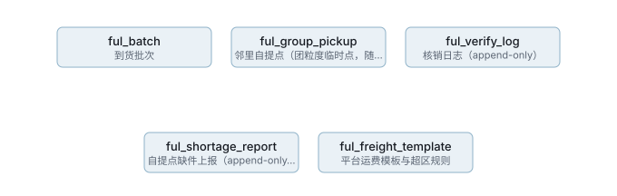

| 表 | 说明 |
|---|---|
| `ful_batch` | 到货批次 |
| `ful_group_pickup` | 邻里自提点（团粒度临时点，随团生灭，零报酬） |
| `ful_verify_log` | 核销日志（append-only） |
| `ful_shortage_report` | 自提点缺件上报（append-only，只留痕不改状态） |
| `ful_freight_template` | 平台运费模板与超区规则 |

**跨域引用**：`ful_batch.pickup_no` → `cmt_pickup_point`、`ful_batch.community_no` → `cmt_community`、`ful_group_pickup.pickup_no` → `cmt_pickup_point`、`ful_group_pickup.group_no` → `mkt_group_buy`、`ful_group_pickup.user_no` → `usr_account`、`ful_verify_log.sub_order_no` → `ord_sub_order`、`ful_verify_log.pickup_no` → `cmt_pickup_point`、`ful_shortage_report.sub_order_no` → `ord_sub_order`、`ful_shortage_report.pickup_no` → `cmt_pickup_point`、`ful_shortage_report.sku_no` → `prd_sku`

### 营销与团购 `mkt_*`（17 张）

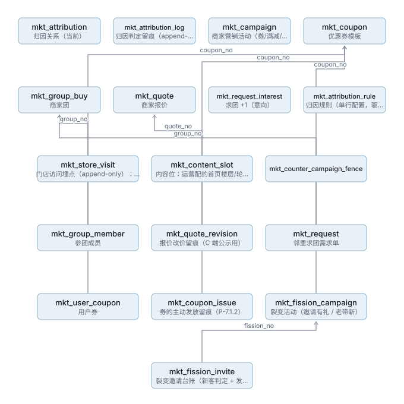

| 表 | 说明 |
|---|---|
| `mkt_attribution` | 归因关系（当前） |
| `mkt_attribution_log` | 归因判定留痕（append-only，可回放） |
| `mkt_campaign` | 商家营销活动（券/满减/限时特价/买赠统一模型） |
| `mkt_coupon` | 优惠券模板 |
| `mkt_group_buy` | 商家团 |
| `mkt_group_member` | 参团成员 |
| `mkt_quote` | 商家报价 |
| `mkt_quote_revision` | 报价改价留痕（C 端公示用） |
| `mkt_request` | 邻里求团需求单 |
| `mkt_request_interest` | 求团 +1（意向） |
| `mkt_user_coupon` | 用户券 |
| `mkt_coupon_issue` | 券的主动发放留痕（P-7.1.2） |
| `mkt_attribution_rule` | 归因规则（单行配置，驱动归因引擎） |
| `mkt_fission_campaign` | 裂变活动（邀请有礼 / 老带新） |
| `mkt_fission_invite` | 裂变邀请台账（新客判定 + 发奖幂等 + 真计数） |
| `mkt_store_visit` | 门店访问埋点（append-only）：扫码落地即记，匿名也记 |
| `mkt_content_slot` | 内容位：运营配的首页楼层/轮播/频道；这一版只有 HOME_FLOOR 被 C 端读 |

**跨域引用**：`mkt_attribution.user_no` → `usr_account`、`mkt_attribution.entity_no` → `mch_entity`、`mkt_attribution.inviter_no` → `usr_account`、`mkt_attribution_log.user_no` → `usr_account`、`mkt_attribution_log.entity_no` → `mch_entity`、`mkt_attribution_log.inviter_no` → `usr_account`、`mkt_attribution_log.order_no` → `ord_order`、`mkt_attribution_log.store_no` → `mch_store`、`mkt_campaign.entity_no` → `mch_entity`、`mkt_campaign.store_no` → `mch_store`、`mkt_coupon.entity_no` → `mch_entity`、`mkt_group_buy.goods_no` → `prd_goods`、`mkt_group_buy.sku_no` → `prd_sku`、`mkt_group_buy.entity_no` → `mch_entity`、`mkt_group_buy.pickup_no` → `cmt_pickup_point`、`mkt_group_buy.activity_no` → `pmt_activity`、`mkt_group_member.user_no` → `usr_account`、`mkt_group_member.sub_order_no` → `ord_sub_order`、`mkt_quote.entity_no` → `mch_entity`、`mkt_quote_revision.entity_no` → `mch_entity`、`mkt_request.pickup_no` → `cmt_pickup_point`、`mkt_request_interest.user_no` → `usr_account`、`mkt_user_coupon.user_no` → `usr_account`、`mkt_user_coupon.order_no` → `ord_order`、`mkt_coupon_issue.user_no` → `usr_account`、`mkt_fission_invite.inviter_no` → `usr_account`、`mkt_fission_invite.order_no` → `ord_order`、`mkt_store_visit.entity_no` → `mch_entity`、`mkt_store_visit.store_no` → `mch_store`、`mkt_store_visit.user_no` → `usr_account`

### 积分 `pts_*`（41 张）

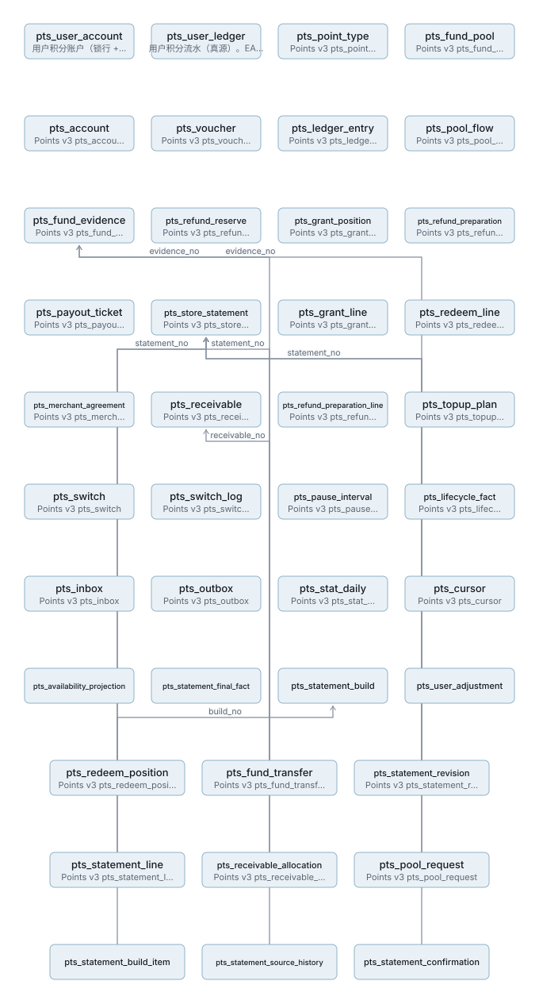

| 表 | 说明 |
|---|---|
| `pts_user_account` | 用户积分账户（锁行 + 派生余额） |
| `pts_user_ledger` | 用户积分流水（真源）。EARN/USE/REFUND/EXPIRE/REVOKE 五种行，**没有批次概念**（V30 起按账户滚动到期） |
| `pts_point_type` | Points v3 pts_point_type |
| `pts_fund_pool` | Points v3 pts_fund_pool |
| `pts_account` | Points v3 pts_account |
| `pts_voucher` | Points v3 pts_voucher |
| `pts_ledger_entry` | Points v3 pts_ledger_entry |
| `pts_pool_flow` | Points v3 pts_pool_flow |
| `pts_fund_evidence` | Points v3 pts_fund_evidence |
| `pts_refund_reserve` | Points v3 pts_refund_reserve |
| `pts_grant_position` | Points v3 pts_grant_position |
| `pts_redeem_position` | Points v3 pts_redeem_position |
| `pts_refund_preparation` | Points v3 pts_refund_preparation |
| `pts_payout_ticket` | Points v3 pts_payout_ticket |
| `pts_store_statement` | Points v3 pts_store_statement |
| `pts_fund_transfer` | Points v3 pts_fund_transfer |
| `pts_grant_line` | Points v3 pts_grant_line |
| `pts_redeem_line` | Points v3 pts_redeem_line |
| `pts_merchant_agreement` | Points v3 pts_merchant_agreement |
| `pts_statement_revision` | Points v3 pts_statement_revision |
| `pts_statement_line` | Points v3 pts_statement_line |
| `pts_receivable` | Points v3 pts_receivable |
| `pts_receivable_allocation` | Points v3 pts_receivable_allocation |
| `pts_refund_preparation_line` | Points v3 pts_refund_preparation_line |
| `pts_pool_request` | Points v3 pts_pool_request |
| `pts_topup_plan` | Points v3 pts_topup_plan |
| `pts_switch` | Points v3 pts_switch |
| `pts_switch_log` | Points v3 pts_switch_log |
| `pts_pause_interval` | Points v3 pts_pause_interval |
| `pts_lifecycle_fact` | Points v3 pts_lifecycle_fact |
| `pts_inbox` | Points v3 pts_inbox |
| `pts_outbox` | Points v3 pts_outbox |
| `pts_stat_daily` | Points v3 pts_stat_daily |
| `pts_cursor` | Points v3 pts_cursor |
| `pts_availability_projection` | — |
| `pts_statement_final_fact` | — |
| `pts_statement_build` | — |
| `pts_statement_build_item` | — |
| `pts_statement_source_history` | — |
| `pts_user_adjustment` | — |
| `pts_statement_confirmation` | — |

**跨域引用**：`pts_user_account.user_no` → `usr_account`、`pts_user_ledger.user_no` → `usr_account`、`pts_user_ledger.issuer_merchant_no` → `mch_entity`、`pts_user_ledger.sub_order_no` → `ord_sub_order`、`pts_grant_position.sub_order_no` → `ord_sub_order`、`pts_grant_position.user_no` → `usr_account`、`pts_redeem_position.sub_order_no` → `ord_sub_order`、`pts_redeem_position.order_no` → `ord_order`、`pts_redeem_position.user_no` → `usr_account`、`pts_redeem_position.store_no` → `mch_store`、`pts_refund_preparation.after_sale_no` → `ord_after_sale`、`pts_refund_preparation.sub_order_no` → `ord_sub_order`、`pts_store_statement.store_no` → `mch_store`、`pts_merchant_agreement.store_no` → `mch_store`、`pts_receivable.store_no` → `mch_store`、`pts_lifecycle_fact.sub_order_no` → `ord_sub_order`、`pts_inbox.event_no` → `sys_outbox`、`pts_outbox.event_no` → `sys_outbox`、`pts_statement_final_fact.sub_order_no` → `ord_sub_order`、`pts_statement_build.store_no` → `mch_store`、`pts_statement_confirmation.merchant_no` → `mch_entity`、`pts_statement_confirmation.store_no` → `mch_store`

### 结算 `stl_*`（18 张）

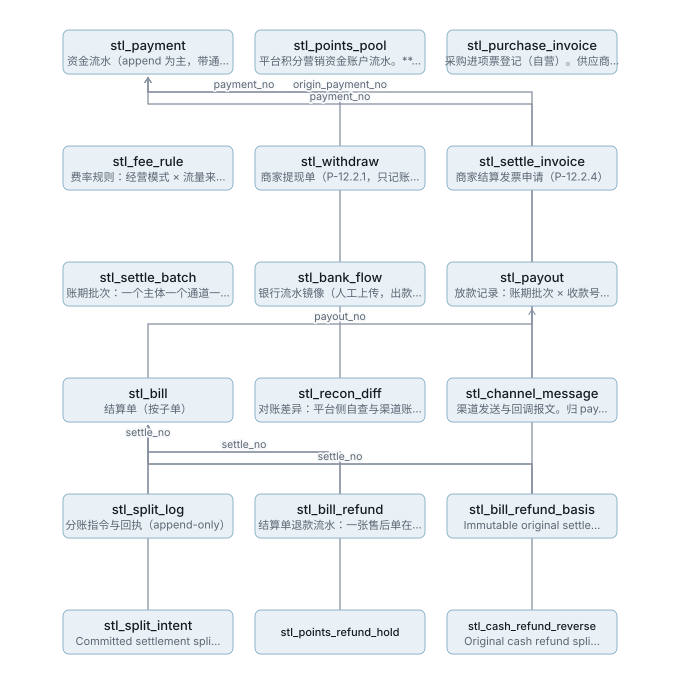

| 表 | 说明 |
|---|---|
| `stl_bill` | 结算单（按子单） |
| `stl_payment` | 资金流水（append 为主，带通道回执与对账状态）：收款 / 退款 / 补差 / 补差回退 / 打款 |
| `stl_points_pool` | 平台积分营销资金账户流水。**平台自己的钱**，用于兑现平台发出的积分（同平台优惠券补差） |
| `stl_split_log` | 分账指令与回执（append-only） |
| `stl_purchase_invoice` | 采购进项票登记（自营）。供应商开给平台，平台据此列支成本 |
| `stl_fee_rule` | 费率规则：经营模式 × 流量来源，按生效时间分版本 |
| `stl_recon_diff` | 对账差异：平台侧自查与渠道账单比对的产出，逐条人工裁决 |
| `stl_withdraw` | 商家提现单（P-12.2.1，只记账不打款） |
| `stl_settle_invoice` | 商家结算发票申请（P-12.2.4） |
| `stl_settle_batch` | 账期批次：一个主体一个通道一个账期一批 |
| `stl_channel_message` | 渠道发送与回调报文。归 pay —— D2 拆库时跟着支付域走 |
| `stl_bank_flow` | 银行流水镜像（人工上传，出款对账 B 侧） |
| `stl_payout` | 放款记录：账期批次 × 收款号一笔，凭证号与银行流水都挂在它上面 |
| `stl_bill_refund` | 结算单退款流水：一张售后单在结算单上扣了 / 回退了多少 |
| `stl_bill_refund_basis` | Immutable original settlement refund basis and retained account version |
| `stl_split_intent` | Committed settlement split instruction and outcome recovery |
| `stl_points_refund_hold` | — |
| `stl_cash_refund_reverse` | Original cash refund split reversal and outcome recovery |

**跨域引用**：`stl_bill.sub_order_no` → `ord_sub_order`、`stl_bill.order_no` → `ord_order`、`stl_bill.entity_no` → `mch_entity`、`stl_bill.store_no` → `mch_store`、`stl_bill.pay_merchant_no` → `mch_payment_merchant`、`stl_payment.order_no` → `ord_order`、`stl_payment.sub_order_no` → `ord_sub_order`、`stl_payment.after_sale_no` → `ord_after_sale`、`stl_payment.user_no` → `usr_account`、`stl_payment.entity_no` → `mch_entity`、`stl_points_pool.entity_no` → `mch_entity`、`stl_split_log.sub_order_no` → `ord_sub_order`、`stl_purchase_invoice.entity_no` → `mch_entity`、`stl_recon_diff.order_no` → `ord_order`、`stl_withdraw.entity_no` → `mch_entity`、`stl_settle_invoice.entity_no` → `mch_entity`、`stl_settle_batch.entity_no` → `mch_entity`、`stl_payout.entity_no` → `mch_entity`、`stl_payout.pay_merchant_no` → `mch_payment_merchant`、`stl_bill_refund.sub_order_no` → `ord_sub_order`、`stl_bill_refund.after_sale_no` → `ord_after_sale`、`stl_bill_refund_basis.sub_order_no` → `ord_sub_order`、`stl_bill_refund_basis.pay_merchant_no` → `mch_payment_merchant`、`stl_points_refund_hold.after_sale_no` → `ord_after_sale`、`stl_points_refund_hold.sub_order_no` → `ord_sub_order`、`stl_cash_refund_reverse.after_sale_no` → `ord_after_sale`

### 评价 `rvw_*`（3 张）

| 表 | 说明 |
|---|---|
| `rvw_appeal` | 商家对差评的申诉（P-13.1.3 裁决入口） |
| `rvw_review` | 商品评价（含三维分） |
| `rvw_review_like` | 评价点赞明细（likeCount 的真源） |

**跨域引用**：`rvw_appeal.entity_no` → `mch_entity`、`rvw_review.sub_order_no` → `ord_sub_order`、`rvw_review.order_no` → `ord_order`、`rvw_review.goods_no` → `prd_goods`、`rvw_review.sku_no` → `prd_sku`、`rvw_review.entity_no` → `mch_entity`、`rvw_review.user_no` → `usr_account`、`rvw_review.store_no` → `mch_store`、`rvw_review_like.user_no` → `usr_account`

### 消息与客服 `msg_*`（1 张）

| 表 | 说明 |
|---|---|
| `msg_faq` | 常见问题（帮助中心） |

### 内容 `cnt_*`（4 张）

| 表 | 说明 |
|---|---|
| `cnt_post` | 种草内容与审核结果 |
| `cnt_question` | 商品问答 |
| `cnt_ranking` | 榜单配置 |
| `cnt_material` | 运营素材 |

**跨域引用**：`cnt_post.community_no` → `cmt_community`、`cnt_post.sku_no` → `prd_sku`、`cnt_question.sku_no` → `prd_sku`、`cnt_question.goods_no` → `prd_goods`

### 会员 `mbr_*`（14 张）

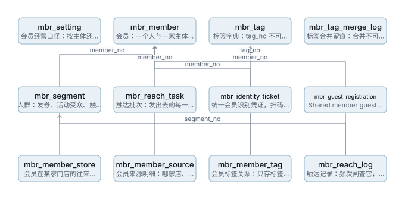

| 表 | 说明 |
|---|---|
| `mbr_setting` | 会员经营口径：按主体还是按门店 |
| `mbr_member` | 会员：一个人与一家主体的关系 |
| `mbr_member_store` | 会员在某家门店的往来与分层。单店主体不写这张表 |
| `mbr_member_source` | 会员来源明细：哪家店、哪条链接、谁发的、谁录的、因哪场活动 |
| `mbr_tag` | 标签字典：tag_no 不可变、name 可改。不存人数，要用时 COUNT |
| `mbr_member_tag` | 会员标签关系：只存标签号，文本在字典里 |
| `mbr_tag_merge_log` | 标签合并留痕：合并不可逆 |
| `mbr_segment` | 人群：发券、活动受众、触达共用同一份条件 |
| `mbr_reach_log` | 触达记录：频次闸查它，效果也算它 |
| `mbr_reach_task` | 触达批次：发出去的每一次 |
| `mbr_identity_ticket` | 统一会员识别凭证，扫码不等于扣款同意 |
| `mbr_scope_member` | — |
| `mbr_store_profile` | — |
| `mbr_scope_legacy_link` | — |

**跨域引用**：`mbr_setting.entity_no` → `mch_entity`、`mbr_member.entity_no` → `mch_entity`、`mbr_member.person_no` → `usr_person`、`mbr_member.first_store_no` → `mch_store`、`mbr_member_store.entity_no` → `mch_entity`、`mbr_member_store.store_no` → `mch_store`、`mbr_member_source.entity_no` → `mch_entity`、`mbr_member_source.store_no` → `mch_store`、`mbr_member_source.activity_no` → `pmt_activity`、`mbr_tag.entity_no` → `mch_entity`、`mbr_member_tag.entity_no` → `mch_entity`、`mbr_tag_merge_log.entity_no` → `mch_entity`、`mbr_segment.entity_no` → `mch_entity`、`mbr_reach_log.entity_no` → `mch_entity`、`mbr_reach_log.task_no` → `notify_push_task`、`mbr_reach_task.task_no` → `notify_push_task`、`mbr_reach_task.entity_no` → `mch_entity`、`mbr_identity_ticket.user_no` → `usr_account`、`mbr_identity_ticket.entity_no` → `mch_entity`、`mbr_identity_ticket.store_no` → `mch_store`、`mbr_identity_ticket.customer_no` → `sv_customer_identity`、`mbr_identity_ticket.issuer_no` → `sv_issuer`、`mbr_scope_member.customer_no` → `sv_customer_identity`、`mbr_scope_member.first_store_no` → `mch_store`、`mbr_store_profile.customer_no` → `sv_customer_identity`、`mbr_store_profile.store_no` → `mch_store`

### 券与活动 `pmt_*`（30 张）

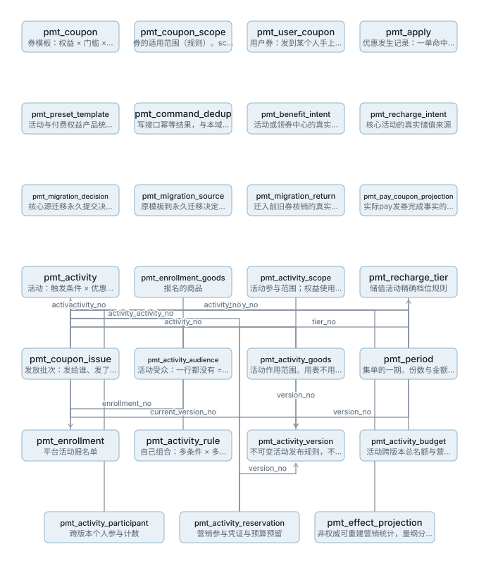

| 表 | 说明 |
|---|---|
| `pmt_coupon` | 券模板：权益 × 门槛 × 范围 × 有效期 × 发放 × 核销 × 次数 |
| `pmt_coupon_scope` | 券的适用范围（规则）。scope_desc 只是文案 |
| `pmt_user_coupon` | 用户券：发到某个人手上的那一张，有自己的有效期 |
| `pmt_coupon_issue` | 发放批次：发给谁、发了多少、跳过多少、谁发的 |
| `pmt_apply` | 优惠发生记录：一单命中了什么、一张券被用了几次，线上线下同一张表 |
| `pmt_activity` | 活动：触发条件 × 优惠形式 × 排期 × 限量 |
| `pmt_activity_audience` | 活动受众：一行都没有 = 对所有人生效 |
| `pmt_activity_goods` | 活动作用范围。用表不用 TEXT：要反查「这个商品在哪些活动里」 |
| `pmt_period` | 集单的一期。份数与金额不存，从订单现算 |
| `pmt_enrollment` | 平台活动报名单 |
| `pmt_enrollment_goods` | 报名的商品 |
| `pmt_activity_rule` | 自己组合：多条件 × 多利益。有行时优先于主表的单条触发 × 利益 |
| `pmt_preset_template` | 活动与付费权益产品统一预置目录 |
| `pmt_activity_version` | 不可变活动发布规则，不拥有权益余次 |
| `pmt_activity_scope` | 活动参与范围；权益使用范围在pay快照中 |
| `pmt_recharge_tier` | 储值活动精确档位规则 |
| `pmt_activity_budget` | 活动跨版本总名额与营销预算 |
| `pmt_activity_participant` | 跨版本个人参与计数 |
| `pmt_activity_reservation` | 营销参与凭证与预算预留 |
| `pmt_effect_projection` | 非权威可重建营销统计，量纲分开 |
| `pmt_command_dedup` | 写接口幂等结果，与本域业务变更同事务 |
| `pmt_benefit_intent` | 活动或领券中心的真实发放来源 |
| `pmt_recharge_intent` | 核心活动的真实储值来源 |
| `pmt_migration_decision` | 核心源迁移永久提交决定，不是目标导入 |
| `pmt_migration_source` | 原模板到永久迁移决定的唯一绑定 |
| `pmt_migration_return` | 迁入前旧券核销的真实退回决定及支付确认 |
| `pmt_pay_coupon_projection` | 实际pay发券完成事实的core身份及券包投影，不是第二份权益账户 |
| `pmt_sv_release_link` | — |
| `pmt_sv_approval` | — |
| `pmt_brand_activity_owner` | — |

**跨域引用**：`pmt_coupon.coupon_no` → `mkt_coupon`、`pmt_coupon.entity_no` → `mch_entity`、`pmt_coupon_scope.coupon_no` → `mkt_coupon`、`pmt_user_coupon.coupon_no` → `mkt_coupon`、`pmt_user_coupon.user_no` → `usr_account`、`pmt_user_coupon.entity_no` → `mch_entity`、`pmt_user_coupon.order_no` → `ord_order`、`pmt_coupon_issue.coupon_no` → `mkt_coupon`、`pmt_coupon_issue.entity_no` → `mch_entity`、`pmt_coupon_issue.segment_no` → `mbr_segment`、`pmt_apply.user_no` → `usr_account`、`pmt_apply.entity_no` → `mch_entity`、`pmt_apply.store_no` → `mch_store`、`pmt_apply.order_no` → `ord_order`、`pmt_apply.sub_order_no` → `ord_sub_order`、`pmt_activity.entity_no` → `mch_entity`、`pmt_activity.store_no` → `mch_store`、`pmt_activity_audience.entity_no` → `mch_entity`、`pmt_activity_goods.entity_no` → `mch_entity`、`pmt_period.entity_no` → `mch_entity`、`pmt_enrollment.entity_no` → `mch_entity`、`pmt_enrollment_goods.goods_no` → `prd_goods`、`pmt_activity_participant.user_no` → `usr_account`、`pmt_activity_reservation.user_no` → `usr_account`、`pmt_activity_reservation.entity_no` → `mch_entity`、`pmt_activity_reservation.store_no` → `mch_store`、`pmt_effect_projection.entity_no` → `mch_entity`、`pmt_effect_projection.store_no` → `mch_store`、`pmt_benefit_intent.user_no` → `usr_account`、`pmt_recharge_intent.recharge_no` → `sv_recharge`、`pmt_recharge_intent.entity_no` → `mch_entity`、`pmt_migration_decision.plan_no` → `ent_migration_plan`、`pmt_migration_decision.entity_no` → `mch_entity`、`pmt_migration_return.entity_no` → `mch_entity`、`pmt_migration_return.order_no` → `ord_order`、`pmt_pay_coupon_projection.instance_no` → `ent_instance`、`pmt_pay_coupon_projection.user_no` → `usr_account`、`pmt_pay_coupon_projection.entity_no` → `mch_entity`、`pmt_pay_coupon_projection.target_template_no` → `ent_template`、`pmt_pay_coupon_projection.template_version_no` → `ent_template_version`、`pmt_pay_coupon_projection.grant_no` → `ent_grant`、`pmt_sv_release_link.management_no` → `mch_management_space`、`pmt_sv_release_link.store_no` → `mch_store`、`pmt_sv_release_link.entity_no` → `mch_entity`、`pmt_sv_release_link.issuer_no` → `sv_issuer`、`pmt_sv_release_link.release_no` → `sv_release`、`pmt_sv_approval.store_no` → `mch_store`、`pmt_sv_approval.management_no` → `mch_management_space`、`pmt_brand_activity_owner.management_no` → `mch_management_space`、`pmt_brand_activity_owner.brand_no` → `mch_brand`、`pmt_brand_activity_owner.entity_no` → `mch_entity`

### 系统 `sys_*`（30 张）

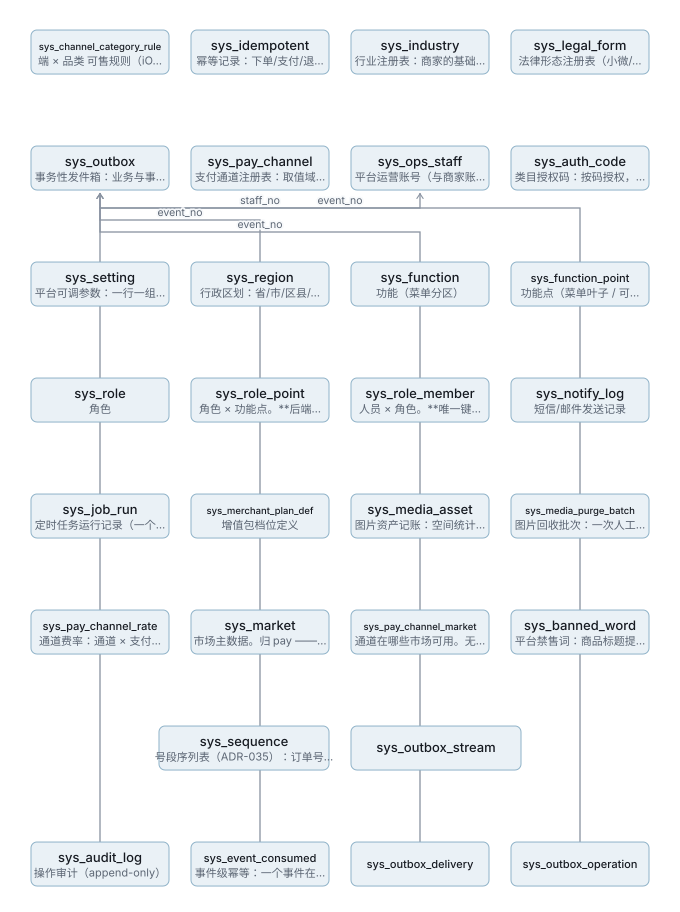

| 表 | 说明 |
|---|---|
| `sys_audit_log` | 操作审计（append-only） |
| `sys_channel_category_rule` | 端 × 品类 可售规则（iOS IAP 约束等） |
| `sys_idempotent` | 幂等记录：下单/支付/退款/核销必接 |
| `sys_industry` | 行业注册表：商家的基础属性，平台维护。通道准入（能否小微）按它判 |
| `sys_legal_form` | 法律形态注册表（小微/个体户/企业）：表管通道映射与资质要求，类型管取值 |
| `sys_outbox` | 事务性发件箱：业务与事件同事务落库 |
| `sys_pay_channel` | 支付通道注册表：取值域与能力位。积分抵扣是否可用由 supports_subsidy 决定 |
| `sys_ops_staff` | 平台运营账号（与商家账号 mch_account 是两套人，键 staff_no 从此只有一个含义） |
| `sys_auth_code` | 类目授权码：按码授权，不按类目节点 |
| `sys_setting` | 平台可调参数：一行一组，值为 JSON |
| `sys_region` | 行政区划：省/市/区县/街道四级，国家统计局口径 |
| `sys_function` | 功能（菜单分区） |
| `sys_function_point` | 功能点（菜单叶子 / 可授权的最小动作） |
| `sys_role` | 角色 |
| `sys_role_point` | 角色 × 功能点。**后端未实现的功能点照样建关联** —— 补齐那天翻个状态就能用，不用重配角色 |
| `sys_role_member` | 人员 × 角色。**唯一键含 role_code —— 这就是「一人多角色」的落点**。B 端真源仍是 mch_store_role（V18 已为多角色放宽唯一键），这里只装运营端 |
| `sys_notify_log` | 短信/邮件发送记录 |
| `sys_job_run` | 定时任务运行记录（一个任务一行） |
| `sys_merchant_plan_def` | 增值包档位定义 |
| `sys_media_asset` | 图片资产记账：空间统计与回收清单的唯一依据 |
| `sys_media_purge_batch` | 图片回收批次：一次人工确认对应一行 |
| `sys_pay_channel_rate` | 通道费率：通道 × 支付方式 × 主体形态，按生效时间分版本 |
| `sys_event_consumed` | 事件级幂等：一个事件在一个消费者上只生效一次 |
| `sys_market` | 市场主数据。归 pay —— 币种与账期口径是资金域的知识 |
| `sys_pay_channel_market` | 通道在哪些市场可用。无行=不限市场 |
| `sys_banned_word` | 平台禁售词：商品标题提审前置校验 |
| `sys_sequence` | 号段序列表（ADR-035）：订单号等自增序列的 DB 游标 |
| `sys_outbox_stream` | — |
| `sys_outbox_delivery` | — |
| `sys_outbox_operation` | — |

**跨域引用**：`sys_idempotent.user_no` → `usr_account`、`sys_ops_staff.merchant_no` → `mch_entity`、`sys_ops_staff.community_no` → `cmt_community`、`sys_ops_staff.pickup_no` → `cmt_pickup_point`、`sys_role.entity_no` → `mch_entity`、`sys_role_point.entity_no` → `mch_entity`、`sys_media_asset.entity_no` → `mch_entity`、`sys_media_asset.store_no` → `mch_store`

## 三、逐表详情

见网页版 [数据库-ER图.html](./数据库-ER图.html) —— 54 张表的字段、类型、索引、关联。
Markdown 里铺开会有近两千行，那不是给人读的。

## 四、不可按名字连线的列

以下列名出现在多张表里但**语义不同**，图中刻意不连：

| 列 | 为什么 |
|---|---|
| `trace_no` | 营销归因链路追踪与打印操作审计追踪各自由来源系统产生，不能按同号跨域连接。 |
| `receipt_no` | 权益迁移返回凭证与打印设备回执是独立证据族，必须按来源表选择所属域。 |
| `route_no` | 打印管理路由目录与统一投递目标路由是不同层级；管理版本引用catalog，投递路由仍由统一服务持有。 |
| `policy_version_no` | 储值发行政策版本与打印场景政策版本各自发布，必须结合来源表选择所属版本族。 |
| `source_event_no` | 来源系统各自产生的事件号；必须结合source_system及原始来源，不能仅按同名跨系统关联。 |
| `rule_no` | stl_fee_rule是结算费率规则；ord_price_quote_allocation保存本次试算规则标识，两套规则目录独立。 |
| `subject_no` | 角色成员与报价/人工改价都使用主体多态编号；需同时核验各自subject_type，不能当成单一外键。 |
| `link_no` | 会员来源、旧会员迁移关系与储值活动发布/审批各有独立关联记录；编号仅在对应关系族内有效。 |
| `attempt_no` | 物流订阅尝试与打印投递尝试独立生成，不能混为同一次执行。 |
| `entry_no` | pts_ledger_entry积分分录与ent_ledger权益分录是不同账本，不共用分录身份。 |
| `binding_no` | 订单积分接线与品牌门店有效期绑定是不同聚合，不能按同名连接。 |
| `adjustment_no` | 积分人工调整与订单人工改价分别有自己的命令/审计身份。 |
| `line_no` | 库存对齐行与储值过账行只在各自父单据内编号，不能作为全局行身份。 |
| `allocation_no` | 储值冻结批次分配与报价金额分摊有不同对象、数量和金额语义。 |
| `target_no` | 权益所有者注册与储值发行政策的目标都是多态范围，必须结合target_type及所属域。 |
| `document_no` | Core与Pay分别分配业务展示单号；通知保存来源单号，必须结合来源系统/单据类型，不能假定单一主表。 |
| `active_revision_no` | 行业模板与门店配置各自引用自己的不可变发布版本，按源表指定目标。 |
| `previous_revision_no` | 行业模板版本与门店配置版本各自形成历史链，不能跨版本族关联。 |
| `draft_revision_no` | 储值发布和Core活动审批冻结对应活动的草稿标识，必须连同activity_no及来源版本解释，非全库通用版本键。 |
| `policy_no` | SKU定价策略、储值发行管控、人工改价策略是独立政策族，不能按同名跨域关联。 |
| `bridge_actor_no` | 打印桥接认证主体标识，需结合可信桥接凭证与租户核验；不是用户或运营账号表的通用外键。 |
| `voucher_no` | 积分凭证与储值凭证是独立账本；须按来源表选择pts_voucher或sv_voucher，禁止跨账本按号猜关联。 |
| `quote_no` | 营销报价与订单试算快照是独立报价族，须按来源表选择权威报价。 |
| `plan_no` | 权益迁移计划与储值充值方案是独立计划族；同名不表示相同方案。 |
| `grant_no` | 权益发放记录与经营管理授权是独立授权族，须按来源表解释。 |
| `parent_no` | 不同层级树的父节点，必须结合所属树。 |
| `provider_no` | 通道回执需结合通道、资金方向与原请求。 |
| `scope_no` | 角色授权范围与积分开关统计范围，须按各自范围类型解释。 |
| `revision_no` | 商品版本与积分账单版本，各自独立。 |
| `holder_no` | 积分持有人多态编号，必须结合 holder_type。 |
| `position_no` | 不同种类积分持仓的多态编号，必须结合持仓类型。 |
| `ticket_no` | 积分资金指令与客服工单的独立编号，不可直接关联。 |
| `request_no` | `mkt_request` 是求团需求单号；`stl_split_log` 是分账幂等号 |
| `express_no` | `ord_sub_order` 是发货单号；`ord_after_sale` 是退货单号，**方向相反** |
| `operator_no` | 各表各自记录操作人，不是外键 |
