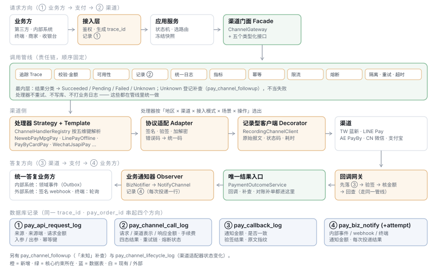

# 支付服务 · 渠道接入统一封装设计

状态：**草稿**（2026-10-25）
依据：[完整设计方案](./TDD-支付服务-完整设计方案.md) §6 渠道层 / §8 统一回调 / §9 接入层 ·
[代码清单（开放 API · 刷卡 POS · 内部调用）](./支付服务-代码清单-开放API刷卡POS内部调用.md) ·
[数据库表结构说明 v4](./TDD-支付服务-数据库表结构说明.md) · 现有 `pay-channel` 的 `AbstractPayGateway` / `PayGatewayRouter` / `ChannelMessageRecorder`
**本篇细化并取代**代码清单 §2.5「渠道层」里按能力拆接口的那一版：能力接口保留为对上的类型化门面，底下改为「命令 + 管线 + 处理器」（§15）。

---

## 0 要解决什么

| # | 要求 | 本篇落点 |
|---|---|---|
| G1 | 分场景统一封装渠道 API 的串接，支持多地区、多渠道、多场景 | §2 路由键 `ChannelKey`、§6 处理器、§7 注册与解析 |
| G2 | 基于 Java 设计模式 | §4 模式总表 |
| G3 | 封装为一个或多个接口，供顶部接口层调用 | §3：一个通用门面 + 五个类型化接口 |
| G4 | 统一日志接口 | §10 `PayLogger` / `InvocationLogSink` |
| G5 | 容错 | §8：超时、重试、熔断、隔离、「未知」补查、降级 |
| G6 | 数据库记录 | §11 四向记录表 |
| G7 | 生命周期管理 | §9：渠道适配器 / 单次调用 / 交易尝试三层生命周期 |
| G8 | 统一的渠道回调 | §12 `CallbackGateway` |
| G9 | **统一答复业务方**（内部系统、外部系统） | §13：同步统一结果模型 + 异步统一通知 `BizNotifier` |
| G10 | 详细记录输入输出参数，**尤其是金额、来源端、来源** | §11.2 金额五段 + 来源两维的记录规范 |

**四个方向，一条链**：

| 方向 | 统一组件 | 记录表 |
|---|---|---|
| ① 业务方 → 支付（请求） | 接入层 + `PayRequestRecorder` | `pay_api_request_log`（新） |
| ② 支付 → 渠道（调用） | `ChannelGateway` → 管线 → 处理器 | `pay_channel_call_log`（扩列） |
| ③ 渠道 → 支付（回调） | `CallbackGateway` | `pay_callback_log`（扩列） |
| ④ 支付 → 业务方（答复） | 同步 `PayResult`；异步 `BizNotifier` | `pay_biz_notify` + `pay_biz_notify_attempt`（新，取代 `pay_webhook_delivery`） |

四张表都带 **`trace_id`** 与 **`pay_order_id`**：任意一笔支付能拉出「谁、从哪、带多少钱来 → 我们怎么调渠道 → 渠道怎么回 → 我们怎么告诉业务方」的完整时间线。



---

## 1 总体分层

| 层 | 组件 | 职责 | 不做什么 |
|---|---|---|---|
| 接入层 | `pay-portal` 的 controller、`PaymentPort`、`InternalPaymentEndpoint` | 鉴权、生成 `trace_id`、记录①、转成应用命令 | 不碰渠道 |
| 应用服务 | `PaymentService` · `RefundService` · `InStorePaymentService` · `OnboardingService` | 业务规则、状态机、选路由、冻结快照 | 不懂渠道协议 |
| **渠道门面** | `ChannelGateway`（通用）+ `ChannelPaymentApi` 等（类型化） | 对上唯一入口：收命令、回统一结果 | 不含渠道差异 |
| **调用管线** | `ChannelInvoker` + 有序 `ChannelInterceptor` | 日志、记录②、幂等、限流、熔断、超时、重试、结果分类 | 不含渠道差异 |
| **渠道处理器** | `ChannelHandler`（每个「渠道 × 场景 × 操作」一个） | 把统一命令翻译成该渠道的请求、把响应翻译回统一结果 | 不做重试、不写库 |
| 协议适配 | `ChannelProtocol`（每渠道一个） | 签名 / 验签 / 加解密 / 编码 | 不懂业务 |
| 传输 | `RecordingChannelClient` → `ChannelClient` | HTTP、证书、连接池；落原始报文 | — |
| **回调网关** | `CallbackGateway` + `CallbackHandler` | 统一接收③、验签、转成统一结果交应用服务 | — |
| **业务通知** | `BizNotifier` + `NotifyChannel` | 统一答复④：内部事件 / 外部 webhook / 终端 | — |

**规则**：渠道差异只允许出现在「处理器」和「协议适配」两层；其上任何一层出现 `if (channel == NEWEBPAY)` 都视为缺陷（架构测试守）。

---

## 2 核心模型

### 2.1 路由键：地区 × 渠道 × 接入模式 × 场景 × 操作

```java
/** 选择处理器的键。地区、渠道、场景三个维度全在这里，不散在各处的 if 里 */
public record ChannelKey(
        String market,          // CN / TW / AE …（值域码）
        String payChannel,      // WECHAT / ALIPAY / NEWEBPAY / LINEPAY / PAYBY
        AccessMode accessMode,  // MERCHANT_OWN / SERVICE_PROVIDER / PLATFORM_SUB
        PayScene scene,         // 见下
        ChannelOperation operation) { }

public enum PayScene {
    ONLINE_REDIRECT,        // 跳转收银台：蓝新 MPG、LINE Pay、PayBy 收银台
    ONLINE_SDK,             // 端上 SDK：微信 JSAPI / APP、支付宝 APP
    ONLINE_QR,              // 线上二维码：微信 NATIVE
    IN_STORE_CARD,          // 刷卡：读卡套件加密数据
    IN_STORE_SCAN_CUSTOMER, // 扫顾客付款码：LINE Pay Offline、PayBy 被扫
    IN_STORE_SHOW_QR,       // 终端屏显码（落统一收银台）
    ANY                     // 与场景无关的操作：查单、关单、退款、对账单、进件
}

public enum ChannelOperation {
    PAY, CONFIRM, QUERY, CLOSE, VOID, REFUND, REFUND_QUERY,
    ONBOARDING_SUBMIT, ONBOARDING_QUERY, MEDIA_UPLOAD, STATEMENT_FETCH, PAYOUT, KEY_VERIFY;

    /** 能否安全重发：只有查询类与带同一外部单号的幂等操作可以 */
    public boolean idempotentResend() { … }
}
```

### 2.2 命令（Command 模式）

每一次对渠道的请求都是一个**不可变命令对象**：可记录、可重放（回调重放、补查）、可审计。

```java
public sealed interface ChannelCommand
        permits PayCommand, ConfirmCommand, QueryCommand, CloseCommand, VoidCommand,
                RefundCommand, RefundQueryCommand, OnboardingCommand, StatementCommand, PayoutCommand {
    ChannelOperation operation();
    InvocationMeta meta();           // 谁、从哪、为哪张单（§2.4）
}

public record PayCommand(InvocationMeta meta, PayScene scene,
                         Money amount, String subject, String outTradeNo,
                         Instant expireAt, PayerInfo payer,          // openid / 设备 / 付款码
                         EncryptedCardData card,                     // 仅 IN_STORE_CARD
                         String authCode,                            // 仅 IN_STORE_SCAN_CUSTOMER
                         URI returnUrl) implements ChannelCommand { … }

public record RefundCommand(InvocationMeta meta, String originOutTradeNo, String originChannelTradeNo,
                            Money originAmount, Money refundAmount, String outRefundNo, String reason)
        implements ChannelCommand { … }
```

### 2.3 统一结果（四态，不是两态）

```java
public sealed interface ChannelResult {
    /** 渠道明确成功（含同步扣款成功） */
    record Succeeded(String channelTradeNo, Money channelAmount, Money fee, Map<String, String> extra) implements ChannelResult {}
    /** 已受理、等用户或渠道下一步：给端上的指令 */
    record Pending(PayInstruction instruction, String channelTradeNo) implements ChannelResult {}
    /** 渠道明确失败；retryable 只表示「换个时间再发同一命令是否可能成功」 */
    record Failed(PayErrorCode code, String channelCode, String channelMessage, boolean retryable) implements ChannelResult {}
    /** 不知道成没成（超时、断连、5xx、响应无法解析）——**绝不当失败** */
    record Unknown(String reason) implements ChannelResult {}
}
```

现有 `PayGateway.Result` 的三态（ok / retry / fatal）里，「超时」被折进了 retry —— 对退款就意味着可能重复发。新模型把它单列为 `Unknown`，由 §8.4 的补查机制处理。

### 2.4 调用元数据：来源端、来源、金额、追踪

```java
public record InvocationMeta(
        String traceId,            // 接入层生成，四向记录共用
        Long payOrderId, Long stlPaymentId, Long payRefundId,
        Long payMerchantId, int keyVersion,
        SourceInfo source,
        MarketContext market) { }

/** 「来源」与「来源端」是两个维度 */
public record SourceInfo(
        CallerType sourceType,     // 来源：PARTNER / INTERNAL / TERMINAL / BIZ / OPS / CHECKOUT
        Long sourceId,             // pay_app.id / pay_terminal.id / 账号 id
        String appNo,              // 对外 AppId（展示用）
        ClientType clientType,     // 来源端：H5 / APP_IOS / APP_ANDROID / MINI_PROGRAM / POS / SERVER / OPS_WEB / BIZ_APP
        String clientIp, String userAgentDigest, String deviceId,  // deviceId = 终端号或设备指纹
        String operatorNo,         // 收银员 / 商家操作员 / 运营
        String bizType, String bizNo) { }

/** 金额一律带币种与最小单位；渠道表示另算 */
public record Money(long minor, String currency) { }
public record MarketContext(String market, String currency, int amountScale, ZoneId zone) { }
```

---

## 3 对上接口：一个通用门面 + 五个类型化接口

应用服务**只依赖这一层**。类型化接口是通用门面的薄包装，便于阅读与 mock；两者共用同一条管线。

```java
/** 通用门面（Facade）：任何命令进来，统一结果出去 */
public interface ChannelGateway {
    ChannelResult execute(ChannelAccountContext account, ChannelCommand command);
    /** 渠道在该地区该场景下是否可用（收银台列方式用；读能力 + 运营开关 + 熔断状态） */
    Availability availability(ChannelKey key);
}

public interface ChannelPaymentApi {      // 收款
    ChannelResult pay(ChannelAccountContext a, PayCommand c);
    ChannelResult confirm(ChannelAccountContext a, ConfirmCommand c);   // LINE Pay
    ChannelResult query(ChannelAccountContext a, QueryCommand c);
    ChannelResult close(ChannelAccountContext a, CloseCommand c);
    ChannelResult voidCharge(ChannelAccountContext a, VoidCommand c);   // 刷卡当日撤销
}
public interface ChannelRefundApi {       // 退款
    ChannelResult refund(ChannelAccountContext a, RefundCommand c);
    ChannelResult queryRefund(ChannelAccountContext a, RefundQueryCommand c);
}
public interface ChannelOnboardingApi { … }   // 进件、媒体上传
public interface ChannelStatementApi { … }    // 对账单下载与解析
public interface ChannelPayoutApi { … }       // AGGREGATED 出款
```

`ChannelAccountContext`（谁的身份、用哪把凭据）仍由 `ChannelContextFactory` 唯一构造（代码清单 §2.5）。

---

## 4 设计模式总表

| 模式 | 用在哪 | 解决什么 |
|---|---|---|
| **外观 Facade** | `ChannelGateway` 与五个类型化接口 | 顶部只面对一个稳定入口，不感知渠道数量 |
| **命令 Command** | `ChannelCommand` 体系 | 请求成为可记录、可重放、可审计的对象；补查与回调重放复用同一命令 |
| **策略 Strategy** | `ChannelHandler`（每个渠道 × 场景 × 操作一个）、`CallbackHandler`、`NotifyChannel`、`FaultPolicy` | 渠道 / 场景 / 通知方式的差异各自封装、可替换 |
| **模板方法 Template Method** | `AbstractChannelHandler`、`AbstractCallbackHandler` | 固定步骤（校验 → 组包 → 签名 → 发送 → 解析 → 映射）不可被子类改写，子类只填差异 |
| **责任链 Chain of Responsibility** | `ChannelInterceptor` 管线、回调处理链 | 日志、记录、幂等、限流、熔断、重试、分类等横切关注点可插拔、顺序固定 |
| **适配器 Adapter** | `ChannelProtocol`、`ChannelErrorMapper` | 把各渠道的签名、报文、错误码适配为统一形状 |
| **装饰器 Decorator** | `RecordingChannelClient` 包 `ChannelClient` | 传输层透明地加上原始报文记录，网关绕不过去 |
| **注册表 / 抽象工厂 Registry** | `ChannelHandlerRegistry`、`ChannelProtocolRegistry` | 按 `ChannelKey` 解析处理器；Spring 自动收集实现，不手写 switch |
| **建造者 Builder** | `ChannelRequest.builder()`、各渠道报文构建器 | 报文字段多、可选项多，构建过程可读、可校验 |
| **状态 State** | 适配器生命周期、交易尝试状态机 | 状态迁移集中定义，非法迁移在一处被拒绝 |
| **观察者 Observer** | `InvocationListener`、`BizNotifier` 订阅领域事件 | 调用事件驱动日志 / 监控；支付结果驱动答复业务方 |
| **空对象 Null Object** | `UnsupportedHandler` | 未实现的「渠道 × 场景」返回明确的 `Failed(CHANNEL_UNSUPPORTED)`，而不是 NPE 或静默走别的渠道 |

---

## 5 调用管线（责任链）

### 5.1 执行器

```java
public final class ChannelInvoker implements ChannelGateway {
    private final ChannelHandlerRegistry registry;
    private final List<ChannelInterceptor> chain;   // 顺序见 5.2，启动时校验，不可在运行时改

    @Override
    public ChannelResult execute(ChannelAccountContext account, ChannelCommand command) {
        ChannelKey key = ChannelKey.of(account, command);
        ChannelHandler<ChannelCommand> handler = registry.resolve(key);     // 找不到 → UnsupportedHandler
        Invocation inv = Invocation.start(key, account, command);             // 单次调用对象，带生命周期（§9.2）
        return new Chain(chain, handler).proceed(inv);
    }
}

public interface ChannelInterceptor {
    ChannelResult intercept(Invocation inv, Chain next);
    int order();
}
```

### 5.2 拦截器（固定顺序）

| 序 | 拦截器 | 职责 | 失败时 |
|---|---|---|---|
| 10 | `TraceInterceptor` | MDC 放入 `traceId` `payOrderNo` `channel` `operation` `market`；没有就生成 | — |
| 20 | `ValidationInterceptor` | 命令完整性：金额 > 0、币种 = 地区币种、`AmountCodec` 按 `amount_scale` 换算无余数、必填字段按场景校验 | `Failed(PARAM_INVALID, retryable=false)`，**不发渠道** |
| 30 | `AvailabilityInterceptor` | 运营开关（`pay_channel_product`）、地区可用、适配器生命周期为 ACTIVE | `Failed(CHANNEL_DISABLED)` |
| 40 | `RecordingInterceptor` | **发出前**写 `pay_channel_call_log`（状态 SENT，含 §11.2 的全部金额与来源字段）；返回后回写结果 | 记录失败不阻断业务，计数告警 |
| 50 | `LoggingInterceptor` | 经 `PayLogger` 输出一条开始、一条结束的结构化日志（§10） | — |
| 60 | `MetricsInterceptor` | 按 `channel × operation × outcome` 计数与耗时直方图 | — |
| 70 | `IdempotencyInterceptor` | 同一 `(operation, outTradeNo / outRefundNo)` 已有终态 → 直接返回记录中的结果，不再发 | — |
| 80 | `RateLimitInterceptor` | 按渠道（与商户）限频；退款按 `refund_interval_seconds` 排队 | `Failed(CHANNEL_THROTTLED, retryable=true)` |
| 90 | `CircuitBreakerInterceptor` | 按 `(channel, payMerchantId)` 熔断（§8.3） | 熔断打开：`Failed(CHANNEL_UNAVAILABLE, retryable=true)`；查询类仍放行半开探测 |
| 100 | `BulkheadInterceptor` | 每个渠道独立并发上限，一个渠道变慢不拖垮其他渠道 | `Failed(CHANNEL_BUSY, retryable=true)` |
| 110 | `RetryInterceptor` | **只对可安全重发的操作**按策略重试（§8.1） | 用尽 → 最后一次的结果 |
| 120 | `TimeoutInterceptor` | 按「渠道 × 操作」设置超时 | 超时 → `Unknown` |
| 130 | `OutcomeClassifier` | 把异常 / HTTP 状态 / 渠道码归入四态（§8.2）；`Unknown` 时登记补查任务 | — |
| — | **处理器** | `ChannelHandler#handle` | — |

### 5.3 单次调用对象

```java
public final class Invocation {
    final String invocationNo;  final ChannelKey key;
    final ChannelAccountContext account;  final ChannelCommand command;
    int attempt;                              // 第几次发送（重试递增）
    Long callLogId;                           // RecordingInterceptor 写入后回填
    InvocationState state;                    // §9.2
    Instant startedAt; Duration elapsed;
    ChannelRequest lastRequest; ChannelResponse lastResponse;   // 供记录与日志使用（已脱敏视图）
}
```

---

## 6 渠道处理器与协议适配

### 6.1 处理器骨架（模板方法）

```java
public interface ChannelHandler<C extends ChannelCommand> {
    Set<ChannelKey.Pattern> supports();          // 例：{market=TW, channel=NEWEBPAY, scene=ONLINE_REDIRECT, op=PAY}
    ChannelResult handle(Invocation inv, C command);
}

public abstract class AbstractChannelHandler<C extends ChannelCommand> implements ChannelHandler<C> {
    protected final ChannelProtocol protocol;
    protected final ChannelTransport transport;  // = RecordingChannelClient
    protected final ChannelErrorMapper errors;

    @Override
    public final ChannelResult handle(Invocation inv, C cmd) {      // final：步骤不可改
        precheck(inv, cmd);                                         // ① 场景前置（如刷卡必须有加密卡数据）
        ChannelRequest req = buildRequest(inv, cmd);                // ② 统一命令 → 渠道报文（Builder）
        ChannelRequest signed = protocol.sign(inv.account(), req);  // ③ 签名 / 加密（Adapter）
        ChannelResponse resp = transport.send(inv, signed);         // ④ 发送（Decorator 落原文）
        protocol.verify(inv.account(), resp);                       // ⑤ 验响应签名
        return mapResult(inv, cmd, resp);                           // ⑥ 渠道响应 → 四态（用 errors 映射错误码）
    }
    protected void precheck(Invocation inv, C cmd) { }
    protected abstract ChannelRequest buildRequest(Invocation inv, C cmd);
    protected abstract ChannelResult mapResult(Invocation inv, C cmd, ChannelResponse resp);
}
```

处理器**不重试、不写库、不打业务日志** —— 那些都在管线里统一做。这正是现有 `AbstractPayGateway#exec` 的经验（成功也要记、异常也要落）被提到了公共层。

### 6.2 处理器清单（多地区 × 多渠道 × 多场景）

| 地区 | 渠道 | 场景 / 操作 | 处理器 |
|---|---|---|---|
| TW | NEWEBPAY | ONLINE_REDIRECT · PAY | `NewebPayMpgPayHandler`（返回 `AutoPostForm`） |
| TW | NEWEBPAY | IN_STORE_CARD · PAY / VOID | `NewebPayCardPayHandler` · `NewebPayCardVoidHandler`（规格待 Q12） |
| TW | NEWEBPAY | ANY · QUERY / CLOSE / REFUND / REFUND_QUERY | `NewebPayQueryHandler` · `NewebPayCloseHandler` · `NewebPayRefundHandler`（信用卡 `Close`；ATM / 超商返回 `Failed(REFUND_OFFLINE_REQUIRED)`） |
| TW | LINEPAY | ONLINE_REDIRECT · PAY / CONFIRM | `LinePayRequestHandler` · `LinePayConfirmHandler` |
| TW | LINEPAY | IN_STORE_SCAN_CUSTOMER · PAY | `LinePayOfflinePayHandler` |
| TW | LINEPAY | ANY · QUERY / REFUND | `LinePayDetailsHandler` · `LinePayRefundHandler` |
| AE | PAYBY | ONLINE_REDIRECT · PAY | `PayByCashierPayHandler` |
| AE | PAYBY | IN_STORE_CARD / IN_STORE_SCAN_CUSTOMER · PAY | `PayByCardPayHandler` · `PayByScanPayHandler`（规格待 Q3 / Q12） |
| AE | PAYBY | ANY · QUERY / CLOSE / REFUND / REFUND_QUERY / PAYOUT / STATEMENT_FETCH | `PayByQueryHandler` 等 |
| CN | WECHAT | ONLINE_SDK · PAY（JSAPI / APP）· ONLINE_QR（NATIVE） | `WechatJsapiPayHandler` · `WechatNativePayHandler`（自现有 `WechatDirectPayGateway` 拆出） |
| CN | WECHAT | ANY · QUERY / REFUND / … | `WechatQueryHandler` 等；收付通（SERVICE_PROVIDER）与直连（MERCHANT_OWN）按 `accessMode` 是两个处理器，不再靠 `shop.pay.wechat.mode` 二选一 |
| CN | ALIPAY | … | `AlipayAppPayHandler` 等（自现有 `AlipayPayGateway`） |
| 全部 | TEST | 全部 | `TestChannelHandler`（沙箱，只在 sandbox app 可路由） |

**加一个渠道 = 加一个 `ChannelProtocol` + 若干 `ChannelHandler` + `ChannelErrorMapper` + `CallbackHandler`**，其余层不动。

### 6.3 协议适配（每渠道一个）

| 类 | 职责 |
|---|---|
| `NewebPayProtocol` | `TradeInfo` AES-256-CBC 加解密、`TradeSha` / `CheckValue` |
| `LinePayProtocol` | v3 HMAC 签名头（`X-LINE-ChannelId` / `X-LINE-Authorization-Nonce` / `X-LINE-Authorization`） |
| `PayByProtocol` | 请求 `sign` 头 RSA 签名、响应验签、`requestTime` 时间窗 |
| `WechatV3Protocol` | 自现有 `WechatApiV3Signer` |
| `AlipayProtocol` | RSA2 签名 |

### 6.4 错误码适配

```java
public interface ChannelErrorMapper {
    /** 渠道原始码 → 统一码 + 是否可重试 + 是否明确失败（不能明确的一律 Unknown） */
    MappedError map(String payChannel, ChannelOperation op, int httpStatus, String channelCode, String channelMessage);
}
```

每个渠道一份映射表（代码里的枚举，带单测）；**未登记的渠道码按「未知」处理而不是失败** —— 把没见过的码当失败，退款就可能被重发。

---

## 7 注册与解析

```java
@Component
public final class ChannelHandlerRegistry {
    /** Spring 注入全部 ChannelHandler 实现，按 supports() 建索引 */
    public ChannelHandlerRegistry(List<ChannelHandler<?>> handlers, ChannelProductCatalog catalog) { … }

    /** 最具体者优先：精确地区 > 任意地区；精确场景 > ANY；同等具体度有两个 → 启动失败 */
    public ChannelHandler<ChannelCommand> resolve(ChannelKey key) { … }
}
```

启动时三项校验，任一不过即**启动失败**（沿用 `PayGatewayRouter`「同名两实现说人话再炸」）：

1. 同一 `ChannelKey` 有两个同等具体的处理器；
2. `pay_channel_product` 里 `ENABLED` 的「渠道 × 场景 × 方式」找不到处理器（表里开了、代码没实现）；
3. 处理器声明的渠道没有对应的 `ChannelProtocol` 与 `CallbackHandler`。

---

## 8 容错

### 8.1 按操作分类的重试策略

| 操作 | 可安全重发 | 重试 | 超时后 | 说明 |
|---|---|---|---|---|
| QUERY / REFUND_QUERY / ONBOARDING_QUERY / STATEMENT_FETCH | ✓ | 指数退避 3 次 | `Unknown` → 下次补查 | 纯读 |
| PAY（同一 `out_trade_no`） | 渠道按单号去重时 ✓ | 仅连接失败（请求未发出）重试 1 次 | `Unknown` → **先查单** | 不确定是否已建单时绝不换单号重发 |
| PAY · IN_STORE_SCAN_CUSTOMER / IN_STORE_CARD | ✗ | 不重试 | `Unknown` → 查单 → 仍不明则撤销 | 同步扣款，重发 = 可能重复扣款 |
| CONFIRM（LINE Pay） | ✗ | 不重试 | `Unknown` → 查 Payment Details | 重复 confirm = 重复扣款 |
| REFUND | ✗ | 不重试 | `Unknown` → 查退款 | 沿用现有「不明只查不重发」 |
| CLOSE / VOID | 视渠道 | 1 次 | `Unknown` → 查单 | 关单前已有一次查单 |
| PAYOUT | ✗ | 不重试 | `Unknown` → 查出款 | 资金出账 |

策略由 `FaultPolicy`（策略模式）按「渠道 × 操作」配置：

```java
public record FaultPolicy(Duration connectTimeout, Duration readTimeout,
                          int maxRetries, Backoff backoff, boolean retryOnTimeout,
                          CircuitBreakerSpec breaker, int maxConcurrent) { }
```

默认值在代码里按上表定死；`shop.pay.channel.<channel>.<operation>.*` 只允许**收紧**（更短超时、更少重试），不允许把不可重发的操作改成可重发（启动校验）。

### 8.2 结果分类（`OutcomeClassifier`）

| 情况 | 归类 |
|---|---|
| 请求未发出（连接拒绝、DNS） | `Failed(retryable=true)` |
| 连接后超时、读超时、断连 | **`Unknown`** |
| HTTP 5xx、网关错误 | **`Unknown`**（渠道可能已处理） |
| HTTP 4xx + 已登记的业务失败码 | `Failed(retryable=按映射)` |
| 响应验签失败 / 无法解析 | **`Unknown`**（并告警：可能被篡改或渠道改版） |
| 未登记的渠道码 | **`Unknown`** |
| 明确成功 / 受理 | `Succeeded` / `Pending` |

### 8.3 熔断与隔离

- **熔断粒度** `(payChannel, payMerchantId)`：一个商户的密钥失效不该让整个渠道熔断；整个渠道故障时，所有商户的熔断器会各自打开。
- 打开条件：滑动窗口内「`Unknown` + `retryable` 失败」占比 ≥ 阈值且次数 ≥ 下限；半开只放行查询类探测。
- 熔断打开时，`ChannelGateway#availability` 返回不可用 → 收银台不展示该方式（**降级**），而不是让用户点了才失败。
- **隔离**：每个渠道独立线程池 / 并发上限（`BulkheadInterceptor`），PayBy 变慢不拖垮蓝新。

### 8.4 「未知」补查（补偿）

```
OutcomeClassifier 得到 Unknown
  → FollowUpScheduler.schedule(invocation, nextAt)      写 pay_channel_followup（新，§11.3）
  → ChannelFollowUpJob 按退避取出到期任务
      → 用同一命令构造对应的查询命令（PAY → QUERY，REFUND → REFUND_QUERY，CONFIRM → QUERY）
      → ChannelGateway.execute（走同一管线，记录同样落库）
      → 有结论 → 交 PaymentOutcomeService / RefundOutcomeService（与回调同一入口）
      → 仍不明 → 继续退避；超过上限 → pay_exception(UNKNOWN_OUTCOME) 进人工
```

回调、补查、对账补单**三条来源进同一个结果入口**，所以哪条先到都只入账一次。

---

## 9 生命周期管理

### 9.1 渠道适配器生命周期（每个「渠道 × 商户」一个运行时实例）

```
REGISTERED ─init(配置、凭据、协议自检)─▶ INITIALIZED ─健康检查通过─▶ ACTIVE
ACTIVE ─熔断打开 / 健康检查失败─▶ DEGRADED ─恢复─▶ ACTIVE
ACTIVE / DEGRADED ─运营停用 / 凭据吊销─▶ SUSPENDED ─启用─▶ ACTIVE
任意 ─应用关闭─▶ DRAINING（不接新请求，等在途调用完成或超时）─▶ STOPPED
```

| 组件 | 职责 |
|---|---|
| `ChannelLifecycleManager`（实现 Spring `SmartLifecycle`） | 启动时按 `sys_pay_channel` / `pay_channel_product` / `pay_merchant` 建运行时实例并 `init`；关闭时 `DRAINING`，等在途调用（上限 30 秒），超时的标 `Unknown` 交补查 |
| `ChannelHealthChecker` | 定时对 ACTIVE / DEGRADED 实例做轻量探测（渠道提供的连通性接口，或查一笔已知单） |
| `ChannelConfigWatcher` | 运营改了渠道开关、产品、费率、凭据版本 → 刷新对应实例（不重启应用） |
| `ChannelLifecycleListener` | 状态变化写 `pay_channel_lifecycle_log`（新，§11.3）并通知运营 |

### 9.2 单次调用生命周期（`InvocationState`）

`CREATED → VALIDATED → SENT → RESPONDED → CLASSIFIED(SUCCEEDED | PENDING | FAILED | UNKNOWN) → [FOLLOWUP_SCHEDULED → RESOLVED]`

每个迁移发一个 `InvocationEvent` 给 `InvocationListener`（观察者）：日志、指标、记录都挂在这上面，而不是散在代码里。

### 9.3 交易尝试生命周期（`stl_payment`）

沿用支付单与通道尝试的状态机（代码清单 §2.2）；本层保证：**通道尝试的每一次状态变化都能在 `pay_channel_call_log` 找到对应的调用记录**（`stl_payment_id` 关联）。

---

## 10 统一日志接口

```java
/** 支付域唯一允许的业务日志入口；渠道处理器、管线、回调、通知都用它 */
public interface PayLogger {
    void invocationStarted(Invocation inv);
    void invocationFinished(Invocation inv, ChannelResult result);
    void callbackReceived(CallbackEnvelope env);
    void callbackHandled(CallbackEnvelope env, CallbackOutcome outcome);
    void notifySent(BizNotification n, NotifyAttemptResult r);
    void anomaly(String type, Map<String, Object> fields);   // 验签失败、金额不符、未登记渠道码…
}

/** 落地方式可替换：结构化 JSON 日志 + 数据库记录 + 指标 */
public interface InvocationLogSink { void accept(PayLogRecord record); }
```

| 约定 | 内容 |
|---|---|
| 格式 | 单行 JSON；固定字段：`ts` `level` `traceId` `direction`（REQUEST / CALL / CALLBACK / NOTIFY）`payOrderNo` `market` `channel` `scene` `operation` `attempt` `outcome` `errorCode` `channelCode` `elapsedMs` `amountMinor` `currency` `sourceType` `sourceId` `clientType` |
| MDC | `traceId` `payOrderNo` `channel` `operation`；跨线程（补查、通知任务）由任务对象带上 `traceId` 再恢复 |
| 脱敏 | 统一经 `PayloadMasker`（递归）；卡数据、签名、密钥、证件号、手机号、银行账号永不进日志 |
| 级别 | 成功 INFO；`Failed` WARN；`Unknown`、验签失败、金额不符 ERROR + 告警 |
| 禁止 | 处理器内直接 `log.info` 打业务日志（架构测试：`pay.channel.*Handler` 不得引用 SLF4J `Logger` 打业务字段） |

---

## 11 数据库记录

### 11.1 四向记录

| 方向 | 表 | 状态 | 一行代表什么 |
|---|---|---|---|
| ① 请求 | **`pay_api_request_log`** | 新 | 业务方（第三方 / 内部 / 终端 / 商家端 / 运营端 / 收银台）对支付的一次接口调用 |
| ② 调用 | `pay_channel_call_log` | v3 已有，**扩列** | 支付对渠道的一次 HTTP 调用（重试每次一行） |
| ③ 回调 | `pay_callback_log` | v3 已有，**扩列** | 渠道对支付的一次通知 |
| ④ 答复 | **`pay_biz_notify`** + **`pay_biz_notify_attempt`** | 新，**取代 `pay_webhook_delivery`** | 支付对业务方的一次通知（内部事件 / 外部 webhook / 终端推送）及每次投递 |
| 补查 | **`pay_channel_followup`** | 新 | 一个「未知」结果的补查任务 |
| 生命周期 | **`pay_channel_lifecycle_log`** | 新 | 渠道适配器的一次状态变化 |

### 11.2 金额与来源的记录规范（四张主表统一）

**金额五段**（同一笔钱在不同环节的表示都要留，任何一段对不上都是对账线索）：

| 字段 | 含义 | 出现在 |
|---|---|---|
| `request_amount_minor` + `request_currency` | 业务方请求的金额（最小单位） | ① ② |
| `channel_amount_text` + `amount_scale` | **按渠道精度换算后、实际发给渠道的字符串**（如 TWD `"1200"`、AED `"35.50"`） | ② |
| `response_amount_minor` + `response_currency` | 渠道响应 / 回调里声明的金额 | ② ③ |
| `fee_minor` | 渠道手续费（以回执为准） | ② ③ |
| `notify_amount_minor` + `notify_currency` | 告诉业务方的金额 | ④ |

`ValidationInterceptor` 保证 ① 与 ② 的换算无余数；回调处理保证 ③ 与 ① 一致，不一致记 `pay_exception(AMOUNT_MISMATCH)` 且**不推进成功**。

**来源两维**：

| 字段 | 维度 | 取值 |
|---|---|---|
| `source_type` · `source_id` · `app_no` | **来源**：谁调的 | `PARTNER` / `INTERNAL` / `TERMINAL` / `BIZ` / `OPS` / `CHECKOUT` + 对应 id |
| `client_type` | **来源端**：从什么端发起 | `H5` / `APP_IOS` / `APP_ANDROID` / `MINI_PROGRAM` / `POS` / `SERVER` / `OPS_WEB` / `BIZ_APP` |
| `client_ip` · `user_agent_digest` · `device_id` · `operator_no` | 端上细节 | 终端号、设备指纹、收银员 / 操作员 |
| `biz_type` · `biz_no` | 业务归属 | `MALL_ORDER` / `FOOD_CHECK` … + 业务单号 |

**输入输出参数**：每张表都存 `*_masked`（递归脱敏后的完整报文，长期保留）+ `*_raw_id`（加密原文，指向 `pay_raw_payload`；密钥模块就绪前为空，见执行方案 §4.6）。

### 11.3 表结构（新增与扩列）

**`pay_api_request_log`（新）· 业务方 → 支付**

| 列 | 类型 | 说明 |
|---|---|---|
| `id` | BIGINT 自增 | 主键 |
| `trace_id` | VARCHAR(64) NOT NULL | 本次请求生成，向下传给 ②③④ |
| `entry` | VARCHAR(24) NOT NULL | `OPEN_API` / `TERMINAL_API` / `INTERNAL_PORT` / `INTERNAL_HTTP` / `BIZ_API` / `OPS_API` / `CHECKOUT` |
| `api` | VARCHAR(128) NOT NULL | 接口标识，如 `POST /open/pay/v1/orders`、`PaymentPort#createPayment` |
| `pay_action` | VARCHAR(32) NOT NULL | `PayAction`：`CREATE_ONLINE` / `START_PAYMENT` / `REQUEST_REFUND` …（不叫 `action`，避开 SQL 关键字） |
| `source_type` / `source_id` / `app_no` | VARCHAR(24) / BIGINT / VARCHAR(64) | 来源 |
| `client_type` / `client_ip` / `user_agent_digest` / `device_id` / `operator_no` | … | 来源端 |
| `biz_type` / `biz_no` / `idempotency_key` | … | 业务归属与幂等键 |
| `store_id` | BIGINT NULL | 门店 |
| `request_amount_minor` / `request_currency` | BIGINT NULL / CHAR(3) NULL | 请求金额 |
| `pay_order_id` / `pay_refund_id` | BIGINT NULL | 处理后回填 |
| `request_masked` / `request_raw_id` | TEXT / BIGINT NULL | 请求参数 |
| `response_masked` / `http_status` / `result_code` | TEXT / INT / VARCHAR(64) | 返回给业务方的内容与统一结果码 |
| `outcome` | VARCHAR(24) NOT NULL | `ACCEPTED` / `REJECTED_AUTH` / `REJECTED_PARAM` / `DUPLICATE` / `ERROR` |
| `elapsed_ms` / `received_at` | INT / DATETIME(3) | — |
| 标准列 | — | `created_at` … `deleted`（无 `tenant_no`） |

索引：`(trace_id)`、`(pay_order_id)`、`(source_type, source_id, received_at)`、`(biz_type, biz_no)`、`(outcome, received_at)`。
**鉴权失败的请求也记**（`REJECTED_AUTH`，只记脱敏后的头部与指纹），用于发现撞库与重放。

**`pay_channel_call_log`（扩列）· 支付 → 渠道**：在 v3 基础上加
`trace_id` · `invocation_no` · `scene` · `operation`（取代 `call_type`）· `access_mode` ·
`request_amount_minor` · `request_currency` · `channel_amount_text` · `amount_scale` · `response_amount_minor` · `response_currency` · `fee_minor` ·
`source_type` · `source_id` · `client_type` · `outcome_class`（`SUCCEEDED` / `PENDING` / `FAILED` / `UNKNOWN`）· `unified_error_code` · `retry_of_id`（指向上一次尝试）· `fault_policy`（本次生效的超时与重试摘要）· `breaker_state`。

**`pay_callback_log`（扩列）· 渠道 → 支付**：加 `trace_id`（按单回查到的原 `trace_id`）· `notify_amount_minor` · `notify_currency` · `fee_minor` · `amount_matched`（与支付单一致与否）· `unified_status`。

**`pay_biz_notify`（新，取代 `pay_webhook_delivery`）· 支付 → 业务方**

| 列 | 类型 | 说明 |
|---|---|---|
| `id` | BIGINT 自增 | 主键 |
| `trace_id` | VARCHAR(64) NOT NULL | 触发它的那次请求 / 回调的追踪号 |
| `event_type` | VARCHAR(32) NOT NULL | `PAYMENT_SUCCEEDED` / `PAYMENT_FAILED` / `PAYMENT_CLOSED` / `REFUND_SUCCEEDED` / `REFUND_FAILED` / `REFUND_REVIEW_REJECTED` … |
| `event_key` | VARCHAR(128) NOT NULL | 幂等键（`event_type|对象 id|状态版本`），与 `target_type`、`pay_app_id` 联合唯一 |
| `target_type` | VARCHAR(24) NOT NULL | `INTERNAL_EVENT`（内部系统，Outbox 领域事件）/ `WEBHOOK`（外部系统）/ `TERMINAL`（终端推送，可选） |
| `pay_app_id` | BIGINT NOT NULL | 接收方 |
| `target_url` | VARCHAR(512) NULL | WEBHOOK 时 |
| `pay_order_id` / `pay_refund_id` | BIGINT NULL | 对象 |
| `notify_amount_minor` / `notify_currency` | BIGINT / CHAR(3) | 告诉业务方的金额 |
| `payload_masked` | TEXT NOT NULL | 推送内容 |
| `status` | VARCHAR(24) NOT NULL | `PENDING` / `DELIVERED` / `FAILED` / `GIVEN_UP` |
| `attempts` / `next_at` / `delivered_at` | INT / DATETIME(3) / DATETIME(3) | — |

**`pay_biz_notify_attempt`（新）**：每次投递一行 —— `pay_biz_notify_id` · `attempt` · `sent_at` · `http_status` · `response_masked` · `elapsed_ms` · `outcome`。

**`pay_channel_followup`（新）**：`invocation_no` · `trace_id` · `stl_payment_id` / `pay_refund_id` · `operation`（原操作）· `next_at` · `attempts` · `status`（`PENDING` / `RESOLVED` / `ESCALATED`）· `last_result`。唯一 `(operation, stl_payment_id, pay_refund_id)` 的进行中任务一个（`open_key`）。

**`pay_channel_lifecycle_log`（新）**：`pay_channel` · `pay_merchant_id` · `from_state` · `to_state` · `reason` · `occurred_at`。

> 以上变更**已并入结构化模型 v4**（2026-10-25，`pay-service-database.json`），DDL、ER 图（§4.5 四向记录、§4.6 渠道运行）与[表结构说明](./TDD-支付服务-数据库表结构说明.md)已重新生成；逐列定义以表结构说明为准。

---

## 12 统一渠道回调

```java
/** 回调外观：唯一的回调入口背后 */
public interface CallbackGateway {
    CallbackAck handle(CallbackEnvelope envelope);   // 渠道、通知类型、路径引用、头、原始字节、来源 IP
}

public abstract class AbstractCallbackHandler implements CallbackHandler {   // 模板方法
    @Override
    public final CallbackAck handle(CallbackEnvelope env) {
        Long logId = recorder.received(env);                         // ① 先落 pay_callback_log（原文、指纹）
        ChannelAccountContext acc = resolveAccount(env);             // ② 路径引用 → pay_merchant.id → ctx
        protocol.verifyCallback(acc, env);                           // ③ 验签 + 时间戳新鲜度
        CallbackMessage msg = parse(acc, env);                       // ④ 渠道报文 → 统一消息（子类）
        crossCheck(acc, msg);                                        // ⑤ 报文商户号 = 路由商户；金额 = 支付单金额
        ChannelResult confirmed = queryBack(acc, msg);               // ⑥ 用同一管线回查（回调不可单独作为入账依据）
        CallbackOutcome out = outcomeSink.apply(msg, confirmed);     // ⑦ 交 PaymentOutcomeService / RefundOutcomeService / OnboardingOutcomeService
        recorder.handled(logId, out);                                // ⑧ 回写结果、关联 id、trace_id
        return ackRenderer.render(env.payChannel(), out);            // ⑨ 每渠道自己的应答格式
    }
    protected abstract CallbackMessage parse(ChannelAccountContext acc, CallbackEnvelope env);
}
```

| 组件 | 说明 |
|---|---|
| `CallbackHandlerRegistry` | 按 `(payChannel, notifyType)` 解析；启动校验每个有处理器的渠道都有回调处理器 |
| `AckRenderer` | 蓝新 `SUCCESS`、LINE Pay 无回调体、PayBy `SUCCESS` JSON、微信 `{"code":"SUCCESS"}`… 集中在一处 |
| 幂等 | 同一 `raw_sha256` 的重复通知直接返回成功 ack；结果入口本身也幂等 |
| 失败策略 | ③⑤ 失败：记录、告警、**返回失败 ack 让渠道重试**；⑥ 回查不明：记录、交补查，返回失败 ack |
| 重放 | `CallbackReplayService` 用 ① 存的原文重走 ②–⑧ |

---

## 13 统一答复业务方

### 13.1 同步答复：一个结果模型，按接入方渲染

```java
/** 内部与外部共用的结果模型：应用服务只返回它 */
public record PayResult(
        String payOrderNo, String payRefundNo, PayStatus status,   // 统一状态：PROCESSING / SUCCEEDED / FAILED / CLOSED / REFUNDING / REFUNDED
        Money amount, Money paidAmount,
        PayInstruction instruction,                                // 需要端上继续时
        PayErrorCode errorCode, String message,                    // 统一错误码 + 三语文案
        String channelCode,                                        // 渠道原始码：内部系统可见，外部默认不返回
        String traceId) { }

public interface PayResultRenderer<T> { T render(PayResult r, CallerType caller); }
```

| 接入方 | 渲染器 | 形态 |
|---|---|---|
| 第三方 | `OpenApiResultRenderer` | `{code, message, data, requestId}`，`requestId = traceId`；不含渠道码与内部 id |
| 内部系统（内嵌） | 无渲染，直接返回 `PayResult` | 含渠道码，便于排障 |
| 内部系统（独立） | `InternalResultRenderer` | `PayResult` 的 JSON，不经全局包装 |
| 终端 | `TerminalResultRenderer` | 精简字段 + 终端状态映射（`CREATED / PAYING / SUCCESS / FAILED / UNKNOWN`） |
| 收银台 | `CheckoutResultRenderer` | 只有「成功 / 处理中 / 失败」 |

**统一错误码 `PayErrorCode`** 分段：`PARAM_*` 参数 · `AUTH_*` 鉴权 · `MERCHANT_*` 收款商户 · `CHANNEL_*` 渠道 · `RISK_*` 风控 · `REFUND_*` 退款 · `SYSTEM_*` 系统；每个码登记三语文案（`BackendI18nParityTest` 守）。渠道原始码经 `ChannelErrorMapper` 落到统一码。

### 13.2 异步答复：一个通知器，三种通道

```java
/** 订阅支付领域事件，统一决定「告诉谁、怎么告诉」 */
public final class BizNotifier {
    void on(PaymentSucceededEvent e) { dispatch(BizNotification.of(e)); }
    void on(RefundSucceededEvent e) { … }   // 以及 PaymentFailed / Closed / RefundFailed / RefundReviewRejected
    private void dispatch(BizNotification n) {
        for (NotifyTarget t : router.targetsOf(n)) {            // 按 pay_app.owner_type 与订阅决定
            notifyStore.enqueue(n, t);                          // 写 pay_biz_notify（event_key 幂等）
        }
    }
}

public interface NotifyChannel {                                // 策略
    NotifyTargetType type();                                    // INTERNAL_EVENT / WEBHOOK / TERMINAL
    NotifyAttemptResult deliver(BizNotification n, NotifyTarget t);
}
```

| 通道 | 实现 | 怎么送达 | 重试 |
|---|---|---|---|
| `INTERNAL_EVENT` | `OutboxEventNotifyChannel` | 经 `sys_outbox` 发领域事件，商城 / 餐饮的消费者处理（如 `PaymentSucceededConsumer → markPaid`） | Outbox 自身的投递保证 |
| `WEBHOOK` | `WebhookNotifyChannel` | 用接入方密钥对推送体签名（头部与请求签名同构）POST 到 `notify_url` / `webhook_url` | 指数退避 ≥ 24h → `GIVEN_UP`；运营可手动重推 |
| `TERMINAL` | `TerminalNotifyChannel` | 可选：推送到终端长连接；不可用时终端轮询兜底 | 不重试（终端以轮询为准） |

**统一保证**：
- **至少一次 + 幂等**：同一 `event_key` 业务方可能收到多次，推送体带 `eventKey` 让对方去重；
- **只推终态与关键中间态**，不推每一次状态抖动；
- **顺序**：同一支付单的通知按 `pay_order` 状态版本递增，业务方以版本号丢弃旧通知；
- **以查询为准**：文档明确告知外部系统「推送用于提醒，结果以 `GET /orders/{no}` 为准」；
- 每次投递写 `pay_biz_notify_attempt`，运营端可查「这笔通知送到没有、对方回了什么」。

---

## 14 端到端示例

| 场景 | 链路 |
|---|---|
| **TW · 第三方 · 蓝新信用卡** | `OPEN_API` 记① → `PaymentService.start` → `ChannelPaymentApi.pay(PayCommand{scene=ONLINE_REDIRECT, amount=1200 TWD})` → 管线（校验 `amount_scale=0` 换算 `"1200"`、记②）→ `NewebPayMpgPayHandler` → `Pending(AutoPostForm)` → 用户付款 → 蓝新回调记③ → 回查 → `PaymentOutcomeService` → `BizNotifier` → `WEBHOOK` 记④ |
| **AE · 刷卡机 · PayBy 卡片在场** | `TERMINAL_API` 记①（`client_type=POS`、`device_id=终端号`、`operator_no=收银员`）→ `InStorePaymentService` → `pay(scene=IN_STORE_CARD, card=…)` → `PayByCardPayHandler` → 超时 → `Unknown` → 补查任务 → 查到成功 → 结果入口 → `INTERNAL_EVENT` 通知餐饮结账、`TERMINAL` 推送；终端轮询到 `SUCCESS` |
| **CN · 商城 · 微信 JSAPI** | `INTERNAL_PORT` 记①（`client_type=MINI_PROGRAM`）→ `WechatJsapiPayHandler` → `Pending(SdkParams)` → 微信回调③ → 结果入口 → `INTERNAL_EVENT` → `markPaid` |

---

## 15 与已有设计的关系

| 已有 | 本篇 |
|---|---|
| 代码清单 §2.5：`OnlinePaymentGateway` / `OfflinePaymentGateway` / `CardPaymentGateway` / `TransactionGateway` 等能力接口，每个渠道实现若干个 | 能力接口改为**对上的类型化门面**（`ChannelPaymentApi` 等，§3）；渠道侧实现改为「每个渠道 × 场景 × 操作一个 `ChannelHandler`」（§6），能力由 `ChannelHandlerRegistry` 推出 |
| `AbstractPayGateway#exec`（能力位 → 组包 → 发送 → 判失败 → 取单号 → 记日志与报文） | 拆成管线（日志、记录、分类、重试在公共层）+ `AbstractChannelHandler`（组包、签名、映射）；现有微信 / 支付宝网关按 §6.2 拆成处理器 |
| `PayGatewayRouter`（按渠道名一张 Map） | `ChannelHandlerRegistry`（按五维键、最具体者优先），保留启动即炸的判据 |
| `ChannelMessageRecorder` / `stl_channel_message` | `RecordingInterceptor` + `RecordingChannelClient` → `pay_channel_call_log`；回调 → `pay_callback_log` |
| `PayGateway.Result`（ok / retry / fatal） | `ChannelResult`（Succeeded / Pending / Failed / **Unknown**） |
| `pay_webhook_delivery` | `pay_biz_notify` + `pay_biz_notify_attempt`（内部事件、外部 webhook、终端统一） |
| `WebhookPublisher` / `WebhookDeliveryJob`（代码清单 §3.2） | 并入 `BizNotifier` + `WebhookNotifyChannel` |

---

## 16 代码清单（本篇新增 / 变更）

| 类 | 模块 · 包 | 功能 |
|---|---|---|
| `ChannelGateway` · `ChannelPaymentApi` · `ChannelRefundApi` · `ChannelOnboardingApi` · `ChannelStatementApi` · `ChannelPayoutApi` | `pay-channel` · `channel.api` | 对上门面（§3） |
| `ChannelKey` · `PayScene` · `ChannelOperation` · `AccessMode` | `channel.api` | 路由键（§2.1） |
| `ChannelCommand` 及 10 个实现 · `InvocationMeta` · `SourceInfo` · `Money` · `MarketContext` | `channel.api.command` | 命令与元数据（§2.2、§2.4） |
| `ChannelResult` · `PayInstruction` · `PayErrorCode` | `channel.api` | 统一结果（§2.3） |
| `ChannelInvoker` · `Invocation` · `InvocationState` · `Chain` | `channel.invoke` | 执行器与单次调用（§5） |
| `ChannelInterceptor` 及 13 个实现 | `channel.invoke.interceptor` | 管线（§5.2） |
| `FaultPolicy` · `FaultPolicyRegistry` · `OutcomeClassifier` · `CircuitBreakerRegistry` | `channel.fault` | 容错（§8） |
| `FollowUpScheduler` · `ChannelFollowUpJob` · `PayChannelFollowup` 实体 | `channel.fault` / `pay-domain` | 「未知」补查（§8.4） |
| `ChannelHandler` · `AbstractChannelHandler` · `UnsupportedHandler` · `ChannelHandlerRegistry` | `channel.handler` | 处理器骨架与注册（§6、§7） |
| 各渠道处理器（§6.2 表） | `channel.<渠道>` | 渠道 × 场景 × 操作 |
| `ChannelProtocol` 及 5 个实现 · `ChannelErrorMapper` 及实现 | `channel.<渠道>` | 协议与错误码适配（§6.3、§6.4） |
| `ChannelTransport` · `RecordingChannelClient` | `channel.http` | 传输与原文记录 |
| `ChannelLifecycleManager` · `ChannelHealthChecker` · `ChannelConfigWatcher` · `ChannelLifecycleListener` | `channel.lifecycle` | 生命周期（§9） |
| `PayLogger` · `InvocationLogSink` · `JsonLogSink` · `DbLogSink` · `PayLogRecord` | `pay-domain` · `log` | 统一日志（§10） |
| `PayRequestRecorder` · `PayApiRequestLog` 实体 | `pay-portal` / `pay-domain` · `log` | 记录①（§11） |
| `CallbackGateway` · `AbstractCallbackHandler` · `CallbackHandlerRegistry` · `AckRenderer` · 各渠道 `*CallbackHandler` | `pay-domain` · `callback` | 统一回调（§12） |
| `PayResult` · `PayResultRenderer` 及 4 个实现 | `pay-domain` · `acquiring.dto` / `pay-portal` | 同步统一答复（§13.1） |
| `BizNotifier` · `NotifyRouter` · `NotifyChannel` 及 3 个实现 · `PayBizNotify` / `PayBizNotifyAttempt` 实体 · `BizNotifyDeliveryJob` | `pay-domain` · `notify` | 异步统一答复（§13.2） |

---

## 17 测试与守卫

| 测试 | 守什么 |
|---|---|
| `InterceptorOrderTest` | 管线顺序固定（记录在发送前、分类在最内层） |
| `HandlerRegistryStartupTest` | 三项启动校验（§7）各构造一个反例 → 启动失败 |
| `NoChannelBranchOutsideHandlersTest`（架构） | `channel.handler` / `channel.<渠道>` 之外不得出现渠道码分支 |
| `HandlerHasNoRetryOrLoggingTest`（架构） | 处理器不引用重试工具、不打业务日志、不注入 Mapper |
| `FaultPolicyTest#non_idempotent_operations_never_retry` · `#config_can_only_tighten` | 退款、刷卡、confirm 永不重发；配置只能收紧 |
| `OutcomeClassifierTest`（逐行对应 §8.2） | 超时、5xx、未登记码、验签失败一律 `Unknown` |
| `FollowUpFlowTest#unknown_resolved_by_query_books_once` | 补查与回调同时到达只入账一次 |
| `CircuitBreakerTest#per_merchant_isolation` | 一个商户熔断不影响同渠道其他商户 |
| `AmountTraceTest` | 五段金额都落库；TWD 有余数被拒；回调金额不符不推进成功 |
| `SourceTraceTest` | ① → ② → ③ → ④ 同一 `trace_id`，来源两维完整传递 |
| `CallbackTemplateTest#{bad_sig,merchant_mismatch,amount_mismatch,duplicate}` | 回调模板每一步的失败分支 |
| `BizNotifierTest#{internal_event,webhook_signed,dedup_by_event_key,version_ordering}` | 统一答复三通道与幂等、顺序 |
| `LifecycleDrainTest` | 关闭时在途调用排空，超时的转 `Unknown` 补查 |

---

## 18 待确认

| # | 问题 | 推荐 |
|---|---|---|
| ~~U1~~ | §11.3 的表结构变更是否并入结构化模型 v4 | **已并入**（2026-10-25）：新增 5 张表、2 张扩列、删除 `pay_webhook_delivery` |
| U2 | `pay_api_request_log` 是否记录**全部**接口（含查询），还是只记写操作 | 全部记：查询量大时按月归档；排障常需要「对方到底查过没有」 |
| U3 | 熔断、限流用现成库（Resilience4j）还是自研 | Resilience4j：与 Spring Boot 集成成熟；拦截器只包一层，策略仍由 `FaultPolicy` 定义 |
| U4 | 终端推送（`TerminalNotifyChannel`）本期是否做 | 不做，终端轮询兜底；通道接口先留 |
| U5 | 外部系统是否需要看到渠道原始错误码 | 默认不返回；对白名单接入方按需开放 |
