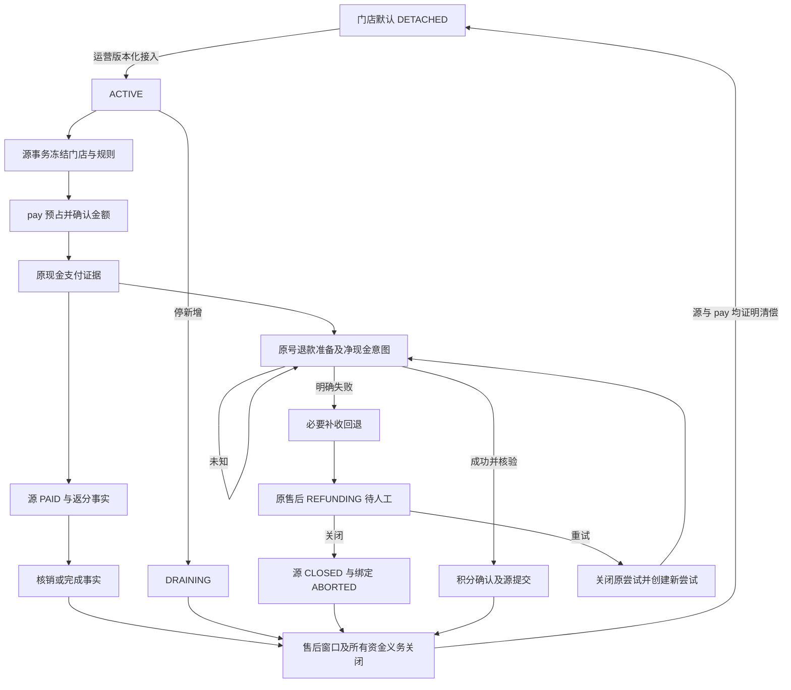

# 积分第三阶段验收记录

日期：2026-10-18（Asia/Shanghai）。分支：codex/points-v3。范围基线：72ed4b38b。

当前状态：实现及最终 Review 修复已提交；发布闸门、原生并发、前端验收与部署证据仍在补齐。此文件不表示已完成生产发布。

## 业务边界

- 积分是 pay 内的独立业务模块，以门店为业务维度。
- 订单接线默认脱离；停新增保留原占用、返分、退款与资金义务的收尾能力。
- 生产不迁移旧积分余额；旧引擎已退出生产源码，仅在历史测试夹具中保留。
- 补收成功、现金退款明确失败且补收回退成功后，原售后保留待人工处理；运营可重试或关闭。
- 用户已授权完成后部署现有生产环境；代码发布不自动为门店签约或启用接线。

## 验收矩阵与证据

| 能力 | 主要证据 | 当前结论 |
|---|---|---|
| 默认脱离、缺实现、原义务阻止脱离 | PointsOrderDetachmentTest、PointsOrderDetachmentWiringTest | 集中用例通过 |
| 门店接线及版本控制 | PointsOrderIntegrationPolicyTest、PointsOrderBindingTest | 集中用例通过；原生竞争另记 |
| 下单占用、源事务失败恢复、UNKNOWN 不改价 | PointsOrderPlacementFlowTest、PointsOrderHoldRecoveryTest | 集中用例通过 |
| 门店路由、非 1:1 报价与实扣一致 | PointsOrderLiveCreationTest | 集中用例通过 |
| 支付证据、返分源事实 | PointsOrderLiveCreationTest、PointsOrderPaidRouteContractTest | 集中用例通过 |
| 部分退款、累计额度、零现金 | PointsOrderRefundStageTest、AfterSaleRefundExecutionTest | 集中用例通过；原生额度竞争另记 |
| 现金结果未知不重复支付、失败补偿、人工关闭/重试 | AfterSaleRefundExecutionTest | 集中用例通过 |
| 售后窗口和原责任关闭 | PointsOrderClosureFlowTest | Review 修复后通过，合法 ABORTED 原尝试不再阻止关闭 |
| 原事件投递、ACK 丢失、扫描游标 | PointsOrderSourceOutboxTest、PointsOrderSourceOrdersFlowTest、PointsOrderRecoveryFlowTest | 集中用例通过；原生提交顺序另记 |
| 失败队列不阻塞后续记录 | PointsOrderClosureCursorTest | Review 修复后通过，三队列持久游标绕回 |
| B 端门店作用域与属主签约 | BizStorePointsScopeTest、BizStorePointsAgreementScopeTest | 集中用例通过 |
| 买家账本隔离 | MpBuyerPointsReadTest、MpEndpointAuthTest | 定向通过 |
| 同店 R、随单/定期结算、跨门店债务隔离 | 既有 pay 内核验收证据 | 本轮不重复计入订单集中数量，发布前核对关联记录 |

## 本轮命令与耗时

- 20261018T050445Z-016b2138：20 个测试报告、83 项，其中 82 项通过、1 项原生环境限定跳过；0 失败/错误；命令 63.598 秒；阈值 1 秒，慢用例 0。
- 20261018T050823Z-27da6aa8：人工关闭/重试责任关闭两个真实断言失败，复现 Review 问题。
- 20261018T051038Z-7be1bf6f：12 项通过、1 项夹具错误（新增游标表未生成到 H2 schema），不计作业务失败。
- 20261018T051154Z-6da0fb00：受影响 13 项通过，慢用例 0；H2 schema 已从迁移重新生成。
- 旧引擎退出后的干净构建确认生产 classes 不含旧 PointsService/Impl、PointsPortImpl 和旧 SPI。历史夹具用例不计入现行业务验收。

计时原始证据位于 backend/target/test-timings/<run_id>/，包含 maven.log、summary.json、test-timings.log、suite-timings.log、slow-tests.log 和 progress.log。命令启动/上下文耗时与单用例耗时分别统计，不能将命令时间全部归因于测试方法。

## 最终独立 Review

只读审查范围为 BASE 至 41ee7b03f；发现 2 个 Important，无已确认 Critical 或 Minor。

1. ABORTED 原售后阻止责任关闭：已修复，要求原售后 CLOSED、执行 ABORTED 且门店子单一致，再排除该记录；重复退款商品额只计已提交尝试。
2. 恢复队列前部失败记录造成饥饿：已修复，三队列分别持久记录扫描位置并绕回；失败不改变原业务标识，也不永久跳过承诺。

修复提交：7bd9f095e。按计划只做一次独立 Review，修复由定向失败与通过证据验证。

## 生产发布记录（待完成）

- 发布前只读检查：soukmind-tx，实际健康端口 8081，health=UP。
- 发布前版本：a0a41a6c3-recipient-salutation。
- 当前回滚包：shop-app-20261015-recipient-salutation-a0a41a6c3.jar。
- 待填：最终提交、闸门证据、DDL 核验、三端产物版本、发布结果与健康检查、回滚方法。

## Review 修复后的最终定向证据

- 20261018T051358Z-3e97bf8c：20 个报告、85 项，其中 84 通过、1 原生限定跳过；0 失败/错误；命令 62.945 秒；慢用例 0。
- 20261018T051249Z-530bb7ef：原生 MySQL 6 项全部通过，0 跳过；命令 11.914 秒；慢用例 0。限定接线 CAS、跨场景 admission 锁、提交序号扫描及同单退款累计额度竞争。与 H2 重叠的业务断言不相加计算覆盖率。
- 前端：C 端相关 15 项、B 端 6 项、运营端 10 项通过；三端类型检查通过。以上是组件/契约验证，浏览器验收另记。
- OpenAPI 及接口清单已从当前契约重新生成；C 端生成器支持 clientTag 字段，不再漏掉下单和积分报价。旧 C/B 积分接口已从当前契约删除。

## 源流程与接脱

恢复队列分别持久保存下单、退款、事件扫描位置，到末尾绕回。业务动作在选取游标事务之外执行；失败保留原号和重试资格。进程在游标提交后崩溃时，该记录在后续绕回再次入选。

## 发布闸门发现问题与收口（2026-10-18）

干净提交 `3609e874f` 的首轮全量 Maven 闸门耗时约 13 分 56 秒，失败后未部署、未增加失败白名单。其失败用于定位真实回归和测试隔离问题，不能称为验收通过。

实际代码修复：

- 未接线现金退款继续走既有按额分账回退，积分准备冻结协议仅用于已接线订单；系统退款显式落 CASH 模式。
- 运营退款续跑移除外层支付事务；分账已回退而现金尚未到账时，保留原售后待办。
- 分账结果未知也按原请求号保存可查询日志；后续核验成功更新同一条日志，不重复发起新资金命令。
- 分账回退改按原分账指令金额累计分摊，而非商家净所得；分账前已退款的金额从后续分摊基数中剔除。
- 独立支付进程补上缺少远程门店目录时的明确失败代理，未制造商家或门店数据。
- 运营页面补上按门店查询存量义务；来源/支付核验不可用时显示未知，脱离变更仍服务端独立复核。

测试收口：

- H2 重复初始化不再重建旧 MICRO 自然键；测试通道市场种子改为幂等写入。新增两次完整 schema/补充种子重放用例，验证已存在配置保持原值。
- 拼团、集单、售后与运营退款场景使用 TEST 银行收款凭据，等待原退款指令核验后再断言 REFUNDED；保留真实现金、金额与幂等断言。
- 原子持久化用例清理自身合成的未签名 Outbox 事件，避免污染后续消息/链路健康验收；对账替身按退款请求返回唯一回执。
- 旧 PointsDeduct/PointsConfirmWiring 场景改验旧协议不再扣账或确认旧 USE；正向报价、占用、接收门店与释放幂等分别由 RedeemServiceTest、PointsOrderLiveCreationTest、PointsOrderHoldRecoveryTest 验证。旧补差网关的正向断言由 PerOrderSettlementTest、PointsPayoutPreparationTest 的真实账本与持久资金指令覆盖；无持仓账单明确不能补差或分账。
- 三张旧积分表登记为生产已停写，保留历史测试夹具，未恢复旧引擎。

证据（不同批次有重叠，不累加为独立用例数量）：

| 批次 | 结果 | 命令耗时 | 慢用例阈值 1 秒 |
| --- | --- | --- | --- |
| 20261018T052644Z-367aa54a | 支付独立进程 8 项通过 | 见 summary.json | 0 |
| 20261018T054012Z-cdfa5ebb | 9 个报告、109 项通过，0 跳过 | 69.746 秒 | 3 |
| 20261018T054239Z-7866bcb3 | 2 个报告、8 项通过，0 跳过 | 19.555 秒 | 0 |
| 20261018T054523Z-8000bd10 | 交叉退款场景有效 RED：期望 180、实际 120 | 见 summary.json | 0 |
| 20261018T054640Z-ff5094ac | 8 个报告、80 项通过，含交叉退款 GREEN | 见 summary.json | 3 |
| Ops Vitest | 3 个文件、11 项通过 | 188 毫秒 | 不与后端混计 |
| Ops 类型检查 | tsc --noEmit 通过 | 独立命令 | — |

中间的零用例测试编译失败、测试夹具失败均保留日志，不算通过证据。日常只运行受影响集合，最终全量闸门单独记录；每 15 秒输出测试进度。命令时间包含编译、Spring 上下文初始化和进程退出，不能直接当作单用例耗时。本地三端冒烟使用合成/mock 数据，运营页面已验证 DETACHED、返分/抵扣关闭及未知义务提示，不代表生产真实门店已验收。
