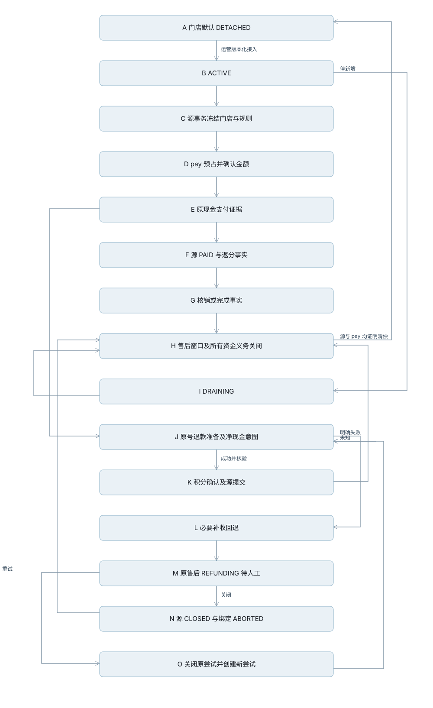

# 积分第三阶段验收记录

> 当前状态（2026-10-19）：订单含积分基本流程已完成生产整合及发布，后端/C/运营端为2cbd7bf2b，B端补发00ab46234。见[实际发布记录](订单含积分基本流程-Review修复与发布记录-2026-10-19.md)。本文中“生产尚未修改”“待整合”等为当时过程记录，不代表当前状态。后续结算资金修复仍在本地开发，尚未部署，见[本轮执行记录](积分资金Review修复-执行记录-2026-10-19.md)。

> 状态：验收与发布执行记录，最终部署结果在生产发布段落中列明。

日期：2026-10-18（Asia/Shanghai）。分支：codex/points-v3。范围基线：72ed4b38b。

当前状态：积分实现及一次最终 Review 修复已有定向与原生证据，完整后端已通过，前端发布检查随实际推送再执行。生产兼容预检发现分支与迁移冲突，尚未部署；详见文末整合方案。

## 业务边界

- 积分是 pay 内的独立业务模块，以门店为业务维度。
- 订单接线默认脱离；停新增保留原占用、返分、退款与资金义务的收尾能力。
- 生产不迁移旧积分余额；旧引擎已退出生产源码，仅在历史测试夹具中保留。
- 补收成功、现金退款明确失败且补收回退成功后，原售后保留待人工处理；运营可重试或关闭。
- 用户已授权完成后部署现有生产环境；代码发布不自动为门店签约或启用接线。

## 验收矩阵与证据

| 能力 | 主要证据 | 当前结论 |
|---|---|---|
| 默认脱离、缺实现、原义务阻止脱离 | PointsOrderDetachmentTest、PointsOrderDetachmentWiringTest | 集中用例通过 |
| 门店接线及版本控制 | PointsOrderIntegrationPolicyTest、PointsOrderBindingTest | 集中用例通过；原生竞争另记 |
| 下单占用、源事务失败恢复、UNKNOWN 不改价 | PointsOrderPlacementFlowTest、PointsOrderHoldRecoveryTest | 集中用例通过 |
| 门店路由、非 1:1 报价与实扣一致 | PointsOrderLiveCreationTest | 集中用例通过 |
| 支付证据、返分源事实 | PointsOrderLiveCreationTest、PointsOrderPaidRouteContractTest | 集中用例通过 |
| 部分退款、累计额度、零现金 | PointsOrderRefundStageTest、AfterSaleRefundExecutionTest | 集中用例通过；原生额度竞争另记 |
| 现金结果未知不重复支付、失败补偿、人工关闭/重试 | AfterSaleRefundExecutionTest | 集中用例通过 |
| 售后窗口和原责任关闭 | PointsOrderClosureFlowTest | Review 修复后通过，合法 ABORTED 原尝试不再阻止关闭 |
| 原事件投递、ACK 丢失、扫描游标 | PointsOrderSourceOutboxTest、PointsOrderSourceOrdersFlowTest、PointsOrderRecoveryFlowTest | 集中用例通过；原生提交顺序另记 |
| 失败队列不阻塞后续记录 | PointsOrderClosureCursorTest | Review 修复后通过，三队列持久游标绕回 |
| B 端门店作用域与属主签约 | BizStorePointsScopeTest、BizStorePointsAgreementScopeTest | 集中用例通过 |
| 买家账本隔离 | MpBuyerPointsReadTest、MpEndpointAuthTest | 定向通过 |
| 同店 R、随单/定期结算、跨门店债务隔离 | 既有 pay 内核验收证据 | 本轮不重复计入订单集中数量，发布前核对关联记录 |

## 本轮命令与耗时

- 20261018T050445Z-016b2138：20 个测试报告、83 项，其中 82 项通过、1 项原生环境限定跳过；0 失败/错误；命令 63.598 秒；阈值 1 秒，慢用例 0。
- 20261018T050823Z-27da6aa8：人工关闭/重试责任关闭两个真实断言失败，复现 Review 问题。
- 20261018T051038Z-7be1bf6f：12 项通过、1 项夹具错误（新增游标表未生成到 H2 schema），不计作业务失败。
- 20261018T051154Z-6da0fb00：受影响 13 项通过，慢用例 0；H2 schema 已从迁移重新生成。
- 旧引擎退出后的干净构建确认生产 classes 不含旧 PointsService/Impl、PointsPortImpl 和旧 SPI。历史夹具用例不计入现行业务验收。

计时原始证据位于 backend/target/test-timings/<run_id>/，包含 maven.log、summary.json、test-timings.log、suite-timings.log、slow-tests.log 和 progress.log。命令启动/上下文耗时与单用例耗时分别统计，不能将命令时间全部归因于测试方法。

## 最终独立 Review

只读审查范围为 BASE 至 41ee7b03f；发现 2 个 Important，无已确认 Critical 或 Minor。

1. ABORTED 原售后阻止责任关闭：已修复，要求原售后 CLOSED、执行 ABORTED 且门店子单一致，再排除该记录；重复退款商品额只计已提交尝试。
2. 恢复队列前部失败记录造成饥饿：已修复，三队列分别持久记录扫描位置并绕回；失败不改变原业务标识，也不永久跳过承诺。

修复提交：7bd9f095e。按计划只做一次独立 Review，修复由定向失败与通过证据验证。

## 生产发布记录（历史占位，实际结果见文首链接）

- 发布前只读检查：soukmind-tx，实际健康端口 8081，health=UP。
- 发布前版本：a0a41a6c3-recipient-salutation。
- 当前回滚包：shop-app-20261015-recipient-salutation-a0a41a6c3.jar。
- 最终提交、DDL核验、各端实际版本及回滚方式已记录在文首链接的2026-10-19发布记录；本节保留原验收范围说明。

## Review 修复后的最终定向证据

- 20261018T051358Z-3e97bf8c：20 个报告、85 项，其中 84 通过、1 原生限定跳过；0 失败/错误；命令 62.945 秒；慢用例 0。
- 20261018T051249Z-530bb7ef：原生 MySQL 6 项全部通过，0 跳过；命令 11.914 秒；慢用例 0。限定接线 CAS、跨场景 admission 锁、提交序号扫描及同单退款累计额度竞争。与 H2 重叠的业务断言不相加计算覆盖率。
- 前端：C 端相关 15 项、B 端 6 项、运营端 10 项通过；三端类型检查通过。以上是组件/契约验证，浏览器验收另记。
- OpenAPI 及接口清单已从当前契约重新生成；C 端生成器支持 clientTag 字段，不再漏掉下单和积分报价。旧 C/B 积分接口已从当前契约删除。

## 源流程与接脱

[可复现图源](diagrams/points-order-integration-1.mmd)

恢复队列分别持久保存下单、退款、事件扫描位置，到末尾绕回。业务动作在选取游标事务之外执行；失败保留原号和重试资格。进程在游标提交后崩溃时，该记录在后续绕回再次入选。

## 发布闸门发现问题与收口（2026-10-18）

干净提交 `3609e874f` 的首轮全量 Maven 闸门耗时约 13 分 56 秒，失败后未部署、未增加失败白名单。其失败用于定位真实回归和测试隔离问题，不能称为验收通过。

实际代码修复：

- 未接线现金退款使用独立持久分账回退续跑，积分准备冻结协议仅用于已接线订单；系统退款显式落 CASH 模式。
- 运营退款续跑移除外层支付事务；分账已回退而现金尚未到账时，保留原售后待办。
- 分账结果未知也按原请求号保存可查询日志；后续核验成功更新同一条日志，不重复发起新资金命令。
- 分账回退改按原分账指令金额累计分摊，而非商家净所得；分账前已退款的金额从后续分摊基数中剔除。
- 独立支付进程补上缺少远程门店目录时的明确失败代理，未制造商家或门店数据。
- 运营页面补上按门店查询存量义务；来源/支付核验不可用时显示未知，脱离变更仍服务端独立复核。

测试收口：

- H2 重复初始化不再重建旧 MICRO 自然键；测试通道市场种子改为幂等写入。新增两次完整 schema/补充种子重放用例，验证已存在配置保持原值。
- 拼团、集单、售后与运营退款场景使用 TEST 银行收款凭据，等待原退款指令核验后再断言 REFUNDED；保留真实现金、金额与幂等断言。
- 原子持久化用例清理自身合成的未签名 Outbox 事件，避免污染后续消息/链路健康验收；对账替身按退款请求返回唯一回执。
- 旧 PointsDeduct/PointsConfirmWiring 场景改验旧协议不再扣账或确认旧 USE；正向报价、占用、接收门店与释放幂等分别由 RedeemServiceTest、PointsOrderLiveCreationTest、PointsOrderHoldRecoveryTest 验证。旧补差网关的正向断言由 PerOrderSettlementTest、PointsPayoutPreparationTest 的真实账本与持久资金指令覆盖；无持仓账单明确不能补差或分账。
- 三张旧积分表登记为生产已停写，保留历史测试夹具，未恢复旧引擎。

证据（不同批次有重叠，不累加为独立用例数量）：

| 批次 | 结果 | 命令耗时 | 慢用例阈值 1 秒 |
| --- | --- | --- | --- |
| 20261018T052644Z-367aa54a | 支付独立进程 8 项通过 | 见 summary.json | 0 |
| 20261018T054012Z-cdfa5ebb | 9 个报告、109 项通过，0 跳过 | 69.746 秒 | 3 |
| 20261018T054239Z-7866bcb3 | 2 个报告、8 项通过，0 跳过 | 19.555 秒 | 0 |
| 20261018T054523Z-8000bd10 | 交叉退款场景有效 RED：期望 180、实际 120 | 见 summary.json | 0 |
| 20261018T054640Z-ff5094ac | 8 个报告、80 项通过，含交叉退款 GREEN | 见 summary.json | 3 |
| Ops Vitest | 3 个文件、11 项通过 | 188 毫秒 | 不与后端混计 |
| Ops 类型检查 | tsc --noEmit 通过 | 独立命令 | — |

中间的零用例测试编译失败、测试夹具失败均保留日志，不算通过证据。日常只运行受影响集合，最终全量闸门单独记录；每 15 秒输出测试进度。命令时间包含编译、Spring 上下文初始化和进程退出，不能直接当作单用例耗时。本地三端冒烟使用合成/mock 数据，运营页面已验证 DETACHED、返分/抵扣关闭及未知义务提示，不代表生产真实门店已验收。

## 第二轮闸门与现金回退补齐

`152781ae3` 干净闸门：20 个模块、3880 项，4 项断言失败、3 项错误、9 项跳过，未部署。Maven 14 分 30 秒；完整 XML 已归档，统计批次 `20261018T060322Z-b4f57590`。其中单方法合计约 320.372 秒、方法外类级开销约 534.916 秒；单方法中位数 0.011 秒、P95 0.365 秒、最长 4.038 秒、超过 1 秒共 25 项。这表明本轮耗时主要来自大量类/上下文及整轮运行，不能归因于某一条测试长时间卡住。

发现的实际安全边界已补齐：普通现金已分账退款也使用 V438 原命令持久化；外部回退/回查不占源或支付事务，UNKNOWN 不重复发送，成功回执与结算调整原子提交。原分账证明缺失不操作资金，原请求内容变化拒绝，待定回退阻止另一售后及旧入口绕行。网关收到完整冻结的门店、商家、币种、通道与收款号；不支持回查时原售后保持待处理。积分已接线的冻结/补偿协议保持独立。

| 批次 | 验证结果 |
| --- | --- |
| 20261018T060155Z-43b8dd14 | 现金回退与售后/结算 108 项通过 |
| 20261018T060521Z-b665154c | 其余闸门失败的定向修复 48 项通过 |
| 20261018T060643Z-a107adc3 | 合法分账确认推进场景有效 RED，未错误计作环境失败 |
| 20261018T060803Z-91432ed5 | 状态推进、原命令查询、剩余闸门修复 63 项通过 |
| 20261018T061021Z-88dd15ca | 原生 MySQL 并发 1 项通过、0 跳过；命令 18.423 秒、方法 0.577 秒 |
| 20261018T061201Z-49734129 | 架构、迁移漂移、支付事务及相关业务 49 项通过 |

这些定向集合存在重叠，不相加成独立测试总数。新增用例同时保留“无原证明不退现金”的原保护，以及真实分账已成功时的退款闭环。

独立支付进程预检另发现具名事务管理器缺失，已在 pay-svc 自身配置中将 transactionManager 与 payTxManager 指向同一物理数据源管理器；未引入新服务或积分 jar。预检 RED `2ed2a61d`，修复后 `a964f996` 8 项通过、0 慢用例。

推送流程已补充完整验证记录复用：只有完整零失败记录、验证提交为当前祖先、后端及构建闸门输入未变化时复用；文档/前端守卫仍执行。不写入或伪造真实验证记录。独立临时 Git 仓库 8 项测试通过，覆盖后端变化、闸门变化、分叉记录、仅编译记录和非零失败均不可复用，避免同一后端刚验完又重复等待整轮测试。

## 最终完整后端验证（2026-10-18 14:32 CST）

`JAVA_HOME=<JDK21> scripts/check-head-compiles.sh 8bc12299f` 从干净提交编译及全量测试，命令退出 0；20 个模块、3888 项，3878 项通过、10 项环境限定跳过，0 失败/错误。没有增加失败白名单。归档 628 份 XML，统计数量与 Maven 汇总完全一致：`20261018T063211Z-f65fb219`；这是 existing_reports 采集，采集器的 0.363 秒不是测试耗时，原始闸门测试耗时为 882 秒。

阈值 1 秒的慢用例 27 项；方法时间合计 312.525 秒，中位数 0.010 秒，P95 0.360 秒，最大 3.964 秒。测试类合计 868.586 秒，其中未归属于方法的初始化/销毁时间 556.061 秒；原日志出现 Spring 定时任务执行器退出等待 30 秒。说明本轮主要开销在全量覆盖与上下文生命周期，并非某一个用例运行数分钟。后续优化应先处理测试上下文及调度器销毁，保留真实并发/超时测试语义；日常仍只跑受影响范围。各类、各方法及慢日志保留在本地 target，未提交原始测试日志。

本次发布前还修复页面标题不一致、已接通页面仍在欠账清单、无引用旧词条、生成文档漂移；权限矩阵生成器补齐多行及分操作权限，不修改实际接口鉴权。解析器回归 2 项及矩阵守卫 6 项通过；分操作端点只表示至少一个动作可访问，具体请求仍按动作校验权限。

## 实施决策归档

以下保留执行台账中的裁决，避免清理临时工作目录后丢失设计取舍：

- preserve prior 11-argument PointsOrderEvent Java constructor as an explicit schemaVersion=1 convenience while canonical persisted JSON requires schemaVersion1 — C1 consumers already exist but no production source log has been written — cost: unversioned draft JSON rejected; source producers must use the new wire format.
- same-event different-body persistence rejection is verified with real journal in T07; T01 verifies only the immutable wire identity — DTOs alone cannot enforce uniqueness — cost: T01 is not a persistence proof and must not be reported as such.
- no-op upsert locks policy exclusively before read — native InnoDB proved INSERT IGNORE shared-lock upgrade deadlock — cost: relies on MySQL-compatible upsert already supported by project dialect, verified native and H2.
- obligation clearance scans existing whitelisted position payloads with 100 types/10000 rows bounded budget; incomplete ownership or exhausted scan is UNKNOWN — no new money aggregate is inferred from incomplete data — cost: large/unattributed backlog conservatively blocks detachment until investigated, outside ordinary cash hot path.
- initialize/lock the two known scenes in ONLINE then OFFLINE order for every source policy mutation/admission, and reject whole-store detach while any scene ACTIVE — per-scene locks alone allowed an admission in the other scene to race the whole-store proof — cost: short source admissions for the same store serialize across scenes, not across stores.
- connect factory to actual order creation together with T06 staged workflow, rather than adapting its result back into legacy merchant-only Target in T05 — legacy Target discards the store and route the new factory protects — cost: T05 boundary wiring is incomplete until T06 and T05 checkbox remains open accordingly.
- execute T07 durable journal before T06 live order wiring — T06 cancellation must persist an original source fact, and an afterCommit-only temporary bridge would lose crash recovery — journal only requires completed T01/T03 interfaces, not live placement — cost: plan execution order changes, with order behavior still gated until the complete T06 workflow is verified.
- separate pre-payment acceptance route from later verified payment receipt — provider tradeNo and generated merchant outTradeNo do not exist at placement, and existing RedeemService uses subOrderNo as provisional context.outTradeNo; PointsRefundPreparation requires the exact paid context — add optional payment proof to LifecycleFact and canonical shared digest (old 11-argument constructor retained; absent proof preserves old digest), then T08 binds verified dynamic receipt fields to the original static route before PAID moves H — cost: source producer/payment verification must be wired before live acceptance can be considered complete; never fabricate tradeNo or treat root orderNo as an actual merchant payment number.
- RAW is not admission. Persist the non-payable order/resources before remote terms/quote, then perform authoritative admission in a second short source transaction under the original expected policy version — remote pay queries cannot be hidden under source policy/stock locks — cost: a stopped/changed policy can leave an unaccepted RAW order awaiting explicit reconfirm/cancellation; bounded timeout recovery must release its ordinary stock/coupon reservations. No hold may run before ADMITTED commits.
- V430 is placement and V431 is the source order marker; T09 refund binding moves to V432. Source marker avoids a placement-table read for ordinary cash cancellation/timeout. Existing legacy refund/grant/display calls remain explicitly scheduled for T08/T12 removal; T06 proves recoverable pre-payment admission only, not complete financial production wiring. Production points flag remains off.
- retain old engine only under test source while migrating historical assertions — preserves old protections without deploying dual logic — cost: legacy tests remain a maintenance burden and cannot count as current business acceptance.

- 普通现金退款的分账回退独立持久化，UNKNOWN 只查询原号；无查询能力保留待人工，不重发资金命令。代价是部分通道需人工处理，不能为了自动完成而冒重复扣款风险。
- 用户已明确授权现有生产发布，覆盖现有主应用、支付进程及三端 Web/H5；积分业务开关和恢复开关保持关闭，不创建真实门店、协议或余额。小程序发行不在本次 Web 部署范围内。

## 生产兼容阻断：本分支不可直接发布

发布前只读核对发现：生产主应用基线 `a0a41a6c3-recipient-salutation`，独立支付包基线 `458fc83e9`，都不是本分支祖先。共同祖先为 `df2adc641`；不能将“同仓库”当成“线上功能已包含”。仅做 `git merge-tree --write-tree` 预演，没有实际合并、没有切换生产。

预演有 47 个冲突文件，涉及订单创建/回调、售后、退款执行 mapper、支付账务与退款对账、三端页面及生成物。生产分支自共同祖先包含手机会话绑定、门店收藏身份、物流双通道订阅与状态推进、商家退款待办等变更。直接选取当前积分分支会回退已上线行为；直接合并也不能保证两套退款执行协议兼容。

迁移编号冲突如下（此为 Git 中生产基线对比，还需与数据库 Flyway 历史逐条核验 checksum）：

| 版本 | 生产基线文件 | 当前积分分支文件 |
|---|---|---|
| V410 | V410__order_creation_request_hash.sql | V410__settlement_points_funding.sql |
| V411 | V411__order_creation_recovery.sql | V411__points_withdrawal_budget_locks.sql |
| V412 | V412__order_payment_resolution.sql | V412__points_evidence_business_binding.sql |
| V413 | V413__order_shipping_active_waybill_claim.sql | V413__refund_verified_cash_evidence.sql |
| V414 | V414__shipment_logistics_source_mapping.sql | V414__refund_execution_preparations.sql |
| V415 | V415__basic_refund_execution.sql | V415__refund_dispatch_claim.sql |
| V416 | V416__settlement_refund_basis.sql | V416__refund_request_snapshot.sql |
| V417 | V417__logistics_channel_subscription.sql | V417__refund_execution_queue.sql |
| V418 | V418__logistics_push_audit.sql | V418__payment_request_snapshot.sql |

后续整合执行方案：

1. 固定现有生产 jar 的源码和额外 recipient-salutation 补丁来源，记录数据库 Flyway 历史、两套退款执行表结构及未决记录数量；只读核对，不导出敏感正文。
2. 以生产版本建立独立整合工作树，保留手机会话、收藏和物流等线上能力；将本分支作为已验收的积分实现来源，逐项合并订单和退款冲突，禁止整文件选择任一方掩盖资金协议差异。
3. 已执行迁移保持文件名、版本及 checksum 原样；仅对未部署的积分迁移重新分配空闲连续版本，并核对表名及字段冲突。已有普通现金退款记录不能当作积分“未上线”数据删除或重置。
4. 普通现金订单继续遵守现有生产退款恢复协议，积分绑定订单按原准备版本处理；明确原请求、回执、UNKNOWN、待人工及关闭责任如何映射。用生产结构的脱敏/合成夹具验证未决退款可续跑，不操作真实资金。
5. 先运行各冲突点的最小回归集合和原生并发；通过后再做一次完整后端闸门及三端检查。当前分支的全量结果不能替代整合提交的验证。
6. 整合提交推送成功后，主应用、现有支付进程及三端 H5 按同一提交发布，记录健康检查、VERSION、默认关闭状态和各自回滚包。期间不改真实门店接线或积分余额。

当前生产尚未修改。本分支允许作为开发交付提交和推送，但不具备直接生产发布条件。已请求用户确认后续采用“生产基线兼容整合后部署”还是“先交付当前分支、暂缓部署”；依赖该选择的整合工作暂不执行。

发布守卫修复的补充证据：`0c23fb39` 复现商品统计越过商家数据域，修复后 `1a1fc28a` 本类 3 项通过、0 慢用例。此次后端改动独立提交 `d81afb4a1`，新一轮干净全量验证重新执行，不能复用前一版后端记录。契约配对/数据域/SQL 模型与血缘/样式定向 37 项通过，字段配对 22 项通过，接口说明完整性 12 项通过，运营 DataTable/错误重试纪律 31 项通过。各批存在重叠，不累加。三端类型检查通过。未扩大任何失败白名单。

测试耗时优化补充：契约字段守卫在一次固定源码快照内缓存文件内容，避免每个接口重复读取全部 Java 文件。此前同组守卫中业务字段检查约 60 秒；缓存后原 8 项断言全部通过，命令 5.49 秒、方法合计 4.66 秒。未减少扫描目录、断言或字段集合。运营表格与三语检查 33 项通过。该优化仅影响测试工具，不改变生产逻辑。

## 最新后端交付检查点（2026-10-18 14:55 CST）

后端提交 `d81afb4a1f42a472a5534ad663d9b1178dbe6b61` 的干净编译和完整测试退出 0：20 个模块、3889 项，3879 项通过、10 项环境限定跳过，0 失败/错误，Maven 测试 863 秒；后续提交只改前端、文档与测试工具，后端无差异。真实完整验证记录由闸门脚本写入，未伪造或扩大白名单。

归档 628 份 XML，数量与全量汇总一致；统计批次 `20261018T065542Z-15b7355f`，超过 1 秒共 24 项。方法合计 312.376 秒，中位数 0.010 秒、P95 0.364 秒、最大 3.839 秒；类合计 849.485 秒，方法外初始化/销毁等 537.109 秒。采集器耗时 0.327 秒仅表示读取既有报告，不是测试运行时间。

本轮本地 mock 服务 5178、5179、3188 已停止；自建 MySQL 容器已停止并保留数据/报告，不停止共享 Docker 环境。分支、工作树、逐测试时长、慢日志及开发台账保留，待生产兼容整合使用。生产主应用、支付进程和 Web 均未切换。

### 2026-10-18 生产基线复核补充

前述“生产最高 V327 / jar 含 V424”的判断已被直接只读查询纠正：当前生产 `ai_shop.flyway_schema_history` 有 360 条记录，V424 位于 rank 360，V422 checksum 与当前生产源文件一致；服务健康且运行包包含 V422/V424。不要对 `version` 字符串使用 `MAX()` 判断最大版本。

生产包和 schema 均未安装积分基础迁移 V408；本分支的 V408 是未发布的新脚本，因低于生产 V424 会被默认 Flyway 顺序忽略，导致后续积分迁移引用不存在的表。已将其重编号为 V425（首个空闲版本），V439–V463 保持原顺序；测试夹具资源路径同步调整。生产数据库只读检查未执行任何 DDL/DML。

前端发布守卫最后收口：C 端完整 499 项通过；活动选择检查由固定“两处”改为分别验证现金预览、积分报价和下单，定向 11 项通过。B 端按天明细检查改为验证新门店账本入口在 dayMode 隐藏，并禁止旧主体积分请求，定向 15 项通过。门店签约确认复用现有 prompt 组件，换行、间距和主色文字改用共享样式；自造件守卫只剩原有 4 项，未加豁免。实际推送仍完整执行全部前端、文档和 Hook 检查，不跳过。

### 2026-10-18 收银台补充验收

积分订单处于 `POINTS_PROCESSING` 时，收银台必须明确提示服务端仍在核验，不能显示“未知结果”或再次支付；`RECONFIRM` 状态提供取消本次未支付订单并回购物车重新确认的动作。新增两项界面行为测试，覆盖普通核验状态、重确认文案、禁止支付入口、取消原单、清除 checkout 幂等键和返回购物车。首轮测试按预期复现两项缺失，修复后收银台及相关售后/订单定向测试 48/48 通过，C/B 类型检查通过。未改任何生产现金退款语义。
