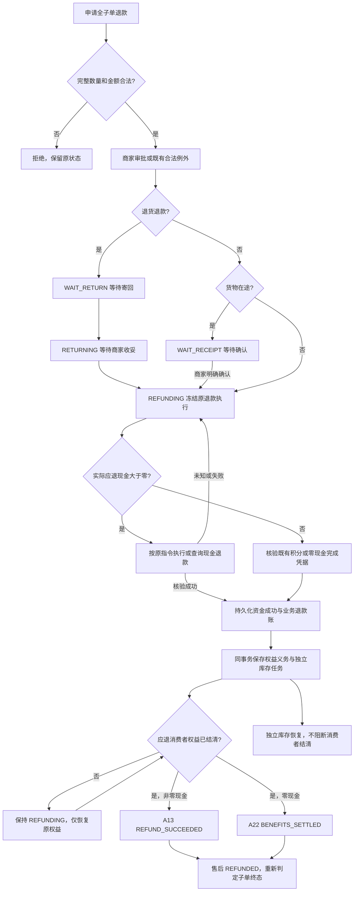
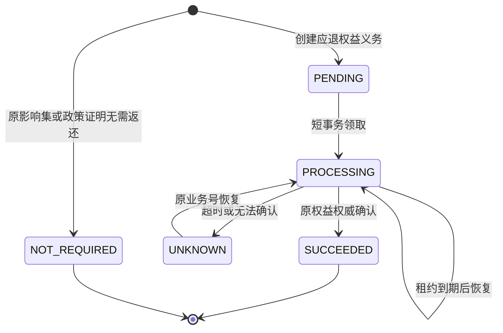

# 订单退款结清 M1 流程与契约

2026-10-19：用户收敛范围为只支持整单退款，屏蔽部分退款。当前“整单”沿用现有商家子订单边界；多店支付单分别处理各子单，不新增跨店一键退款。

本文件记录已实现的版本2协议；`shop.refund.closure.enabled` 默认关闭，未表示生产已启用。版本1执行仍使用原恢复协议。部分退款、金额补偿、保留运费及全积分连续部分退款均延期，不能依据纯策略测试宣称入口已开放。

## 入口与不可变事实

申请必须覆盖该子单全部原商品和原退款金额，已发生退款的子单不能重新申请。商家核定金额只能等于原全额；执行准备再次核验。原始积分抵扣/服务费为负的历史数据拒绝自动推导，返回人工核对。

积分追回抵销可能使实际现金少于业务全额退款额度，甚至为零；这是全单退款内部的权益处理，不是部分退款。旧 `refunded_minor` 仍有业务容量用途，本次不将它重新定义为实际现金比例。

## 已实现流转图

图中的普通现金和积分使用各自已有资金确认流程，不共用或伪造资金凭据。普通现金 `SUCCEEDED` 与积分源 `COMMITTED` 是不同执行事实。图不增加超时自动同意/自动退款；定时任务只续跑已经合法批准的决定。

券影响集按原下单分摊冻结。支付根锁内检查影响集的退款数量，最后满足返还条件的决定承担返还义务；其他决定记 NOT_REQUIRED。不等待所有子单先成为 REFUNDED。库存使用同表的 STOCK 类型任务，读取消费者结清时只计算 COUPON 类型；积分继续引用既有权威确认。

## 展示字段

既有 `refundExecution` 追加可选字段，旧端可忽略，新端对缺字段回退原逻辑。

|字段|语义|
|---|---|
|closureVersion|持久协议版本，1 为旧协议、2 为本次协议|
|closureStatus|LEGACY / PENDING / DONE；表示消费者结清|
|cashStatus|CONFIRMED / NOT_REQUIRED / UNKNOWN / PENDING，普通现金失败沿用原执行状态|
|benefitsStatus|PENDING / SETTLED；版本1不伪造权益结清|
|resourceStatus / resourceErrorCode|独立库存恢复情况，继续使用既有字段|

现金成功、权益待完成显示“现金已退，权益处理中”；零现金显示“权益处理中”，不承诺现金到账；消费者结清后不等待库存。失败、未知与人工核对优先于上述普通进度。运营可恢复“现金成功、库存完成、权益仍待完成”的原执行，不生成新退款金额。

## 迁移与实现索引

下列路径均相对仓库根目录。

|规则/迁移|代码|验证|
|---|---|---|
|申请/审批/准备仅全退|BasicRefundPolicy、AfterSaleServiceImpl.approve、RefundPreparationServiceImpl|LineRefundFlowTest、RefundPreparationConflictFlowTest|
|A13 非零现金与权益结清|AfterSaleGuards.CASH_SETTLED、RefundResultServiceImpl|RefundTerminalGuardsTest、RefundClosureObligationFlowTest|
|A22 零现金与权益结清，限 SYSTEM|AfterSaleEvent.BENEFITS_SETTLED、AfterSaleGuards.ZERO_SETTLED|RefundTerminalGuardsTest、BasicZeroRefundFlowTest、AfterSaleRefundExecutionTest|
|A21 线下确认使用独立事实|AfterSaleGuards.OFFLINE_SETTLED|RefundTerminalGuardsTest；未替换现有线下业务协议|
|未备货例外与补偿关闭仍可达|AfterSaleMachine、MachineTablesTest|MachineTablesTest、MachineInvariantsTest、AfterSaleRefundExecutionTest|
|全量商品终止且权益结清才结束子单|RefundClosurePolicy、RefundResultServiceImpl、AfterSaleServiceImpl.recoverPointsClosure|RefundClosurePolicyTest、RefundClosureObligationFlowTest|
|现金/积分中断不重发|RefundObligationServiceImpl、AfterSaleServiceImpl.resumePointsRefund|AfterSaleRefundExecutionTest、PointsOrderRefundStageTest|
|库存失败独立、未发货释放、已收货不重复回补|PointsRefundResourceServiceImpl、RefundRetryJob|AfterSaleRefundExecutionTest、RefundRetryJobTest|
|三端区分现金、权益、库存|shared/order-phase1、ops-web/lib/refund-progress、AfterSaleVO|refund-closure-progress.test.ts、refund-recovery.test.ts、商家页场景测试|

V476 增加普通退款协议、原券影响集及义务表；V477 增加积分执行协议。默认值保留旧任务原义。不得修改已应用迁移。新任务暂停后继续查询与恢复已有版本2执行；不能回退到不认识版本2的旧包。

## 验收边界

本地定向验证、合成 MySQL 迁移/唯一键/行锁验证见[执行记录](./订单退款结清对齐-执行记录-2026-10-19.md)。真实通道认证、生产历史差异导出和生产启用均没有执行。历史数据只读核对，不能根据状态猜取消数量，也不批量改回 REFUNDED。

储值沿用独立项目的线下收款、全额储值核销边界；不因本次订单全额退款而新增储值线上退款或现金混合支付。
