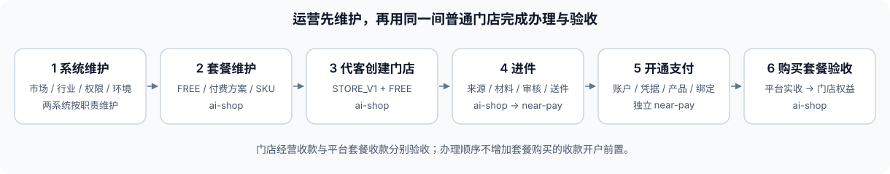

# 运营端开店收款闭环开发功能清单

> 状态：S01–S07、P01–P07 本地 review、缺口修复及专项验证完成；后续代客建店阶段待执行 · 2026-11-11 · 未提交或部署。
> 顺序：系统维护 → 套餐维护 → 代客创建门店 → 进件 → 开通支付；原任务中的代客购买套餐列为最后的闭环验收。
> 关联：[运营端套餐商城](./TDD-运营端套餐商城.md)、[子行业与能力端验收](./TDD-子行业与能力端验收.md)、[独立 near-pay 对齐清单](./ai-shop与独立near-pay后端对齐清单-2026-11-10.md)、[入驻代填与运营管理](../requirements/门店注册与进件-运营端对齐与开发计划.md)。历史文档中的完成状态需结合本清单及当前代码判断。

## 一、目标与范围

让运营人员从后台维护基础数据和套餐，代普通第三方商户创建门店，办理支付进件，启用指定门店的收款能力，最后代客购买套餐并核对权益生效。日常业务办理通过运营页面完成；部署密钥、服务互信和真实渠道验收由对应技术负责人准备，不以手工改库替代业务入口。

“运营独立办理”允许不同运营分别录入、审核和复核，保留现有职责分离。商户协议、渠道要求的本人签约仍需真实授权人确认，后台应展示待办和结果，不能替其制造确认事实。

本清单共 **39 项**，每项同时列服务端和运营端。**P0** 为首轮指定市场、行业和渠道走通所需；**P1** 为扩大维护范围或补完整生命周期，可在 P0 后实施。标注“已有”的项目进入复用、配置或联调，不按重写估算；“待补”为本轮开发增量；“待验”为已有实现尚不能据此声称全链路可用。

## 二、顺序、归属与阶段产出

顺序表示办理和验收次序。系统维护先准备可用市场、业务端与支付目录；套餐发布后才能初始化新门店的 FREE 权益。套餐款收给平台，门店经营收款走该门店的支付账户，两者必须分别验收，不建立“商户必须先开通经营收款才能买套餐”的新限制。

| 阶段 | 项数 | 服务端归属 | 运营端归属 | 阶段产出 |
|---|---:|---|---|---|
| S 系统维护 | 7 | ai-shop 平台/商户/commerce；near-pay 支付目录与凭据 | ai-shop 系统与权限页；near-pay 系统、渠道与凭据页 | 可用基础字典、权限、部署能力和渠道基础配置 |
| P 套餐维护 | 7 | ai-shop commerce、平台套餐收款能力 | ai-shop `/mall` | 已发布经营类型、FREE/付费方案、在售 SKU、平台收款档案 |
| C 代客创建门店 | 7 | ai-shop 账号、入驻审核、商户与 commerce 建店 | ai-shop 代填、入驻审核、门店档案 | 普通第三方主体、owner、指定市场的 STORE_V1 门店及 FREE 权益 |
| O 进件 | 7 | ai-shop 来源申请/门店同步；独立 near-pay 来源、资料、进件 | 两套运营端按职责接续 | 来源关联、支付商户、进件材料及可追溯渠道结果 |
| A 开通支付 | 6 | 独立 near-pay 账户、凭据、产品、门店绑定和路由；ai-shop 读结果 | near-pay 商户工作区；ai-shop 门店收款信息 | 指定门店、渠道、产品、币种的有效收款资格 |
| B 代客购买与权益验收 | 5 | ai-shop commerce 与平台收款/履约能力 | ai-shop 代客购买、订单、核款、权益来源 | 平台实收、商城履约、门店权益对应同一购买事实 |

系统维护证据及完整验证边界见 [系统维护 TDD §5–§6](./TDD-系统维护与运营建店基础.md)。

## 三、开发功能清单

### 3.1 S 系统维护

| 编号/优先级 | 功能 | 服务端工作 | 运营端工作 | 当前处理 |
|---|---|---|---|---|
| S01 / P0 | 市场、币种与地区基础 | 复用市场、币种精度、时区和地区数据；建店、套餐报价、来源同步使用同一市场事实；保留市场与币种既有约束 | 复用“市场/货币/汇率”和地区页；建店可选已启用市场，展示币种、时区和地区；市场不可用时说明原因 | 市场维护已 review，修正 OPS 写权限并补统一 DTO 校验；代填建店接市场归 C02 |
| S02 / P0 | 门店行业、子行业与经营类型映射 | 复用 `sys_store_industry`、commerce 经营类型和现有建店查询；只返回所属关系正确、已启用且方案已发布的选项 | 普通建店表单按行业→子行业选择并回显经营类型；经营类型维护复用商城入口 | 系统侧已补启停配置全量读取、父子过滤及全部停用不回落；代客建店表单归 C 阶段 |
| S03 / P1 | 门店行业和子行业完整维护 | 在现有门店行业模型补新增、编辑、排序、启停和映射维护；保留存量门店引用，停用控制新选择 | 补门店行业管理页面，区分行业与子行业，展示映射和停用影响 | 首批已有种子；完整运营维护原为后置项，现已补齐 API/OPS 页面、版本并发、停用恢复与真实 MySQL 验证，待部署 |
| S04 / P0 | 入驻与支付行业规则 | 复用法律形态、支付行业、小微白名单、经营授权码、服务范围规则；不把 `sys_industry` 与 `sys_store_industry` 合成一张表 | 复用行业白名单、授权码、经营范围页；表单按当前市场和通道展示适用规则，避免台湾流程显示成大陆进件规则 | 已修正支付行业/范围读写菜单与页面权限，并说明现有微信/支付宝规则适用范围；C 阶段再接代填 |
| S05 / P0 | 运营账号、权限与审核岗位 | 复用两系统各自身份、权限、数据范围、审批和审计；配置目录编辑/发布、代填/审核、进件办理/审批、凭据录入/启用、核款等既有权限；缺项按实际端点补齐 | 复用账号/角色和 near-pay 审批页；按权限开放操作并显示当前处理人；审批人可处理上一人的待办 | 已按端点核对权限、修正三项错位菜单；MySQL 迁移不扩权、冻结编码回归及真实上下文测试通过 |
| S06 / P0 | 业务端与部署能力准备 | 复用已验收部署清单、必须具备的业务端、模块开关和启动配置；缺少配置在既有装配层处理；可信验收来源继续由部署配置控制 | 从 `deployment-options` 选择业务端；显示已验收、待验收和不可售原因，不允许通过商城表单自行宣布部署已验收 | 可信目录与发布校验已 review，相关后端 20 项测试通过；真实部署记录仍需准备 |
| S07 / P0 | 支付基础目录、平台凭据与实例环境 | near-pay 复用地区/币种、渠道、支付产品、环境端点和平台凭据；明确测试/生产绑定、渠道送件能力与收款能力的区别 | 复用 near-pay 渠道、产品、凭据中心及实例设置；配置可用目录，展示真实就绪情况；敏感值仅走既有受控录入 | 已 review 并通过前端 19 项、后端定向 20 项；全测试源码另有 4 个旧构造器用例阻塞，真实渠道配置/验收待执行 |

阶段验收：选定一个目标市场，运营可查到可用行业/子行业和经营类型，目录编辑、审核等账号各具备正确权限，业务端来自可信部署清单，支付环境及渠道目录归属一致。首轮市场和渠道未确定前，不把所有地区、所有通道都列为 P0。

### 3.2 P 套餐维护

| 编号/优先级 | 功能 | 服务端工作 | 运营端工作 | 当前处理 |
|---|---|---|---|---|
| P01 / P0 | 经营类型与三档稳定方案 | 复用经营类型、FREE/PRO/CHAIN 方案定义和启停；建店只使用可用的已发布经营类型 | 复用“经营类型与套餐”；起草经营类型，核对三档方案，展示已发布与待发布状态 | 已 review，复用经营类型与三档定义；目录/发布/权限专项通过，目标行业仍按真实配置联调 |
| P02 / P0 | 套餐权益与基础能力 | 复用方案版本、权益代码和业务端目录；校验 FREE 基础入口、递进关系及已验收可售业务端 | 维护方案名称、说明、权益和版本；展示各档包含的业务端、不可发布原因 | 已 review，权益及基础能力校验专项通过；旧主体增值包仍为独立合同 |
| P03 / P0 | 套餐商品、SKU 与价格 | 复用商品、分类、SKU、方案组件、币种、周期和现有退款政策；金额沿既有最小单位合同 | 复用分类与商品/SKU 页；选择经营类型、方案版本、价格和周期；首轮准备一个可售纯数字套餐 | 已 review，SKU 价格/币种/组件和发布校验专项通过；实际价格、周期及销售范围仍由运营配置 |
| P04 / P0 | 发布、改版与版本冲突处理 | 复用行业发布与 SKU 发布；目录回读保留 `catalogVersion` 和各定义/草稿版本；并发冲突沿原合同处理 | 补齐 `catalogVersion` 类型和自动读入；刷新、跨人编辑后按服务端当前版本发布；冲突后重读，不要求运营猜版本 | 已修复并验证：服务器版本只读展示；冲突刷新、关闭旧确认并重新确认，不再手填 |
| P05 / P0 | 平台套餐收款档案 | 复用平台收款主体、档案、币种和期限；补管理查询，使停用后仍能读到当前版本和启停状态；报价继续读取可用档案 | 复用收款档案页；准确显示启停状态，支持停用后重新启用，保留当前版本；显示配置所要求的档案/收款主体约束 | 已补管理读模型并验证停用后保留版本及恢复；原报价启用约束与冻结条款保留，未新增多币种并行模型 |
| P06 / P0 | 门店可购套餐与购买前检查 | 复用正式报价和结账资格判断，按门店经营类型、币种、当前订阅及在售版本判定；管理目录不代替门店可购判断 | 代购入口显示目标店、当前方案和币种；只提交可用选择或展示服务器明确拒绝原因，报价金额以回执为准 | 已补服务器当前方案/经营类型/币种摘要和匹配 SKU 筛选；无读权明确提示，正式报价仍负责最终资格；专项通过 |
| P07 / P1 | 停售、旧版本与硬件套餐 | 复用停售、冻结版本、硬件履约及退款能力；保留旧订单事实；含硬件时沿现有收货地址合同 | 支持停售影响说明、旧版本查询；补代购收货地址，允许方案+硬件组合下单，衔接发货与退款 | 停售/履约复用；已补硬件地址、必填与首次尝试固定地址，原键重试通过；实物发货/退款仍待目标订单联调 |

阶段验收：从维护页面完成一次首次发布，再刷新页面完成一次改版发布；FREE 可供新店初始化，付费 SKU 具备报价所需的发布及价格配置；收款档案停用后可恢复，恢复沿原版本继续。新店的正式报价在 C05 建店后执行 B01，避免把“报价要有目标门店”变成前两阶段的循环依赖。可信部署未验收的业务端不能靠配置文案变成可售。

### 3.3 C 代客创建门店

| 编号/优先级 | 功能 | 服务端工作 | 运营端工作 | 当前处理 |
|---|---|---|---|---|
| C01 / P0 | 普通商户代填与既有资源选择 | 复用普通商户入驻、账号查找和主体授权事实；识别新商户与已有合法主体的建店场景，不沿自营豁免创建第三方店 | 清楚区分“代客创建普通门店”和“平台自营”；按授权选择既有资源或填写新商户资料，展示最终 owner | 已有代填和自营两个入口；普通入口需补新商城建店衔接，既有主体增店按 C07 |
| C02 / P0 | 市场、身份与联系方式 | 代填合同补显式市场并复用该市场的账号/联系方式处理；沿既有身份类型建立或选择 owner；主体市场不依赖 CN 默认值 | 补市场选择、联系方式输入和 owner 确认；显示号码对应对象，避免填错人；台湾/阿联酋不套大陆手机号表单 | 当前代填只接受大陆手机号且未带市场，待补 |
| C03 / P0 | 门店与申请资料 | 在现有申请/创建命令携带行业、子行业、经营类型、门店名、地址及必需的范围等；沿现有规范明确字段落点和生命周期 | 代填表单补行业联动、门店资料、地区/地址与资质；审核页可核对同一份资料，驳回后补交 | 当前旧申请没有完整新模型建店合同，待补；不另建同义申请状态机 |
| C04 / P0 | 受理、审核、驳回与重放 | 保留代填人不能审核自己的申请、原因和审计；通过按原申请原子激活，重复请求返回原结果；错误不留下半创建数据 | 待办/历史复用原页；审核显示 owner、市场、经营类型、资质及影响；通过后可查生成的主体号和门店号 | 审核基础已有；需衔接 C03/C05 的新字段与结果 |
| C05 / P0 | STORE_V1 建店与 FREE 初始化 | 扩展现有建店与初始化合同以支持真实 OPERATOR 代办，保留目标 owner/主体；主体、成员、门店和订阅按原有事务语义落地；复用现有商城初始化，不伪造商户会话 | 成功页展示市场、币种、行业/子行业、经营类型、当前 FREE 及权益状态；未完成不能提示全流程成功 | 核心阻断：旧审核传空 actor/type；新建店开启时失败，关闭时落 LEGACY。当前初始化授权只支持商户账号 |
| C06 / P0 | 门店档案与后续办理入口 | 复用主体/门店查询，投影已存在的订阅、来源支付商户与进件引用；不同领域事实分开读取，不新增可写“总完成状态” | 门店详情展示建店、套餐、进件、收款四类信息；按现有引用进入套餐购买、支付服务申请及 near-pay 办理页；失败可继续原业务单 | 档案与支付申请入口已有；跨阶段信息及接续入口待补齐 |
| C07 / P1 | 既有普通主体增店与重试 | 复用主体成员、门店额度和分店创建规则，补真实运营代办入口；原命令重放不能重复占额度/建店/发 FREE；不顺带做历史 LEGACY 自动迁移 | 从普通主体详情新增门店，展示额度和创建结果；支持失败后查询原结果；自营增店维持自营边界 | 普通 B 端建分店及自营运营增店已有，不能直接作为普通商户 OPS 增店完成证据 |

阶段验收：两名真实运营分别代填和审核，得到正确市场的普通 STORE_V1 门店及 FREE 权益；同一申请重放仍是原主体/门店；该门店能继续正式报价。把普通商户标成自营或手工修改 `commerce_model` 均不算验收通过。

### 3.4 O 进件

| 编号/优先级 | 功能 | 服务端工作 | 运营端工作 | 当前处理 |
|---|---|---|---|---|
| O01 / P0 | 申请支付服务与来源资料 | 复用 ai-shop `PaySourceLinkApi`、受控来源申请、原主体修订和门店快照；沿原事件/请求键办理；提交结果与后续查询可追溯 | 复用主体详情“申请支付服务”；显示返回支付商户引用、来源处理状态和继续办理方式，刷新后可查询 | 申请接口/表单已有；当前主要 toast 回执，持续查询与接续体验待补 |
| O02 / P0 | 来源核验、资料审核与门店同步 | near-pay 复用来源映射、FIAT 资料修订审核和宿主门店同步；沿真实来源关系确定支付商户与门店，不凭同名或同手机号合并 | 复用来源映射、资料审核、商户工作区；能查来源宿主主体和门店，区分待核验、待审、已批准及同步失败 | 来源、审核和同步基础已有；对本轮新建门店做双服务联调 |
| O03 / P0 | 运营创建进件与通道选择 | 复用 near-pay OPS 创建申请，按支付商户、市场、渠道和提交方式办理；同商户同通道在途约束沿用现有实现 | 从目标支付商户创建进件；展示可用渠道、送件方式和未就绪原因；回到原申请继续办理 | 创建入口已有；关联目标及真实能力提示待验 |
| O04 / P0 | 代填材料、附件、确认与冻结版本 | 复用草稿、敏感封存、私有附件、运营代确认和提交版本；保留版本/原命令查询；渠道字段要求以对应合同为准 | 复用材料表单和私有预览；补缺项、保存、确认、送审；展示确认方式，商户依法须签署的事项独立待办 | 蓝新材料/附件及 OPS 代确认已有；需以运营身份完成一轮，无需依赖 App 代提交 |
| O05 / P0（选人工渠道时） | 人工渠道的材料提交和送件 | 复用 OPS `/onboardings/{no}/submit`、审核、人工送件回执和人工结果；不把不同渠道都套进蓝新资料模型 | 补街口等人工渠道的材料送审入口；审核通过后登记线下送件回执，由规定的其他操作人登记结果 | JKOPAY 可创建，但运营页缺材料送审入口；若首轮只选蓝新，本项后续做 |
| O06 / P0（选蓝新时） | 真实渠道送件与结果恢复 | 独立 near-pay 在现有协议/网关/执行环境和凭据体系补真实获准环境调用、验真、查询/通知及 UNKNOWN 恢复；真实、模拟就绪分开；不换申请号自动重复开户 | 展示平台审核、渠道送件、补件、签约及未知结果；提供原单查询/恢复，只有真实环境就绪才开放真实送件 | 现有新增 HTTP 网关只允许 SANDBOX 127.0.0.1 模拟；真实伙伴合同、参数及验收仍是外部前置 |
| O07 / P1 | 进件运营总览与异常待办 | 复用 near-pay 真实进件列表、补件、取消、历史版本和命令结果；ai-shop 旧 WECHAT/ALIPAY 进件看板不能替代独立支付状态 | ai-shop 从门店跳到对应真实申请；near-pay 筛选待审、补件、未知和待签约；按原版本继续，展示历史处理 | 相关列表和命令基础已有；补跨系统导航和旧/新看板适用范围说明 |

阶段验收：运营从真实宿主门店办理来源核验、进件材料、审核和指定渠道送件，可按原申请补件/恢复，保留真实签约结果。收到模拟响应只代表本地链路可运行；平台审核通过、渠道通过和可收款分别记录。

### 3.5 A 开通支付

| 编号/优先级 | 功能 | 服务端工作 | 运营端工作 | 当前处理 |
|---|---|---|---|---|
| A01 / P0 | 开户结果交接与渠道账户 | 复用候选账户、响应密钥封存和原申请幂等交接；恢复失败的本地交接，不重发渠道开户；保留商户/渠道归属 | 进件详情显示回执、候选、交接状态并进入渠道账户工作区，原交接可重试 | 基础已有；真实响应到该链路待联调 |
| A02 / P0 | 渠道账户核验与启停 | 复用账户核验、审核和启用规则；渠道通过不自动绕过核验，也不自动为门店绑定 | 复用渠道账户列表/详情、待核验与审批；显示核验和启停各自状态 | 已有，按选定渠道做实链路验收 |
| A03 / P0 | 商户凭据验证、复核与启用 | 复用凭据中心、归属校验、版本、验证、复核和环境绑定；与平台伙伴凭据分别管理 | 复用凭据中心及账户入口；录入/验证人与启用人按现有规则分离；仅展示指纹及元数据 | 已有，不新建宿主明文密钥配置页 |
| A04 / P0 | 账户产品、币种及支付方式开通 | 在已启用渠道目录下，复用账户产品开通、支付方式/币种/限额与路由规则 | 账户详情选可用产品，展示 OPEN/未开通、币种与限额；说明当前门店为何不能使用某方式 | 领域与页面基础已有；目录启用与账户产品开通必须分别核对 |
| A05 / P0 | 来源门店绑定与路由资格 | 复用 source-store 映射、有效账户绑定和路由事实；按商户、环境、币种及产品判定实际资格；换绑沿既有影响评估 | 在目标商户工作区选本次真实门店并绑定，显示有效绑定、可用产品和拒绝原因 | 绑定与批量绑定已有；重点核实宿主门店号到支付门店的真实映射 |
| A06 / P0 | 开通结论与真实收款验收 | 复用现有收款资格/路由读口，将账户、凭据、产品、门店绑定各事实接齐；宿主读正确门店结果，不从进件 APPROVED 或 `channelReady` 推出已开通 | near-pay 展示可收款方式与未满足条件；ai-shop 门店详情回显并提供真实验收记录入口；故障仍能定位原申请/账户/绑定 | readiness 明确未评估门店资格；真实链路联合验收待做。只在现有读口确有缺口时补适配 |

阶段验收：同一门店在指定市场、环境、币种和产品下，从真实入口完成收款与结果查询；支付订单、渠道记录和宿主关联一致。停用账户、凭据失效或解除绑定时，新的收款请求应按现有资格规则拒绝。具体实付金额及操作由受控渠道验收安排确定。

### 3.6 B 代客购买套餐与权益验收

| 编号/优先级 | 功能 | 服务端工作 | 运营端工作 | 当前处理 |
|---|---|---|---|---|
| B01 / P0 | 正式报价、下单和付款指引 | 复用 OPERATOR 发起、STORE 归属、服务器报价、订单冻结及原幂等键；平台收款方取既有配置 | 从门店进入代购，核对目标店、商品、周期和币种；报价→下单→显示平台付款指引，超时查询原单 | 基础已有；待用 C05 新建门店验证 |
| B02 / P0 | 运营直接录款和核款 | 复用不依赖买家申报的直接核款、私有凭证、实际金额/日期/收款方核对；保留 ACCEPTED/UNMATCHED 等既有结果 | 订单抽屉直接上传平台到账凭证并核款；分开显示申报、资金与权益状态；不要求商家先在 App 提交申报 | 入口和合同已有，按真实后端联调 |
| B03 / P0 | 履约、方案生效与门店权益查询 | 复用到账后的履约、订阅/权益来源与既有恢复执行者；核对订单、来源、起止时间及已购业务端，不另加手工发权益链 | 订单可查支付/履约/退款状态，门店可查当前方案、权益来源和有效期；异常进入原订单恢复 | 领域基础已有；需验证正式资金结果到同一门店权益生效 |
| B04 / P0 | 重试、金额不符与未到账处理 | 复用原订单/核款命令查询、未匹配资金处置和对账作废；重复动作不重复建单、录款或发权益 | 支持查询原结果、明确展示未到账/不匹配/待恢复原因；处置后可核对资金与权益，不把“操作受理”显示为付款完成 | 已有相关合同和操作页；以真实后端验收，不把 mock 测试视为资金闭环 |
| B05 / P1 | 退款、到期和后续套餐变更 | 复用现有退款试算/审核、实际出款确认、权益回收/到期及可购方案约束；具体续费/升降级只覆盖已有或另行确定的业务规则 | 查询退款及回收结果；展示到期和可执行的后续购买，含硬件时连同 P07 验收 | 退款和权益生命周期已有基础；不在本清单自行新增未确定的升降级结算规则 |

阶段验收：使用 C05 创建的同一间门店，购买 P03 发布的纯数字套餐，平台实际到账并核款后，订单履约及门店权益均可查；重复请求结果一致。门店经营收款是否已开通不作为套餐购买新增前置。

## 四、已确认缺口与现有落点

本节只定位当前评审证据，不代替后续接口/数据库设计。实施前按实际契约变化补充对应 TDD，不先在清单中发明新的端点、权限码或数据模型。

| 关联编号 | 当前证据 | 开发含义 |
|---|---|---|
| S02/S03/S04 | [子行业 TDD](./TDD-子行业与能力端验收.md)：`sys_store_industry` 已落库，完整维护原定第二期；[运营支付行业页](../../ops-web/app/system/industry-tab.tsx)维护另一套支付行业规则 | 复用两套既有职责；只补门店行业维护和 OPS 选择，不混表 |
| C02/C03 | [普通商户代填 Controller](../../backend/shop-core/src/main/java/ai/neargo/shop/platform/api/ops/OpsMerchantApplyController.java)及[代填页](../../ops-web/app/merchants/on-behalf-tab.tsx)：大陆手机号校验、无显式市场和完整新建店资料 | 补齐目标市场身份输入和建店合同 |
| C05 | [审核激活](../../backend/shop-core/src/main/java/ai/neargo/shop/platform/impl/OpsServiceImpl.java)、[默认店创建](../../backend/shop-merchant/src/main/java/ai/neargo/shop/merchant/port/MerchantPortImpl.java)、[新建店规则](../../backend/shop-merchant/src/main/java/ai/neargo/shop/merchant/service/MerchantStoreCreation.java)、[宿主创建授权](../../backend/shop-app/src/main/java/ai/neargo/shop/commercebridge/HostStoreCreationAuthority.java) | 普通 OPS 代办需贯通真实运营身份、目标 owner、经营类型与 FREE 初始化；不能只放松一次判空 |
| P04 | [目录查询](../../backend/commerce/commerce-core/src/main/java/ai/neargo/commerce/core/catalog/CatalogQueryService.java)已返回 `catalogVersion`；[商城类型](../../ops-web/lib/types/commerce.ts)与[发布页](../../ops-web/app/mall/catalog-tab.tsx)已消费真实版本 | 已补回读及冲突重新确认，旧 TDD 描述已更新 |
| P05 | [线下档案](../../backend/pay/pay-domain/src/main/java/ai/neargo/shop/pay/service/impl/PlatformOfflineLedger.java)已分为启用条款查询和包含停用项的管理查询；[收款档案页](../../ops-web/app/mall/collection-tab.tsx)保留真实版本恢复 | 已补管理回读与停用恢复；报价仍只读取可用档案 |
| O01/O02 | [宿主申请](../../backend/shop-app/src/main/java/ai/neargo/shop/portal/ops/OpsPayServiceController.java)、[申请表单](../../ops-web/app/merchants/pay-service-block.tsx)、[宿主门店同步](../../backend/shop-merchant/src/main/java/ai/neargo/shop/merchant/paysync/StoreSyncPublisher.java) | 接续现有跨系统合同，不把申请支付服务当进件完成 |
| O05/O06/A06 | 独立仓库 `/Users/robin/work/ai/near-pay`：`ops-web/features/onboarding/onboarding-pages.tsx`、`backend/pay/pay-domain/src/main/java/ai/neargo/shop/pay/onboarding/newebpay/NewebPayHttpOnboardingGateway.java`、`OnboardingReadinessService.java` | 人工渠道材料入口缺失；新增蓝新 HTTP 仅允许 SANDBOX 本机模拟；现有 readiness 不给门店最终收款结论 |
| B01–B04 | [代客购买页](../../ops-web/app/mall/assisted-tab.tsx)、[订单抽屉](../../ops-web/app/mall/order-drawer.tsx)、[线下购买服务](../../backend/commerce/commerce-core/src/main/java/ai/neargo/commerce/core/offline/DefaultOfflinePurchaseFacade.java) | 已有正式代购、直接核款、异常状态和恢复基础，重点补运营体验并验证资金到权益 |

ai-shop `backend/pay` 是仓内历史/兼容支付模块，独立 near-pay 是另一仓库。进件、渠道账户与凭据增量应明确落在独立项目；商城当前平台收款适配仍按其实际装配核对，不默认改两仓同名类就完成互通。

## 五、实施批次与验收记录要求

| 批次 | 执行顺序 | 交付判据 |
|---|---|---|
| 1 | S01–S07 中 P0：先核对基础数据/权限/环境，明确首轮市场与渠道；需要完整行业维护时补 S03 | 后续表单能从系统选择正确基础数据，无需手改库准备业务对象 |
| 2 | P01–P06；P07 已补地址，实物履约仍待订单联调 | FREE 和一个付费纯数字套餐可首次发布、改版发布并具备报价配置；平台收款档案可恢复；新店实时报价留 B01 |
| 3 | C01–C06；C07 留后 | 普通 OPS 代办新建 STORE_V1 门店、FREE 初始化及申请重放通过；用该门店继续办理 |
| 4 | O01–O04，再按选定渠道做 O05 或 O06 | 本地状态链与真实渠道验收分别记账；记录来源、申请、版本、处理人、真实渠道回执 |
| 5 | A01–A06 | 同一来源门店的账户、凭据、产品、绑定与真实收款结果全部对应 |
| 6 | B01–B04；B05/P07 按后续范围执行 | 同一门店的正式商城订单、平台实收、履约和权益来源闭环 |

每批验收记录实际市场、主体/门店、方案/SKU 版本、进件/账户/绑定、订单或支付单及操作人；敏感原文、凭据、令牌和银行明文不写入文档。验证范围与次数遵循 [Java 规范 §八](../../.claude/skills/ai-shop-dev-standards/references/java.md#八简洁实现框架校验与增量验证2026-10-30-用户确认)。本次文档整理不重跑业务测试，也不把上一轮局部测试通过写成全流程验收通过。

## 六、范围边界与待定项

- 用户已确定办理顺序；这不改变现有资金方向、权限、审核分工、原子约束及领域命名。普通商户代建不得走自营免证照豁免；历史 LEGACY 门店迁移是独立范围。
- 本清单以现有两套运营后台接续办理为基础，不承诺在 ai-shop 内重建完整 near-pay 后台。跨系统引用、查询和跳转需要补齐；服务凭据与真实操作人身份各按原合同传递。
- 首轮具体市场、行业、价格/周期和渠道是执行前需要填定的配置/业务参数；当前不擅自确定。此前台湾/TWD 为项目已讨论场景，本清单同时保留现有多市场边界。
- 真实渠道的合作资格、正式协议版本、伙伴参数、测试/生产验收权限和商户本人签约，不能靠补本地 mock 消除。O06 的真实送件完成必须提供对应渠道证据。
- 当前线上商城通道未接通时，代购先复用平台银行转账与核款；原先搁置的“销售代收/现金确认”不随本清单恢复开发。若以后要线上购买，另列平台商城通道接入，不误用该商户门店的收款账户。
- S03 行业维护及 P07 代购地址已随本轮补齐并完成局部验证；C07 普通主体增店、B05 扩展生命周期及硬件真实履约仍保留各自验收边界。

2026-11-11 执行结果：S01–S07 本地专项完成后，已继续完成 P01–P07 review 与缺口修复。套餐部分后端 60 项、OPS 39 项通过，类型/静态与契约检查通过；详见 [套餐商城 TDD](./TDD-运营端套餐商城.md)。以上不代表 C/O/A/B 同店全流程或真实渠道验收已完成。
