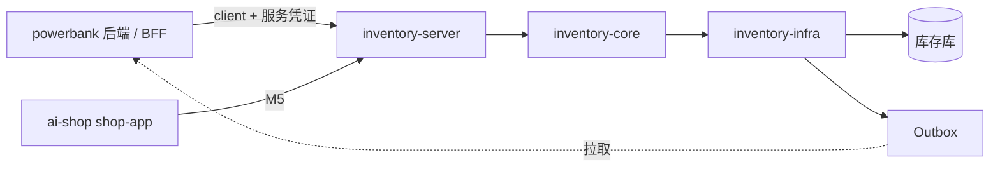

# ai-shop 独立库存服务 · 需求、方案与开发计划

> 2026-10-29 · 读者：ai-shop 库存服务开发、测试、运维 · 姊妹篇：[B-租户身份与权限方案](B-业务系统对接-租户身份与权限方案.md) · 相对 `shop-inventory` 的增量见 [C-进销存补充功能清单](C-进销存补充功能清单.md)
>
> **依据**：v4/17 独立进销存方案（`origin/chore/rescue-ref-assets` · `bbc891b4`）+ [评审](../评审-独立进销存方案.md) §六 的用户裁决 R1 ~ R4d。与 v4/17 冲突处以本文为准。
> **基线**：ai-shop `0e686ab8f`（v4/17 写于 `df2adc641`，开工前复核差异）；powerbank PR #1（出库池链路 V161 ~ V175）。

## 〇、与 v4/17 的差异（一页看懂）

| 项 | v4/17 | 本文 | 依据 |
|---|---|---|---|
| 出库目的地 | 站点 / 人员 | **商户，或商户下的站点** + **内部接收人**（必填） | R1 |
| 出错处理 | 只能审批纠正 | 未领取的出库池记录可在出库模块**调整**目的地 / 接收人，或**撤回**回仓 | R2 |
| 按商户查 | 无 | 出库池、在途按商户可查（站点反查商户） | R3 |
| 质检 | 库存服务拥有模板、任务、执行器、放行 | **移出**：业务系统质检，通过后才发起入库；库存只校验放行凭证 | R4d |
| 前端 | 独立 `inventory-web` | **不做**；仓管页面在各宿主运营端，经宿主后端调用 | R4c |
| 退货 | RETURN 入库 | 一律重新入库（新在库周期） | R4a |
| 充电宝 | SERIAL | **QUANTITY**（一期假设，Q2） | 评审 §6.4 |
| 领取时机 | 安装时 | **接收人签收即领取**（一期假设，Q1′） | 评审 §6.4 |

规模因此比 v4/17 小一整块（删质检子系统与独立前端）。

---

# 第一部分 · 需求

## 1.1 范围

**做**：受管仓库内的物料与设备 —— 入库、在仓、出库、出库池交接、盘点、流水与余额；独立部署，对宿主系统提供 API 与事件。

**不做**：仓外位置跟踪（出库后归业务系统）· 质检（业务系统）· 运营界面（宿主运营端）· 采购订单与应付 · 资产折旧与会计 · 设备远控。

## 1.2 调用方

| 调用方 | 身份 | 用到的能力 | 阶段 |
|---|---|---|---|
| powerbank 后端（BFF + 桥接任务） | 服务凭证 `systemCode = POWERBANK` | 主数据同步、入库（含退货 / 期初）、出库（ISSUE 到商户 / 站点）、出库池调整 / 撤回 / 领取 / 释放、盘点、查询、事件 | M1 ~ M4 |
| ai-shop `shop-app`（invbridge） | `systemCode = SHOP` | 数量物料、预留 / 销售提交 / 退货、仓间调拨 | M5 |
| 人（仓管、运维） | **不直连**；经宿主后端，宿主把操作人透传为 `actor` | — | — |

## 1.3 功能需求

编号 `IS-xx`（Inventory Service）。优先级：P0 一期必须 · P1 一期应做 · P2 后置。

### A 主数据

| 编号 | 需求 | 优先级 | 验收 |
|---|---|---|---|
| IS-A1 | **业主**（owner）：库存账隔离边界；powerbank 一个运营方一个 owner | P0 | 跨 owner 读写一律 403 |
| IS-A2 | **物料**：`trackingMode = SERIAL / QUANTITY`、基本单位、`qcPolicy = REQUIRED / NONE`、外部引用（宿主型号号）；有流水后不可改跟踪方式与单位 | P0 | 机柜型号建为 SERIAL + REQUIRED；充电宝型号建为 QUANTITY + REQUIRED |
| IS-A3 | **仓库**：建、改、停用；停用前须无余额、无未完成单、无开放冻结 | P0 | 停用条件不满足返回逐项原因 |
| IS-A4 | **外部目标**：宿主同步商户、站点、人员（`systemCode + type + ref`，带名称、状态、上级引用）；站点带所属商户 | P0 | 站点的 `parentRef` 为商户；名称变更不改历史单据快照 |

### B 入库

| 编号 | 需求 | 优先级 | 验收 |
|---|---|---|---|
| IS-B1 | 入库单：仓、用途（`PURCHASE / OPENING / RETURN / CORRECTION / COUNT_GAIN / OTHER`）、行（物料、数量、SN 列表）、来源引用；`DRAFT → POSTED`，草稿可取消 | P0 | 过账前不改余额 |
| IS-B2 | **放行凭证**：`qcPolicy = REQUIRED` 的物料，入库行必须带业务质检单号 `qcRef`（SERIAL 逐件、QUANTITY 逐行）；库存只校验「有凭证且来源系统授权」，不判断质检内容 | P0 | 缺 `qcRef` 的过账 400 并列出缺的件 |
| IS-B3 | **SN 校验**：同一 SN 同时只能有一个在库周期；过账时校验，草稿不占用；未知 / 重复一次列全 | P0 | 并发过账同一 SN 只成功一个 |
| IS-B4 | **退货入库**（`RETURN`）：可引用原出库池记录；过账后原池记录 → `RETURNED`，新建在库周期；已领取的退货默认加「业务退仓确认」冻结，原领取系统确认后解除 | P0 | 退货不能复用旧周期；未确认前不可再出库 |
| IS-B5 | **期初入库**（`OPENING`）：带依据（发票 / 送货单 / 合同 / 盘点 / 其他）与附件引用 | P1 | 期初单在流水与报表中单列 |

### C 出库与出库池

| 编号 | 需求 | 优先级 | 验收 |
|---|---|---|---|
| IS-C1 | 出库单：来源仓、用途（`ISSUE / SCRAP / RETURN_SUPPLIER / COUNT_LOSS / OTHER`；`SALE / TRANSFER_OUT` 归 M5）、行 | P0 | — |
| IS-C2 | **交接出库**（`ISSUE`）：必填**商户** + **内部接收人**；选了站点则目的地为站点（站点须属于该商户）。一张单一个目的地 | P0 | 站点与商户不匹配 400 |
| IS-C3 | ISSUE 过账原子完成：扣余额、关闭在库周期、写流水、**生成出库池记录**（SERIAL 一件一条；QUANTITY 一行一条带数量）、写事件 | P0 | 任何一步失败全部回滚 |
| IS-C4 | **出库池查询**：按商户（含其站点）、站点、接收人、状态、物料、SN、出库单号、日期 | P0 | 按商户查能看到出到其站点的记录 |
| IS-C5 | **调整**（未领取）：改商户 / 站点 / 接收人；原因必填；保留调整前后快照 | P0 | 已领取的记录调整 409，提示先释放 |
| IS-C6 | **撤回**（未领取）：出库出错的设备撤回原仓或指定仓 —— 池记录 → `REVOKED`，同事务生成纠正入库、新建在库周期（需重新出具放行凭证或沿用原凭证，见 §2.6） | P0 | 撤回后余额恢复；旧池记录不能再领取 |
| IS-C7 | **领取**：接收人签收即领取（宿主调用），批量全成全败；记业务引用 | P0 | 一条池记录最多一个有效领取 |
| IS-C8 | **释放**（受控）：原领取系统证明可释放时，`CLAIMED → AVAILABLE` | P1 | 非原系统释放 403 |
| IS-C9 | 处置出库（报废、退供应商、盘亏）不生成出库池 | P0 | — |
| IS-C10 | 已过账的 ISSUE **不开放通用作废**；纠错只走 C5 / C6 / 退货 | P0 | 调用作废 409 |

### D 盘点

| 编号 | 需求 | 优先级 | 验收 |
|---|---|---|---|
| IS-D1 | 开盘：范围（仓 + 物料集合），持久化冻结，快照账面（SERIAL 列 SN、QUANTITY 列数量） | P1 | 冻结范围内所有改库存入口 409 |
| IS-D2 | 扫码 / 录数：可多次、多人；同一 SN 重扫不重计；未知 SN 列为异常候选 | P1 | — |
| IS-D3 | 提交 → 复核（复核人 ≠ 录入人）→ 过账：生成盘盈入库 / 盘亏出库，解冻 | P1 | 驳回回到录入；批准绑定内容版本 |
| IS-D4 | 盘点单可作废，立即解冻 | P1 | — |

### E 查询、流水与报表支撑

| 编号 | 需求 | 优先级 | 验收 |
|---|---|---|---|
| IS-E1 | 余额：仓 × 物料，`onHand / reserved / unavailable / available` | P0 | 与在库 SN 数逐件一致 |
| IS-E2 | 在库 SN 查询：仓、物料、SN、冻结原因、所属入库单 | P0 | 只返回在库周期 |
| IS-E3 | 流水：只追加；按仓、物料、SN、单号、期间查 | P0 | — |
| IS-E4 | **期间汇总**：给定期间与仓 / 物料，返回期初、按用途分类的入 / 出、期末（供宿主统一库存报表，R4a） | P0 | 期初 + 入 − 出 = 期末 |
| IS-E5 | 在途：出库池中未领取 + 已领取未结的数量，按商户汇总 | P1 | — |

### F 平台能力

| 编号 | 需求 | 优先级 | 验收 |
|---|---|---|---|
| IS-F1 | 服务凭证：客户端 → 系统码 → 可访问 owner 与动作范围；操作人 `actor` 由宿主透传、落审计 | P0 | 请求体里的 owner 不被信任 |
| IS-F2 | **幂等**：所有写请求带 `Idempotency-Key`；同键同参返回原结果、同键异参 409；可按键查结果 | P0 | 回包丢失后重试拿到原结果 |
| IS-F3 | 事件：同事务写 Outbox；宿主按订阅游标拉取、确认；可重放 | P0 | 乱序提交不漏事件 |
| IS-F4 | 审计：所有写动作记操作人、客户端、前后值、原因、traceId | P0 | — |
| IS-F5 | 错误码 + 三语文案键；OpenAPI 契约随代码发布 | P0 | 契约与实现差异测试为 0 |
| IS-F6 | 仓间调拨（数量与 SN）：出库 → 在途 → 实收，差异有账 | P2（M5 必做） | — |

## 1.4 非功能需求

| 项 | 要求 |
|---|---|
| 一致性 | 单服务内每个命令一个本地事务；跨服务只靠幂等 + 事件，不做分布式事务 |
| 并发 | 同 SN、同池记录、同盘点范围的竞争只一方成功，其余 409；固定加锁顺序防死锁 |
| 性能 | 单命令 ≤ 200 SN；P95 写 < 500 ms、查 < 300 ms（10 万 SN 规模） |
| 可用性 | 宿主对库存服务不可用要有降级：查询提示、写入转持久化任务重试；库存服务本身无状态可多实例 |
| 安全 | 凭证不落日志；按 owner / 系统隔离；最小权限 |
| 可观测 | 健康检查、指标（命令量、冲突率、事件积压、游标延迟）、日志带 traceId 与 actor |
| 数据 | 独立库、独立 Flyway 历史表；时间 API 用带偏移的 ISO-8601 |

## 1.5 验收用例（必须全绿才可交付给 powerbank）

| 编号 | 场景 | 期望 |
|---|---|---|
| AC-01 | 入库过账中途失败 | 单据、SN、余额、流水、事件全部回滚 |
| AC-02 | 同一 SN 两张入库单并发过账 | 只成功一个 |
| AC-03 | 写请求成功但回包丢失，按原键重试 | 返回原结果，不重复入库 |
| AC-04 | 缺放行凭证的 REQUIRED 物料入库 | 400，列出缺凭证的件 |
| AC-05 | ISSUE 到不属于该商户的站点 | 400 |
| AC-06 | ISSUE 过账 | 余额减、周期关、池记录生成、事件发出，同一事务 |
| AC-07 | 未领取池记录调整商户 / 站点 / 接收人 | 成功并留调整前后快照；已领取 409 |
| AC-08 | 撤回 | 池 → REVOKED、新周期在仓、余额恢复；旧记录不可领取 |
| AC-09 | 两个接收人同时领取同一批 | 只一方成功，整批全成全败 |
| AC-10 | 已领取设备退货入库 | 新周期 + 业务退仓冻结；确认前出库 409 |
| AC-11 | 盘点开盘后对范围内出库 | 409；作废或过账后放行 |
| AC-12 | 期间汇总 | 期初 + 入 − 出 = 期末，可追到流水 |
| AC-13 | 已过账 ISSUE 调用作废 | 409 |
| AC-14 | 事件游标过期后重拉 | 可恢复，不漏不重 |
| AC-15 | 跨 owner、跨系统访问 | 403 |

---

# 第二部分 · 方案

## 2.1 架构与模块

```
ai-shop/backend/inventory/
  inventory-api      契约：DTO、错误码、OpenAPI（无框架依赖）
  inventory-core     领域：物料、仓、SN 周期、单据、出库池、盘点、过账（无 Spring Web / 无 shop-base）
  inventory-infra    MyBatis Mapper、Flyway、凭证鉴权、Outbox 与事件投递、定时任务
  inventory-server   可执行：Spring Boot 启动、控制器、健康检查
  inventory-client   Java 客户端（OpenAPI 生成 + 幂等 / 重试封装），宿主引用
```

- 包前缀 `ai.neargo.inventory`；技术栈沿用 Java / Spring / MyBatis-Plus / Flyway，版本跟 ai-shop 父 POM（`neargo-build-parent 2.0.0-SNAPSHOT`）。
- **依赖规则**（ArchUnit 守门）：`core` 不依赖 `infra / server`、不依赖任何 `ai.neargo.shop.*`；`api` 不依赖 `core`。
- 代码先托管在 ai-shop 仓库；`inventory-api` 与 `inventory-client` 独立版本号发布，powerbank 只依赖这两个产物。



## 2.2 从 `shop-inventory` 提取

| 处理 | 内容 |
|---|---|
| **复用并迁入 core** | 余额与流水过账（`StockPostingServiceImpl`）、入 / 出库单（`InboundServiceImpl`、`OutboundServiceImpl`）、盘点（`StockCountServiceImpl` + `InventoryMutationGuard` 冻结思路）、调拨（`TransferServiceImpl`，M5）、预留（M5） |
| **复用并迁入 infra** | 独立数据源与 Flyway 装配（`InventoryDataSourceConfig`，历史表 `inv_flyway_history`）、Outbox（`InvOutbox` + 投递任务）、开放凭证（`InvOpenCredential` 演进为服务凭证） |
| **替换** | `BizException / ErrorCode` → 本服务错误码；`BizContext / BizPerms / SecurityUtils` → `InventoryPrincipal`；`JobSupport` → infra 内的任务调度 |
| **留在 shop-app 不动** | `invbridge`、`api/biz`、`api/ops`（商城运营与商家端）—— 嵌入模式继续运行，到 M5 再改走客户端 |
| **新增** | SN 与在库周期、外部目标、出库池（调整 / 撤回 / 领取 / 释放）、冻结原因、命令幂等表、事件订阅游标、期间汇总 |

**过渡期双轨**：`shop-inventory` 嵌入模块与新服务**共用同一套迁移脚本源**但跑在不同库；嵌入模式不开启新能力。M5 切流前，商城仍走嵌入模式。

**现状说明**：ai-shop 今天的「独立部署」是 `shop-app` 以 `openapi` profile 多起一个进程（只有查物料、查流水、数量同步 3 个接口，仍需平台主库、Redis 与整套商城装配），不是独立服务。逐类依赖与解耦方式见 [C 清单附录](C-进销存补充功能清单.md#附n1独立服务化的含义与依赖清单)。

## 2.3 数据模型

库存库内表；迁移从现有 `V15` 之后编号（开工时 `ls db/inventory/` 确认）。★ 新表 · ◇ 改表。

| 表 | 关键列 | 约束 |
|---|---|---|
| ◇ `inv_item` | 加 `tracking_mode`（`SERIAL / QUANTITY`）、`qc_policy`（`REQUIRED / NONE`） | 有流水后不可改；CHECK |
| ◇ `inv_location` | 现有 `kind` 沿用 `WAREHOUSE`；加 `disabled_at` | 停用守卫在服务层 |
| ◇ `inv_stock_balance` | 加 `unavailable_quantity` | `on_hand ≥ reserved + unavailable ≥ 0` |
| ★ `inv_serial` | `serial_id`、`owner_id`、`item_id`、`serial_no`、`active_episode_id` | `UK(owner_id, serial_no)`；`active_episode_id` 条件更新保证唯一在库周期 |
| ★ `inv_stock_episode` | `episode_id`、`serial_id`、`location_id`、`inbound_no`、`qc_ref`、`state`（`OPEN / CLOSED`）、`outbound_no`、`prev_episode_id`、`version` | 生成列 `open_serial_id` + 唯一索引（双保险） |
| ★ `inv_document_serial` | `doc_kind`、`doc_no`、`line_no`、`serial_id`、`episode_id` | `UK(doc_kind, doc_no, serial_id)` |
| ◇ `inv_inbound_order` | `source_type` 扩 `OPENING / CORRECTION`；加 `basis`、`attachment_refs`、`dispatch_item_id`（退货引用） | — |
| ◇ `inv_inbound_line` | 加 `qc_ref` | REQUIRED 物料非空（服务层校验） |
| ◇ `inv_outbound_order` | `purpose` 扩 `ISSUE / RETURN_SUPPLIER`；加 `merchant_ref`、`site_ref`、`receiver_ref` 及名称快照 | ISSUE 时商户、接收人非空 |
| ★ `inv_target_ref` | `owner_id`、`system_code`、`object_type`（`MERCHANT / SITE / PERSON`）、`object_ref`、`parent_ref`、`name`、`status`、`source_version` | `UK(owner_id, system_code, object_type, object_ref)` |
| ★ `inv_dispatch_item` | `dispatch_item_id`、`outbound_no`、`item_id`、`serial_id`（SERIAL）/ `quantity`（QUANTITY）、`episode_id`、`merchant_ref`、`site_ref`、`receiver_ref`、`state`（`AVAILABLE / CLAIMED / RETURNED / REVOKED`）、`version` | SERIAL：`UK(episode_id)` |
| ★ `inv_dispatch_claim` | `claim_no`、`dispatch_item_id`、`business_system`、`business_type`、`business_ref`、`request_id`、`status`（`ACTIVE / RELEASED`） | 每池记录至多一个 `ACTIVE`（生成列唯一） |
| ★ `inv_dispatch_adjust` | `dispatch_item_id`、`action`（`REDIRECT / REVOKE`）、`before_json`、`after_json`、`reason`、`actor`、`at` | 只追加 |
| ★ `inv_stock_hold` | `hold_id`、`episode_id`、`reason_code`（`COUNT / BUSINESS_RETURN_CLEARANCE / MANUAL`）、`source_ref`、`status` | 同周期多原因并存；`unavailable` 每件至多计 1 |
| ◇ 盘点三表 | 加 `scope_items`、`content_version`、`approved_version`、`reviewer`；实扫行加 `serial_id` | 复核人 ≠ 录入人 |
| ★ `inv_command` | `client_id`、`owner_id`、`request_id`、`payload_hash`、`status`、`response_json`、`actor` | `UK(client_id, owner_id, request_id)` |
| ★ `inv_event_subscription` / `inv_event_delivery` | 订阅、游标、序号 | `UK(subscription_id, sequence)`；提交后分配序号 |
| ★ `inv_audit` | `actor`、`client_id`、`action`、`resource`、`before / after`、`reason`、`trace_id` | 只追加 |

## 2.4 状态机

| 对象 | 迁移 |
|---|---|
| 入 / 出库单 | `DRAFT →(post) POSTED`；`DRAFT →(cancel) VOIDED`；**ISSUE 过账后不可 void** |
| 在库周期 | 入库建 `OPEN`；出库关 `CLOSED`；关闭后不重开（回仓新建） |
| 出库池 | `AVAILABLE →(claim) CLAIMED →(release) AVAILABLE`；`AVAILABLE →(redirect) AVAILABLE`（快照变化）；`AVAILABLE →(revoke) REVOKED`；`AVAILABLE / CLAIMED →(return inbound) RETURNED`；终态不可再领 |
| 盘点 | `COUNTING →(submit) REVIEW →(approve + post) POSTED`；`REVIEW →(reject) COUNTING`；`COUNTING / REVIEW →(cancel) CANCELLED` |
| 冻结 | `ACTIVE →(release) RELEASED`；按原因单独解除 |

每个状态机一个类，非法迁移返回 `inventory.state.illegal_transition`（409），所有状态更新带原状态条件。

## 2.5 关键事务

**出库（ISSUE）过账**：条件更新单头 `DRAFT → POSTED` → 按 `serial_id` 升序锁 SN 与在库周期 → 校验在本仓、`OPEN`、无冻结、不在盘点范围 → 扣余额 → 关周期 → 写流水 → 逐件 / 逐行建池记录（带商户、站点、接收人快照）→ Outbox `DispatchCreated` → 命令结果 → 提交。

**调整（redirect）**：锁池记录（`AVAILABLE` 条件更新 + `version`）→ 校验新站点属于新商户、新接收人有效 → 改快照 → 写 `inv_dispatch_adjust` → 事件 `DispatchRedirected`。

**撤回（revoke）**：锁池记录（`AVAILABLE`）→ 置 `REVOKED` → 同事务生成 `CORRECTION` 入库并过账（目标仓默认原仓），新建周期（`prev_episode_id` 指向原周期），**沿用原周期的 `qc_ref`**（设备未离开受控链路；宿主可配置为要求重新质检）→ 事件 `DispatchRevoked`。

**领取（claim）**：校验调用方为目标系统 → 按 ID 升序 `AVAILABLE → CLAIMED` → 插领取记录 → 事件 `DispatchClaimed`。任一失败整批回滚。

**退货入库（RETURN）**：锁 SN → 校验无 `OPEN` 周期 → 原池记录 → `RETURNED`（若存在）→ 新周期（REQUIRED 物料须带新的 `qc_ref`，即业务复检通过）→ 若原池已领取，加 `BUSINESS_RETURN_CLEARANCE` 冻结 → 余额 `onHand +1`、冻结时 `unavailable +1` → 事件 `ReturnReceived`。原领取系统调 `business-clearance` 解除冻结。

**盘点冻结**：开盘时对 `(owner, location, item)` 范围写冻结记录；所有改库存的命令在锁 SN / 余额之前先查范围冻结（与开盘竞争同一范围锁）；范围内有活跃预留或未结命令时拒绝开盘。

## 2.6 关键规则说明

- **放行凭证**（R4d）：库存不存质检内容，只存 `qc_ref` 与来源系统；凭证由宿主保证真实，库存校验格式、来源系统授权、同一凭证不被不同 SN 重复使用。
- **撤回是否要求重新质检**：设备从未离开受控链路（未领取），默认沿用原凭证；物料级可配 `revokeRequiresQc = true`。
- **QUANTITY 物料的出库池**（Q2 假设）：一行一条池记录，按整行领取，不支持部分领取；随柜充电宝由宿主在同一出库单里以「柜 SN 行 + 宝数量行」表达。
- **按商户查**（R3）：池记录冗余 `merchant_ref`；出到站点时由服务端从 `inv_target_ref.parent_ref` 取商户。

## 2.7 API

前缀 `/api/inventory/v1`；JSON camelCase；分页 `PageResult{list,total}`；写请求头 `Idempotency-Key`；认证 `Authorization: Bearer <服务凭证>`；操作人 `X-Inventory-Actor`。

| 能力 | 端点 |
|---|---|
| 主数据 | `GET/POST /items`、`PATCH /items/{id}` · `GET/POST /warehouses`、`PATCH /warehouses/{id}`、`POST /warehouses/{id}/disable` · `PUT /external-targets/{system}/{type}/{ref}`、`GET /external-targets` |
| 入库 | `POST /inbounds`、`PATCH /inbounds/{no}`、`GET /inbounds/{no}`、`POST /inbounds/{no}/post`、`/cancel`、`/business-clearance` |
| 出库 | `POST /outbounds`、`PATCH /outbounds/{no}`、`GET /outbounds/{no}`、`POST /outbounds/{no}/post`、`/cancel` |
| 出库池 | `GET /dispatch-pool`（`merchantRef / siteRef / receiverRef / state / itemId / serialNo / outboundNo / from / to`）· `POST /dispatch-pool/{id}/redirect` · `POST /dispatch-pool/{id}/revoke` · `POST /dispatch-pool/claims` · `GET /dispatch-pool/claims/by-request/{requestId}` · `POST /dispatch-pool/claims/{claimNo}/release` |
| 盘点 | `POST /counts`、`GET /counts/{no}`、`POST /counts/{no}/scans`、`PUT /counts/{no}/lines/{itemId}`、`POST /counts/{no}/submit / reject / approve / post / cancel` |
| 查询 | `GET /balances` · `GET /serials` · `GET /ledger` · `GET /documents` · `GET /reports/period-summary`（`from / to / warehouseId / itemId`）· `GET /in-transit`（按商户） |
| 平台 | `GET /commands/{requestId}` · `GET /events`（`subscriptionId / cursor / limit`）· `POST /event-acks` |

错误：`{code, message, data}`，`code` 如 `inventory.serial.duplicate_open`、`inventory.dispatch.not_available`、`inventory.count.frozen`、`inventory.qc.ref_missing`；批量错误在 `data.errors[]` 逐件列出。

## 2.8 事件

`InboundPosted` · `OutboundPosted` · `DispatchCreated` · `DispatchRedirected` · `DispatchRevoked` · `DispatchClaimed` · `DispatchReleased` · `ReturnReceived` · `ReturnCleared` · `CountOpened` · `CountPosted` · `CountCancelled`。
信封：`eventId`、`type`、`ownerId`、`resourceType / resourceId`、`resourceVersion`、`occurredAt`、`traceId`、`payload`。宿主按 `resourceVersion` 丢弃旧事件。

## 2.9 部署

- 独立进程（端口可配，默认 8085）、独立库 `inventory`、独立迁移历史；`/actuator/health`（存活 / 就绪含数据库与迁移）。
- 配置：数据源、凭证密钥（从环境 / 密钥服务读取，不进仓库）、事件保留期、批量上限。
- 部署模板参照 ai-shop PAY 服务（`deploy/tencent/systemd/` 同形）；先上测试环境供 powerbank 联调。

---

# 第三部分 · 开发计划

## 3.1 里程碑

| 里程碑 | 目标 | 交付给 powerbank 的东西 |
|---|---|---|
| **M0** 独立启动 + 契约 | 服务能在空库上启动；**OpenAPI v1 冻结（powerbank 子集）** | OpenAPI v1、`inventory-client` 0.1、测试环境地址 |
| **M1** 命令与 SN 入出库 | 凭证、幂等、主数据、入库（含放行凭证、期初）、处置出库、余额 / SN / 流水查询 | 可联调入库与查询 |
| **M2** 出库池 | ISSUE 到商户 / 站点 + 接收人、调整、撤回、领取、释放、退货入库与业务确认、事件拉取 | 可联调完整交接链路 |
| **M3** 盘点与汇总 | 盘点全流程与冻结、期间汇总、在途 | 统一库存报表的数据源 |
| **M4** 上线就绪 | 迁移工具（powerbank 旧 `inv_*` → 新库 dry-run / apply）、监控告警、故障演练、生产部署 | 切换手册 |
| **M5** 商城切流（后置） | 预留 / 销售 / 退货、仓间调拨、`invbridge` 改客户端、按业主灰度 | — |

**契约先行**：M0 结束即冻结 v1（不含 M5 部分），之后只做向后兼容的增加；powerbank 据此并行开发 Fake 与 mock，不等 M2。

## 3.2 任务清单

规模：S ≤ 2 天 · M 3 ~ 5 天 · L 1 ~ 2 周（单人）。每个任务按「先写失败测试 → 最小实现 → 目标测试通过 → 回归 → 显式路径提交」。

### M0

| # | 任务 | 文件落点 | 测试 / 验收 | 规模 |
|---|---|---|---|---|
| T0.1 | 基线复核：两仓 HEAD、`shop-inventory` 迁移 V1 ~ V15、父 POM 版本、在途改动；输出提取清单 | `backend/inventory/README.md` | 清单评审通过 | S |
| T0.2 | 模块骨架：5 个子模块、`backend/pom.xml` 注册、依赖规则 | `backend/inventory/*/pom.xml` | ArchUnit `CoreHasNoShopDependency` | S |
| T0.3 | 独立启动与迁移装配：数据源、Flyway（复制 V1 ~ V15 为新库基线）、健康检查 | `inventory-server/.../InventoryApplication.java`、`inventory-infra/.../db/` | `StandaloneContextTest`：无 shop Bean、空库可启动、迁移幂等 | M |
| T0.4 | **OpenAPI v1**（powerbank 子集）+ 错误码表 + 事件信封；生成 `inventory-client` | `inventory-api/src/main/resources/openapi/inventory-v1.yaml` | 契约评审（powerbank 参加）；客户端可编译 | M |

### M1

| # | 任务 | 测试 / 验收 | 规模 |
|---|---|---|---|
| T1.1 | 凭证与鉴权：服务凭证、owner / 动作范围、`actor` 透传、审计 | AC-15 | M |
| T1.2 | 命令幂等：`inv_command`、`CommandService.execute`、按键查结果 | AC-03 | M |
| T1.3 | 主数据：物料（跟踪方式、质检策略）、仓库（含停用守卫）、外部目标同步 | IS-A1 ~ A4 | M |
| T1.4 | 余额扩 `unavailable`；提取过账内核，修「普通扣减侵占预留」 | 原数量过账回归 0 失败 | M |
| T1.5 | SN 与在库周期：`inv_serial`、`inv_stock_episode`、唯一在库周期双保险、固定锁序 | AC-02、并发测试 | L |
| T1.6 | 入库：用途扩展、放行凭证校验、期初依据与附件、SN 校验一次列全 | AC-01、AC-04 | M |
| T1.7 | 处置出库（报废 / 退供应商 / 盘亏）与查询（余额、SN、流水、单据） | IS-C9、IS-E1 ~ E3 | M |

### M2

| # | 任务 | 测试 / 验收 | 规模 |
|---|---|---|---|
| T2.1 | ISSUE 出库：商户 / 站点 / 接收人校验、过账生成池记录（SERIAL / QUANTITY） | AC-05、AC-06 | L |
| T2.2 | 出库池查询（按商户含站点）、调整、撤回（含纠正入库与新周期） | AC-07、AC-08 | M |
| T2.3 | 领取 / 释放：批量全成全败、唯一有效领取、按请求号查 | AC-09 | M |
| T2.4 | 退货入库：引用池记录、新周期、业务退仓冻结与确认解除 | AC-10 | M |
| T2.5 | 事件：Outbox → 订阅序号 → 拉取 / 确认 / 重放；保留期清理 | AC-14 | M |
| T2.6 | 已过账 ISSUE 禁止作废；纠错路径收口 | AC-13 | S |

### M3

| # | 任务 | 测试 / 验收 | 规模 |
|---|---|---|---|
| T3.1 | 盘点：范围冻结（持久化）、快照、扫码 / 录数、提交 / 复核 / 过账 / 作废；所有写入口接冻结守卫 | AC-11 | L |
| T3.2 | 期间汇总与在途汇总 | AC-12 | M |

### M4

| # | 任务 | 测试 / 验收 | 规模 |
|---|---|---|---|
| T4.1 | 迁移工具：读 powerbank 旧 `inv_warehouse / dev_cabinet / dev_powerbank`（仓内设备）→ 新库；dry-run 报告（重复 SN、无仓号、在途、已出库）；apply 幂等 | `MigrationReplayTest`：重复 apply 无变化；已投放设备不入库；未知质检不自动放行（以 `OPENING` + 依据「迁移」入库，`qc_ref = MIGRATION-…`，由宿主确认） | L |
| T4.2 | 监控告警：命令失败率、冲突率、事件积压、游标延迟、冻结超时 | 告警演练记录 | M |
| T4.3 | 故障演练：库停、服务重启、事件重放、回包丢失 | 演练记录 | M |
| T4.4 | 生产部署与回滚手册（新服务为权威后不开旧表写） | 手册评审 | S |

### M5（后置，单独立项验收）

预留 / 销售提交 / 退货（03 §8）、仓间调拨（03 §9）、`invbridge` 改走客户端、按业主灰度、旧嵌入模式下线。详见 v4/17 的 T8。

## 3.3 依赖与排期

```
T0.1 → T0.2 → T0.3 ─┬→ T1.1 → T1.2 → T1.3 → T1.4 → T1.5 → T1.6 → T1.7
          T0.4 ─────┘                                   ↓
                         T2.1 → T2.2 → T2.3 → T2.4 → T2.6 ;  T2.5（T1.2 后可并行）
                         T3.1（T1.5 后可开始）; T3.2（T2.1 后）
                         T4.*（M3 后）
```

单人粗估：M0 约 1.5 周、M1 约 4 周、M2 约 3.5 周、M3 约 2 周、M4 约 2.5 周，合计约 13 周；两人并行（M2 与 M3 交叉）约 8 ~ 9 周。M5 另估。

## 3.4 完成定义（每个任务）

- 目标测试与相关回归 0 失败，并在提交说明里贴真实命令与结果；
- OpenAPI 与实现一致（契约测试）；错误码与三语文案键齐全；
- 迁移在空库与已有数据库各跑一次，重复启动无变化；
- 只用显式路径提交，不带其它会话在途改动。

## 3.5 风险

| 风险 | 对策 |
|---|---|
| 抽离 `shop-base` / `BizContext` 时牵出大量隐性依赖 | T0.1 先出依赖清单；ArchUnit 从 T0.2 起守门 |
| 嵌入模式与新服务两份代码分叉 | 过渡期新能力只进新服务；嵌入模式只修 bug |
| powerbank 等不及 M2 | M0 冻结契约 + 客户端；powerbank 用 Fake 并行开发 |
| 生成列唯一索引依赖数据库能力（MySQL / MariaDB 差异） | 同时用条件更新兜底，并在两种库上跑并发测试 |
| 迁移出现无法解释的差异 | dry-run 只报不改；人工确认清单后再 apply |

## 3.6 待确认（不影响 M0 / M1 开工）

| # | 事项 | 本文假设 |
|---|---|---|
| Q1′ | 领取时机 | 接收人签收即领取 |
| Q2 | 充电宝跟踪方式 | QUANTITY |
| Q6 | 出到站点后能否绑到同商户其它站点 | 不能，先调整 |
| Q7 | 撤回是否要求重新质检 | 默认沿用原凭证，可按物料配置 |
| Q8 | 代码长期是否迁出 ai-shop 仓库 | M4 前决定；`api / client` 先独立发布 |
