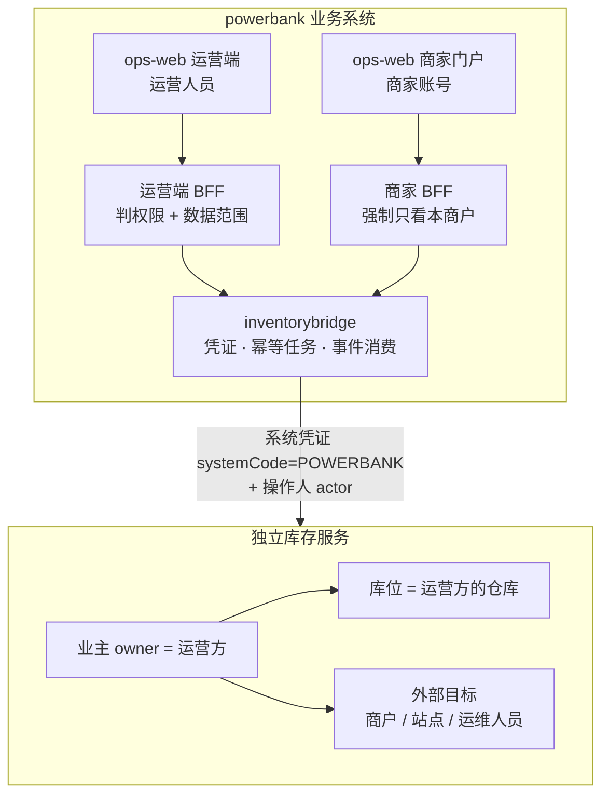

# 业务系统 × 进销存 · 租户、身份与权限对接方案

> 2026-10-29 · 读者：powerbank 后端 / 前端、库存服务开发 · 配套：[A-ai-shop库存服务-需求方案与开发计划](A-ai-shop库存服务-需求方案与开发计划.md)
>
> 用户口径：① 运营方作为进销存的租户，相当于电商的一个门店；② 平台下的运营人员、商家如何对接进销存。
> 前提（评审 §六）：出库选商户（有站点到站点）+ 内部接收人 · 出错在出库模块调整 · 按商户可查 · 统一运营端经后端调用 · 仓外履历与质检归业务系统。

## 〇、一页结论



| 问题 | 结论 |
|---|---|
| 运营方在进销存里是什么 | **一个租户（业主 owner）**。像电商的一家店：一本独立的库存账，运营方的每个仓库是这家店下的库位 |
| 运营人员怎么接入 | **不直接登录进销存**。在 ops-web 操作，powerbank 判权限与数据范围，再以「运营方的系统凭证 + 操作人工号」调用库存服务 |
| 商家怎么接入 | **商家不是进销存的用户，也不是租户**，而是出库的「接收方」（外部目标）。商家在商家门户只读查看「出给我的设备」，后端强制按本商户过滤；商家不做任何库存写操作 |
| 谁管「这个人能不能做」 | powerbank 的 IAM（角色、权限码、数据范围）—— 唯一真源。库存服务只校验「这个系统能不能对这个租户做这类动作」，并把操作人记进审计 |

---

## 一、租户模型：运营方 = 一家店

### 1.1 三方对照

| 层级 | ai-shop（电商） | powerbank（共享充电宝） | 库存服务里的对象 |
|---|---|---|---|
| 调用系统 | ai-shop | powerbank | `systemCode`：`SHOP` / `POWERBANK` |
| **租户（一本账）** | 商家主体 `mch_entity.entity_no`（一家店） | **运营方** `tenant_id`（当前只有 `MAIN`） | **业主** `ownerId`，`externalRef` = 租户号 |
| 库位 | 门店 `mch_store`、仓库 | **运营方的仓库**（`inv_warehouse`） | `Location(kind = WAREHOUSE)` |
| 物料 | SKU | 设备型号（机柜按 SN，充电宝按数量） | `Item` |
| 下游接收方 | 买家（销售出库，不进出库池） | **商户、站点、运维人员** | **外部目标** `MERCHANT / SITE / PERSON` |

要点：

- **一个运营方 = 一个业主**，与电商「一个商家主体 = 一个业主」完全同构；运营方的多个仓库就是这家店的多个库位。
- **商户不是业主**。设备是运营方的资产，出库给商户只是交接，所有权不变（库存服务禁止用普通出库做跨业主转移）。
- 将来平台有多个运营方（多租户），每个 `tenant_id` 对应一个独立业主，账本天然隔离；powerbank 的 `tenant_id` 与 `ownerId` 1:1。

### 1.2 开通一个运营方

| 步 | 动作 | 谁做 |
|---|---|---|
| 1 | 在库存服务建业主（`externalRef = tenant_id`，名称、币种） | 库存服务管理员（一次性配置） |
| 2 | 签发系统凭证：`client = powerbank-<tenant>`，`systemCode = POWERBANK`，可访问业主 = 该运营方，动作范围 = 本方案 §三.3 | 同上；凭证存 powerbank 的密钥配置，不进仓库、不下发浏览器 |
| 3 | 建仓库（运营方的库位） | 运营人员在 ops-web「仓库」页建（经 BFF） |
| 4 | 初始同步外部目标：全部启用的商户、站点、运维人员 | powerbank 的同步任务（§五） |
| 5 | 建物料：每个设备型号一个 Item（`externalRef = 型号`） | powerbank 同步任务（型号新增时自动） |

---

## 二、身份分层：谁在调用、代表谁、以谁的名义

| 层 | 含义 | 由谁确定 | 库存服务怎么用 |
|---|---|---|---|
| **系统** | 哪个业务系统在调用 | 系统凭证 | 只允许访问凭证绑定的业主；按凭证的动作范围放行 |
| **租户** | 动的是哪本账 | 凭证绑定（**不信请求体**） | 所有读写限定在该业主内 |
| **操作人** | 实际点按钮的人 | powerbank 登录会话，BFF 透传 `X-Inventory-Actor` | **只记审计，不做授权**（`actor = STAFF:E1003` / `AGENT:AG001` / `SYSTEM:job`） |
| **人的权限** | 这个人能不能做这件事、能看哪些数据 | **powerbank IAM**（角色、权限码、数据范围） | 不参与 |

为什么人的权限不放进库存服务：库存服务没有用户体系，也不该有第二套角色。powerbank 的员工、商家账号、角色、数据范围已经是唯一真源；在库存服务里再建一套，两边必然漂移。库存服务守住「系统 × 租户 × 动作」这一层，powerbank 守住「人」这一层，审计两边都留操作人。

---

## 三、平台运营人员如何接入

### 3.1 入口与调用链

运营人员只用 **ops-web**（统一运营端）。库存相关页面放在「设备管理 › 仓储与出库」组；前端只调 powerbank 的 `/api/ops/…`，由 BFF 转发：

```
ops-web  →  /api/ops/inventory/...（BFF：@perm 判权限 → 套数据范围 → 补操作人）
         →  inventorybridge（系统凭证 + 幂等键 + 重试 / 查结果）
         →  /api/inventory/v1/...
```

### 3.2 角色与职责

| 角色（powerbank 现有角色码） | 在库存里做什么 |
|---|---|
| 仓管（`OPS` 下的仓储岗；可单独建角色） | 建仓、入库（含退货、期初）、出库制单与过账、盘点录入 |
| 运维（`OPS`） | 作为**内部接收人**签收出库的设备（= 领取），查看出给自己 / 自己负责商户的设备 |
| 运营主管（`ADMIN` 或新建主管角色） | 出库调整、撤回、盘点复核、库存冻结处置 |
| 财务（`FINANCE`） | 只读：余额、流水、库存报表 |
| 客服 / BD / 只读（`CS` / `BD` / `VIEW`） | 按需只读，默认不给 |

### 3.3 权限码与库存动作的对应

权限码在 powerbank 判定；凭证的动作范围是这些动作的并集。**新码先登记[功能权限清单](../../requirements/功能权限清单.md)再用**。

| powerbank 权限码 | 状态 | 放行的库存动作 |
|---|---|---|
| `device:inventory:read` | 已登记 | 仓库、余额、在库 SN、流水、出库池、在途、期间汇总（只读） |
| `device:inventory:warehouse` | **新** | 建 / 改 / 停用仓库 |
| `device:inventory:inbound` | **新** | 入库制单与过账（采购、期初、退货）、退货业务确认 |
| `device:inventory:transfer` | 已登记 | 出库制单与过账（ISSUE、报废、退供应商）、仓间调拨 |
| `device:inventory:receive` | **新** | 签收出库设备（= 领取）；只能签自己作为接收人的单 |
| `device:inventory:adjust` | **新** | 出库调整（改商户 / 站点 / 接收人）、撤回、释放领取 |
| `device:inventory:stocktake` | 已登记 | 开盘、录入 |
| `device:inventory:stocktake-review` | **新** | 盘点复核与过账（复核人 ≠ 录入人由库存服务再校验） |

### 3.4 数据范围（谁看得到哪些）

库存服务按租户返回全量；**powerbank BFF 按登录人的数据范围过滤后再返回**，写操作同样先校验范围。

| 数据范围 | 仓内（仓库、余额、SN、流水） | 出库池、在途（按商户） |
|---|---|---|
| `ALL` | 全部 | 全部商户 |
| `REGION`（区域） | 所在区域的仓库 | 区域内商户 / 站点 |
| `AGENT`（指定商户） | 不可见（仓内不属于任何商户） | 只看指定商户（满足「运维按商户看到」） |
| `SELF` | 不可见 | 只看**自己作为接收人**的出库 |

实现：BFF 把范围翻译成库存查询参数（`warehouseId in …`、`merchantRef in …`、`receiverRef = 本人`），库存服务查询接口支持多值过滤；**不允许前端自带这些参数绕过**（BFF 覆盖，而不是合并）。

### 3.5 运维人员作为接收人

- 运维人员同步为外部目标 `PERSON`（`ref = employee_no`，带姓名、状态、所属区域）；离职 / 停用即同步为停用，**不能再被选为新出库的接收人**，已有的单可按 R2 调整接收人。
- 签收：运维在 ops-web「待我签收」列表逐台或整单签收 → BFF 校验「当前登录人 = 接收人」→ 调领取 → 本地写设备的商户归属（`issued_agent_no`）与履历。

---

## 四、商家如何接入

### 4.1 定位

| | 结论 |
|---|---|
| 是不是库存租户 | **不是**。设备不归商家所有 |
| 是不是库存用户 | **不是**。商家不做入库、出库、盘点 |
| 在库存服务里是什么 | **外部目标 `MERCHANT`**（出库的接收方之一），其站点为 `SITE`（`parent = 商户号`） |
| 能看到什么 | 出给自己（及自己站点）的设备：待交付（已出库未签收）、已交付（已签收）、退回中 |
| 能做什么 | 只读。一期不做商家签收（接收人是内部运维）；后续若要商家确认收货，再加 `device:inventory:receive` 给商家角色并定义规则 |

### 4.2 入口与调用链

```
商家门户（ops-web 我的资产）→ /api/ops/merchant/devices/dispatch（商家 BFF）
  → 强制 merchantRef = 登录账号的 agentNo（忽略请求里的任何商户参数）
  → inventorybridge → GET /api/inventory/v1/dispatch-pool?merchantRef=AG001
```

- 商家账号身份域为 `AGENT`，`agentNo` 来自登录会话；BFF 只用它，不接受前端传入。
- 返回给商家的字段裁剪：不含仓库内部信息、接收人工号（显示为「平台运维」）、成本等。
- 权限：沿用商家门户「我的设备」的现有码（`device:cabinet:read`）；新页签「待交付设备」不另加码。

### 4.3 商户、站点的同步

| powerbank 事件 | 同步到库存服务 |
|---|---|
| 商户开通 / 改名 / 停用 / 恢复 / 清退 | `PUT /external-targets/POWERBANK/MERCHANT/{agentNo}`（名称、状态、版本） |
| 站点新建 / 改名 / 关闭 | `PUT …/SITE/{siteNo}`（`parentRef = agentNo`） |
| 整站换商家 | 更新该站点的 `parentRef`；**历史出库单与池记录保留出库时的商户快照**；未签收的记录如需改商户，走出库调整 |
| 商户停用 / 清退 | 库存服务拒绝新出库到该商户；已出库未签收的记录在运营端提示「需调整或撤回」 |

---

## 五、主数据同步机制

| 项 | 规则 |
|---|---|
| 方向 | **powerbank → 库存服务，单向**（库存服务不改业务主数据） |
| 触发 | powerbank 在商户、站点、员工、型号变化的同一事务里写同步意图（本地 outbox），由桥接任务推送 |
| 幂等与顺序 | 以 `sourceVersion`（业务行版本号）为准，旧版本到达被忽略；推送失败按退避重试，超限进人工处理 |
| 对账 | 每日比对一次全量（名称、状态、上级），只报差异、生成处理任务，不自动覆盖 |
| 引用约束 | 出库时库存服务校验：商户启用、站点启用且上级 = 所选商户、接收人启用 |

---

## 六、四条典型链路

**① 出库（运营人员）**
运营在 ops-web 选来源仓、商户（可选站点）、接收人、设备 → BFF 校验 `device:inventory:transfer` 与数据范围 → 建出库单并过账 → 库存服务生成出库池记录 → 事件回到 powerbank，「待我签收」出现在接收人名下，商家门户出现「待交付」。

**② 签收领取（运维）**
接收人在「待我签收」签收 → BFF 校验本人是接收人、持 `device:inventory:receive` → 桥接任务调领取（固定幂等键）→ 成功后本地写设备归属与履历；失败或超时先查结果再重试，页面显示「处理中」。

**③ 出错调整（运营主管）**
未签收：改商户 / 站点 / 接收人，或撤回回仓（`device:inventory:adjust`）。已签收：先在 powerbank 解除业务关联并释放领取，再调整。

**④ 退货重新入库（仓管 + 业务）**
撤机或返修 → powerbank 记「到仓待检」→ 业务质检 / 复检通过 → 仓管发起退货入库（带质检单号）→ 库存服务新建在库周期；若原记录已领取，powerbank 解除本地关联后调「退货业务确认」解冻。

---

## 七、安全边界

- 系统凭证只在 powerbank 后端；浏览器永远拿不到。
- 租户由凭证决定，请求体里的业主一律忽略。
- 商家 BFF 强制本商户；运营 BFF 强制数据范围；两者都**覆盖**而非合并前端参数。
- 两侧审计都记操作人（`STAFF:工号` / `AGENT:商户号` / `SYSTEM:任务名`）与 traceId，可串联排查。
- 凭证可轮换；轮换期间新旧凭证并存，powerbank 配置热更新。

## 八、对 A 文档（库存服务）的补充要求

| # | 要求 | 落到 A 的哪里 |
|---|---|---|
| 1 | 业主建在租户层，`externalRef = tenant_id`；凭证绑定业主 | IS-A1、IS-F1 |
| 2 | 外部目标支持 `PERSON`（运维接收人）并带区域属性 | IS-A4 |
| 3 | 出库池、在途、仓内查询支持**多值过滤**（`merchantRef in`、`warehouseId in`、`receiverRef`） | IS-C4、IS-E1 ~ E5 |
| 4 | 操作人头 `X-Inventory-Actor` 格式 `类型:编号`，进审计与事件信封 | IS-F1、IS-F4、§2.8 |
| 5 | 商户 / 站点停用后拒绝新出库，返回可识别的错误码 | IS-C2 |

## 九、待确认

| # | 事项 | 建议 |
|---|---|---|
| P1 | 仓管是否单独建角色（与运维 `OPS` 分开） | 单独建「仓管」角色，权限码按 §3.3 组合 |
| P2 | 商家将来是否需要「确认收货」 | 一期不需要（接收人是内部运维）；需要时再给商家角色开 `receive` |
| P3 | 区域范围下仓库如何归属区域 | 仓库带 `regionId`（建仓时必填），BFF 按区域过滤 |
| P4 | 多运营方（多租户）何时启用 | 不影响一期；模型已 1:1 预留 |
