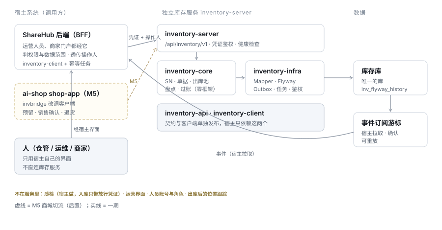
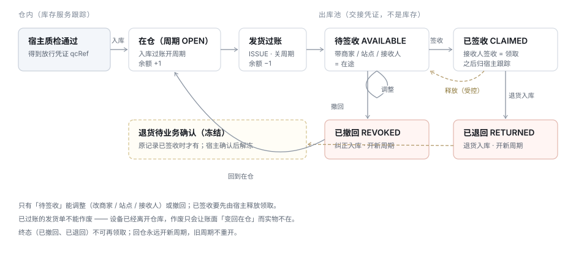
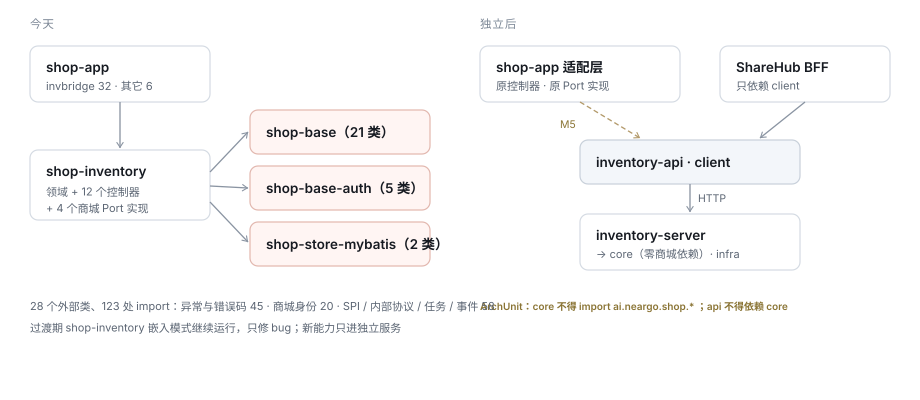

# 进销存独立服务改造方案

> 状态：草稿 · 待评审 · 2026-10-29
> 上游：[TDD-进销存领域模型](../../docs/technical/design/TDD-进销存领域模型.md)（D5「可独立交付」）· 修订 [TDD-进销存模块化与独立部署](../../docs/technical/design/TDD-进销存模块化与独立部署.md) §2.2 的部署结论（仅对外部宿主）
> 首个接入方：共享充电宝运营平台 ShareHub（powerbank 仓库）· 商城切流（M5）后置、单独验收
> 基线：ai-shop `0e686ab8f`；`shop-inventory` 迁移 V1 ~ V15
> 2026-10-29 补：按 ShareHub《设备库存-运营端功能清单与矩阵》§八 回写 —— 发货物流信息、供应商档案与安全库存开放、统一单据与跨库位查询（§4.5、§4.7、§4.9、§4.10、§5.1、T1.3 / T1.7 / T2.1）

---

## 一、一句话

把 `shop-inventory` 提取成**不带商城、只连库存库、提供服务间写接口**的独立服务 `inventory-server`，补上**按 SN 逐台管理、发货出库池、外部收货方**三块能力；第一个调用方是 ShareHub（设备仓储），商城在核心稳定后再切过来。

库存服务只管**仓内**：入库、在仓、出库、盘点、流水。货一旦交出去（签收），它就不再跟踪 —— 之后的位置、安装、维修都归调用方。

---

## 二、为什么是这个方案

### 2.1 背景

ShareHub 要管设备（充电柜、充电宝）的仓储：入库、发货给商家、退货回仓、盘点。它自己的库存模块只有调拨与差异两块，仓库主数据、余额、盘点、期初都缺；而 ai-shop 的进销存在单据、流水、盘点、冻结上已经很成熟，领域模型从立项起就以「可独立交付」为约束（A1 零跨库引用、A2 自有身份、A3 自有一致性协议）。

### 2.2 被否掉的选项

| 选项 | 做法 | 否掉的理由 |
|---|---|---|
| **A. 沿用 profile 多起进程**（[模块化与独立部署](../../docs/technical/design/TDD-进销存模块化与独立部署.md) §2.3，`openapi` profile 已实现） | `shop-app` 换 profile 多起一份 | 它解决的是**商城自己**的故障域与限流；对外部宿主不可用：只有查物料、查流水、数量同步 3 个接口，没有单据写接口、SN、出库池；启动仍要商城主库、Redis 与整套商城装配，等于要求对方「先装一个 ai-shop」—— 正是领域模型 A1 要防的 |
| **B. 作为 Java 库嵌入宿主** | 宿主直接依赖 `shop-inventory` 包 | 带入 `shop-base` / `shop-base-auth` 的全部商城假设；两边的库存账落在两个库里，统一运营、统一报表做不到；版本被宿主绑死 |
| **C. 宿主各自建库存** | ShareHub 在自己仓库里补齐仓储 | 重写 ai-shop 已有的单据、流水、盘点、冻结；两套库存口径长期分叉。ShareHub 侧做过完整需求与设计后放弃，原因同此 |
| **D. 独立服务（本方案）** | 提取内核 + 独立启动 + 服务凭证 + 各宿主适配 | 复用余额、流水、单据、盘点；补 SN、出库池、外部目标；一个库、一份契约、多个宿主 |

### 2.3 与现有文档的关系

| 文档 | 关系 |
|---|---|
| [TDD-进销存领域模型](../../docs/technical/design/TDD-进销存领域模型.md) | **沿用**：Owner / Item / Location / Document 聚合、A1 ~ A3 三条约束。本方案是它 D5 的落地，并补上它「一期不做」的序列号 |
| [TDD-进销存模块化与独立部署](../../docs/technical/design/TDD-进销存模块化与独立部署.md) | **对外部宿主修订** §2.2 ~ 2.3：外部宿主用独立服务，不用 profile。**商城自己的扣减热路径不受影响**，M5 前仍在 `shop-app` 进程内；M5 是否跨进程见 §八 Q5 |
| [进销存-决策记录](../../docs/technical/design/进销存-决策记录.md) | 其中「批次 / 效期 / **序列号** 一期只留位」—— 本方案**启用序列号**（仅对 `SERIAL` 物料），数量物料行为不变 |
| [进销存-与其他模块的交互契约](../../docs/technical/design/进销存-与其他模块的交互契约.md) | 商城侧的六条交互面不变；本方案新增「外部宿主」这一类调用方 |

---

## 三、结构

图上看不出来的三件事：

- **人不直连库存服务**。仓管、运维、商家都只用宿主自己的界面；宿主后端判断「这个人能不能做、能看哪些数据」，再以**系统凭证 + 操作人**调用。库存服务没有用户体系，也不该有第二套角色 —— 有了必然与宿主漂移。
- **事件由宿主拉取**，不由服务推送。推送要知道每个宿主的地址与可用性，拉取只需要游标；宿主宕机一天回来接着拉，不丢不重。
- **质检不在服务里**。设备检测、安装验收都是业务的事；库存只认「宿主出具的放行凭证」，见 §4.4。

| 部分 | 内容 | 不包含 |
|---|---|---|
| `inventory-api` | DTO、错误码、OpenAPI 契约 | 任何实现 |
| `inventory-core` | 物料、仓库、SN 与在库周期、出入库单、出库池、盘点、过账 | Spring Web、任何 `ai.neargo.shop.*` |
| `inventory-infra` | Mapper、Flyway、凭证鉴权、Outbox 与事件游标、任务调度 | 商城装配 |
| `inventory-server` | 启动类、控制器、健康检查 | 商城控制器 |
| `inventory-client` | 生成的客户端 + 幂等 / 重试封装 | — |

**库存服务管什么、不管什么**

| 管 | 不管（归调用方） |
|---|---|
| 仓库、物料、仓内余额与 SN | 质检执行与结论（只收放行凭证） |
| 入库（采购、期初、退货、纠正、盘盈） | 出库后的位置：绑定、安装、换站点、撤机 |
| 出库（发货、报废、退供应商、盘亏） | 人员账号、角色、数据范围 |
| 发货出库池：调整、撤回、签收、释放、退回 | 运营与商家界面 |
| 盘点与冻结、流水、期间汇总 | 资产折旧与会计、采购订单与应付 |

---

## 四、详细设计

### 4.1 租户与身份

**一个租户 = 一本库存账 = 一个业主（Owner）**。商城里业主是商家主体；ShareHub 里业主是**运营方**（平台运营公司），它的每个仓库是业主下的库位 —— 与「一家商城商家 + 它的门店和仓」完全同构。

| 层 | 含义 | 由谁确定 | 服务怎么用 |
|---|---|---|---|
| 系统 | 哪个宿主在调用（`SHOP` / `POWERBANK`） | 系统凭证 | 只放行凭证允许的动作 |
| 租户 | 动哪本账 | 凭证绑定（**不信请求体**） | 所有读写限定在该业主 |
| 操作人 | 实际点按钮的人 | 宿主透传 `X-Inventory-Actor`（`STAFF:E1003` / `AGENT:AG001` / `SYSTEM:job`） | **只记审计，不授权** |

防住什么：租户取自请求体时，任何持有凭证的调用方都能改写别人的账；操作人不透传时，审计里全是「系统」，出了错查不到人。

**外部目标（收货方档案）**：宿主单向同步过来的、可以作为发货目的地或接收人的对象。

| 类型 | 例 | 上级 | 说明 |
|---|---|---|---|
| `MERCHANT` | ShareHub 商家 AG001 | — | 发货的收货方。**不是租户**：设备仍归运营方，交给商家运营 |
| `SITE` | 商家的站点 ST01 | 商家号 | 有站点时发到站点；站点必须属于所选商家 |
| `PERSON` | 运维 E1001 | — | 内部接收人：负责送达并签收 |

以 `systemCode + type + ref` 唯一，带名称、状态、`sourceVersion`；旧版本到达忽略。停用的目标不能再作为新发货的收货方，历史单据保留当时的名称快照 —— 防住「商家改名后，历史发货单显示成新名字」。

### 4.2 物料与 SN

| 字段 | 取值 | 防住什么 |
|---|---|---|
| `trackingMode` | `QUANTITY` / `SERIAL` | 商城 SKU 不被强制录 SN；设备必须逐台可追。有流水后不可改 —— 改了历史流水就解释不通 |
| `qcPolicy` | `REQUIRED` / `NONE` | 设备入库必须带放行凭证；普通商品不受影响 |

**SN 档案与在库周期**：每个 SN 一份档案（`inv_serial`）；入库开一个在库周期（`inv_stock_episode`，`OPEN`），出库关闭（`CLOSED`）。**同一 SN 同时最多一个 `OPEN` 周期**，用「条件更新档案上的当前周期号 + 生成列唯一索引」双保险。回仓永远开新周期，旧周期不重开 —— 防住退货后旧的质检凭证、旧的事件污染新一轮。

ShareHub 一期：机柜 `SERIAL + REQUIRED`，充电宝 `QUANTITY + REQUIRED`（随柜出库只记数，见 §八 Q2）。

### 4.3 余额口径

`available = onHand − reserved − unavailable`，三者非负且 `reserved + unavailable ≤ onHand`。

`unavailable` 来自冻结（`inv_stock_hold`）：盘点、退货待业务确认、人工三类原因可以并存、按原因单独解除；**同一件至多计 1** —— 防住「盘点中又在等退货确认」被扣两次。

### 4.4 入库

| 用途 | 何时用 | 规则 |
|---|---|---|
| `PURCHASE` | 采购到货 | 沿用 |
| `OPENING` | 期初登记（存量设备无发票） | 必带依据（发票 / 送货单 / 合同 / 盘点 / 其他）与附件引用；报表单列 |
| `RETURN` | 退货回仓 | 可引用原出库池记录 → 标「已退回」；原记录已签收的加「退货待业务确认」冻结 |
| `CORRECTION` | 发货撤回的纠正入库 | 只由撤回动作生成，不可手工建 |
| `COUNT_GAIN` / `OTHER` | 盘盈 / 其他 | 沿用 |

**放行凭证**：`qcPolicy = REQUIRED` 的物料，入库行必须带宿主的质检单号 `qcRef`（SERIAL 逐件、QUANTITY 逐行）；库存校验「有、来源系统授权、未被别的 SN 用过」，**不判断质检内容**。防住两件事：没检就入库（之后能直接发出去）；库存服务里长出第二套质检规则。

SN 校验在**过账时**做（草稿不占用 SN），重复与未知一次列全。

### 4.5 出库与发货出库池

**出库用途**：沿用 `SCRAP` / `COUNT_LOSS` / `TRANSFER_OUT` / `SALE`（销售仍只能由预留确认产生）；新增 `ISSUE`（发货给外部收货方）与 `RETURN_SUPPLIER`。

**发货（`ISSUE`）**：必填**商家 + 内部接收人**，可选站点（须属于该商家）；一张单一个目的地；**物流信息**（承运方、运单号）选填，发出后可补，出库池可按运单号查 —— 与调拨单 V4 的承运方 / 运单号同语义。过账在一个事务里完成：

> 条件更新单头 `DRAFT → POSTED` → 按 SN 升序锁档案与周期 → 校验在本仓、`OPEN`、无冻结、不在盘点范围 → 扣余额 → 关周期 → 写流水 → **逐件 / 逐行建出库池记录**（带商家、站点、接收人快照）→ 写事件 → 存命令结果。

**出库池**是**交接凭证，不是库存**：

| 状态 | 进入方式 | 能做什么 |
|---|---|---|
| `AVAILABLE` 待签收 | 发货过账 | **调整**（改商家 / 站点 / 接收人，原因必填，留前后快照）· **撤回**（同事务生成 `CORRECTION` 入库、开新周期、恢复余额）· 签收 |
| `CLAIMED` 已签收 | 接收人签收（= 领取，宿主调用，批量全成全败） | 受控**释放**回 `AVAILABLE`（只有原领取系统、且证明无业务占用）· 退货入库 |
| `REVOKED` 已撤回 | 撤回 | 终态 |
| `RETURNED` 已退回 | 退货入库 | 终态 |

规则与防住什么：

- **已过账的发货单不能作废**。设备已经离开仓库，作废会让账面「变回在仓」而实物不在；纠错只有调整、撤回、退货三条路。
- **只有待签收能调整或撤回**。已签收的设备宿主那边可能已经装上了，直接改会让两边对不上。
- **签收后库存不再跟踪**。商家手里还有几台没装、装在哪个点位，是宿主的业务数据。
- **出库池按商家可查**：记录冗余 `merchantRef`（发到站点时从站点上级取），查询支持多值过滤（`merchantRef in`、`receiverRef`、`siteRef`），供宿主按登录人的数据范围过滤。

### 4.6 盘点

沿用现有盘点单与「一个库位同时一张」，补：

- **范围冻结持久化**：开盘时对 `(业主, 库位, 物料集合)` 写冻结；所有改库存的命令（过账、发货、撤回、退货确认、预留）在锁行之前先查冻结。范围内有活跃预留或未结命令时拒绝开盘 —— 防住冻结卡住商城支付提交。
- **SN 实盘**：扫码可多次、多人，同一 SN 重扫不重计；未知 SN 列为异常候选，不自动当盘盈；已出库的 SN 作为「疑似未登记退货」提示。
- **复核**：提交 → 复核（复核人 ≠ 录入人）→ 过账；批准绑定内容版本，驳回后修改使旧批准失效。
- 作废立即解冻；冻结持久化，重启后仍在。

### 4.7 查询与期间汇总

| 查询 | 用途 |
|---|---|
| 余额（仓 × 物料，含不可用） | 仓内数量 |
| 在库 SN（仓、物料、SN、冻结原因） | 只返回 `OPEN` 周期 |
| 流水（只追加） | 按仓、物料、SN、单号、期间 |
| **期间汇总** | 给定期间与仓 / 物料：期初、按用途分类的入与出、期末 —— 宿主的统一库存报表（在仓 + 在途 + 投放中）取仓内这一段 |
| 在途（按商家） | 待签收数量按商家汇总 |
| **统一单据** | 入库 / 出库 / 盘点 / 调拨一张表，按类型、单号、库位、期间查；单据详情带「这张单动了哪些物料 / SN」—— 宿主「单据」视图与「流水点一行看那张单」都用它 |
| **安全库存与缺货** | 物料 × 库位的安全库存（沿用余额表现有的 `safety_stock`）；可用低于它即「缺货」，0 = 不预警；查询支持只返回缺货行 |
| **跨库位汇总** | 一物料一行，各库位可用合计，可展开到每个库位 —— 宿主「跨仓」视图 |

### 4.8 命令幂等、事件、审计

- **幂等**：所有写请求带 `Idempotency-Key`；`inv_command(client, owner, requestId)` 唯一，与业务写入同事务存结果；同键同参返回原结果、同键异参 409；可按键查结果。防住「请求成功但回包丢了，重试又发了一次货」。
- **事件**：沿用 `inv_outbox` 同事务写；新增订阅序号与游标（提交后分配序号），宿主 `GET /events` 拉取、`POST /event-acks` 确认；信封带 `resourceVersion`，宿主丢弃旧版本。
- **审计**：所有写动作记操作人、客户端、前后值、原因、traceId；只追加。

### 4.9 数据模型变更

迁移接在现有 V15 之后（开工时 `ls db/inventory/` 确认）。

| 表 | 变更 |
|---|---|
| `inv_owner` | 显式开通：`external_ref` = 宿主租户号；与凭证绑定 |
| `inv_open_credential` | 升级为服务凭证：`system_code`、可访问业主、动作范围 |
| `inv_item` | 加 `tracking_mode`、`qc_policy` |
| `inv_location` | 加 `region_ref`、`disabled_at`（停用守卫：有余额 / 未完成单 / 冻结时逐项拒绝） |
| `inv_stock_balance` | 加 `unavailable_quantity` |
| `inv_inbound_order` / `_line` | 用途扩 `OPENING / CORRECTION`；单头加 `basis`、`attachment_refs`、`dispatch_item_id`；行加 `qc_ref` |
| `inv_outbound_order` | 用途扩 `ISSUE / RETURN_SUPPLIER`；加 `merchant_ref`、`site_ref`、`receiver_ref` 及名称快照；加 `carrier_name`、`tracking_no`（选填，索引 `tracking_no`） |
| `inv_supplier`（V3，沿用） | 不改表；外部宿主经 API 使用（入库供应商、退供应商目标）。改名不改历史单据的名称快照，停用不删 |
| `inv_stock_balance.safety_stock`（沿用） | 不改表；开放给外部宿主按物料 × 库位设置 |
| 盘点三表 | 加 `scope_items`、`content_version`、`approved_version`、`reviewer`；实扫加 `serial_id` |
| ★ `inv_serial` | SN 档案，`UK(owner_id, serial_no)`，`active_episode_id` |
| ★ `inv_stock_episode` | 在库周期，生成列 `open_serial_id` 唯一 |
| ★ `inv_document_serial` | 单据 SN 明细，`UK(doc_kind, doc_no, serial_id)` |
| ★ `inv_target_ref` | 外部目标，`UK(owner_id, system_code, object_type, object_ref)` |
| ★ `inv_dispatch_item` | 出库池记录；SERIAL `UK(episode_id)` |
| ★ `inv_dispatch_claim` | 领取记录；每条池记录至多一个 `ACTIVE` |
| ★ `inv_dispatch_adjust` | 调整 / 撤回的前后快照，只追加 |
| ★ `inv_stock_hold` | 多原因冻结 |
| ★ `inv_command` | 命令幂等与结果 |
| ★ `inv_event_subscription` / `inv_event_delivery` | 订阅与序号 |
| ★ `inv_audit` | 审计，只追加 |

改完同步更新 [进销存-数据库表结构](../../docs/technical/design/进销存-数据库表结构.md) 的表清单与「张数」（有守卫测试）。

### 4.10 API

前缀 `/api/inventory/v1`；`Authorization: Bearer <服务凭证>`；写请求带 `Idempotency-Key`；`X-Inventory-Actor`；分页 `{list, total}`；错误 `{code, message, data}`，批量错误在 `data.errors[]` 逐件列出。

| 能力 | 端点 |
|---|---|
| 主数据 | `GET/POST /items` · `PATCH /items/{id}` · `GET/POST /warehouses` · `PATCH /warehouses/{id}` · `POST /warehouses/{id}/disable` · `PUT /external-targets/{system}/{type}/{ref}` · `GET /external-targets` · `GET/POST /suppliers` · `PATCH /suppliers/{id}` · `POST /suppliers/{id}/archive` · `/unarchive` |
| 入库 | `POST /inbounds` · `PATCH /inbounds/{no}` · `GET /inbounds/{no}` · `POST /inbounds/{no}/post` · `/cancel` · `/business-clearance` |
| 出库 | `POST /outbounds` · `PATCH /outbounds/{no}` · `GET /outbounds/{no}` · `POST /outbounds/{no}/post` · `/cancel`（仅草稿） |
| 出库池 | `GET /dispatch-pool` · `POST /dispatch-pool/{id}/redirect` · `/revoke` · `POST /dispatch-pool/claims` · `GET /dispatch-pool/claims/by-request/{requestId}` · `POST /dispatch-pool/claims/{claimNo}/release` |
| 盘点 | `POST /counts` · `GET /counts/{no}` · `POST /counts/{no}/scans` · `PUT /counts/{no}/lines/{itemId}` · `POST /counts/{no}/submit` · `/reject` · `/approve` · `/post` · `/cancel` |
| 查询 | `GET /balances`（`shortageOnly`、`groupBy=item` 跨库位汇总）· `PUT /balances/safety-stock` · `GET /serials` · `/ledger` · `/documents`（`docKind`、`docNo`、`locationId`、`from / to`）· `/documents/{kind}/{no}` · `/reports/period-summary` · `/in-transit` |
| 平台 | `GET /commands/{requestId}` · `GET /events` · `POST /event-acks` |

错误码示例：`inventory.serial.duplicate_open` · `inventory.qc.ref_missing` · `inventory.dispatch.not_available` · `inventory.target.disabled` · `inventory.count.frozen` · `inventory.issue.void_forbidden`。

### 4.11 事件

`InboundPosted` · `OutboundPosted` · `DispatchCreated` · `DispatchRedirected` · `DispatchRevoked` · `DispatchClaimed` · `DispatchReleased` · `ReturnReceived` · `ReturnCleared` · `CountOpened` · `CountPosted` · `CountCancelled`。
信封：`eventId`、`type`、`ownerId`、`resourceType / resourceId`、`resourceVersion`、`occurredAt`、`actor`、`traceId`、`payload`。

### 4.12 部署与运行时依赖

| 资源 | 现在（`openapi` profile 起 `shop-app`） | 独立服务 |
|---|---|---|
| 商城主库 | 必需 | 不需要 |
| 库存库 | 必需 | 必需（唯一的库，独立 Flyway 历史表） |
| Redis、商城登录配置 | 必需 | 不需要；凭证密钥从环境读取 |
| 程序包 | `shop-app` 整包 | `inventory-server` |

健康检查 `/actuator/health`（存活 / 就绪含库与迁移）；部署模板参照 `deploy/tencent/systemd/ai-shop-pay.service` 同形新增一份。

### 4.13 走查：平台给商家发一单货

从仓 W1 发 2 台柜（含 16 块宝）给商家 AG001 的站点 ST01，由运维 E1001 送达：

| 步 | 调用方动作 | 库存服务里的变化 |
|---|---|---|
| 0 | 商家开通、站点建立、运维入职时，宿主同步外部目标 | `MERCHANT/AG001`、`SITE/ST01（上级 AG001）`、`PERSON/E1001` |
| 1 | 仓管建出库单：W1、AG001、ST01、E1001、2 个柜 SN + 宝 16 | `ISSUE` 草稿，库存不变 |
| 2 | 仓管确认出库 | W1 柜 −2、宝 −16；两个周期关闭；流水两笔；出库池 3 条（柜各 1、宝 1），`AVAILABLE`；`DispatchCreated` |
| 3 | 路上发现站点选错 | `redirect` 改到 ST02（须属于 AG001），留快照；`DispatchRedirected` |
| 4 | E1001 签收 | 3 条 → `CLAIMED`；`DispatchClaimed`；之后库存服务不再跟踪 |
| 5 | 半年后 1 台柜撤机回仓，宿主复检通过 | `RETURN` 入库（带新 `qcRef`）→ 新周期、原记录 `RETURNED`、加「退货待业务确认」冻结 |
| 6 | 宿主解除本地业务关联后确认 | `business-clearance` 解冻，柜可再次发货 |

---

## 五、改造清单

### 5.1 复用 · 改造 · 新增 · 不做

| 类别 | 项 |
|---|---|
| **直接复用（10）** | 余额与过账内核 · 只追加流水 · 入 / 出库单骨架 · 盘点单与操作 · 仓间调拨（承运商、运单号）· `inv_outbox` · 独立数据源与迁移历史 · 盘点与过账互斥（`InventoryMutationGuard`）· **供应商档案**（`inv_supplier`）· **安全库存**（`safety_stock`） |
| **改造（11）** | 业主显式开通 · 凭证升级为服务凭证 · 物料加跟踪方式与质检策略 · 仓库加区域与停用守卫 · 入库用途与放行凭证 · 出库用途 `ISSUE` 与收货方 · 已过账发货禁止作废 · 余额加不可用 · 盘点 SN 与复核 · 事件改拉取 · 错误码与契约 |
| **新增（14 + 1）** | 独立服务化 · 命令幂等 · 操作人与审计 · SN 档案与在库周期 · 外部目标 · 出库池 · 出库池多值查询 · 调整 · 撤回 · 签收与释放 · 退货关联发货 · 多原因冻结 · 期间汇总 · 在途按商家；另加数据迁移工具（宿主旧仓储数据导入） |
| **不做（6）** | 质检 · 商家库存或商家虚拟库位 · 商家作为租户（跨租户转移）· 出库后位置跟踪 · 运营界面 · 人员账号与角色 |

商城专用能力（预留、销售确认、退款回补、估值、每日快照、供应商）**保留不动**，供 M5。

### 5.2 依赖拆分

`shop-inventory` 今天的 Maven 直接依赖：`shop-base`、`shop-base-auth`、`shop-store-mybatis`、`flyway-core`、`flyway-mysql`、`h2`（测试）。代码引用 **28 个外部类、123 处 import**：

| 外部类 | 模块 | 引用文件数 | 处理 |
|---|---|---|---|
| `common.BizException` / `ErrorCode` | shop-base | 23 / 22 | 本服务异常与错误码（三语文案键） |
| `common.BizKey` · `common.pricing.PricingSnapshotHash` | shop-base | 1 / 5 | 本服务编号生成；哈希工具复制为本服务纯函数 |
| `auth.BizContext` / `BizPerms` / `SecurityUtils` / `Perms` | shop-base-auth | 6 / 6 / 5 / 2 | `InventoryPrincipal`（系统 + 租户 + 操作人）+ 凭证动作范围 |
| `auth.PasswordHasher` | shop-base-auth | 1 | 本服务凭证哈希 |
| `spi.inventory.MaterialCatalog*`（3 类） | shop-base | 10 | **反向依赖**（库存向商城要物料资料）→ 改为宿主同步物料 |
| `spi.inventory.InventoryDemandPlan*` / `InventoryProduction*` / `InventoryReservation*`（8 类） | shop-base | 约 18 | 接口定义移入 `inventory-api`，商城侧实现适配 |
| `spi.report.ReportContracts` / `ReportSourceFactsPort` | shop-base | 9 | 报表事实适配器移到 `shop-app`；服务只提供期间汇总 |
| `svc.InternalHttp` / `InternalServiceResponses` | shop-base | 4 / 4 | 本服务统一 API 与错误模型 |
| `event.DomainEvent` / `event.outbox.RetryPolicy` | shop-base | 1 / 1 | 本服务事件信封与重试 |
| `job.JobSupport` · `event.outbox.runtime.UnifiedOutboxFacade` | shop-store-mybatis | 3 / 2 | 本服务任务调度（锁表在库存库）；用 `inv_outbox` |

放错位置、要移回 `shop-app` 的：`ai/neargo/shop/portal/internal/InternalMaterialCatalogController`；`port/` 下 4 个商城 Port 实现；`api/biz`（6）、`api/ops`（2）、`api/internal`（3）、`api/open`（1）控制器 —— 留作商城自己的 BFF，M5 后改调客户端。

反向依赖：`shop-app` 38 个文件（`invbridge` 32），M5 前不动。

---

## 六、开发计划

### 6.1 里程碑

| 里程碑 | 目标 | 对 ShareHub 的交付 |
|---|---|---|
| **M0** 独立启动 + 契约 | 空库可启动；**OpenAPI v1 冻结**（ShareHub 子集） | 契约、`inventory-client` 0.1、测试环境 |
| **M1** 命令与 SN 入出库 | 凭证、幂等、主数据、外部目标、入库（放行凭证、期初）、处置出库、查询 | 可联调入库与查询 |
| **M2** 出库池 | 发货、调整、撤回、签收、释放、退货与业务确认、事件拉取 | 可联调完整交接链路 |
| **M3** 盘点与汇总 | 盘点冻结与复核、期间汇总、在途 | 统一库存报表数据源 |
| **M4** 上线就绪 | 迁移工具、监控告警、故障演练、生产部署 | 切换手册 |
| **M5** 商城切流（后置） | 预留 / 销售 / 退货、`invbridge` 改客户端、按业主灰度 | — |

**契约先行**：M0 冻结 v1，之后只做向后兼容的增加；ShareHub 据此做 Fake 与 mock 并行开发。

### 6.2 任务

规模：S ≤ 2 天 · M 3 ~ 5 天 · L 1 ~ 2 周（单人）。每个任务：先写失败测试 → 最小实现 → 目标测试通过 → 回归 → 显式路径提交。

| # | 任务 | 验收 | 规模 |
|---|---|---|---|
| T0.1 | 基线复核与依赖清单（§5.2）落为提取清单 | 评审通过 | S |
| T0.2 | 五个子模块骨架、`backend/pom.xml` 注册、ArchUnit「core 不依赖 `ai.neargo.shop.*`」（先红） | 规则可执行 | S |
| T0.3 | 按 §5.2 逐类替换，独立数据源与 Flyway、健康检查 | `StandaloneContextTest`：无商城 Bean、空库启动、迁移幂等；ArchUnit 转绿 | L |
| T0.4 | OpenAPI v1 + 错误码 + 事件信封；生成客户端 | 与 ShareHub 联合评审 | M |
| T1.1 | 服务凭证、业主与动作范围、操作人、审计 | AC-15 | M |
| T1.2 | 命令幂等 | AC-03 | M |
| T1.3 | 物料、仓库（停用守卫）、外部目标同步、供应商档案开放 API | §4.1、§4.9 | M |
| T1.4 | 余额加不可用；修「普通扣减侵占预留」 | 原数量过账回归 0 失败 | M |
| T1.5 | SN 档案与在库周期、唯一 OPEN 双保险、固定锁序 | AC-02 + 并发测试 | L |
| T1.6 | 入库用途、放行凭证、期初依据、SN 一次列全 | AC-01、AC-04 | M |
| T1.7 | 处置出库与查询（含统一单据、安全库存与缺货、跨库位汇总） | §4.7 | M |
| T2.1 | 发货：收货方校验、物流信息、过账建出库池 | AC-05、AC-06 | L |
| T2.2 | 出库池查询（多值）、调整、撤回 | AC-07、AC-08 | M |
| T2.3 | 签收与释放 | AC-09 | M |
| T2.4 | 退货入库、业务确认冻结 | AC-10 | M |
| T2.5 | 事件订阅、拉取、确认、重放、保留期 | AC-14 | M |
| T2.6 | 已过账发货禁止作废 | AC-13 | S |
| T3.1 | 盘点：持久化冻结、SN 实盘、复核、作废；所有写入口接冻结守卫 | AC-11 | L |
| T3.2 | 期间汇总、在途 | AC-12 | M |
| T4.1 | 迁移工具：dry-run 差异报告 → apply，可重复执行 | 重复 apply 无变化 | L |
| T4.2 | 监控告警（命令失败率、冲突率、事件积压、游标延迟、冻结超时） | 演练记录 | M |
| T4.3 | 故障演练（库停、重启、事件重放、回包丢失） | 演练记录 | M |
| T4.4 | 生产部署与回滚手册 | 评审 | S |

单人约 13 周（M0 1.5 · M1 4 · M2 3.5 · M3 2 · M4 2.5）；两人并行约 8 ~ 9 周。M5 另估。

### 6.3 验收用例（M2 结束前全绿才交付 ShareHub 联调）

| 编号 | 场景 | 期望 |
|---|---|---|
| AC-01 | 入库过账中途失败 | 单据、SN、余额、流水、事件全部回滚 |
| AC-02 | 同一 SN 两张入库单并发过账 | 只成功一个 |
| AC-03 | 写成功但回包丢失，原键重试 | 返回原结果，不重复 |
| AC-04 | 缺放行凭证的 REQUIRED 物料入库 | 400，列出缺的件 |
| AC-05 | 发到不属于该商家的站点 | 400 |
| AC-06 | 发货过账 | 余额、周期、出库池、流水、事件同事务 |
| AC-07 | 待签收调整 / 已签收调整 | 成功并留快照 / 409 |
| AC-08 | 撤回 | 池 `REVOKED`、新周期在仓、余额恢复 |
| AC-09 | 两人同时签收同一批 | 只一方成功，整批全成全败 |
| AC-10 | 已签收设备退货 | 新周期 + 业务确认冻结；确认前发货 409 |
| AC-11 | 开盘后对范围内发货 | 409；作废或过账后放行 |
| AC-12 | 期间汇总 | 期初 + 入 − 出 = 期末，可追到流水 |
| AC-13 | 已过账发货调用作废 | 409 |
| AC-14 | 游标过期重拉 | 可恢复，不漏不重 |
| AC-15 | 跨业主、跨系统访问 | 403 |

---

## 七、取舍记录

| 冲突 | 让了谁 | 为什么 |
|---|---|---|
| 商城「扣减永远不跨进程」 vs 外部宿主需要独立服务 | 外部宿主走独立服务；**商城热路径暂不动** | 两个结论回答的不是一个问题：前者防商城超卖，后者解决外部宿主根本接不进来。M5 再按领域模型的预留协议论证跨进程（§八 Q5） |
| 出库后继续跟踪（商家库位）vs 交接即止 | 交接即止 | 跟踪到安装意味着绑定、换站点、撤机都要回写库存，跨系统交互翻几倍；「商家手里还有几台」由宿主统计 |
| 质检放库存（统一放行）vs 放业务 | 放业务，库存只收凭证 | 检测项是设备专属的（槽位、通信、电量），放进通用库存就要做模板引擎与执行器；凭证足以防「没检就入库」 |
| 已过账可作废（沿用反冲）vs 禁止 | 发货禁止作废 | 反冲只改账不改实物，发货后作废必然账实不符；商城原有用途的反冲语义不变 |
| 独立前端 vs 宿主界面 | 宿主界面 | 运营不应在两个后台之间切换；独立交付给无界面的客户时再议 |
| 每个宿主一套业主 vs 共享 | 每个宿主租户一个业主 | 账本天然隔离；跨业主转移另行设计，本期禁止 |

---

## 八、待确认

| # | 事项 | 建议 | 卡住谁 |
|---|---|---|---|
| Q1 | 签收（领取）的时机 | 内部接收人签收即领取 | T2.3 |
| Q2 | 充电宝按 SN 还是数量 | 一期按数量，机柜按 SN | T1.5、T2.1 |
| Q3 | 撤回是否要求重新出具放行凭证 | 默认沿用原凭证（设备未离开受控链路），物料级可配 | T2.2 |
| Q4 | 代码长期托管 | 先在 ai-shop；`inventory-api` / `inventory-client` 独立版本发布；M4 前定是否迁出 | T4.4 |
| Q5 | M5 商城扣减是否跨进程 | M5 立项时单独论证；在此之前商城热路径留在 `shop-app` | M5 |
| Q6 | ShareHub 侧仓储数据如何导入 | 仓内设备按 `OPENING` 入库，依据「迁移」，放行凭证由 ShareHub 出具；已投放设备不入库 | T4.1 |
